<p><a href="wall.md">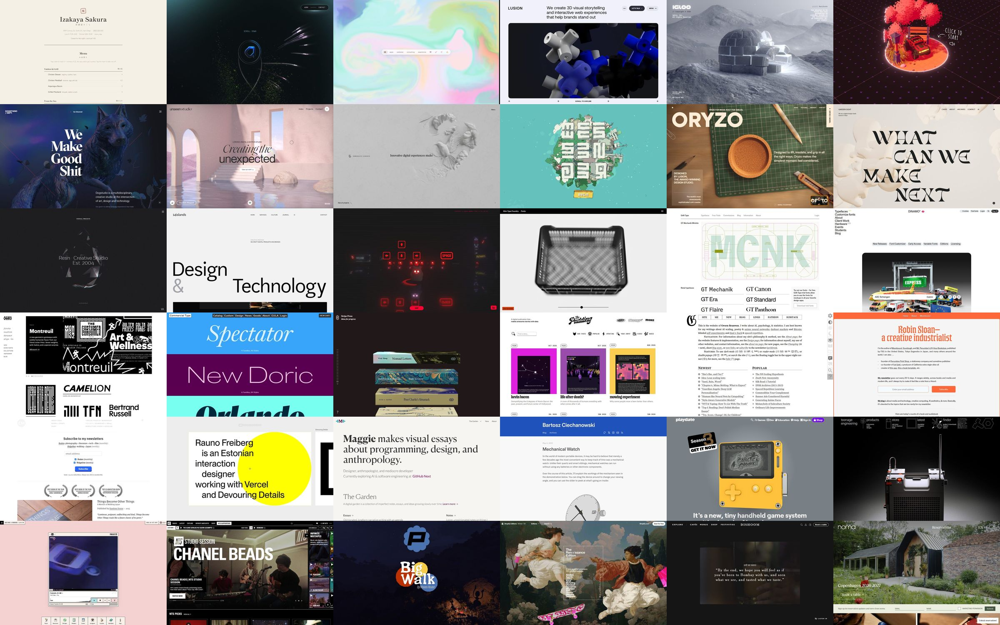</a></p>

# web-refs

Sean's reference library for building websites that don't look AI-generated. The website chats read this before building a page.

**How a chat uses it:**

1. Fill in [`briefs/template.md`](briefs/template.md).
2. Pick one site from [`sites/`](sites/) and name the exact thing to take from it.
3. State the one idea in a sentence before writing any code.
4. Judge the result by phone and desktop screenshots.

The banned list in `~/.claude/CLAUDE.md` ("No AI UI slop") applies to everything here.

**Adding a site:**

1. Add a line to `tools/sites.tsv` (group, slug, url, shoot options).
2. Run `npm install` once, then `./tools/shoot-all.sh <slug>`. Headless Chrome captures the hero, scroll stills, a phone shot, motion frames and a stack fingerprint into `sites/<slug>/`. Cookie banners are hidden, never accepted. It finds Chrome, Chromium or Edge in the usual places; if yours is elsewhere, set `CHROME_PATH` to the executable.
3. Write `sites/<slug>/teardown.md`: the idea, what you see, the stack, steal, don't steal. Copy the shape of any existing one, and add `name` and `idea` to its `meta.json`.
4. Run `pip install -r requirements.txt` once (it's just Pillow), then `python tools/gallery.py` (`python3` on some systems). It rebuilds the cards, motion previews, the wall, this README's grid, `wall.md`, the prev/next links and the offline viewer's data.

Links and GitHub stats were checked on 2026-10-28.

<!-- gallery:start -->

**36 sites, 201 screenshots.** Click any card for the teardown: every screenshot, a motion preview, the stack, what to steal and what not to.

Jump to:

- [House standard](#house-standard) (1)
- [Worlds](#worlds) (14)
- [Type foundries and editorial](#type-foundries-and-editorial) (7)
- [Writing and personal sites](#writing-and-personal-sites) (6)
- [Products, radio and genre pieces](#products-radio-and-genre-pieces) (6)
- [Restaurants](#restaurants) (2)
- [Every screen on one page](wall.md)
- [Our own Hydra](hydra.md) and the kit, [stage](https://github.com/clotheshoesandwoes/stage)
- [Brief template](briefs/template.md)
- Offline: open `gallery.html` from this folder (arrow keys flip through everything, `/` filters by name, font or library, and `gallery.html#<slug>` opens one site)

## House standard

The page that passed review. Everything else is measured against it.

<table>
<tr>
<td width="33%" valign="top"><a href="sites/izakaya-sakura/teardown.md">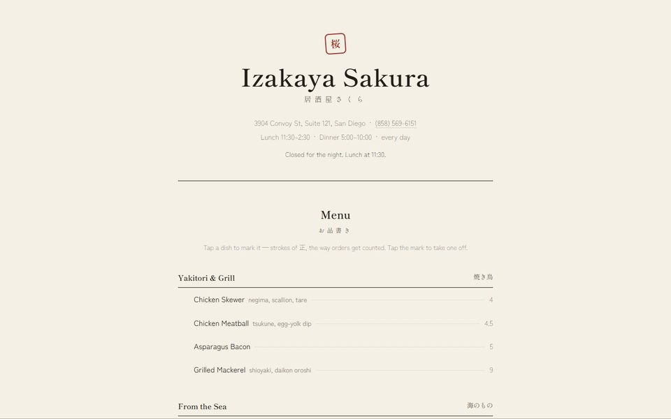</a><br><b><a href="sites/izakaya-sakura/teardown.md">Izakaya Sakura</a></b><br><sub>A printed izakaya menu: noren curtain on entry, orders counted in 正 tally strokes</sub></td>
</tr>
</table>

## Worlds

Real-time 3D. Look at what each one spends its WebGL on.

<table>
<tr>
<td width="33%" valign="top"><a href="sites/activetheory/teardown.md">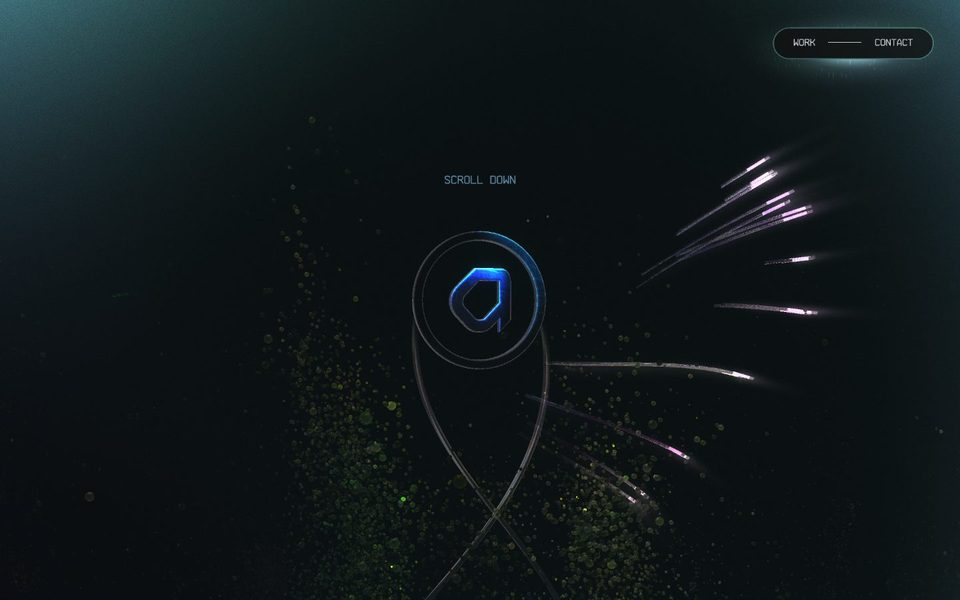</a><br><b><a href="sites/activetheory/teardown.md">Active Theory</a></b><br><sub>One continuous 3D world, held to: why is this in WebGL at all?</sub></td>
<td width="33%" valign="top"><a href="sites/seanblundin/teardown.md">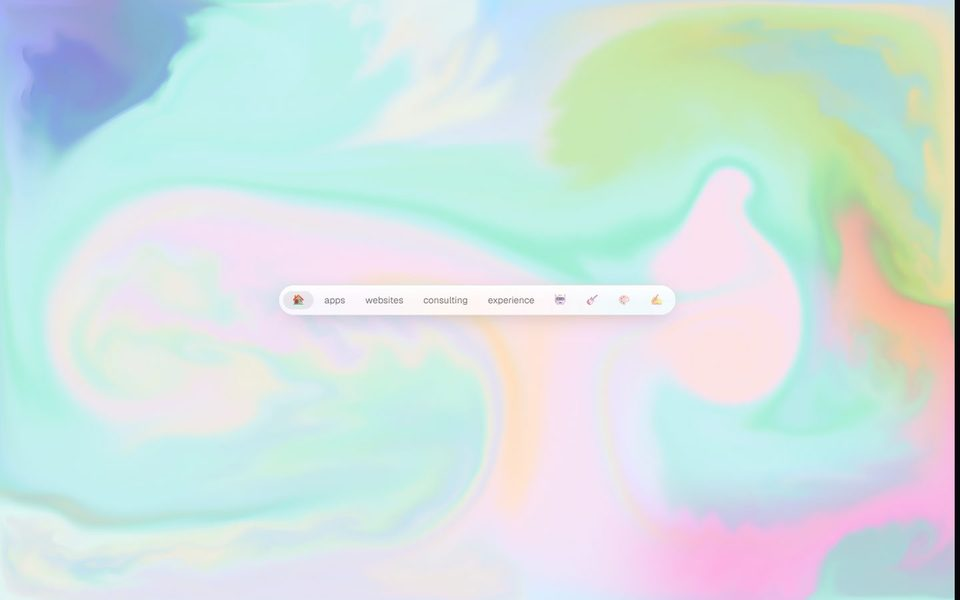</a><br><b><a href="sites/seanblundin/teardown.md">Sean Blundin</a></b><br><sub>The site is a TV and every page is a channel</sub></td>
<td width="33%" valign="top"><a href="sites/lusion/teardown.md">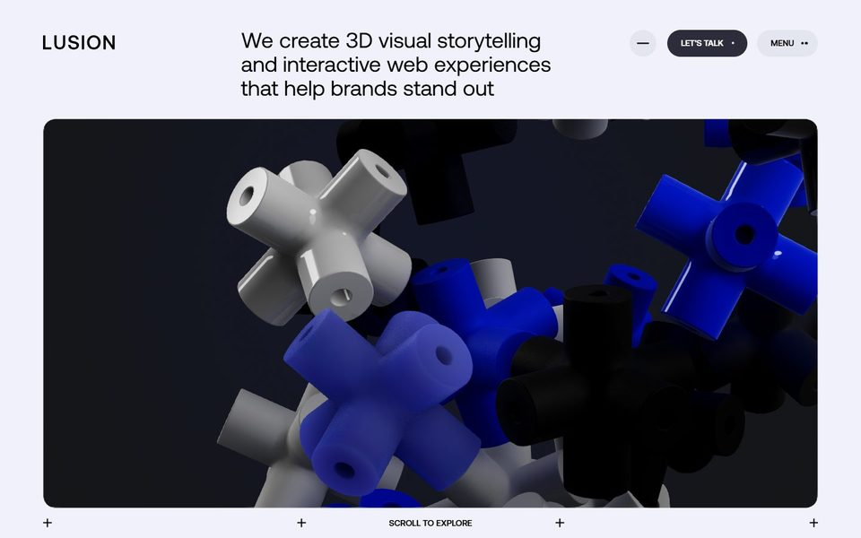</a><br><b><a href="sites/lusion/teardown.md">Lusion</a></b><br><sub>A 3D studio opens on a heap of rendered parts, then steps aside for the work</sub></td>
</tr>
<tr>
<td width="33%" valign="top"><a href="sites/igloo-inc/teardown.md">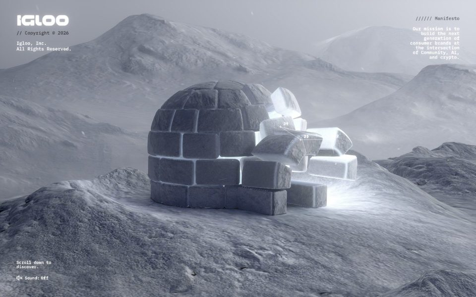</a><br><b><a href="sites/igloo-inc/teardown.md">Igloo Inc.</a></b><br><sub>An igloo built from ice blocks, and each portfolio company is frozen inside one</sub></td>
<td width="33%" valign="top"><a href="sites/bruno-simon/teardown.md">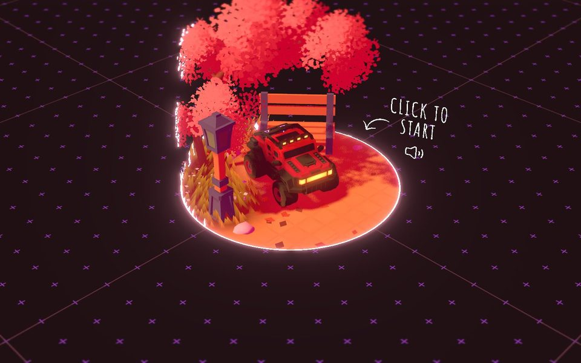</a><br><b><a href="sites/bruno-simon/teardown.md">Bruno Simon</a></b><br><sub>The portfolio is a toy world you drive a car through</sub></td>
<td width="33%" valign="top"><a href="sites/dogstudio/teardown.md">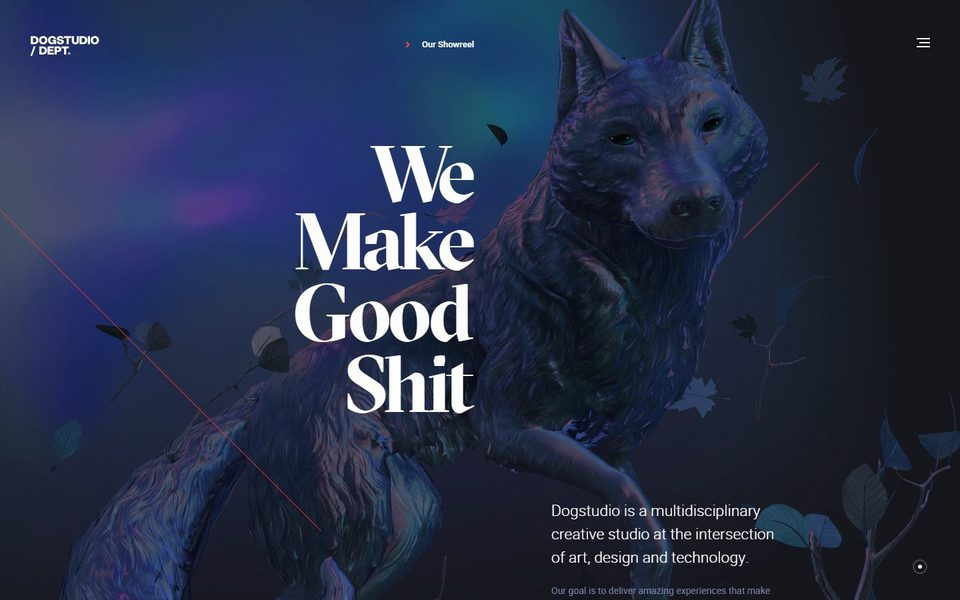</a><br><b><a href="sites/dogstudio/teardown.md">Dogstudio</a></b><br><sub>The studio's name made literal: a sculpted dog that takes on each project's colours</sub></td>
</tr>
<tr>
<td width="33%" valign="top"><a href="sites/unseen/teardown.md">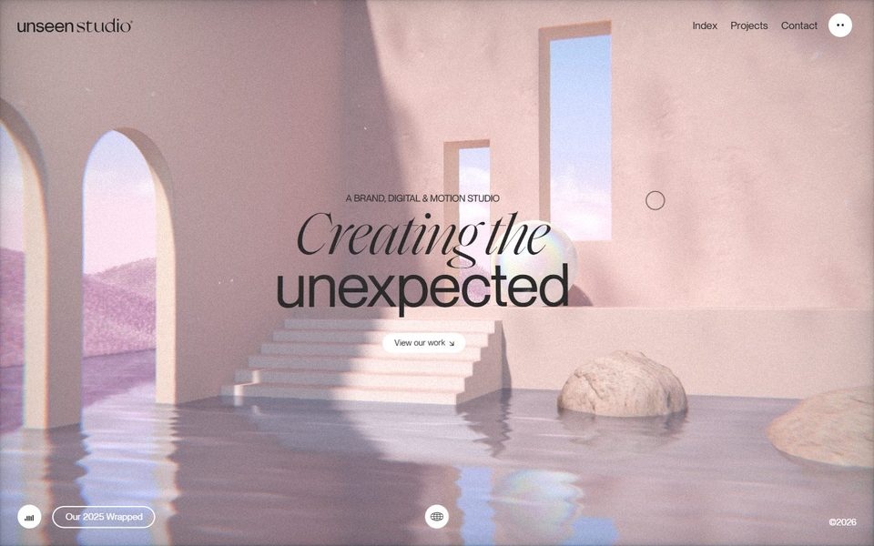</a><br><b><a href="sites/unseen/teardown.md">Unseen Studio</a></b><br><sub>The homepage is a pastel world you drag through, not a page you scroll</sub></td>
<td width="33%" valign="top"><a href="sites/immersive-garden/teardown.md">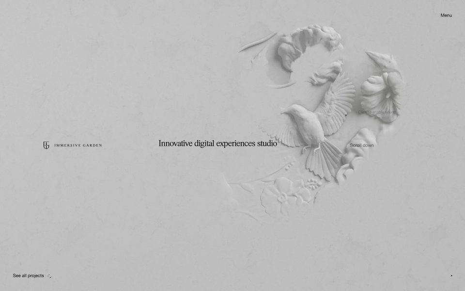</a><br><b><a href="sites/immersive-garden/teardown.md">Immersive Garden</a></b><br><sub>The name as a plaster relief: birds and flowers that rise out of a grey wall</sub></td>
<td width="33%" valign="top"><a href="sites/messenger-abeto/teardown.md">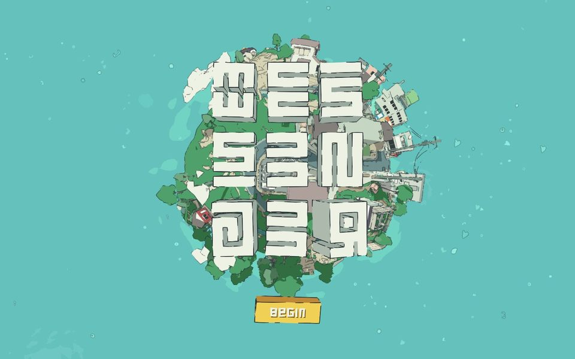</a><br><b><a href="sites/messenger-abeto/teardown.md">Messenger (Abeto)</a></b><br><sub>A tiny planet that needs its mail delivered, drawn like an inked comic</sub></td>
</tr>
<tr>
<td width="33%" valign="top"><a href="sites/oryzo/teardown.md">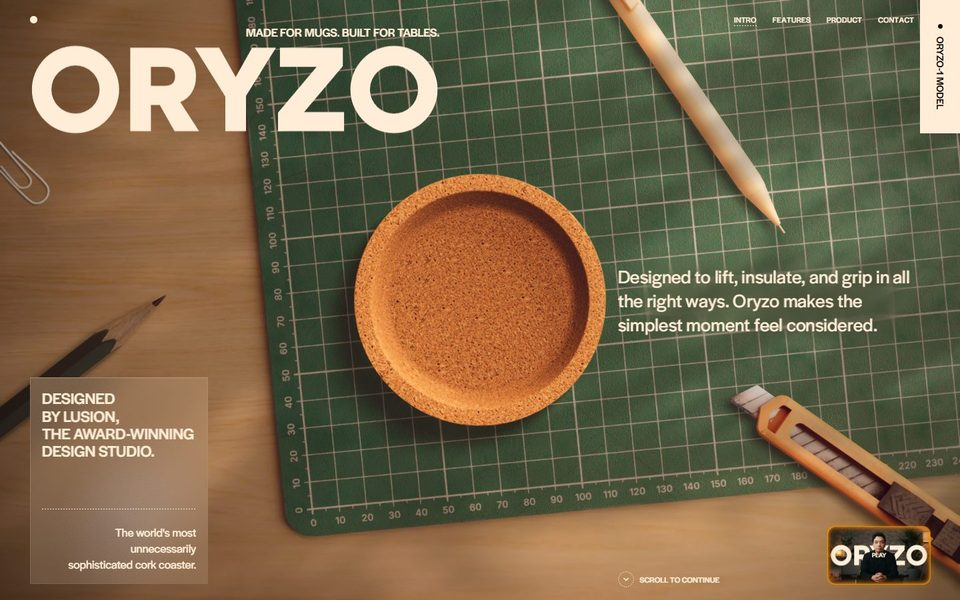</a><br><b><a href="sites/oryzo/teardown.md">Oryzo</a></b><br><sub>Sell a cork coaster like an AI model launch, to prove the studio can sell anything</sub></td>
<td width="33%" valign="top"><a href="sites/garden-eight/teardown.md">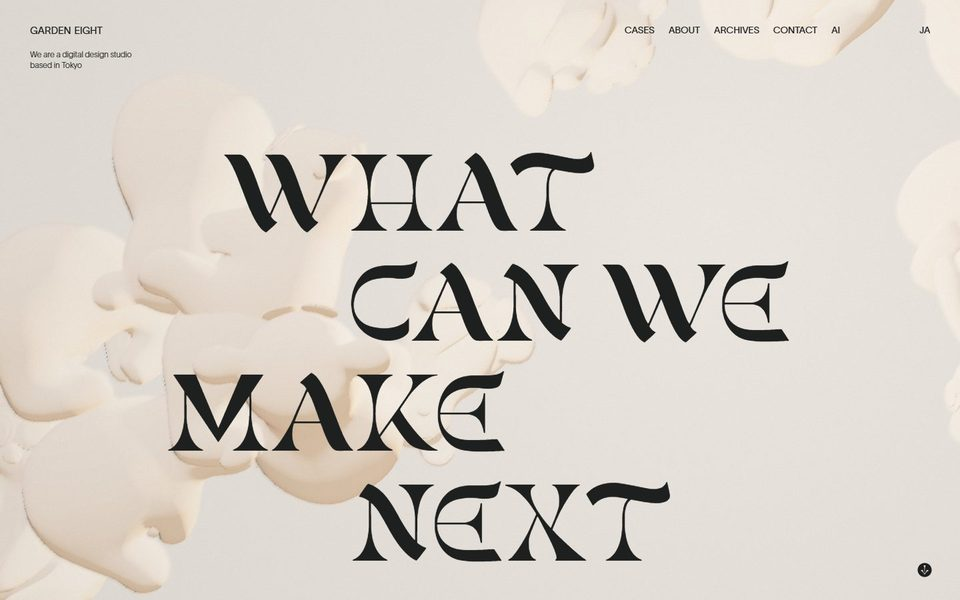</a><br><b><a href="sites/garden-eight/teardown.md">Garden Eight</a></b><br><sub>Playful but humble: clay-soft lizards and one strange serif on warm paper</sub></td>
<td width="33%" valign="top"><a href="sites/resn/teardown.md">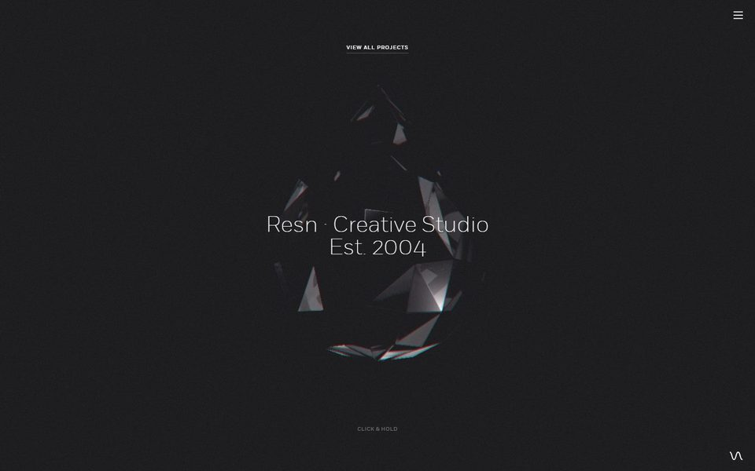</a><br><b><a href="sites/resn/teardown.md">Resn</a></b><br><sub>One faceted drop floating in the dark, and the only instruction is click and hold</sub></td>
</tr>
<tr>
<td width="33%" valign="top"><a href="sites/14islands/teardown.md">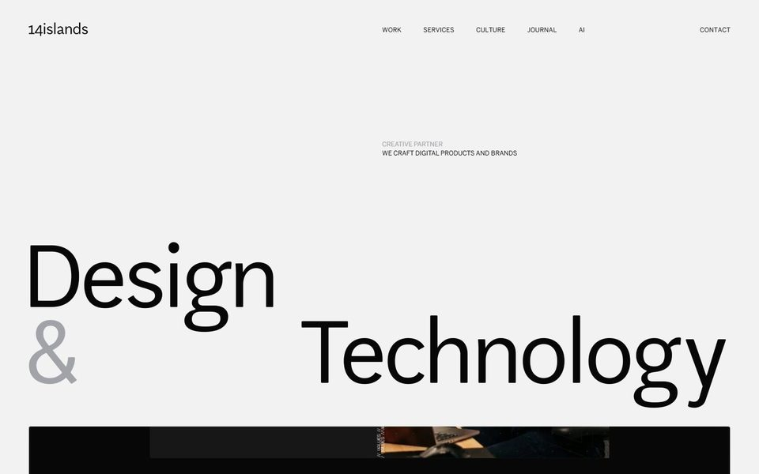</a><br><b><a href="sites/14islands/teardown.md">14islands</a></b><br><sub>Plain big type and real client screens; the 3D is spent only on showing the work</sub></td>
<td width="33%" valign="top"><a href="sites/samsy/teardown.md">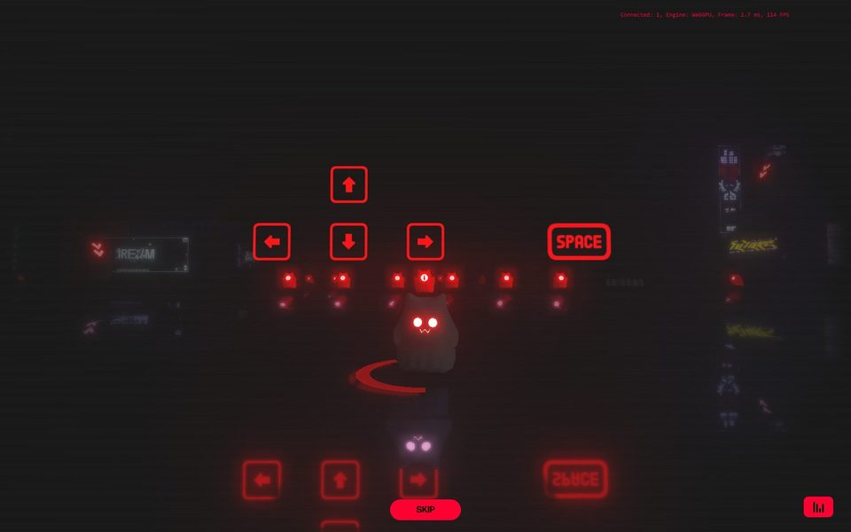</a><br><b><a href="sites/samsy/teardown.md">Samsy</a></b><br><sub>The portfolio is a game, and the first screen teaches you the controls</sub></td>
</tr>
</table>

## Type foundries and editorial

Foundries and publishers: the best typesetting on the web lives here.

<table>
<tr>
<td width="33%" valign="top"><a href="sites/klim/teardown.md">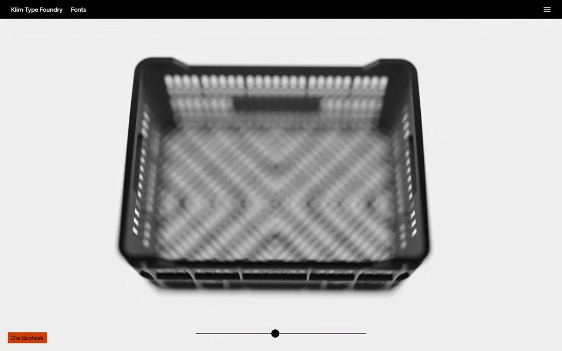</a><br><b><a href="sites/klim/teardown.md">Klim Type Foundry</a></b><br><sub>The home page is a run of full-screen campaigns, one per typeface</sub></td>
<td width="33%" valign="top"><a href="sites/grilli-type/teardown.md">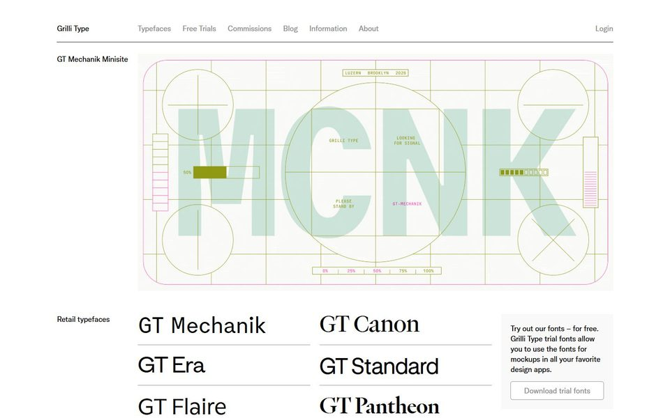</a><br><b><a href="sites/grilli-type/teardown.md">Grilli Type</a></b><br><sub>A Swiss ruled index where every typeface name is set in its own face</sub></td>
<td width="33%" valign="top"><a href="sites/dinamo/teardown.md">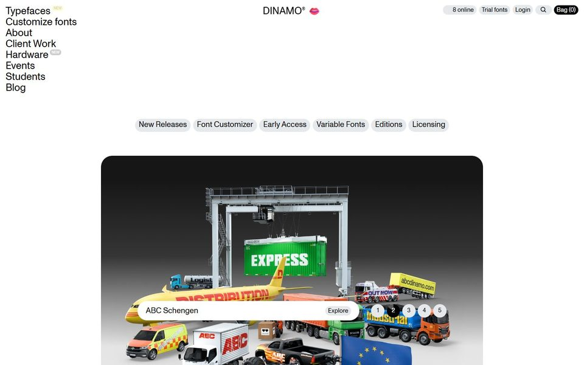</a><br><b><a href="sites/dinamo/teardown.md">Dinamo</a></b><br><sub>A type shop run like a fan club, with everything set big in the house grotesk</sub></td>
</tr>
<tr>
<td width="33%" valign="top"><a href="sites/oh-no-type/teardown.md">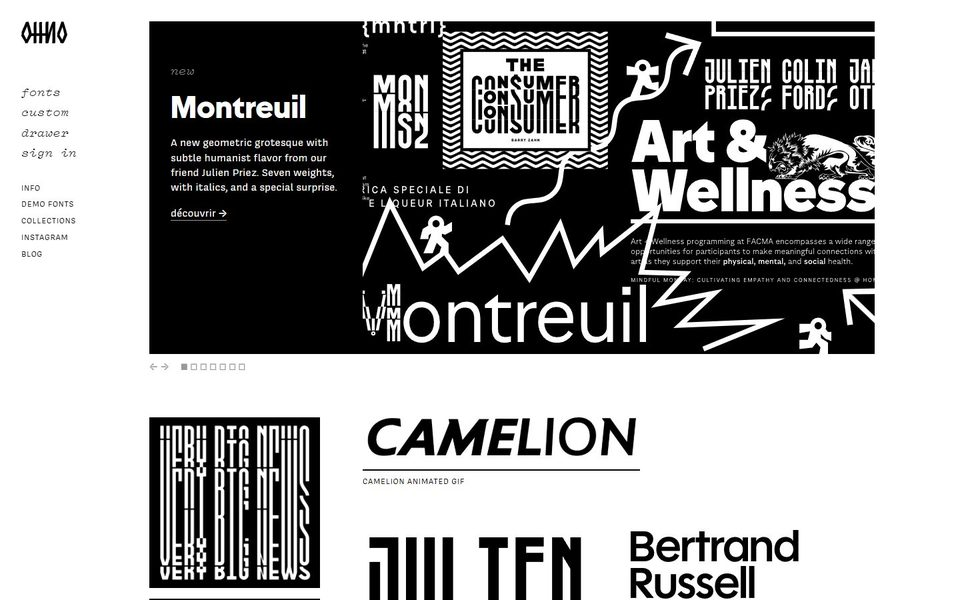</a><br><b><a href="sites/oh-no-type/teardown.md">OH no Type Company</a></b><br><sub>A shop window of black-and-white specimen art, each piece tagged with its font and price</sub></td>
<td width="33%" valign="top"><a href="sites/commercial-type/teardown.md">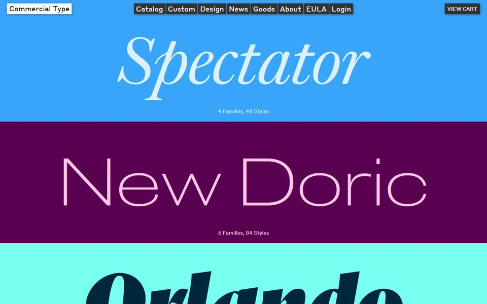</a><br><b><a href="sites/commercial-type/teardown.md">Commercial Type</a></b><br><sub>A stack of colour bands, each with one family's name set live in that family</sub></td>
<td width="33%" valign="top"><a href="sites/stripe-press/teardown.md">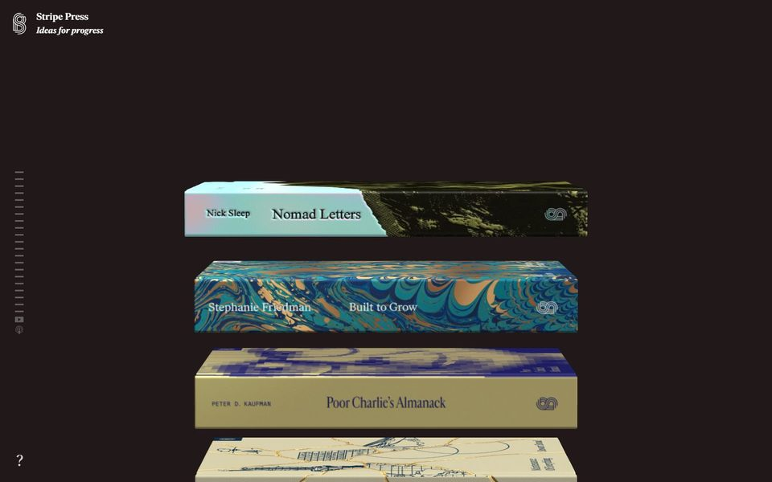</a><br><b><a href="sites/stripe-press/teardown.md">Stripe Press</a></b><br><sub>The catalogue is a stack of the actual books, spines out, rendered in 3D</sub></td>
</tr>
<tr>
<td width="33%" valign="top"><a href="sites/the-pudding/teardown.md">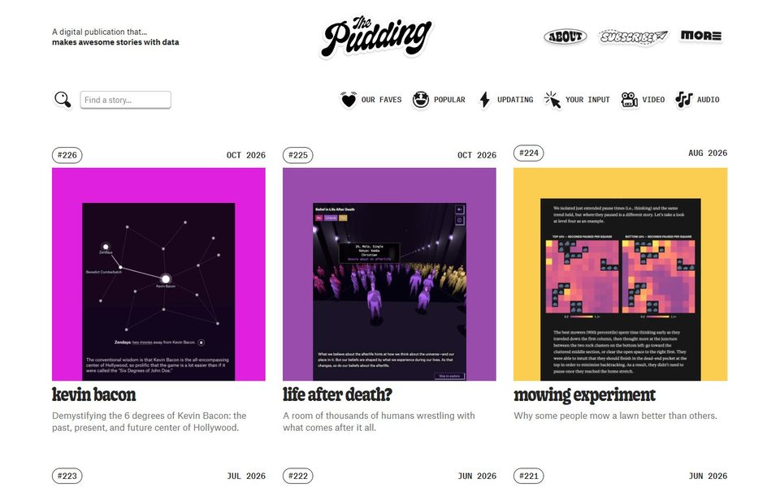</a><br><b><a href="sites/the-pudding/teardown.md">The Pudding</a></b><br><sub>A numbered back catalogue where every thumbnail is a real frame from the story</sub></td>
</tr>
</table>

## Writing and personal sites

Personal sites where the person is the subject.

<table>
<tr>
<td width="33%" valign="top"><a href="sites/gwern/teardown.md">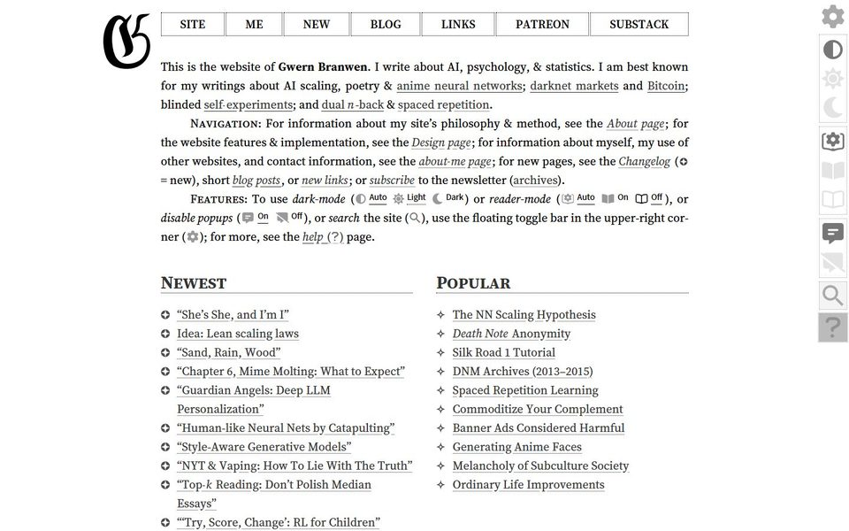</a><br><b><a href="sites/gwern/teardown.md">Gwern.net</a></b><br><sub>An essay archive typeset like a scholarly book: justified serif, small caps, fleurons</sub></td>
<td width="33%" valign="top"><a href="sites/robin-sloan/teardown.md">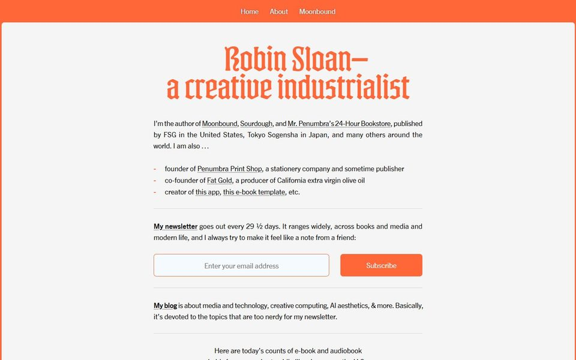</a><br><b><a href="sites/robin-sloan/teardown.md">Robin Sloan</a></b><br><sub>A home page that aims for the printed page: one justified sheet and a directory</sub></td>
<td width="33%" valign="top"><a href="sites/craig-mod/teardown.md">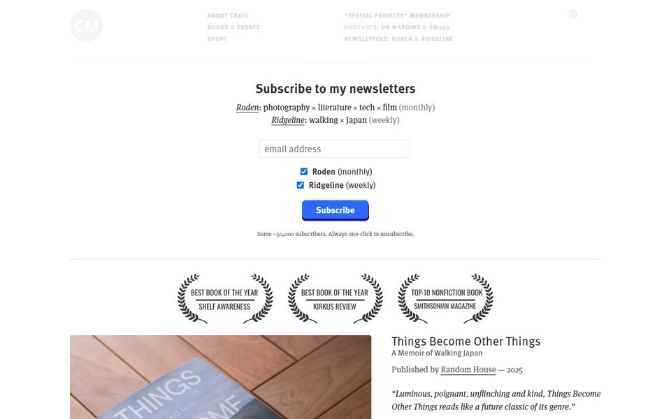</a><br><b><a href="sites/craig-mod/teardown.md">Craig Mod</a></b><br><sub>Sell the printed books with photos of the real objects and words from real readers</sub></td>
</tr>
<tr>
<td width="33%" valign="top"><a href="sites/rauno/teardown.md">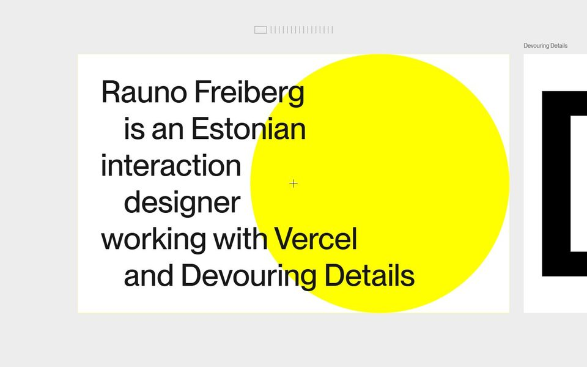</a><br><b><a href="sites/rauno/teardown.md">Rauno Freiberg</a></b><br><sub>The portfolio is one interaction: scrolling moves a sideways reel of big-type slides</sub></td>
<td width="33%" valign="top"><a href="sites/maggie-appleton/teardown.md">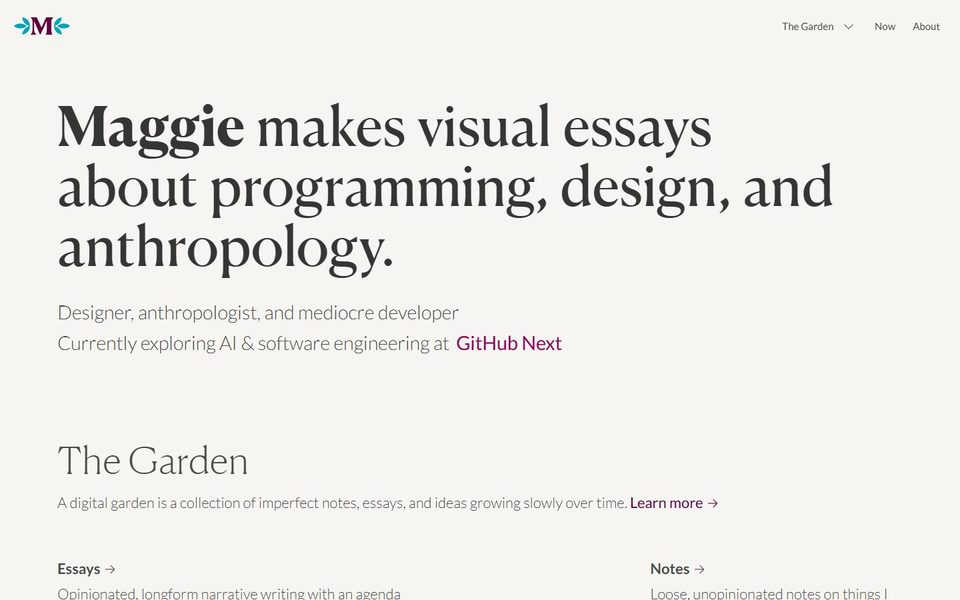</a><br><b><a href="sites/maggie-appleton/teardown.md">Maggie Appleton</a></b><br><sub>A digital garden: notes marked by growth stage, essays carried by her own drawings</sub></td>
<td width="33%" valign="top"><a href="sites/ciechanowski-watch/teardown.md">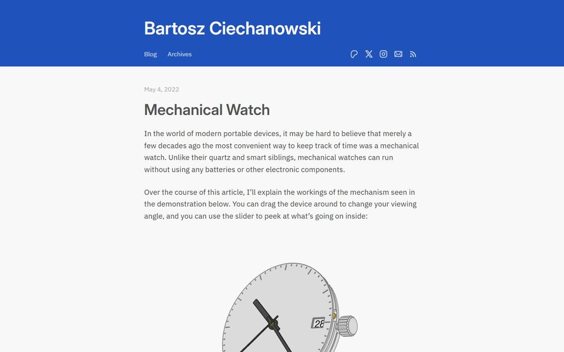</a><br><b><a href="sites/ciechanowski-watch/teardown.md">Mechanical Watch, Bartosz Ciechanowski</a></b><br><sub>Explain a watch by building it: live 3D demos, with each part's name coloured to match</sub></td>
</tr>
</table>

## Products, radio and genre pieces

Products and brands whose sites behave like the thing they sell.

<table>
<tr>
<td width="33%" valign="top"><a href="sites/playdate/teardown.md">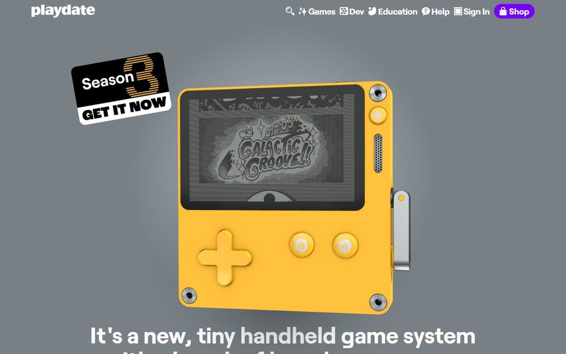</a><br><b><a href="sites/playdate/teardown.md">Playdate</a></b><br><sub>A real 3D Playdate plays its own games on screen and flips its crank open as you scroll</sub></td>
<td width="33%" valign="top"><a href="sites/teenage-engineering/teardown.md">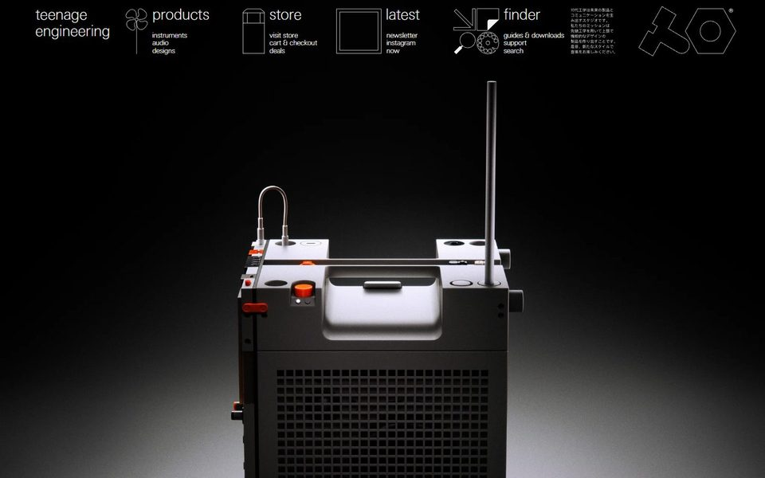</a><br><b><a href="sites/teenage-engineering/teardown.md">teenage engineering</a></b><br><sub>One product under one light; its long shadow runs down the page and becomes the layout</sub></td>
<td width="33%" valign="top"><a href="sites/poolsuite/teardown.md">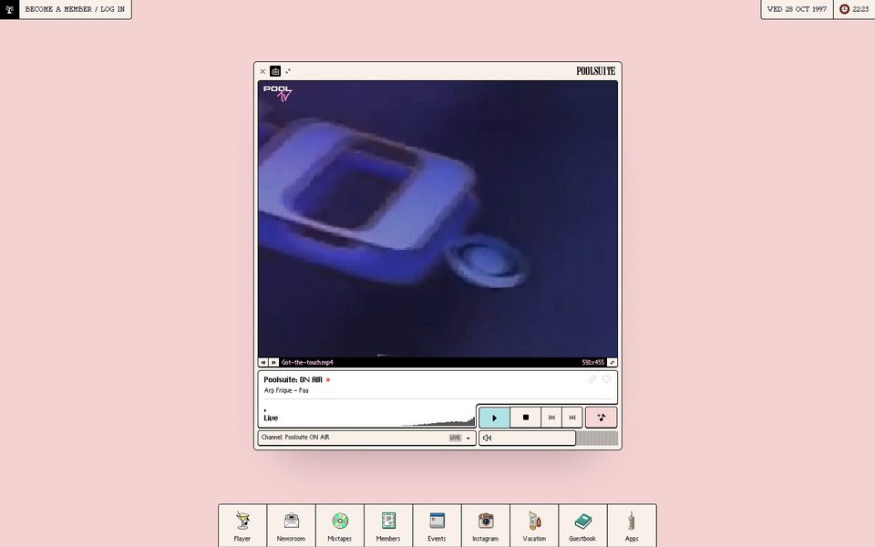</a><br><b><a href="sites/poolsuite/teardown.md">Poolsuite</a></b><br><sub>A late-90s desktop: the radio is an app window, sections are dock icons, the year is 1997</sub></td>
</tr>
<tr>
<td width="33%" valign="top"><a href="sites/nts/teardown.md">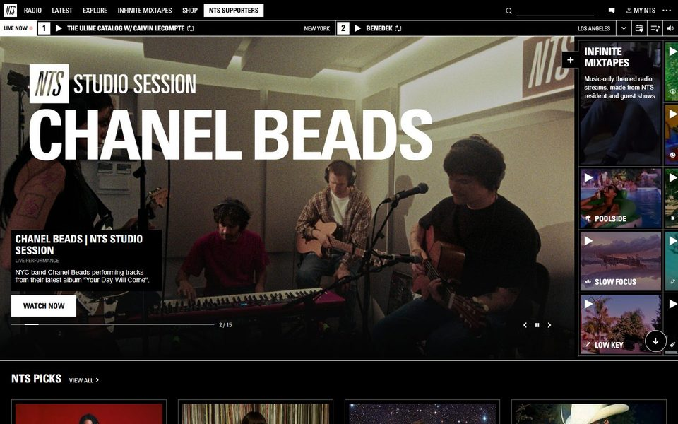</a><br><b><a href="sites/nts/teardown.md">NTS</a></b><br><sub>A radio that is always on: two live channels stay pinned under the nav on every page</sub></td>
<td width="33%" valign="top"><a href="sites/panic/teardown.md">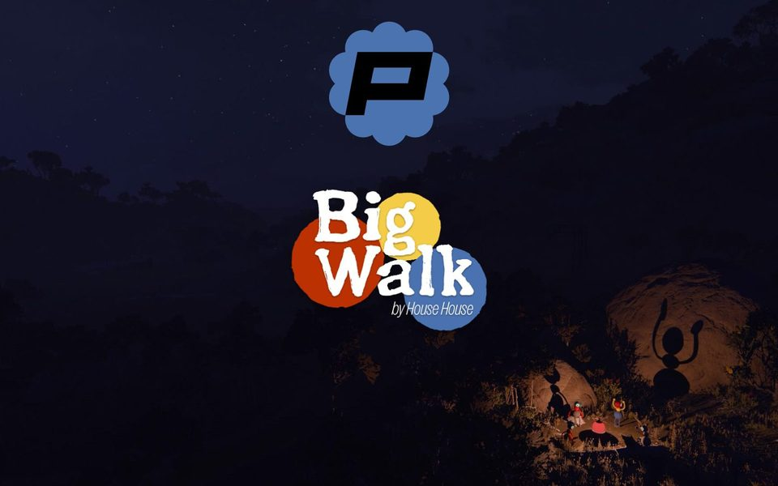</a><br><b><a href="sites/panic/teardown.md">Panic</a></b><br><sub>Three plain sentences say what Panic makes, and the icons of those things sit under each</sub></td>
<td width="33%" valign="top"><a href="sites/shopify-editions/teardown.md">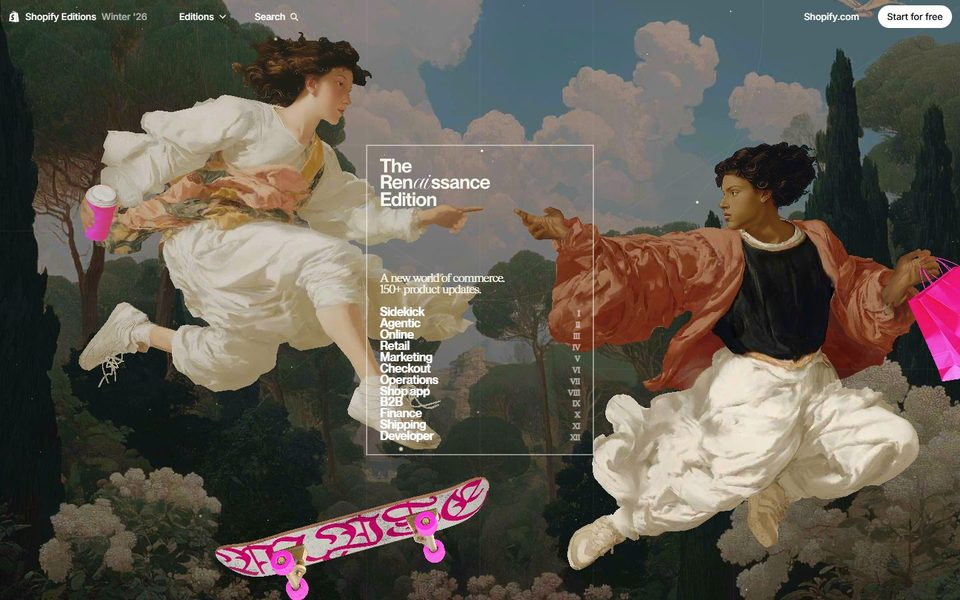</a><br><b><a href="sites/shopify-editions/teardown.md">Shopify Editions Winter '26</a></b><br><sub>A product changelog staged as a Renaissance painting, in twelve Roman-numeral chapters</sub></td>
</tr>
</table>

## Restaurants

Restaurant sites, for the studio.

<table>
<tr>
<td width="33%" valign="top"><a href="sites/dishoom/teardown.md">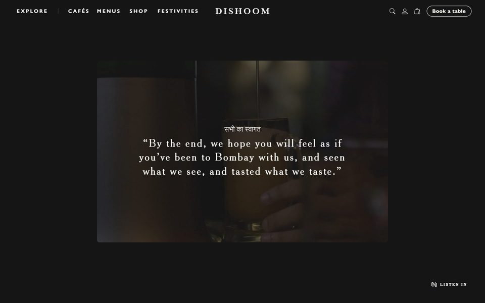</a><br><b><a href="sites/dishoom/teardown.md">Dishoom</a></b><br><sub>An old Bombay Irani café told like a travel book: street film, captioned photos, signage</sub></td>
<td width="33%" valign="top"><a href="sites/noma/teardown.md">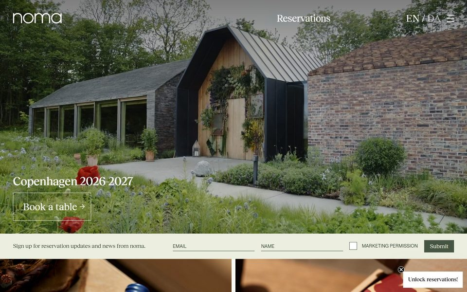</a><br><b><a href="sites/noma/teardown.md">noma</a></b><br><sub>Plain photographs and a long letter signed by the team carry the whole homepage</sub></td>
</tr>
</table>

<!-- gallery:end -->

## Building our own Hydra

Active Theory's in-house engine and editor, broken into parts, with the open-source stand-in for each part, three ways to have one, and what to learn from: **[hydra.md](hydra.md)**.

---

## Start here (top 5)

1. **[Fonts In Use](https://fontsinuse.com)**. Pick type by seeing it on a real menu, record sleeve or sign, not from the top of the Google Fonts list. This is the fastest way off the Inter/Geist default.
2. **[Utopia](https://utopia.fyi)**. Build one fluid type scale and one space scale in `:root` before writing any CSS. Ad-hoc sizes are half of what makes a page look generated.
3. **[Every Layout](https://every-layout.dev)**. A handful of layout primitives that adapt on their own, without breakpoints. They replace the "centered hero + 3 cards" reflex.
4. **[Rauno Freiberg, "Invisible Details of Interaction Design"](https://rauno.me/craft/interaction-design)**. Read it before adding any motion. It makes the case for motion that comes from a real-world metaphor.
5. **[Web Interface Guidelines](https://vercel.com/design/guidelines)** ([repo](https://github.com/vercel-labs/web-interface-guidelines)). A checklist of the small details. Use it as the review pass before calling a page done. Use the checklist, not the Vercel look.

## Why chats slop out

The slop comes from vague briefs. When the brief has no idea in it, the chat fills the gap with the library defaults: Tailwind grays, Inter or Geist, a centered hero, cards, fade-ups. Every site in `sites/` avoids this the same way: **one idea taken from the subject drives every decision.** The fix is the [brief template](briefs/template.md).

## The slop check

[`guard/slopcheck.mjs`](guard/slopcheck.mjs) catches the stock moves in HTML, CSS and component files: tiny uppercase letter-spaced labels, mono used for labels, middot and em dash chains, glass, glows, pulsing loops, fade-up reveals, pills and badges, "click to" instructions, and three or more typefaces. The house page passes it clean.

Audit a page or a folder:

```
node guard/slopcheck.mjs path/to/site
```

Make Claude Code run it on every file it writes, so it has to fix the hits before going on. Add this to `~/.claude/settings.json`, with the path to your clone:

```json
"hooks": {
  "PostToolUse": [
    { "matcher": "Write|Edit|MultiEdit",
      "hooks": [{ "type": "command", "command": "node /path/to/web-refs/guard/slopcheck.mjs --hook", "timeout": 15 }] }
  ]
}
```

It checks only what was just written, never old code. A line holding `slop-ok: <reason>` is skipped, for the rare move that really comes from the subject.

[`examples/charizard`](examples/charizard/index.html) is a graded-card page with the slop taken out: the case and a museum-style label beside it, one family (Libre Franklin), one motion (turning the case over). Drop `front.jpg` and `back.jpg` next to it for the real photos.

---

## The list (30)

Format: what it is · why it's good · when to use it. GitHub stats are as of 2026-10-28.

### Typography

**1. [Fonts In Use](https://fontsinuse.com)** (site)
- **What:** an archive of typefaces in real printed and digital work, searchable by face, era and industry.
- **Why:** you see a face on a real menu or poster before committing to it. The best free-face sources are small foundries like [Collletttivo](https://www.collletttivo.it) (open-source faces with character). Velvetyne is similar, but its site is showing a strike notice right now.
- **When:** picking fonts for any client page.

**2. [Butterick's Practical Typography](https://practicaltypography.com)** (site, free online book)
- **What:** the rules for body text: line length, point size, line spacing, real quotes and dashes, small caps, hanging punctuation.
- **Why:** it's short, opinionated and correct. Most "this looks off" is broken here.
- **When:** any page with paragraphs.

**3. [Utopia](https://utopia.fyi)** ([trys/utopia-core](https://github.com/trys/utopia-core) ★140, last push 2024-09-19; the calculator is stable)
- **What:** generates fluid type and space scales as `clamp()` custom properties from a min and max viewport.
- **Why:** one scale and one rhythm, with no breakpoint jumps.
- **When:** the first 20 lines of CSS on every site.

**4. [Capsize](https://seek-oss.github.io/capsize/)** ([seek-oss/capsize](https://github.com/seek-oss/capsize) ★1.7k, 2026-10-15, MIT)
- **What:** uses font metrics to trim the space above the cap height and below the baseline.
- **Why:** text then sits exactly on rules, grid lines and image edges, like a printed menu.
- **When:** headings against rules (the izakaya heads), buttons, anything aligned to a grid.

**5. [Fontaine](https://github.com/unjs/fontaine)** (★2.0k, 2026-10-28, MIT)
- **What:** generates metric-matched fallback `@font-face` rules (`size-adjust`, `ascent-override`).
- **Why:** no layout jump when the web font swaps in. It's what `next/font` did for Blundin's Geist.
- **When:** Vite, Astro or plain builds that self-host fonts. For Google Fonts via CDN, copy the override values by hand.

### Layout and grid

**6. [Every Layout](https://every-layout.dev)** (site; partly paid)
- **What:** layout primitives (Stack, Sidebar, Switcher, Cover, Reel, Grid) by Heydon Pickering and Andy Bell.
- **Why:** layouts respond to their content instead of to breakpoints, with much less CSS.
- **When:** any multi-section page or app shell.

**7. [Layout Breakouts](https://ryanmulligan.dev/blog/layout-breakouts/)** (Ryan Mulligan, article)
- **What:** one CSS grid with named lines for the content column, a "popout" width and full-bleed.
- **Why:** photos and quotes can break out of the text column without wrappers.
- **When:** editorial pages. For example, a restaurant photo that goes edge to edge between menu sections.

**8. [Defensive CSS](https://defensivecss.dev)** (Ahmad Shadeed, site)
- **What:** a catalogue of real breakages (long words, missing images, flex wrap, scrollbar shift) and their fixes.
- **Why:** pages built from a happy-path screenshot break on real content.
- **When:** as a pre-ship checklist.

**9. [Tufte CSS](https://edwardtufte.github.io/tufte-css/)** ([edwardtufte/tufte-css](https://github.com/edwardtufte/tufte-css) ★6.6k, 2026-06-24, MIT)
- **What:** sidenotes, margin figures and ET Book, all in one readable CSS file.
- **Why:** it shows how much character margins and notes give long text.
- **When:** case studies, about pages, Needle House write-ups.

### Colour

**10. [Flexoki](https://stephango.com/flexoki)** ([kepano/flexoki](https://github.com/kepano/flexoki) ★3.7k, 2026-03-07, MIT)
- **What:** an "inky" palette modelled on pigment on paper, with light and dark modes. The reasoning is written up.
- **Why:** a palette with a physical reason behind it, like the izakaya's paper, ink, red and indigo.
- **When:** text-first sites and themes that shouldn't look like Tailwind slate.

**11. [OKLCH picker](https://oklch.com)** ([evilmartians/oklch-picker](https://github.com/evilmartians/oklch-picker) ★2.0k, 2026-10-05)
- **What:** pick colours in OKLCH, where equal lightness steps look equal. It shows the P3 gamut.
- **Why:** tints and ramps come out even, with no HSL guessing.
- **When:** building any palette or set of hover and rule shades.

### Motion, with restraint

**12. [Rauno Freiberg, "Invisible Details of Interaction Design"](https://rauno.me/craft/interaction-design)** (essay)
- **What:** why some gestures feel right: physical metaphors, momentum, interruptibility, and frequency (the more often you see something, the less it should animate).
- **When:** before any motion.

**13. [Emil Kowalski, "You Don't Need Animations"](https://emilkowal.ski/ui/you-dont-need-animations)** (essay; paid course at [animations.dev](https://animations.dev))
- **What:** when not to animate, plus durations and easing for when you do.
- **Why:** it is the direct cure for fade-up-on-everything.
- **When:** deciding whether something moves at all.

**14. [View Transitions API](https://developer.chrome.com/docs/web-platform/view-transitions)** (native, docs)
- **What:** page and state transitions with a few lines of CSS and no library. Same-document transitions work in all current major browsers. Check caniuse before relying on cross-document (multi-page) transitions.
- **When:** one morph that comes from the subject, such as a menu item opening into its own page.

**15. [Motion](https://motion.dev)** ([motiondivision/motion](https://github.com/motiondivision/motion) ★34.6k, 2026-10-28, MIT)
- **What:** springs, gestures and layout animation for React and vanilla JS. Blundin's site uses it.
- **Why:** motion that can be interrupted and that follows the hand.
- **When:** drag, reorder, shared-element moves in apps like The Grid. Skip `whileInView` reveals.

**16. [GSAP](https://gsap.com)** ([greensock/GSAP](https://github.com/greensock/GSAP) ★29.9k, 2026-04-13)
- **What:** timeline sequencing. Every plugin (SplitText, MorphSVG, ScrollTrigger) has been free since 3.13.
- **Why:** it's the best tool for one choreographed sequence. The izakaya curtain-then-unfold is a two-step timeline.
- **When:** an intro or a single set piece. Don't use ScrollTrigger to fade every section.

### Real-time WebGL, when the subject earns it

**17. [three.js](https://threejs.org)** ([mrdoob/three.js](https://github.com/mrdoob/three.js) ★117k, 2026-10-28, MIT)
- **What:** the standard 3D library, behind most Active Theory-style sites made outside Active Theory.
- **When:** a scene that is spatial by nature: a room, a venue, an object you turn over.

**18. [OGL](https://oframe.github.io/ogl/)** ([oframe/ogl](https://github.com/oframe/ogl) ★4.7k, last push 2025-04-13; stable but quiet)
- **What:** a minimal WebGL library, much smaller than three.js and closer to raw GL.
- **When:** one full-screen shader on an otherwise 2D page, such as paper grain, ink or a light leak.

**19. [WebGL Fluid Simulation](https://paveldogreat.github.io/WebGL-Fluid-Simulation/)** ([PavelDoGreat/WebGL-Fluid-Simulation](https://github.com/PavelDoGreat/WebGL-Fluid-Simulation) ★16.8k, last push 2024-11-12, MIT)
- **What:** the reference stable-fluids implementation. Blundin's home uses the same passes.
- **When:** read it to learn how fluid works, then art-direct your own. The stock neon look is generic.

**20. [The Book of Shaders](https://thebookofshaders.com)** ([patriciogonzalezvivo/thebookofshaders](https://github.com/patriciogonzalezvivo/thebookofshaders) ★7.1k, 2026-02-28)
- **What:** fragment shaders from zero: shaping functions, noise, patterns.
- **Why:** materials like paper, grain and watercolour come from here.
- **When:** before writing any shader.

**21. [Three.js Journey](https://threejs-journey.com)** (Bruno Simon, paid course)
- **What:** the most direct path for one person to reach studio-level WebGL. His portfolio source is open: [brunosimon/folio-2025](https://github.com/brunosimon/folio-2025) (★2.0k, 2026-04-07, MIT), live at [bruno-simon.com](https://bruno-simon.com).
- **When:** if Sean wants to build Active Theory-type work himself.

**22. [lil-gui](https://lil-gui.georgealways.com/)** ([georgealways/lil-gui](https://github.com/georgealways/lil-gui) ★1.7k, 2025-10-12, MIT)
- **What:** a tiny tweak panel you bind to any number, colour or toggle.
- **Why:** it's the cheap version of Active Theory's editor. Tune by eye, then paste the values into code.
- **When:** any scene, shader or motion curve.

### Design-engineering writing

**23. [Web Interface Guidelines](https://vercel.com/design/guidelines)** ([vercel-labs/web-interface-guidelines](https://github.com/vercel-labs/web-interface-guidelines) ★1.1k, 2026-10-05, MIT)
- **What:** a checklist covering interactions, animation, layout, content, forms and performance.
- **Why:** a chat can run it as a review pass.
- **When:** before shipping anything.

**24. [Frank Chimero, "The Web's Grain"](https://frankchimero.com/blog/2015/the-webs-grain/)** (essay, 2015)
- **What:** design with the web's own material (flow, edgelessness) instead of forcing print or app frames onto it.
- **When:** before deciding a site's concept.

**25. [Active Theory, "Craft Matters"](https://lbbonline.com/news/Craft-Matters-by-Active-Theory)** (LBB, 2026-02-12)
- **What:** the case for 3D only with intent, constraint as style, and stylisation over realism.
- **When:** before adding any 3D or WebGL.

### Sites worth reading the source of

**26. [gwern.net](https://gwern.net)** ([gwern/gwern.net](https://github.com/gwern/gwern.net) ★848, 2026-10-28)
- **What:** Hakyll with a large custom JS and CSS layer: sidenotes, hover link previews, dropcaps, small caps, link icons.
- **Why:** proof that pure typesetting can feel rich, with no imagery needed.
- **When:** text-dense work.

**27. [Maggie Appleton](https://maggieappleton.com)** ([MaggieAppleton/maggieappleton.com-V3](https://github.com/MaggieAppleton/maggieappleton.com-V3) ★225, 2026-10-22; Astro + MDX)
- **What:** hand-drawn illustration, notes marked by growth stage, quiet layout.
- **Why:** the personality comes from the person's drawings and writing, not effects.
- **When:** personal sites and the music portfolio.

**28. [Bartosz Ciechanowski](https://ciechanow.ski)** (no repo; view-source is hand-written JS and WebGL)
- **What:** interactive explainers (gears, cameras, GPS) where every animation explains the subject.
- **Why:** the purest example of motion coming from the subject.
- **When:** any explanatory or interactive piece.

### Components that don't push a look

**29. [Radix Primitives](https://www.radix-ui.com/primitives)** ([radix-ui/primitives](https://github.com/radix-ui/primitives) ★19.4k, 2026-10-14, MIT)
- **What:** unstyled, accessible dialogs, menus and popovers. They're what shadcn/ui is built on.
- **Why:** use them directly with your own styles, and you get the behaviour without the shadcn look. [Base UI](https://base-ui.com) ([mui/base-ui](https://github.com/mui/base-ui) ★11.3k, 2026-10-29) is the newer alternative from the same people.
- **When:** any React UI.

**30. [React Aria Components](https://react-aria.adobe.com)** ([adobe/react-spectrum](https://github.com/adobe/react-spectrum) ★16k, 2026-10-28, Apache-2.0)
- **What:** the most thorough accessibility and i18n behaviour available: date pickers, comboboxes, drag and drop. Unstyled.
- **When:** app UIs like The Grid.

---

## Avoid (and why)

- **shadcn/ui with its default theme.** It is the look of nearly every AI-built app (★127k). Use Radix underneath it and write your own styles.
- **Aceternity UI, Magic UI and similar "animated component" kits.** Beams, spotlights, shimmer borders and glow cards are the banned list sold as components.
- **AOS and other animate-on-scroll libraries, and ScrollTrigger used for reveals.** They produce fade-up on every section.
- **Lenis and other smooth-scroll hijacking,** unless the whole page is a single scroll-driven scene.
- **Geist or Inter as the default face, and glass nav pills.** That includes Blundin's own nav: copy his conceit, not his chrome.
