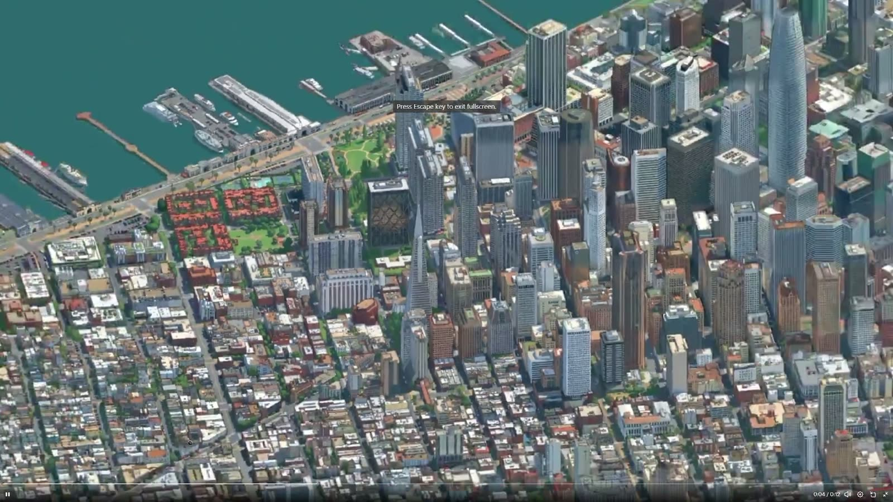
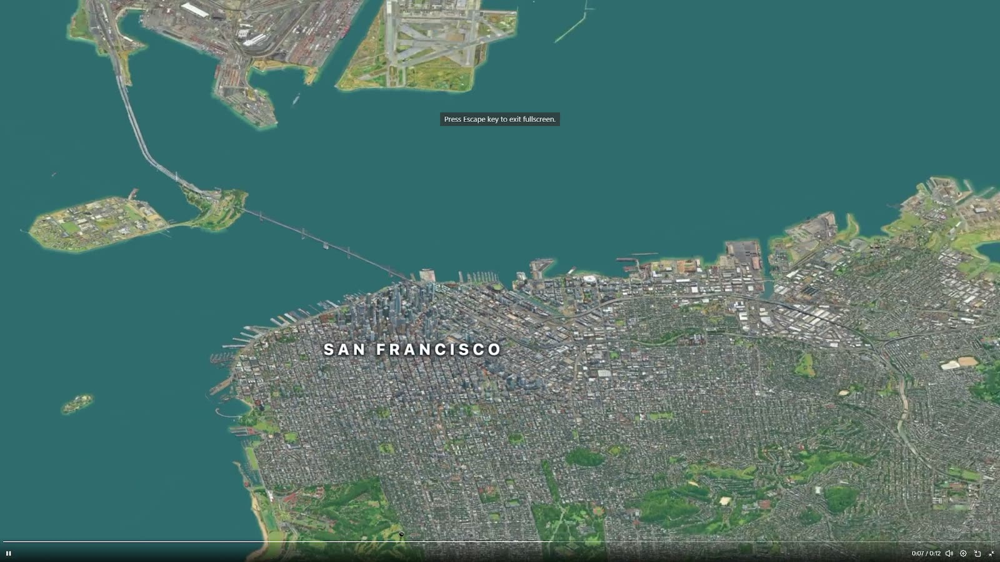
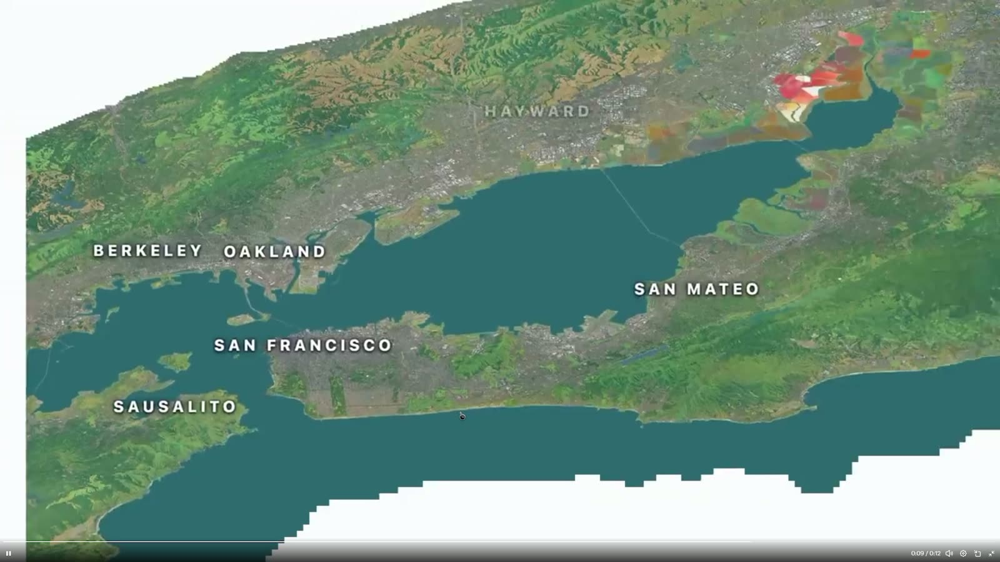
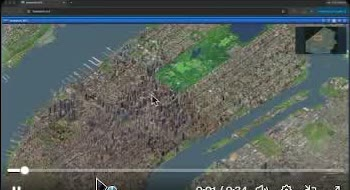
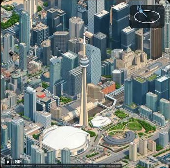
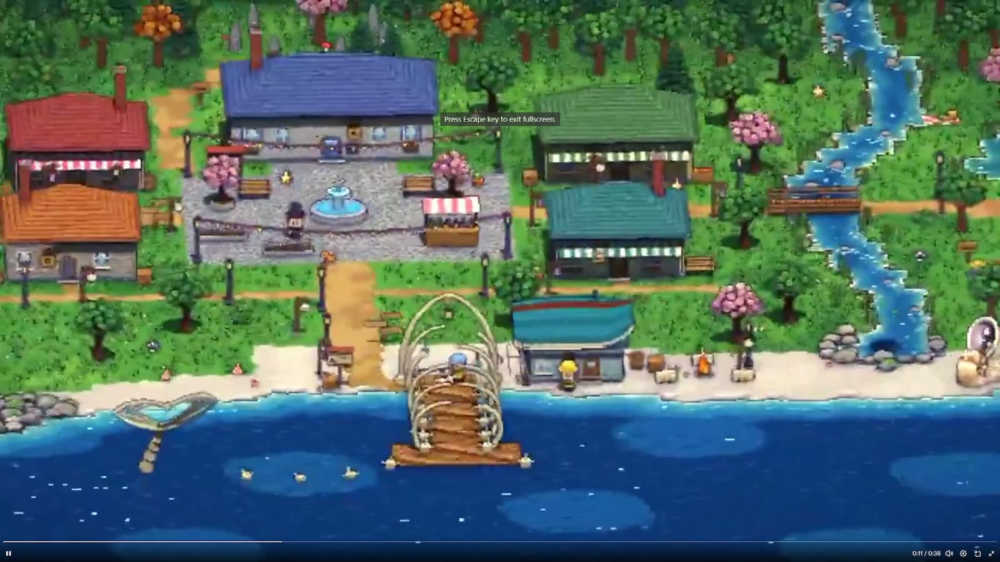
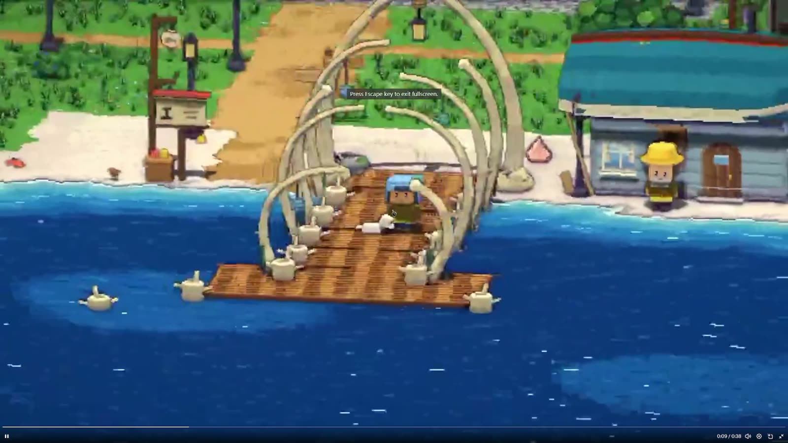
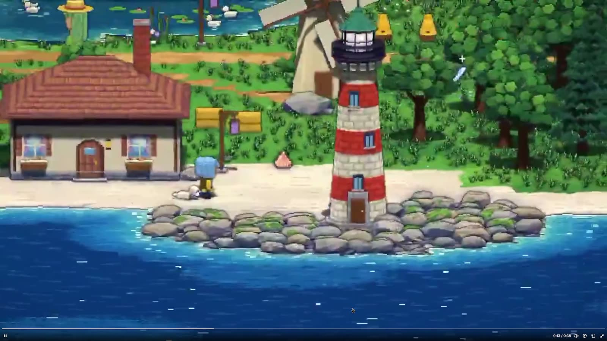

# Isometric maps

For Isometric Earth (`E:\vibecoding\isometric-earth`): a real place, drawn as an isometric pixel-art map you can zoom from the whole region down to one street. Starting with San Diego. Refs saved by Sean from X, Nov 2026.

## The refs

 

**Isometric SF (Justin Chavez, isometricsf.com).** The whole Bay Area, over 1,300 square miles, painted by Klein, a 4B-parameter image-to-image model, run on Modal. What makes it: every building is the real building, water is one flat teal with no satellite murk, the ground keeps the true colours of the aerial photo but simplified, and labels are wide white capitals. Zoomed out it reads as a painted relief map; zoomed in, a model city. Limit: one fixed camera angle, and the map stops at a hard white edge.

 

**Isometric NYC (Andy Coenen, isometric.nyc)** and **Isometric Toronto (John Fewell, iso.sloptoronto.ca).** NYC is the SimCity 2000 look, and its author wrote up the whole method (below). Toronto covers 630 km² and is drawn from four angles, so you can rotate it. Also seen: an isometric Tel Aviv built from 36,604 buildings and 230,452 trees in open municipal data, where 2 GB of paintings open in under a second because the first load is about 400 KB.

 

**Pixel coast town (source not captured in the clip).** A 3D scene shown as pixel art, and the camera turns freely. What makes it: a small fixed palette, hard two-step shading on every object, a dark outline around each shape, and water built from flat bands (deep blue, mid blue, a pale shore band, white foam specks). Trees are round clumps with a few highlight pixels. Nothing is blurred. The dusk frame shows the same scene re-lit by swapping the palette.

## How Isometric NYC was made

From the author's write-up at cannoneyed.com/projects/isometric-nyc.

1. **Source render.** City open 3D data (CityGML whitebox) laid over a satellite photo did not line up well enough, and the image model invented things to cover the mismatch. Google's photorealistic 3D tiles gave geometry and texture from one source. A web renderer with an orthographic camera exports each tile at a fixed isometric angle.
2. **Style.** A large image model (Nano Banana Pro) got the look right about half the time and was too slow and costly for roughly 40,000 tiles. Those good outputs became about 40 before/after pairs used to fine-tune a small image-edit model (Qwen Image Edit): about 4 hours and 12 dollars.
3. **Seams.** The model is trained to infill: part of the target tile is already painted and masked in, so each new tile continues its neighbours. Work is stored as 512 px quadrants in a SQLite table, generated 2x2 at a time.
4. **Tools.** A small web app to pick which quadrants to generate next, a map of what is done, a boundary editor, a water classifier.
5. **Trouble.** Water and trees. The fine-tuned model could not paint them reliably, and they needed separate handling.

## Rules taken from these

- Real geometry first. The painting model is only as accurate as the render it is given.
- Water is drawn, never photographed: flat colour, a pale band at the shore.
- One light direction for the entire map, so every tile shades the same way.
- Fine-tune a small model on a few dozen hand-picked pairs; do not prompt a big one tile by tile.
- Paint with neighbours visible, or the seams show.
- Rotation means painting the map once per angle (four), or keeping it as live 3D with a pixel-art shader.
- Ship the first screen small; load paintings as the visitor moves.

## For San Diego

Sean's machine has Blender 4.5 and an RTX 4080 Super (16 GB), enough to render the source tiles and run a small image-edit model locally. Open data to build from: USGS 3DEP lidar and NAIP aerial photos (both public domain), SanGIS building footprints, Overture and OpenStreetMap. The edge over Isometric SF is rotation and being able to click a place and see what it is.
