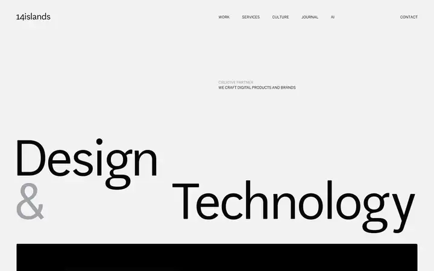
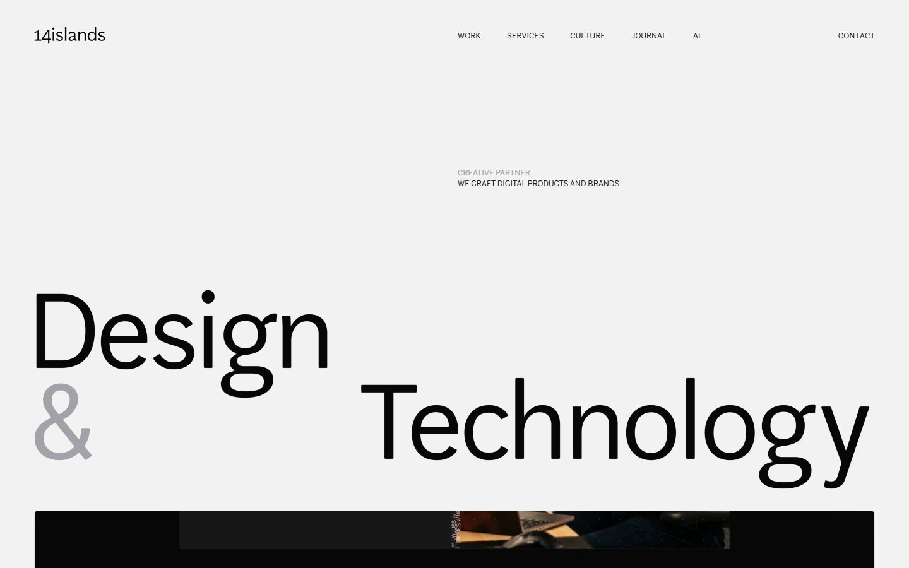
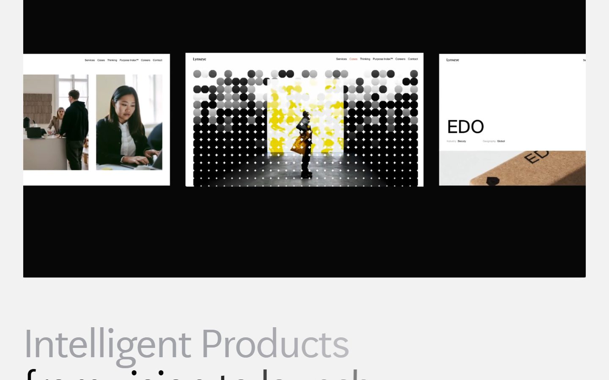
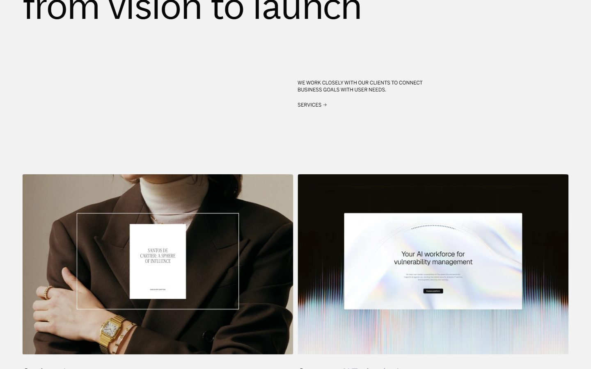
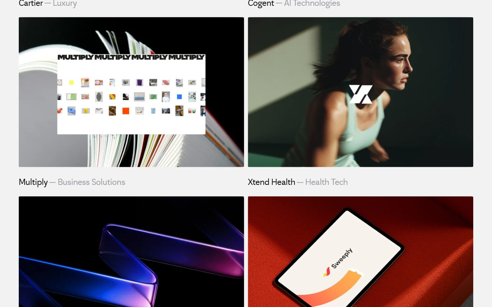
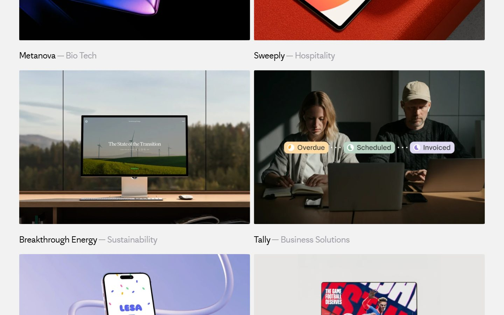
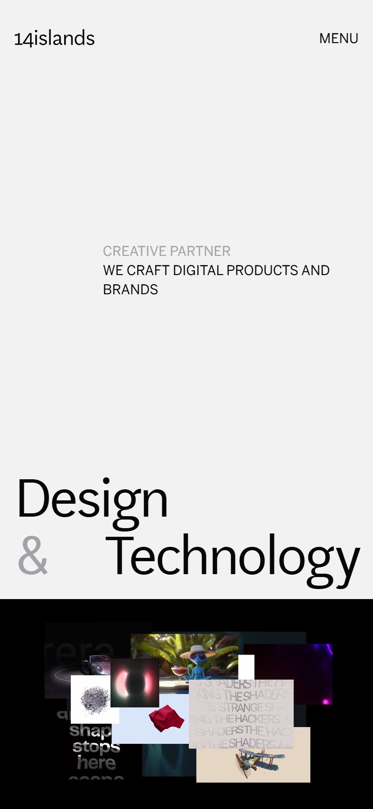

# 14islands

<!-- gallery:start -->

<a href="../../README.md#worlds">All sites</a> &nbsp;&nbsp; <a href="../resn/teardown.md">&larr; Resn</a> &nbsp;&nbsp; <a href="../samsy/teardown.md">Samsy &rarr;</a> &nbsp;&nbsp; <a href="https://www.14islands.com">Open the live site</a>

<!-- gallery:end -->

Looked at on 2026-10-28. https://www.14islands.com

**The idea:** plain big type and real client screens; the 3D is spent only on showing the work.

## What you see
A light grey page with black type. A big two-line headline sits offset left and right, with the ampersand in grey. Below it, a black panel shows case-study screens on curved planes, blurred as they slide past. The next headline is grey in one capture and black in the next, so it darkens as you scroll. Then a two-column grid of cases: image, client name in black, sector in grey. On the phone the reel is a collage of small renders and type tests.

## Stack
| Layer | What |
|---|---|
| Framework | Next.js (`X-Powered-By: Next.js`) |
| 3D | three.js r156, one full canvas; Lenis for scrolling |
| Fonts | AftenScreen, BentonSans |
| Weight | 2.8 MB (1.1 MB JS), 103 requests |
| Reduced motion | Yes, the CSS has a `prefers-reduced-motion` rule |
| Hosting | Vercel |

## Steal
- Grey instead of a smaller size for secondary words: the "&", the sector names.
- WebGL spent on the work reel, not on a hero object.
- Two facts per case card, client and sector, and nothing else.
- A reduced-motion rule. The only site in this batch with one.

## Don't steal
- "CREATIVE PARTNER / WE CRAFT DIGITAL PRODUCTS AND BRANDS", a small uppercase kicker above the headline.
- "Intelligent Products from vision to launch". A stock agency line.
