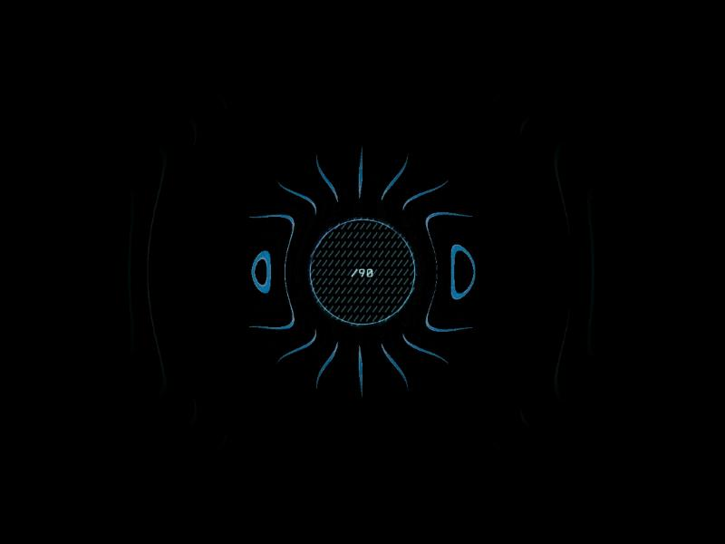
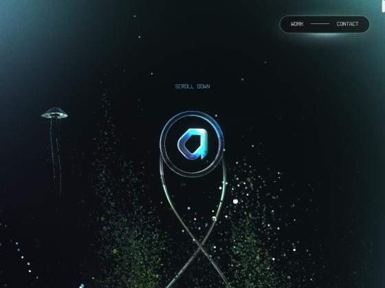
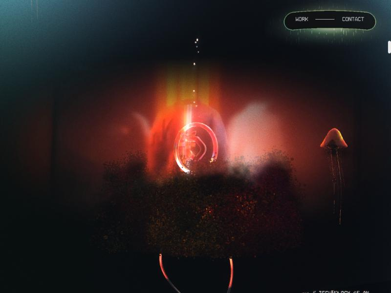
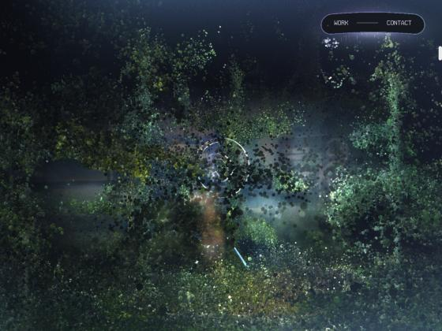
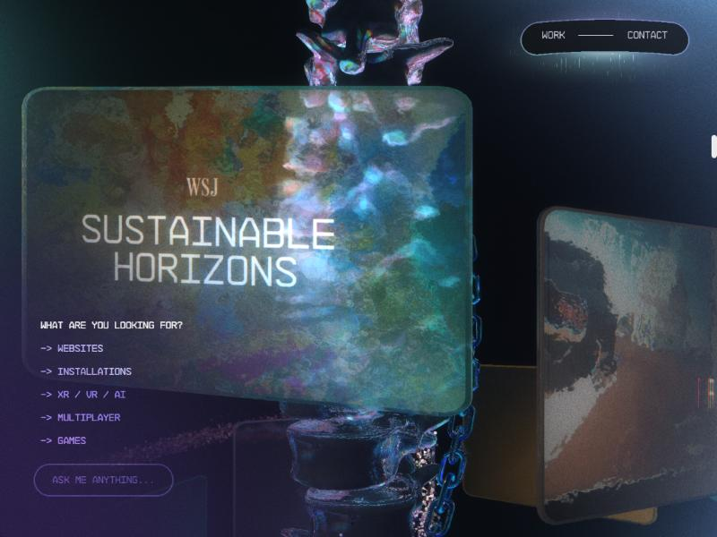

# activetheory.net

Looked at on 2026-10-28.

**The idea:** the studio's own site is one continuous world you scroll through. They hold their 3D to one rule: "Why is this in WebGL at all?"

 
 

## What you see

- A loader with a counter.
- A dark, underwater-feeling space with jellyfish, drifting particle spores and a chrome "a" on a looping wire.
- Scrolling moves the camera through a red-lit room and then a forest.
- The work section is a set of floating 3D cards.

All the type is drawn in WebGL. The only DOM is the "Work / Contact" pill.

## Stack

| Layer | What |
|---|---|
| Hosting | Firebase Hosting behind Fastly |
| Framework | None from npm. A 6 KB HTML shell loads **one 1.8 MB bundle (348 KB compressed)** on their in-house engine **Hydra** |
| Renderer | Their own WebGL2 renderer, not three.js. It does PBR, shadows, bloom, volumetric light, fluid, mirrors and GL text |
| Assets | Draco meshes, KTX2/Basis textures, decoding on worker threads |
| Scene data | A 220 KB `uil.json` from **their own visual editor**: camera position, FOV and lerp speed per scene, mesh parameters, shader settings |
| Quality | GPU tiers (`GPU.lt(...)`) and `Device.mobile` checks scale effects per device |
| Type | NB Architekt (Neubau), self-hosted |
| Gaps | No `prefers-reduced-motion` handling. Text is canvas, with a hidden DOM layer for screen readers |

How to build something like this: see [`../../hydra.md`](../../hydra.md).

## Their stance

From [Craft Matters, LBB, 2026-02-12](https://lbbonline.com/news/Craft-Matters-by-Active-Theory), paraphrased:

- Surface-level WebGL has become noise.
- 3D earns its place only when it deepens involvement. If a video tells it better, use the video.
- Constraint is style: fog instead of textures, light instead of detail, silhouettes instead of fine modelling.
- Stylised work outlasts realism.

## Steal

- One scene per site, only where the subject is spatial.
- A tweak panel that saves values, so everything is tuned by eye.
- GPU tiers decided up front.
- Fog and light instead of detailed assets.

## Don't steal

- Text drawn only in canvas. Keep real HTML for content.
- Skipping reduced motion.
- The glowing outline pill and the mono uppercase menu on the work section. Both are on the banned list.

## Their open-source bits

[github.com/activetheory](https://github.com/activetheory):

- `split-text` (★69) splits text into lines, words or characters.
- `activeframe` (★418) is a frame-accurate video format for WebCodecs.
- `svg2msdf` (★27) turns SVGs into MSDF textures for crisp GL text.
- `fit-text` and `balance-text` handle fitting and balancing text.
