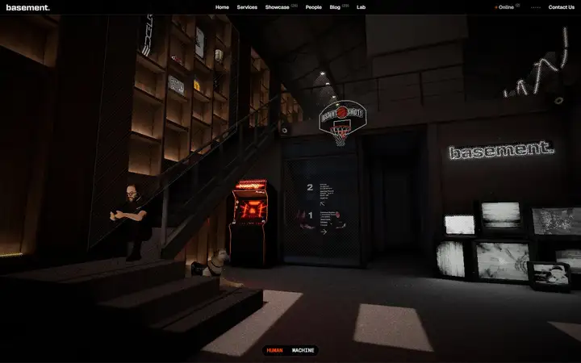
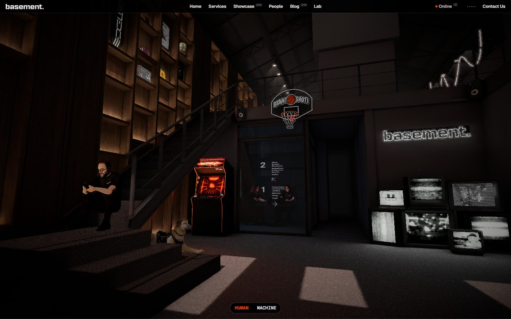
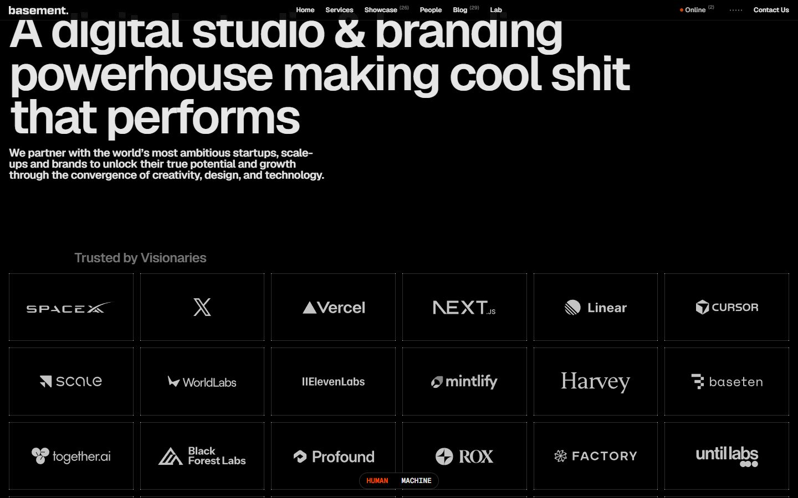
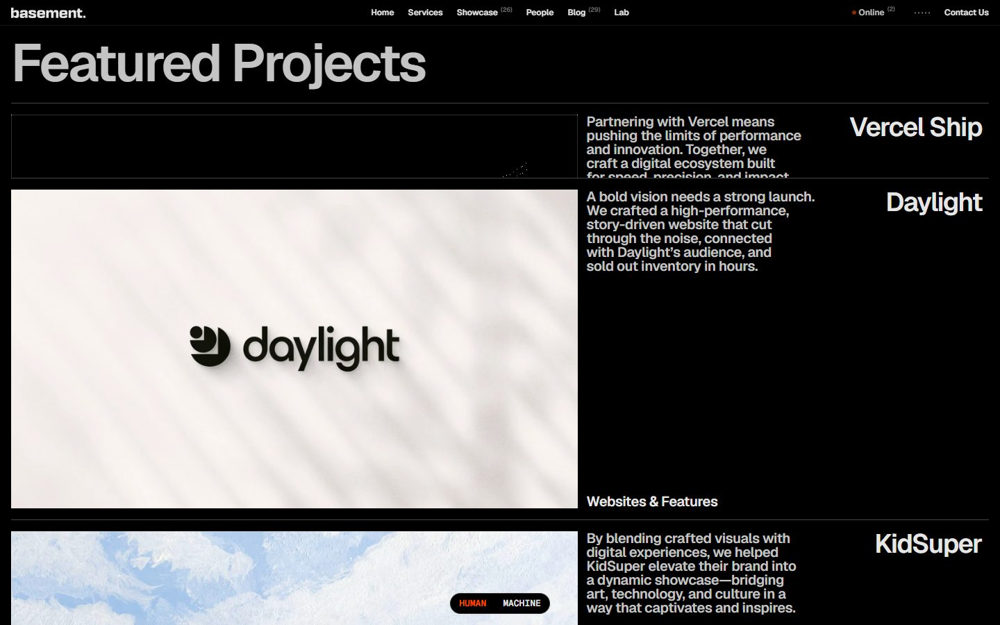
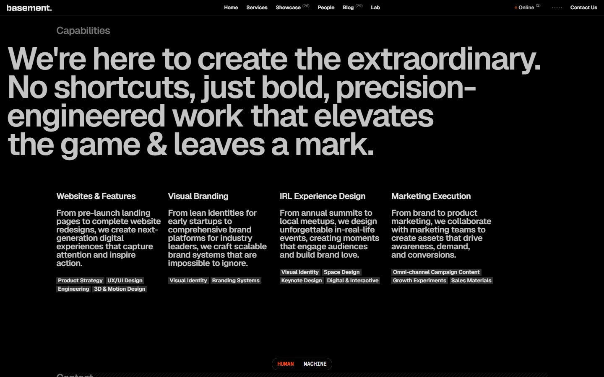
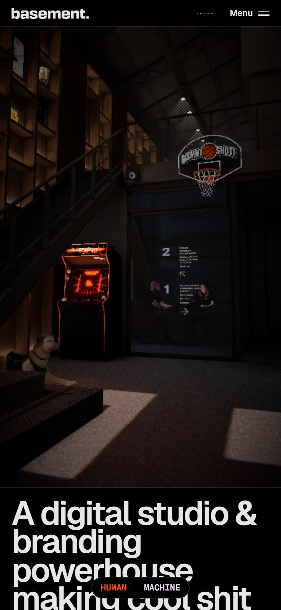

# basement.studio

<!-- gallery:start -->

<a href="../../README.md#studios-and-motion-craft">All sites</a> &nbsp;&nbsp; <a href="../slow-roads/teardown.md">&larr; Slow Roads</a> &nbsp;&nbsp; <a href="../motion-dev/teardown.md">Motion &rarr;</a> &nbsp;&nbsp; <a href="https://basement.studio">Open the live site</a>

<!-- gallery:end -->

Looked at on 2026-11-08. https://basement.studio

**The idea:** a studio site that opens inside a 3D model of the studio itself.

## What you see
The hero is their basement rendered in three.js, dim and warm: an arcade cabinet glowing red, a basketball hoop, stairs, a figure slumped on a couch, the logo as a lit sign. The camera drifts through the room. Below that it turns into a tight black-and-white agency site: a big grotesque headline, a grid of client logos in cells, featured projects as large thumbnails with a short paragraph, then capabilities in four columns. A small HUMAN / MACHINE switch sits at the bottom of the screen, and the nav shows who's online.

## Stack
| Layer | What |
|---|---|
| Framework | three.js r180 for the room, Next.js |
| Fonts | Geist, Geist Mono, flauta |
| Weight | 21.2 MB (2.4 MB JS, 3.2 MB images), 176 requests |
| Reduced motion | Has a `prefers-reduced-motion` rule |
| Hosting | Vercel |

## Steal
- The studio's real place as the hero. It's specific to them; nobody else can use it.
- Strict black and white below the fold so the work thumbnails carry the color.
- A playful toggle (HUMAN / MACHINE) that changes the whole page's voice: one joke, done properly.

## Don't steal
- 21 MB on first load. The room is worth it for a studio; for a client site, bake it to video or a still.
- The logo wall. Fine for an agency selling to companies, filler anywhere else.
