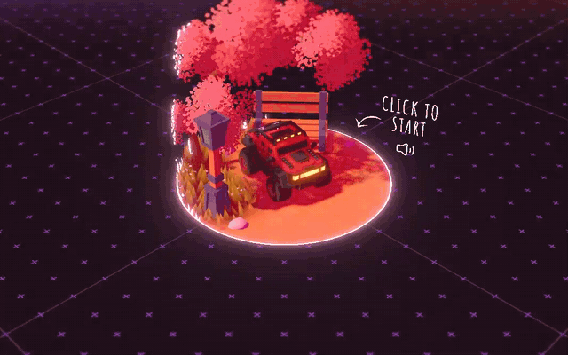
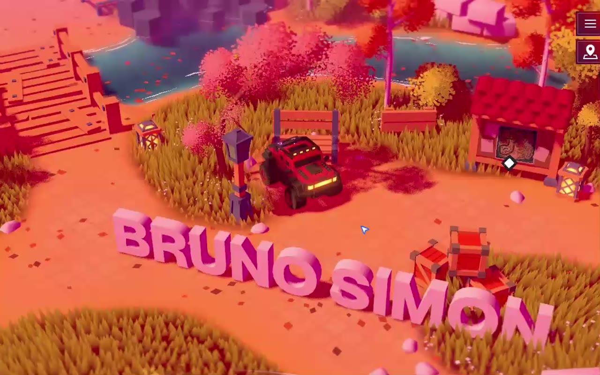
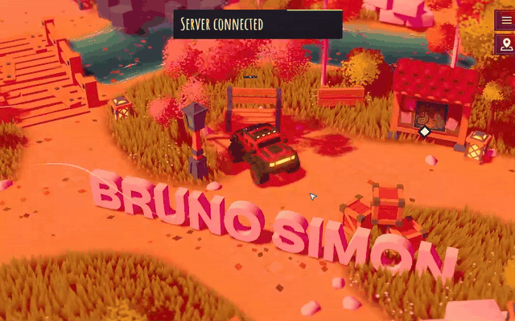
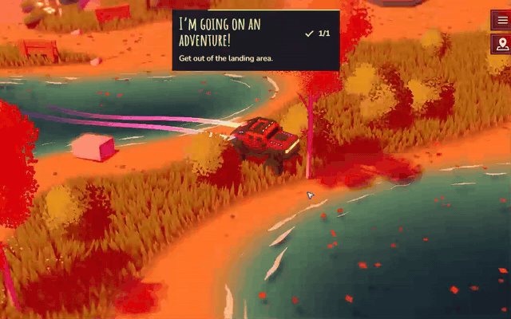
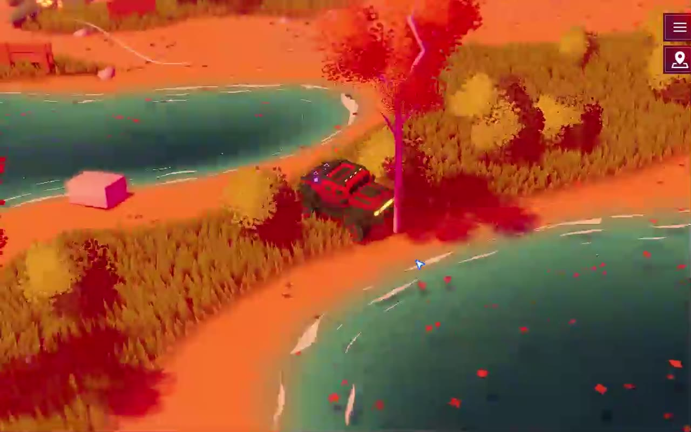

# Bruno Simon: deep audit

Played on 2026-11-08 and read alongside the source (github.com/brunosimon/folio-2025, MIT). It covers the visuals, physics, movement and gameplay, for anyone building a drive-around portfolio world. The short teardown is in [`teardown.md`](teardown.md).

*Click to start. The glowing disc grows out from the car and the world appears inside its ring.*

## The one idea

The portfolio is a toy box you drive through. Every object is a prop you can hit, and every project is a place you drive to. Nothing is a page.

## Visuals

- **The palette does all the work.** The whole world is two or three hues at a time: coral ground, pink and red trees, gold grass, teal water. Models carry no textures, only colors picked from one shared `palette` texture (each model's UVs point at a swatch). Change the swatch and the world recolors.
- **Simple shapes, expensive light.** Low-poly models with a custom Lambert material (`MeshDefaultMaterial`): core shadows, drop shadows caught separately, fake light bounce, fog and a water tint, all written in three.js TSL. One directional light moves with the day cycle.
- **Grass is the texture of the world.** 280 x 280 = 78,400 instanced blades in one draw, colored from a painted terrain map, swaying with a global wind.
- **The ground is a painted data map.** One texture says where grass, dirt and water are, and the terrain, grass and water all read it. Tire tracks are drawn live into a render target, so the car leaves marks in the dirt.
- **The post stack is cheap:** a soft bloom (threshold 1, strength 0.25, so only true highlights glow) and a "cheap DOF" blur toward the screen edges that makes it look like a miniature. No SSAO or TAA.
- **Life everywhere:** falling leaves, wind lines, fireflies around lanterns, rain, snow, lightning and a tornado driven by weather and day/year cycles. The clock and season change the world while you play.
- **The reveal is a mask, not a loader.** The same disc the start screen sits on grows outward, and every material discards pixels outside it (a `reveal` uniform in the shared material). One line in one shader, and the intro feels designed.

## Physics

*Driving into the red explosive crates: the blast throws the letters of his name, then everything settles where it lands.*

- **Engine: Rapier** (`@dimforge/rapier3d`, WASM), at about 60 Hz, with a debug wireframe.
- **Everything is a body.** Letters, benches, fences, bricks, lanterns, crates and bowling pins are all dynamic and all knock over. Objects sleep until touched, so hundreds cost almost nothing.
- **The physics comes from Blender.** Object names carry the rules: a mesh named with `physical` gets a collider, plus `dynamic`, `fixed` or `kinematicPositionBased`. Restitution and friction ride along in custom properties. The level designer sets physics while modeling.
- **Explosions are one function** (`explode(point, radius 7, strength 4)`): an upward-biased impulse that fades with distance, applied to every body in range. Above a strength threshold, it triggers **bullet time** (slow motion for a beat). This is the most fun moment on the site.
- **Every hit has a sound**, picked by material (stone, brick, metal, soft) and scaled by impact speed.

## The vehicle and movement

- **A Rapier raycast vehicle** (`DynamicRayCastVehicleController`): a box chassis with four ray wheels. The tuning is all toy, not sim: steering 0.5 rad, engine force 300, top speed 5 normally and 40 with boost, friction slip 0.9, suspension stiffness 25.
- **The ability is hydraulics.** Each wheel has three suspension heights (0.88, 1.23, 1.63) with matching stiffness. Space pumps all four at once and the car hops. Digits 1-4 or the numpad pump single corners, so you can bounce, tilt and do lowrider tricks. It's just two numbers per wheel changing at runtime, and it's the most memorable control on the site.
- **Boost** (Shift) multiplies both force and top speed and leaves trails behind the car.
- **Self-righting:** it tracks how far the car has rolled, and when it's on its back a "flip" impulse jumps it upright. R respawns at the nearest checkpoint. You can never get stuck.
- **Ice:** when water freezes in winter, wheel friction drops from 0.9 to 0.04. The season changes the handling.
- **Honk** (H). Pointless and essential.
- **Inputs are actions, not keys.** One table maps keyboard, gamepad and a touch joystick (`Nipple`) to the same named actions, filtered by mode (wandering, racing, cinematic).

## Camera

- A high three-quarter view that follows a smoothed **focus point**, not the car itself, so small bumps don't shake the frame.
- It zooms out with speed and "magnets" toward points of interest, framing the landmark you're near.
- A free mode (drag to look around) snaps back to tracking as soon as you drive.

## Gameplay and exploration

- **Areas are the content:** Projects, Lab, Career, Social, a bowling alley, a race circuit with countdown and leaderboard, a toilet, a cookie stand, a time machine, an altar. Each is its own small scene with one interaction.
- **Achievements teach the controls.** "I'm going on an adventure!" fires when you leave the landing area, and "Lowrider" when you use the suspension. Nobody reads a controls screen; the toast tells you what you just discovered.
- **Whispers:** visitors leave one short message in the world, capped at 30. The world feels inhabited without multiplayer.
- **Secrets:** the Konami code, an Easter area, seasonal events (Black Friday). Rewards for poking around.
- **A map button and "I'm stuck"** so exploring never turns into frustration.

## Sound

Over a hundred short clips: per-material impacts, an engine loop, the hydraulic piston, a horn, thunder, rain on leaves, wind in the forest, lake waves, an owl at night and a rooster at dawn. Ambient beds follow the weather and the clock. Sound is half of why the physics feels good.

## Tech and performance

| Layer | What |
|---|---|
| Renderer | three.js r187, `three/webgpu` (WebGPU, WebGL2 fallback), TSL node materials |
| Physics | Rapier 0.19 (WASM) |
| Build | Vite; models exported from Blender as GLB, textures compressed to KTX2 (ETC1S) |
| Audio | Howler |
| Debug | Tweakpane panels for every number (open with `#debug`) |
| Quality | Two levels: shadow map 2048 vs 512, bloom 5 vs 2 mips |

The code runs as one ordered update loop: inputs, player, vehicle before physics, physics, vehicle after physics, view, world, rendering. Every system is a small class with a fixed slot in that order.

## What to take (and not)

**Take:** one palette texture for the whole world; shapes simple and light expensive; every prop knockable, with a sound; one physics-based ability with an obvious, silly payoff (the hydraulics); explosions with a moment of slow motion; achievements as the tutorial; a respawn and a flip so nobody is ever stuck; the reveal mask as the intro.

**Don't take:** his world, car, name letters, layout or areas. The code is MIT, but the art and the idea of *his* portfolio are his. Build your own place, your own vehicle and your own ability on the same grammar. And keep a plain text route to the content for anyone who doesn't want to play.
