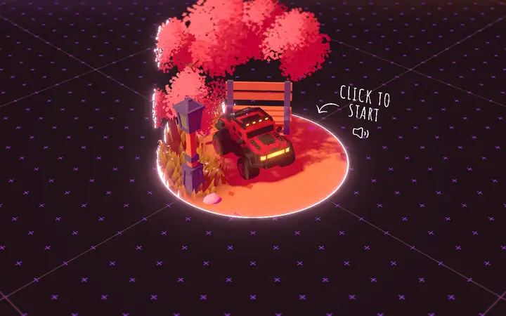
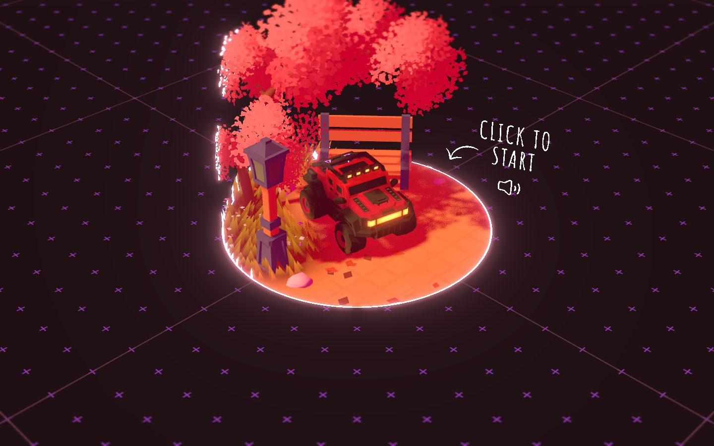
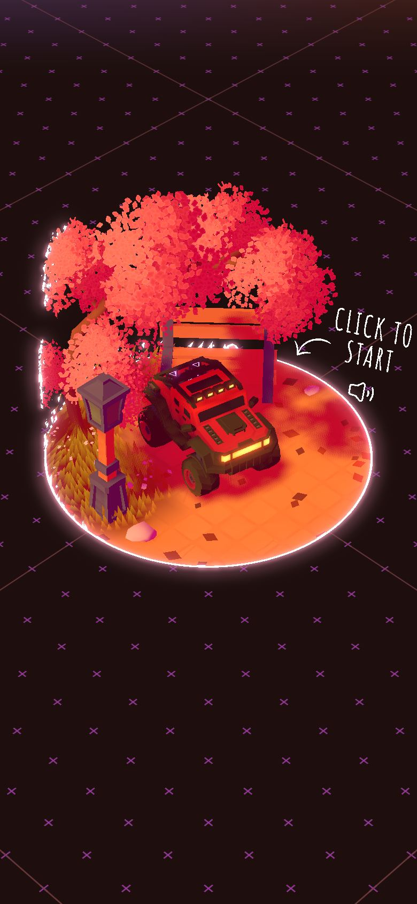

# Bruno Simon

<!-- gallery:start -->

<a href="../../README.md#worlds">All sites</a> &nbsp;&nbsp; <a href="../igloo-inc/teardown.md">&larr; Igloo Inc.</a> &nbsp;&nbsp; <a href="../dogstudio/teardown.md">Dogstudio &rarr;</a> &nbsp;&nbsp; <a href="https://bruno-simon.com">Open the live site</a>

<!-- gallery:end -->

Looked at on 2026-10-28. https://bruno-simon.com

**The idea:** the portfolio is a toy world you drive a car through.

## What you see
Only the start screen was captured. A small diorama on a dark floor printed with purple crosses: a red off-road truck, a pink tree, a bench, a lamp post, and a hand-lettered "Click to start" with an arrow and a sound icon. The HTML holds the rest: a welcome note that says "Please drive around", controls for keyboard, touch and gamepad (boost, jump, honk, hydraulics, respawn), achievements, a daily circuit with scores, and "whispers", messages visitors leave in the world (one per user, 30 at most).

## Stack
| Layer | What |
|---|---|
| Framework | None. One plain 58 KB HTML file holds every UI panel |
| 3D | three.js r183. The options menu offers a WebGPU renderer and a quality toggle |
| Fonts | Amatic SC, Nunito, Pally-Medium |
| Weight | 7.3 MB (1.07 MB JS), 115 requests |
| Reduced motion | No |
| Hosting | nginx 1.24.0 on Ubuntu |

## Steal
- One verb for the whole site, "drive", mapped to every input: keys, touch, gamepad.
- An "I'm stuck!" button that respawns you. Plain help for the one way a game site fails.
- Visitor messages with a hard cap (30, one each), so the world never fills up.
- The single instruction hand-lettered into the scene instead of a UI button.

## Don't steal
- Nothing on the banned list.
- A game as the only way to the content. It works for a creative developer selling exactly that skill. A client site needs its text reachable without playing.
