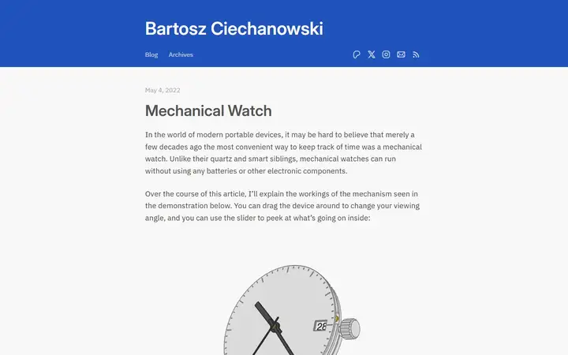
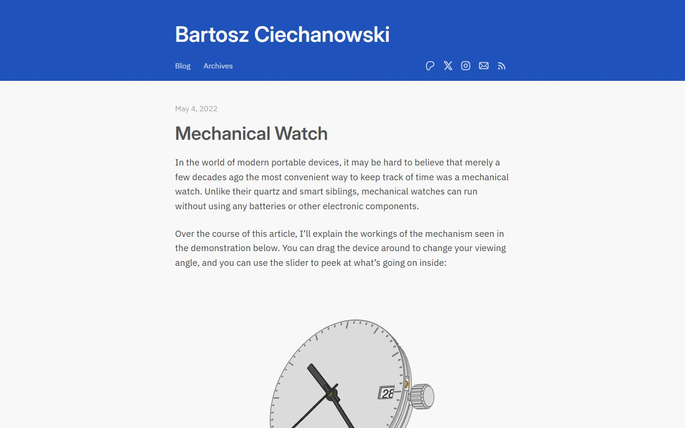
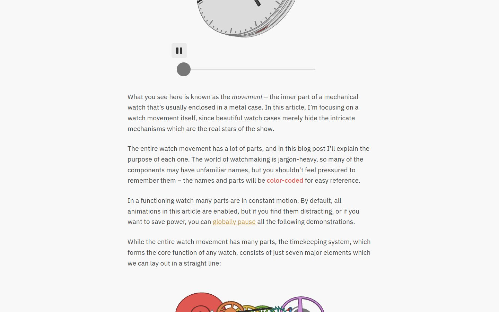
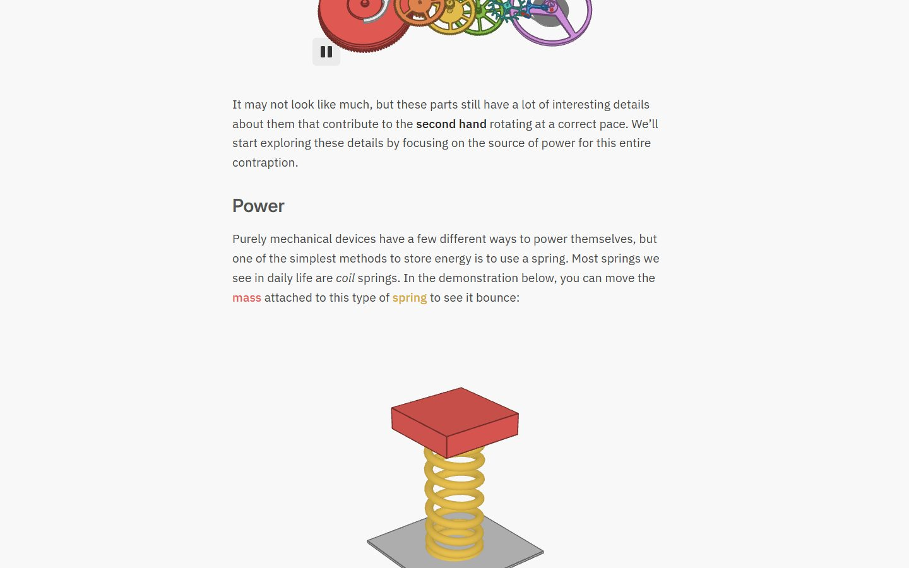
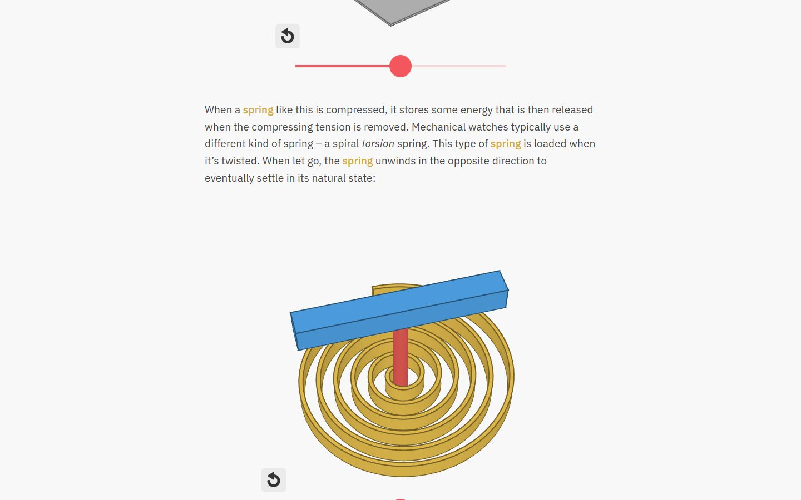
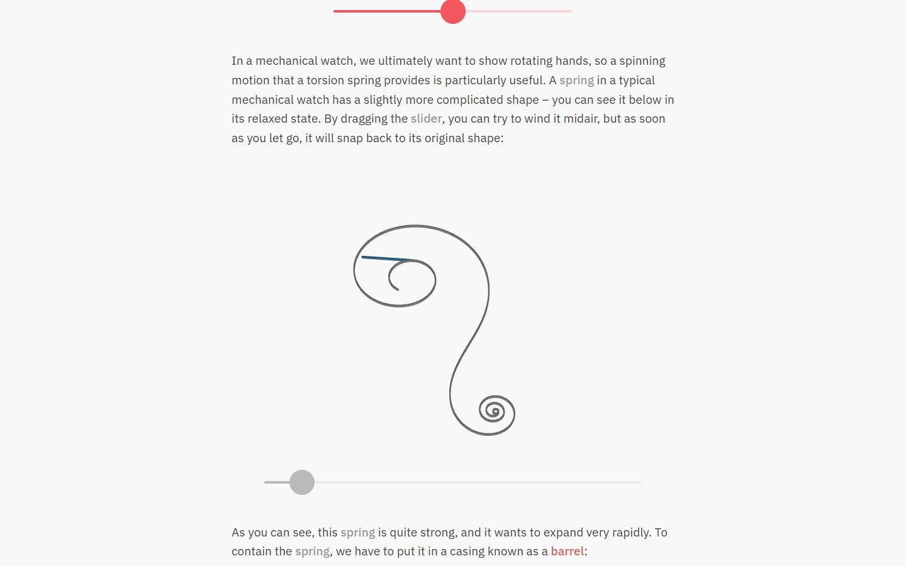
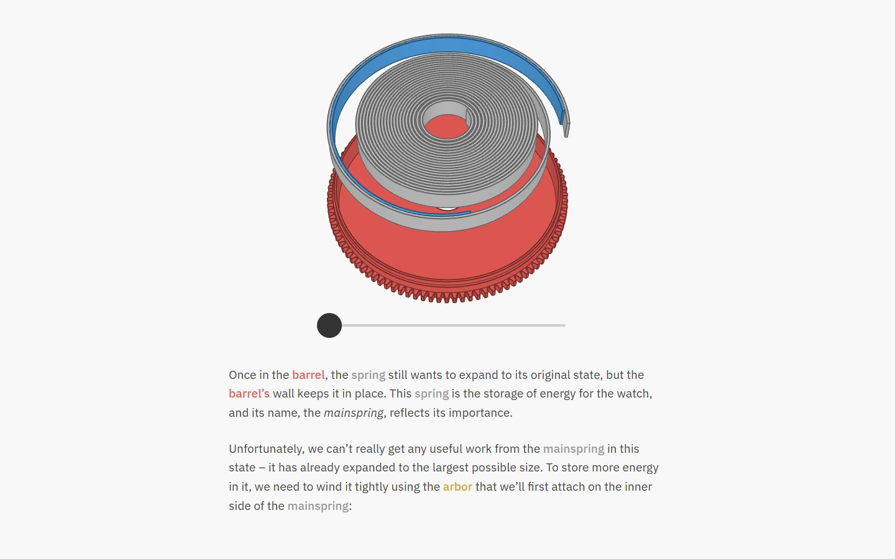
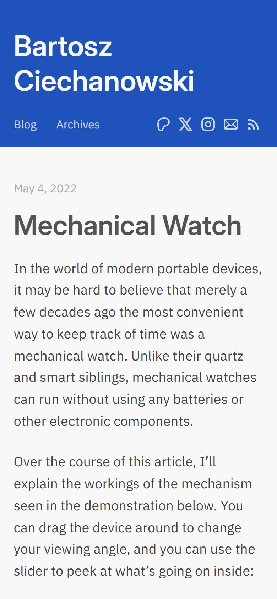

# Mechanical Watch, Bartosz Ciechanowski

<!-- gallery:start -->

<a href="../../README.md#writing-and-personal-sites">All sites</a> &nbsp;&nbsp; <a href="../maggie-appleton/teardown.md">&larr; Maggie Appleton</a> &nbsp;&nbsp; <a href="../playdate/teardown.md">Playdate &rarr;</a> &nbsp;&nbsp; <a href="https://ciechanow.ski/mechanical-watch/">Open the live site</a>

<!-- gallery:end -->

Looked at on 2026-10-28. https://ciechanow.ski/mechanical-watch/

**The idea:** explain a watch by building it: live 3D demos, with each part's name coloured to match.

## What you see

A blue header, then one column of IBM Plex Sans, 44 rem wide, at a line height of 1.6. Every few paragraphs the text stops for a demo: a flat-shaded 3D model you can drag, with a slider and a pause or reset button under it. Part names in the prose are coloured to match the parts in the nearby demo: barrel in red, mainspring in grey, arbor in gold. The text says so early on, and the next paragraph links a pause for every animation on the page. The title and headings are Inter.

## Stack

| Layer | What |
|---|---|
| Code | Hand-written `base.js` and one `watch.js` (327 KB uncompressed) using WebGL and 2D contexts; 93 canvases; no libraries |
| Hosting | nginx on Ubuntu |
| Fonts | IBM Plex Sans for text, Inter for headings, from Google Fonts |
| Colour coding | `` and 13 other colour classes |
| Weight | 2,153 KB over 14 requests |
| Reduced motion | No `prefers-reduced-motion` rule; the text offers a global pause instead |

## Steal

- Colour as a glossary: a term in the text and its part in the figure share one colour, so no legend is needed.
- The figure sits in the text column at the moment it is described, with its control right under it.
- A global pause for all motion, offered in the prose.
- One plain sans at a comfortable measure; the demos carry the visual interest.

## Don't steal

- Nothing on the banned list.
