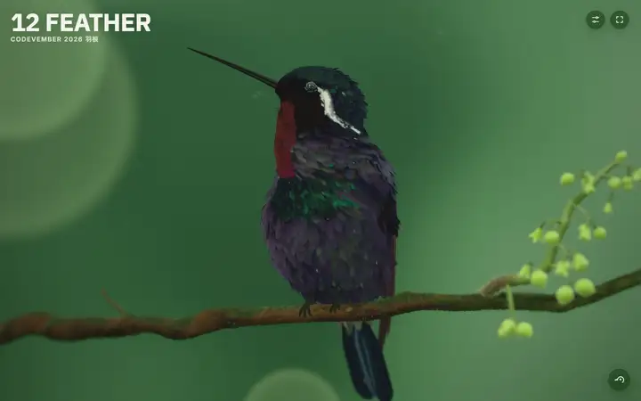
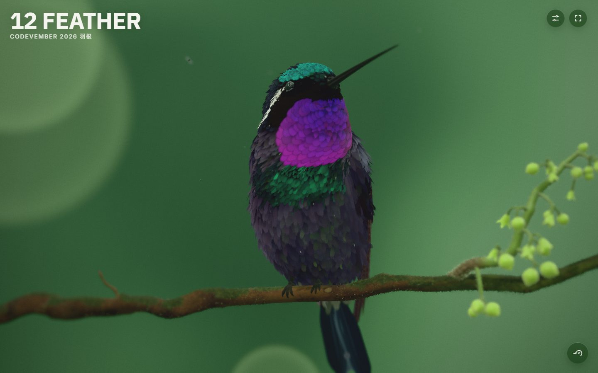
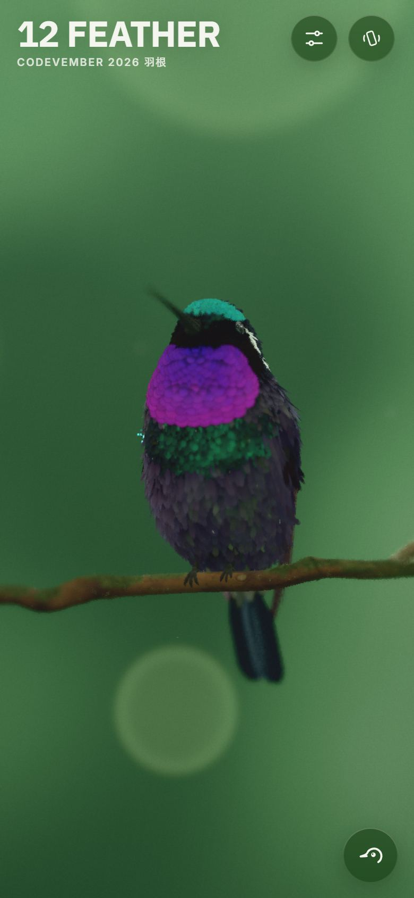

# Feather (T. Tillberg, Codevember 12)

<!-- gallery:start -->

<a href="../../README.md#worlds">All sites</a> &nbsp;&nbsp; <a href="../crimson-loong/teardown.md">&larr; Crimson Loong</a> &nbsp;&nbsp; <a href="../izakaya-sakura/teardown.md">Izakaya Sakura &rarr;</a> &nbsp;&nbsp; <a href="https://ttillberg.github.io/codevember-2026/12/">Open the live site</a>

<!-- gallery:end -->

Looked at on 2026-11-14. https://ttillberg.github.io/codevember-2026/12/
Found on the Three.js X page (posted 2026-11-12, the most liked of that week's links).

**The idea:** one hummingbird on a branch, and the feathers change colour as it turns.

## What you see
A hummingbird perched on a thin branch, in profile, against an out-of-focus green background with large soft discs of light. The throat is violet, the crown and chest green, the body dark. Each feather is a separate piece and catches light on its own. Berries hang on the branch to the right. The title "12 FEATHER" sits top left in heavy capitals. Three round buttons: settings, fullscreen, reset.

## Stack
| Layer | What |
|---|---|
| 3D | three.js r187, WebGL. The site calls it a rigged hummingbird |
| Model | glTF, with Draco, Meshopt and KTX2 support bundled |
| Fonts | IBM Plex Sans, Inter |
| Weight | 5.2 MB, 231 KB of it JavaScript. 4 requests |
| Pixel ratio | Capped at 2, and 1.5 on phones |
| Hosting | GitHub Pages |

## Steal
- One object, shot like a photograph: long lens, shallow focus, plain backdrop in a colour that sets off the subject.
- Colour that depends on the viewing angle. It is the reason to turn the bird.
- Many small parts that each catch light. Feathers here; it works for anything with surface detail.
- A lower pixel ratio on phones.
- Four requests in total.

## Don't steal
- The soft light discs in the background are close to a stock bokeh look. Use a real out-of-focus scene.
