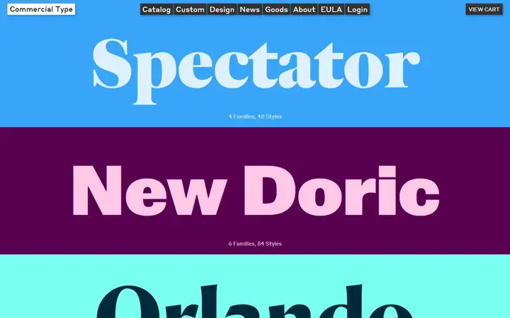
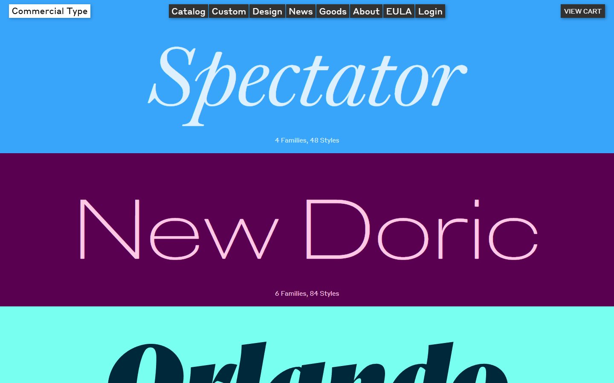
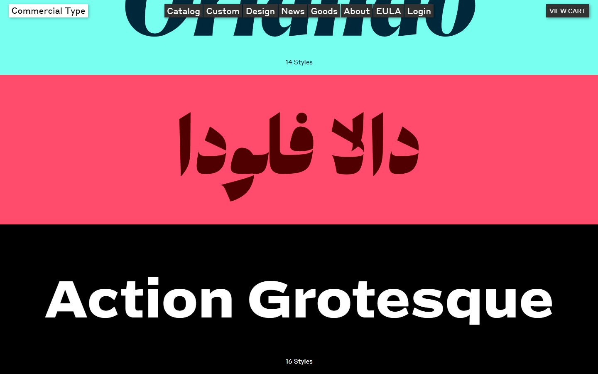
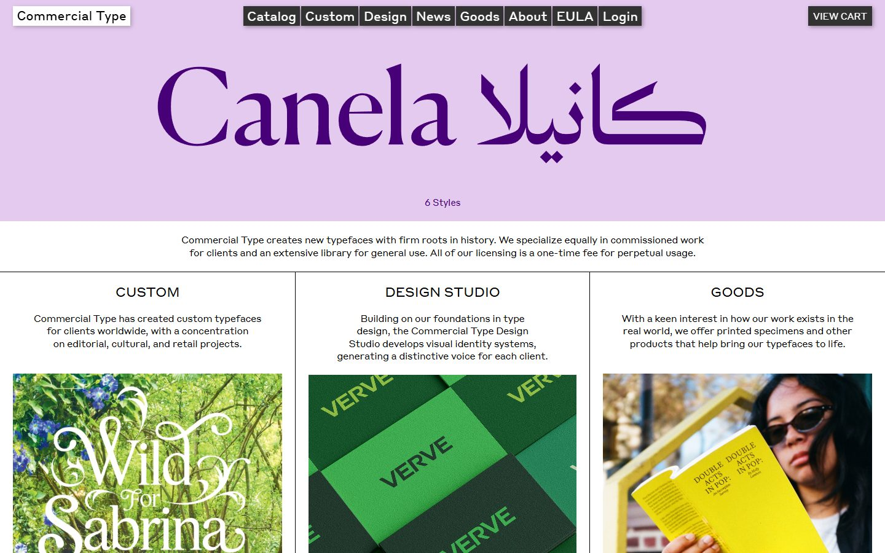
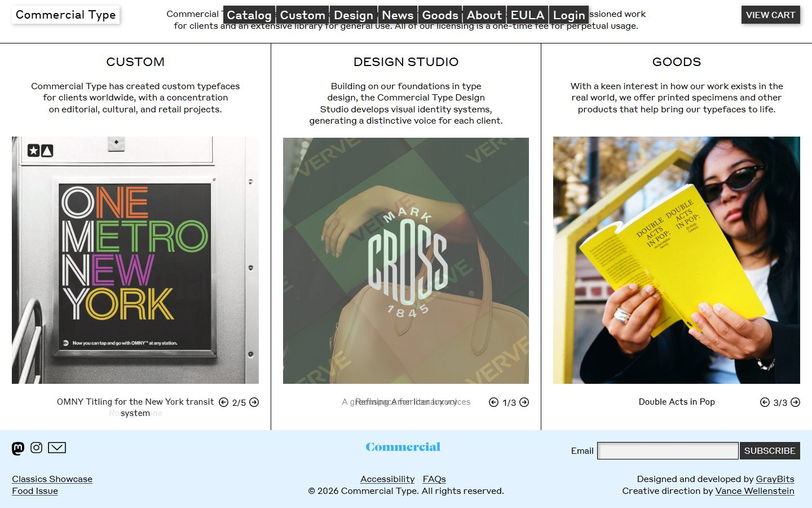
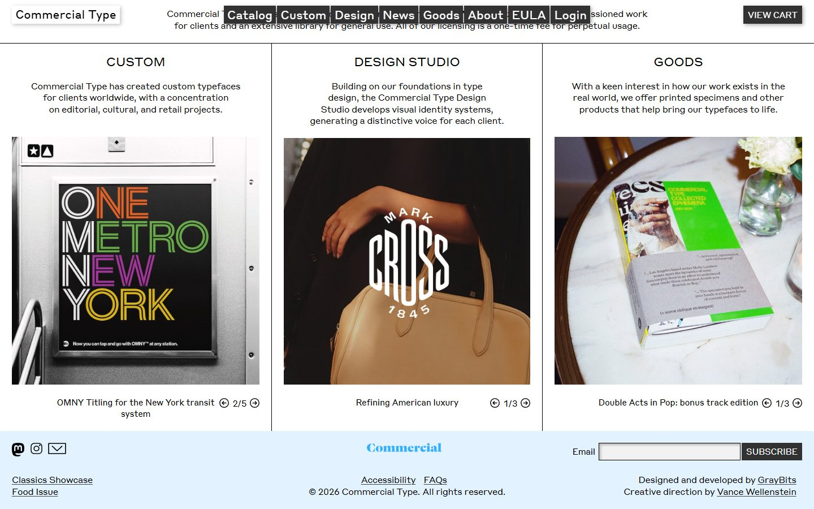
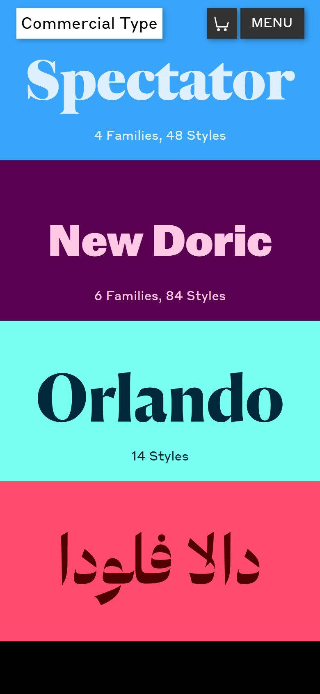

# Commercial Type

<!-- gallery:start -->

<a href="../../README.md#type-foundries-and-editorial">All sites</a> &nbsp;&nbsp; <a href="../oh-no-type/teardown.md">&larr; OH no Type Company</a> &nbsp;&nbsp; <a href="../stripe-press/teardown.md">Stripe Press &rarr;</a> &nbsp;&nbsp; <a href="https://www.commercialtype.com">Open the live site</a>

<!-- gallery:end -->

Looked at on 2026-10-28. https://www.commercialtype.com

**The idea:** a stack of colour bands, each with one family's name set live in that family.

## What you see

Each band fills the width, about 360 px tall, with one name set huge and centred in two colours picked for that family: pale blue on blue for Spectator, pink on plum for New Doric, navy on aqua for Orlando. One small line underneath counts the styles. The names are live text in variable fonts with a set duration per band, and the phone capture shows Spectator and New Doric in different styles from the desktop one. After the bands come one sentence about the foundry and three columns split by hairline rules, each with a carousel of real work.

## Stack

| Layer | What |
|---|---|
| Generator | GrayMatter (meta tag), by GrayBits per the footer; nginx with Phusion Passenger |
| Fonts | Styrene UI A and B for the interface; Spectator, New Doric and Action Grotesque loaded for the bands |
| Motion | Each band has a variable-font id and a `data-duration` (12 s for Spectator) |
| Weight | 4,135 KB over 140 requests: 2,330 KB images, 1,023 KB fonts, 556 KB JS |
| Reduced motion | No `prefers-reduced-motion` rule |

## Steal

- The name is the link, the specimen and the heading at once.
- Two colours per band, chosen per family. No images, no gradients.
- Motion from the subject: each band moves through its variable font's own range.
- Hairline column rules instead of cards in the section below.

## Don't steal

- Nothing on the banned list.
- Once you scroll, the fixed nav sits on top of the intro sentence. Give a fixed bar its own background or space.
