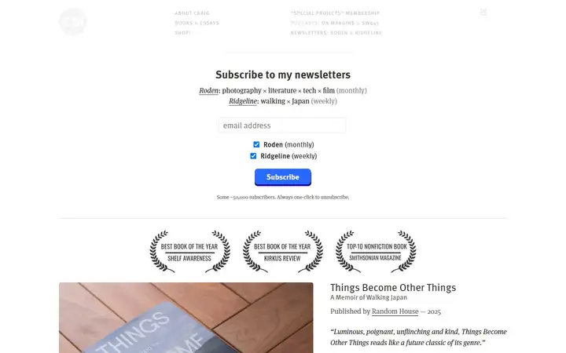
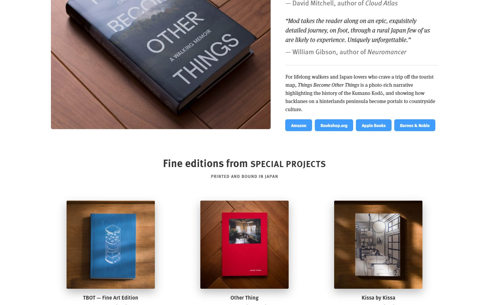
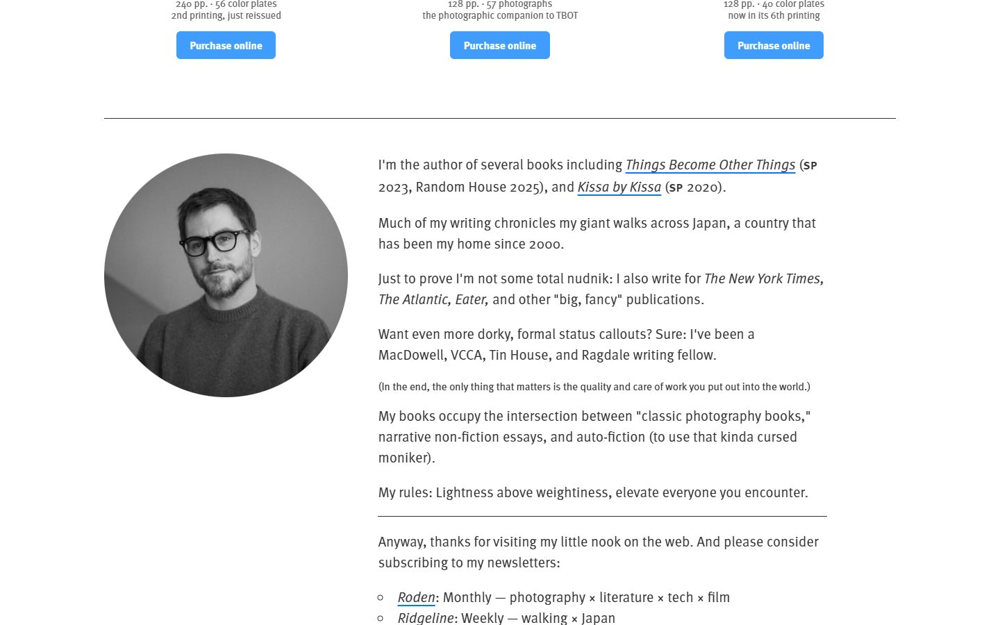
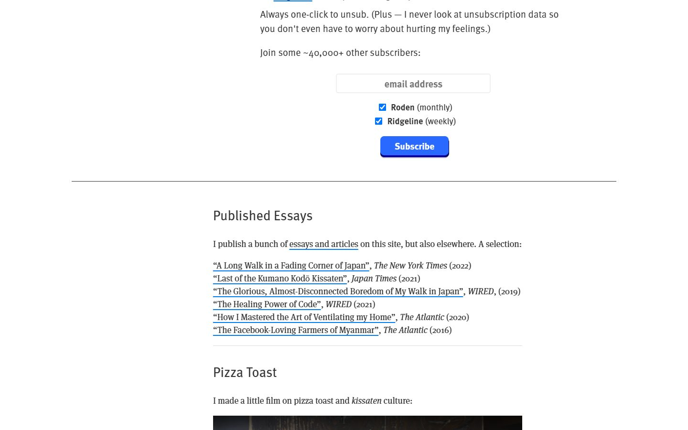
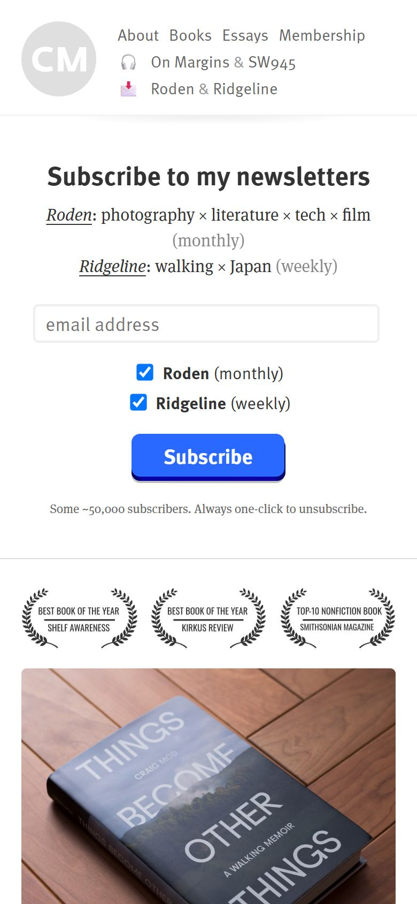

# Craig Mod

<!-- gallery:start -->

<a href="../../README.md#writing-and-personal-sites">All sites</a> &nbsp;&nbsp; <a href="../robin-sloan/teardown.md">&larr; Robin Sloan</a> &nbsp;&nbsp; <a href="../rauno/teardown.md">Rauno Freiberg &rarr;</a> &nbsp;&nbsp; <a href="https://craigmod.com">Open the live site</a>

<!-- gallery:end -->

Looked at on 2026-10-28. https://craigmod.com

**The idea:** sell the printed books with photos of the real objects and words from real readers.

## What you see

The page opens with a newsletter form, not a portrait. Each newsletter gets one line with × between its topics. Below, three laurels name real awards, then the new book: a photo of the hardcover on a wood floor beside the title, publisher and blurbs in italic serif. The fine editions follow as three photos shot the same way, each with page count and plate count. FF Meta and FF Meta Serif alternate: sans for headings and nav, serif for blurbs and the essay list, with oldstyle figures in the prose.

## Stack

| Layer | What |
|---|---|
| Generator | Hugo 0.166.0 |
| Hosting | Cloudflare |
| Grid | `1140.css`, a 1140 px column grid; the content spans 1140 px |
| Fonts | FF Meta and FF Meta Serif from Adobe Fonts (Typekit) |
| Weight | 828 KB over 27 requests: 758 KB images, 20 KB JS. Typekit fonts were not counted |
| Reduced motion | Yes, the CSS has `prefers-reduced-motion` rules |

## Steal

- One photo setup (wood floor, side light) for every book, so the shop reads as one shelf.
- Real blurbs set as quotes with attribution, in serif italic, right beside the product.
- Concrete specs under each edition: page count, number of plates, which printing.
- Sans and serif from one family doing two jobs: sans for structure, serif for voice.

## Don't steal

- The desktop nav in tiny, pale, letter-spaced caps. It is close to the banned kicker label and hard to read; the phone nav in normal case is better.
- "PRINTED AND BOUND IN JAPAN" in small spaced caps under a heading, for the same reason.
- The laurels work only because the awards are real. Never fake them.
