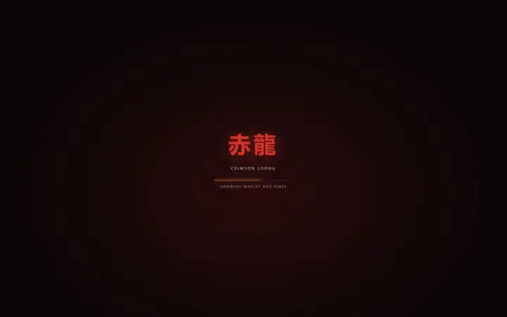
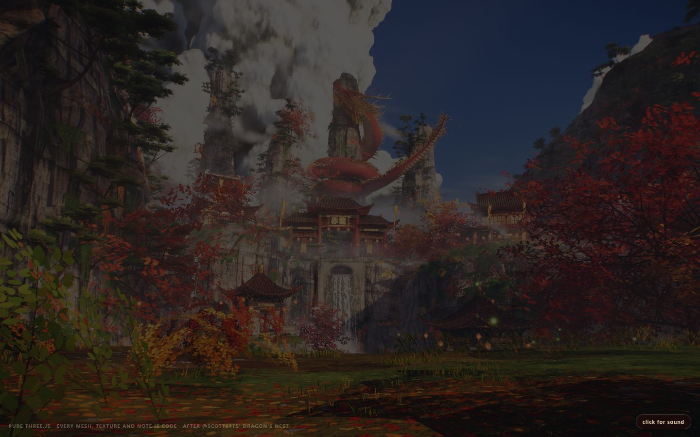
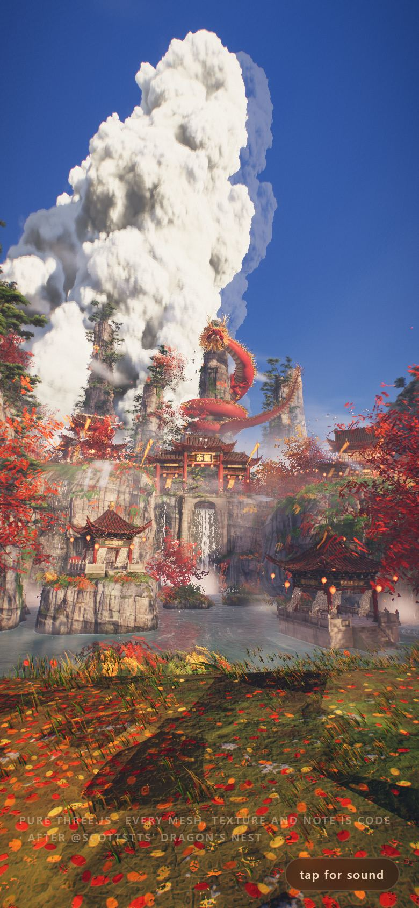

# Crimson Loong

<!-- gallery:start -->

<a href="../../README.md#worlds">All sites</a> &nbsp;&nbsp; <a href="../nightclub-driftspeed/teardown.md">&larr; NightClub: Drift & Speed</a> &nbsp;&nbsp; <a href="../codevember-tillberg-12/teardown.md">Feather (T. Tillberg, Codevember 12) &rarr;</a> &nbsp;&nbsp; <a href="https://chetaslua.github.io/crimson-loong/">Open the live site</a>

<!-- gallery:end -->

Looked at on 2026-11-14. https://chetaslua.github.io/crimson-loong/
Found on the Three.js X page (posted 2026-11-13). The page credits the idea to @scottstts' Dragon's Nest.

**The idea:** a short film of a dragon temple in a gorge, with every mesh, texture and note written as code.

## What you see
A valley between tall limestone cliffs. A temple gate with curved roofs stands in the middle, a red dragon coiled above it, a waterfall under the gate. Red maples frame both sides, with leaves on the grass in front. Cloud sits between the cliffs. The light is late and low. A loading card shows the name in Chinese and English, and "click for sound" waits bottom right.

## Stack
| Layer | What |
|---|---|
| 3D | three.js r187, WebGL, in one 2 MB HTML file with the code left readable |
| Assets | None. Geometry, textures and sound are generated in the page |
| Light | One warm sun `(1.0, 0.66, 0.38)` at intensity 6.9, a hemisphere light (blue sky, brown ground) at 1.15, a cool second directional, two orange point lights |
| Shadows | PCF soft, one 4096 map |
| Colour | Renderer tone mapping off. The page grades the picture itself, from half-float render targets |
| Fog | Exponential, very thin (0.001) |
| Hosting | GitHub Pages |

## Steal
- Warm key, cool fill. The sun is orange, the sky light is blue, and the two never match.
- Cloud shadows that move across the ground and slide down the cliffs. The code times one to reach the gate at 8 seconds and leave by 14.
- Render to half-float, then grade. Bright sun and dark gorge both keep detail.
- A foreground frame: branches at both edges, leaves at the bottom, subject in the gap.
- Sound waits for a click.
- The source is readable. Open it and read the comments.

## Don't steal
- The uppercase letter-spaced credit line.
- A camera on rails with no way to look around, for anything meant to be used.
