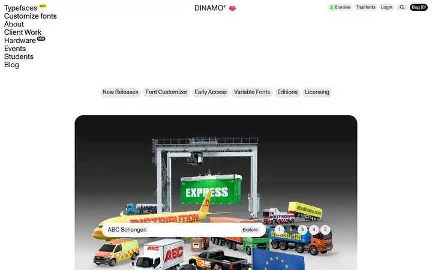
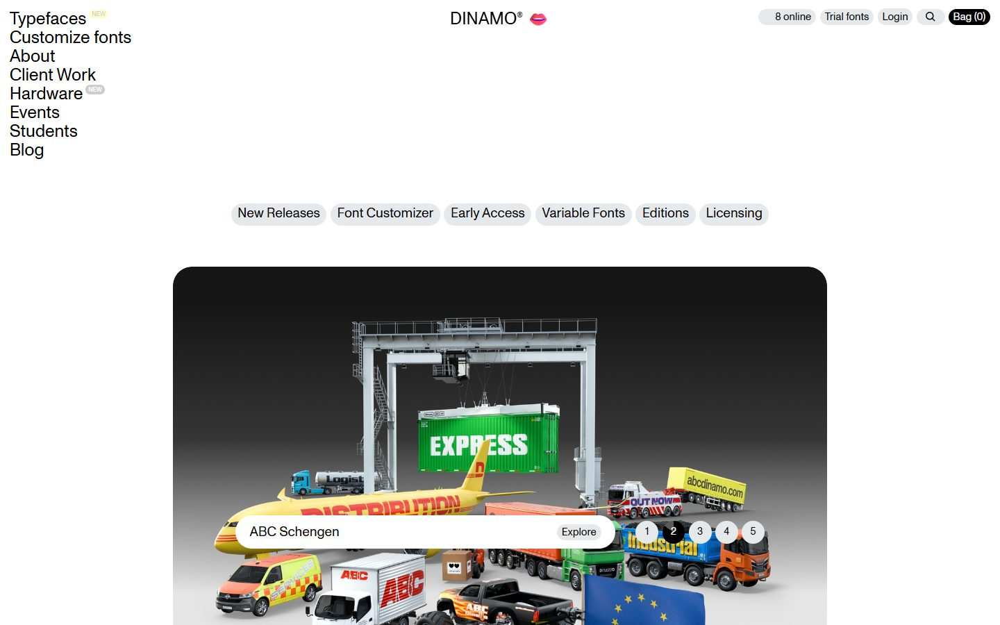
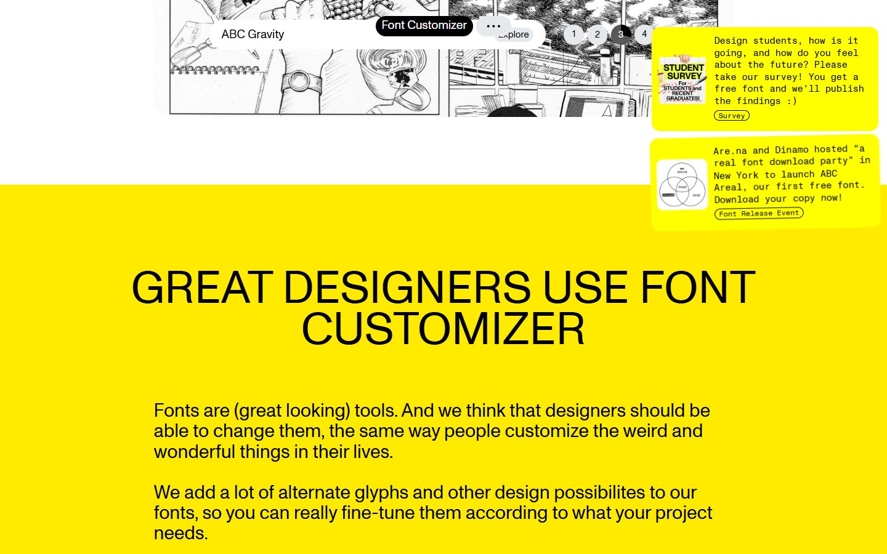
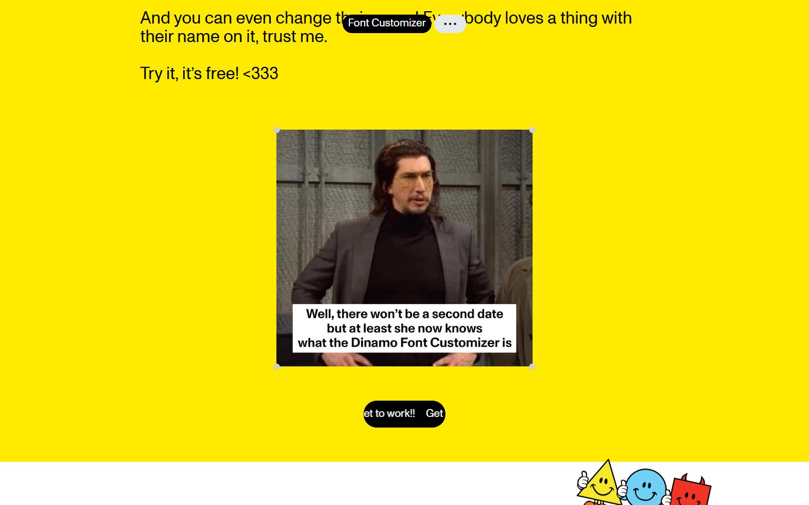
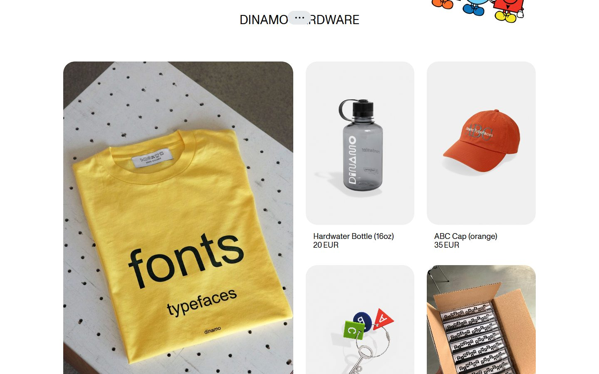
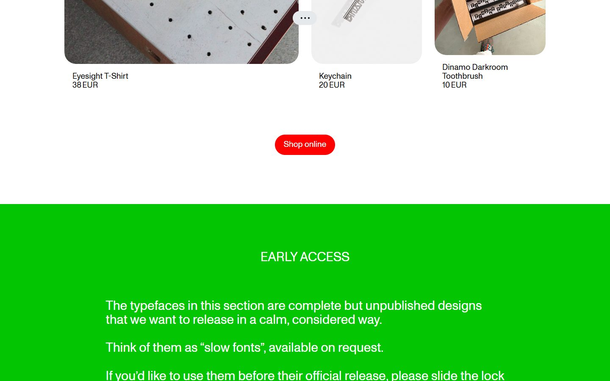
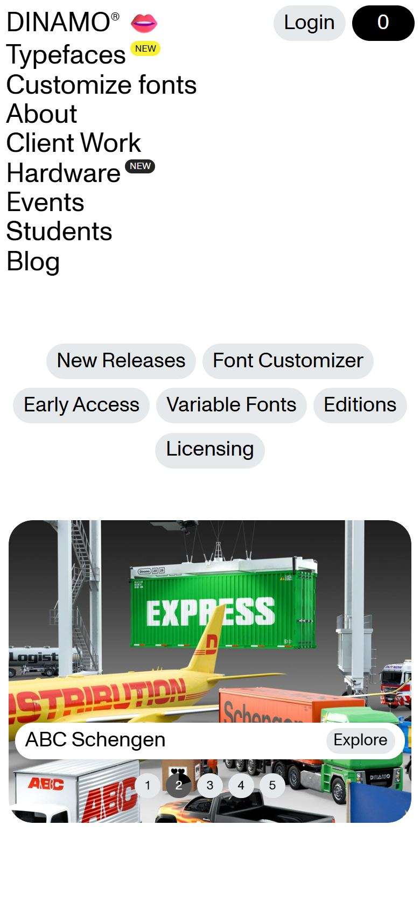

# Dinamo

<!-- gallery:start -->

<a href="../../README.md#type-foundries-and-editorial">All sites</a> &nbsp;&nbsp; <a href="../grilli-type/teardown.md">&larr; Grilli Type</a> &nbsp;&nbsp; <a href="../oh-no-type/teardown.md">OH no Type Company &rarr;</a> &nbsp;&nbsp; <a href="https://abcdinamo.com">Open the live site</a>

<!-- gallery:end -->

Looked at on 2026-10-28. https://abcdinamo.com

**The idea:** a type shop run like a fan club, with everything set big in the house grotesk.

## What you see

The nav is a plain stacked list of words top left at about 24 px, with "NEW" badges. The wordmark sits centred next to a lips emoji, and a row of grey pills top right includes a live "8 online" count. Sections are full-width colour fields (yellow for Font Customizer, green for Early Access) with prose set at around 28 px in a centred column of about 70 characters. Yellow note cards float in the top-right corner, a meme sits in the middle of the pitch, and the merch grid has rounded photos with a name and price under each.

## Stack

| Layer | What |
|---|---|
| Rendering | Server-rendered HTML with Vue components in `x-template` script tags, served by nginx |
| Analytics | Plausible |
| Fonts | Monument Grotesk and Monument Grotesk Mono, Dinamo's own; more families load for the specimens |
| Weight | meta.json counts 186 KB over 190 requests with JS and fonts at 0 KB, so most bytes were not measured |
| Reduced motion | No `prefers-reduced-motion` rule |

## Steal

- The nav as plain words in a stacked list at reading size. No hamburger on desktop, no icons.
- One house family, grotesk plus its mono, from nav to prices.
- Long prose set big on a flat colour field with a sensible measure.
- Merch cards with only a name and a price under the photo.

## Don't steal

- The live "8 online" pill and the "NEW" badges.
- Note cards floating in the top-right corner, one of them slightly tilted.
- The meme, the marquee button, "<333" and a joke in most lines of copy.
- Rounded corners on every card and button.
