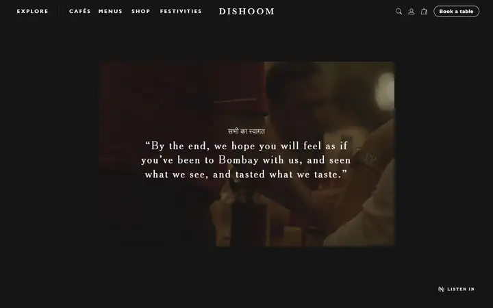
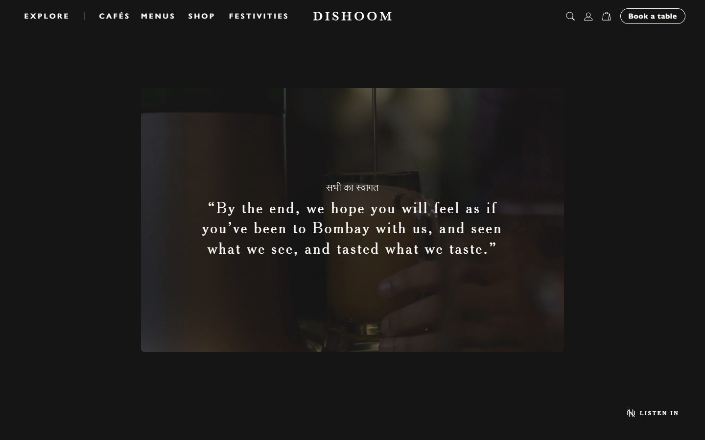
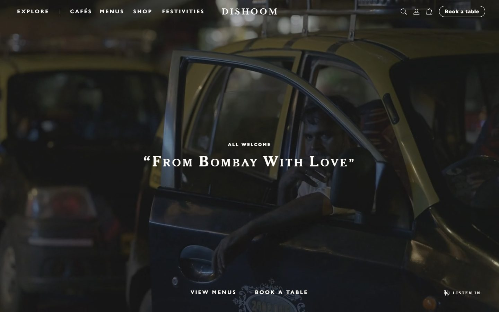
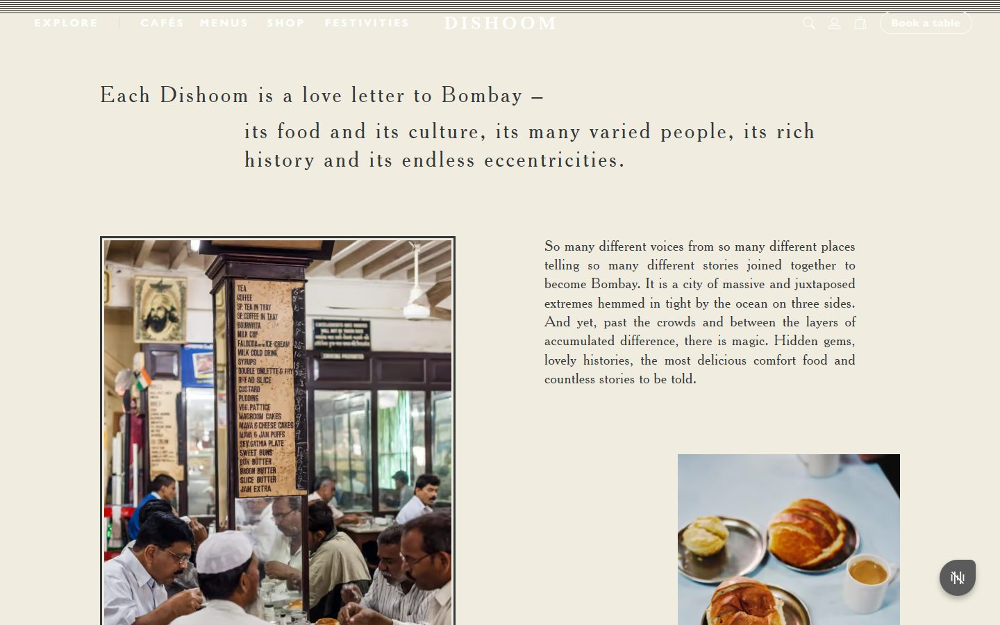
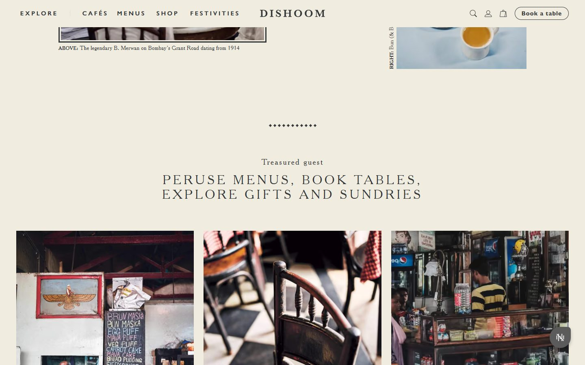
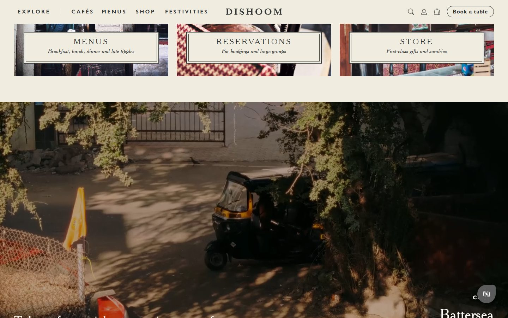
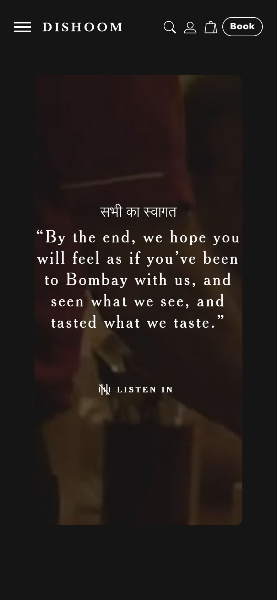

# Dishoom

<!-- gallery:start -->

<a href="../../README.md#restaurants">All sites</a> &nbsp;&nbsp; <a href="../shopify-editions/teardown.md">&larr; Shopify Editions Winter '26</a> &nbsp;&nbsp; <a href="../noma/teardown.md">noma &rarr;</a> &nbsp;&nbsp; <a href="https://www.dishoom.com">Open the live site</a>

<!-- gallery:end -->

Looked at on 2026-10-28. https://www.dishoom.com

**The idea:** An old Bombay Irani café told like a travel book: street film, captioned photos, signage.

## What you see
A framed film opens the page, with "सभी का स्वागत" (all welcome) over a quoted promise that you'll leave feeling you've been to Bombay. On scroll the film fills the screen: a taxi driver in night traffic, "From Bombay With Love", two text links. Then a cream page: a serif intro, an old café photo captioned like a book ("ABOVE: The legendary B. Merwan on Bombay's Grant Road"), three double-ruled cards for Menus, Reservations and Store, and another film introducing a café.

## Stack
| Layer | What |
|---|---|
| Hosting | Vercel |
| Framework | Next.js, Tailwind classes in the markup |
| Content | Sanity (225 cdn.sanity.io image URLs in the HTML) |
| Structured data | 13 schema.org `Restaurant` entries: address, phone, geo, hours, menus, `acceptsReservations` |
| Type | Cheltenham BT, Gill Sans Nova |
| Weight | 2.7 MB, 232 requests, 1.3 MB of it JS; the HTML is 1.2 MB |
| Motion | Has a `prefers-reduced-motion` rule |

## Steal
- Film your own street and room, run it full-bleed, one line on top, with a greeting in the home language above the English. A real place beats food close-ups.
- Caption photos like a book: ABOVE:, RIGHT:, then what and where it is.
- Three doors (Menus, Reservations, Store), each with a short italic line, framed like an old café board.
- One `Restaurant` JSON-LD block per location with hours and menu links.

## Don't steal
- "ALL WELCOME" in small spaced caps above the heading is a kicker label (serif, not mono, same move).
- The "Listen in" sound button floats in the bottom-right corner on every screen: a floating corner chip.
- The row of diamonds is ornament with little reason.
- 232 requests and 1.3 MB of JS for photos and text.
