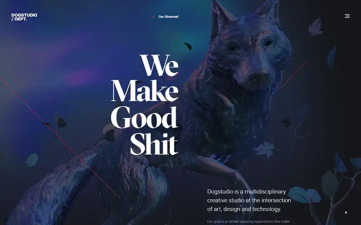
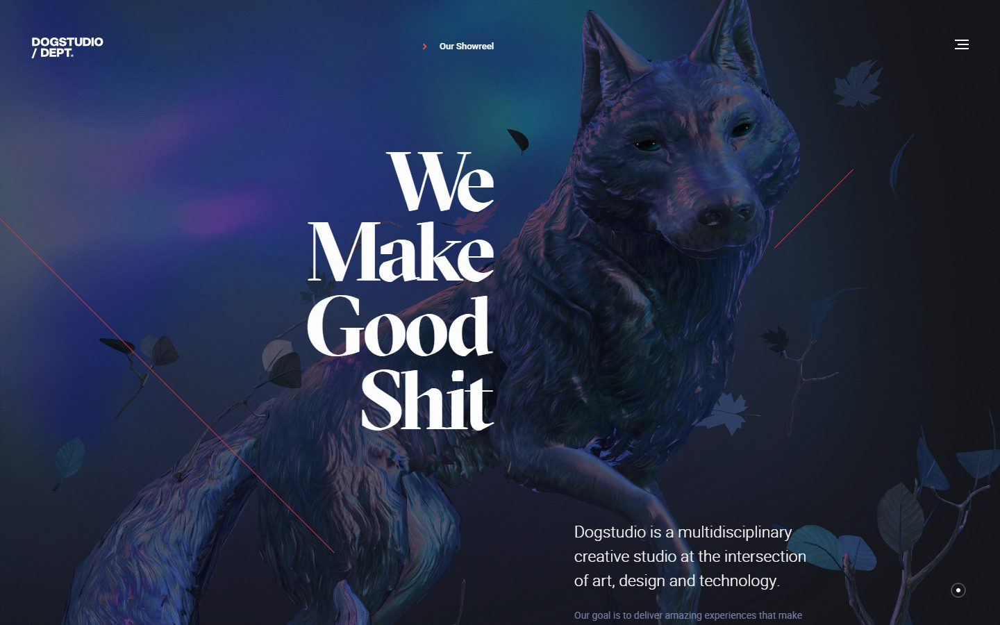
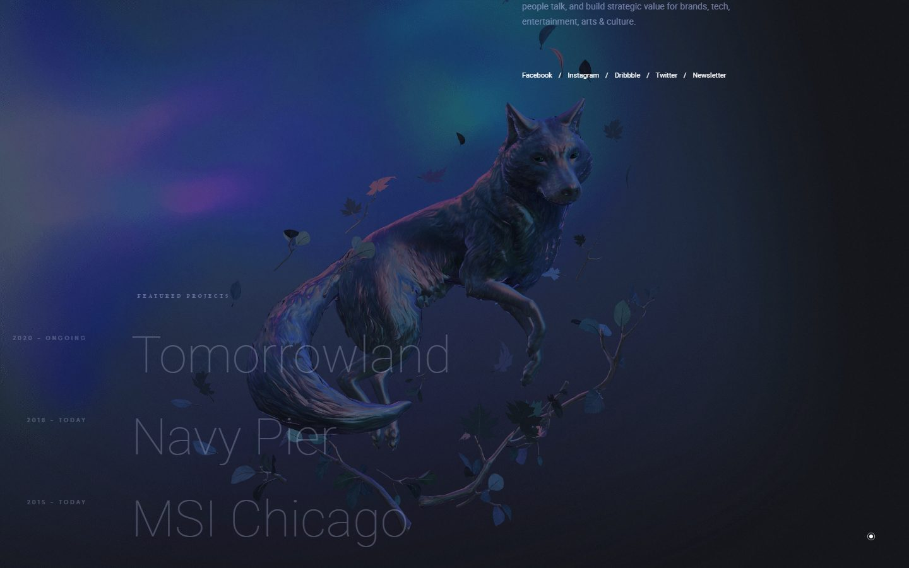
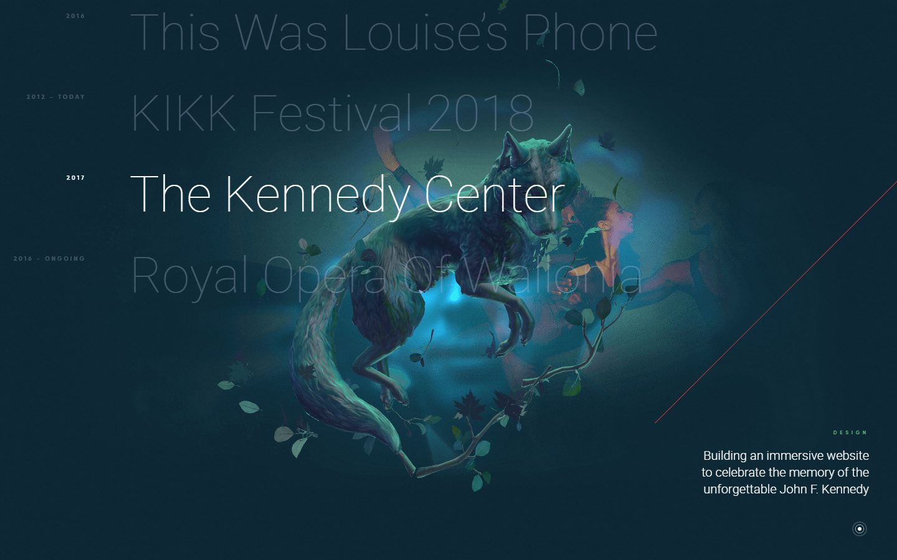
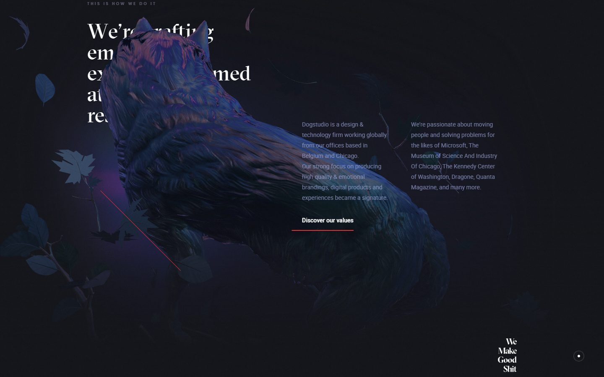
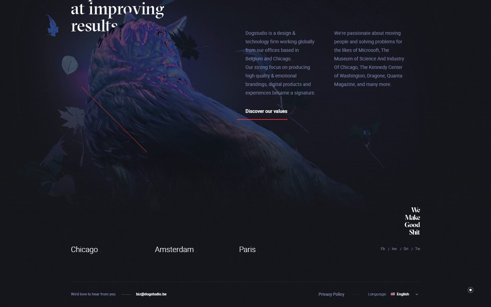
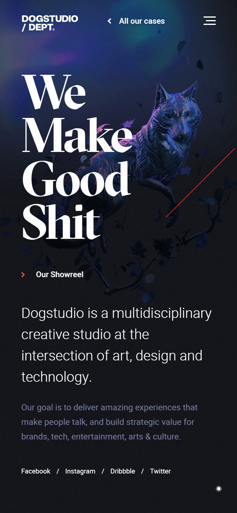

# Dogstudio

<!-- gallery:start -->

<a href="../../README.md#worlds">All sites</a> &nbsp;&nbsp; <a href="../bruno-simon/teardown.md">&larr; Bruno Simon</a> &nbsp;&nbsp; <a href="../unseen/teardown.md">Unseen Studio &rarr;</a> &nbsp;&nbsp; <a href="https://dogstudio.co">Open the live site</a>

<!-- gallery:end -->

Looked at on 2026-10-28. https://dogstudio.co

**The idea:** the studio's name made literal: a sculpted dog that takes on each project's colours.

## What you see
A dark page with a detailed dog sculpture lit blue and violet, leaves and branches drifting around it. The headline is four stacked words in a high-contrast serif. Scrolling changes the dog's pose: standing, leaping, seen from behind. The project list is huge thin type with years in a narrow column; the active project turns white and the dog and background shift colour with it (blue for Tomorrowland, teal for The Kennedy Center). One thin red diagonal line crosses several sections.

## Stack
| Layer | What |
|---|---|
| Framework | None detected |
| 3D | One WebGL canvas (1440x1190); no library detected from globals |
| Fonts | GT Sectra Display, Gilroy, Heebo; Typekit link in the HTML |
| Weight | 7.4 MB, 5.3 MB of it images, 55 requests |
| Reduced motion | No |
| Hosting | Cloudflare |

## Steal
- One mascot carries the whole site and is re-posed per section, instead of new imagery each time.
- The hero object takes the active project's colour, so list and picture stay linked.
- A project index of big names with dates beside them. It reads like a contents page.
- One red hairline as the only accent.

## Don't steal
- Tiny letter-spaced uppercase labels above sections: "FEATURED PROJECTS", "THIS IS HOW WE DO IT", "2020 - ONGOING". On the banned list.
- The drifting leaves. Nothing about dogs or the studio calls for them.
- Grey body text on near-black at small sizes.
