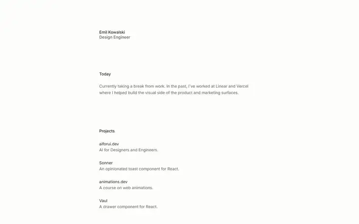
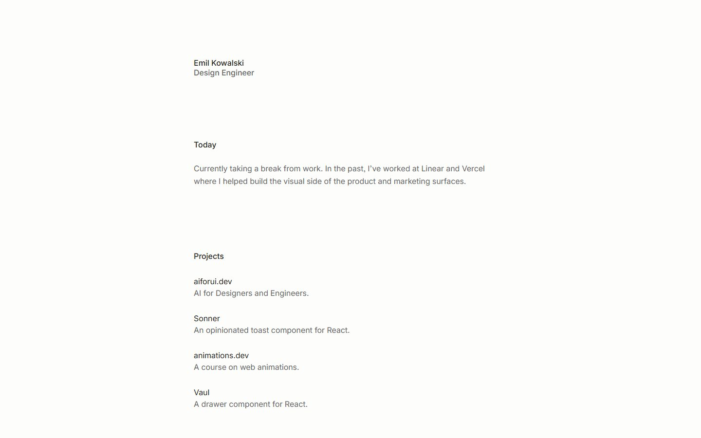
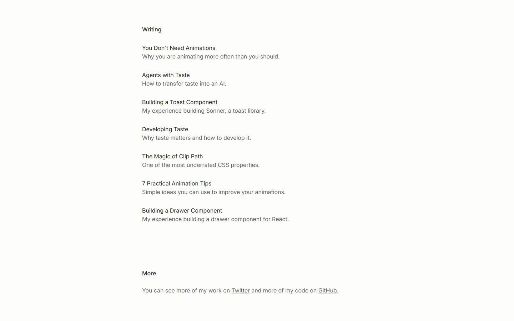
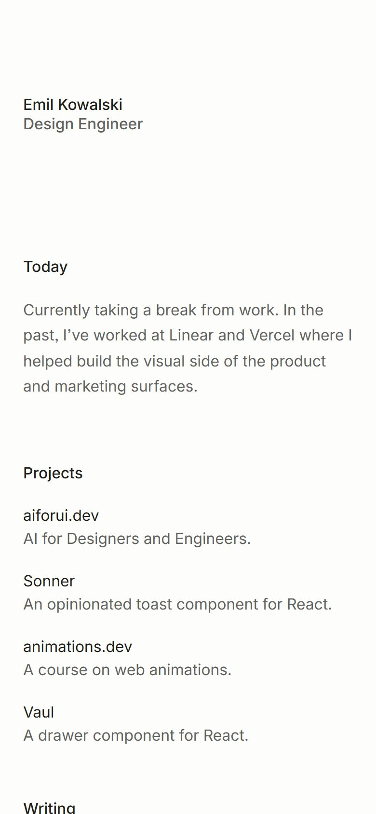

# Emil Kowalski

<!-- gallery:start -->

<a href="../../README.md#studios-and-motion-craft">All sites</a> &nbsp;&nbsp; <a href="../motion-dev/teardown.md">&larr; Motion</a> &nbsp;&nbsp; <a href="../josh-comeau/teardown.md">Josh W. Comeau &rarr;</a> &nbsp;&nbsp; <a href="https://emilkowal.ski">Open the live site</a>

<!-- gallery:end -->

Looked at on 2026-11-08. https://emilkowal.ski

**The idea:** the design engineer behind Sonner and Vaul keeps his own site to plain text; the motion lives in the writing.

## What you see
Nothing moves on the home page. One narrow column of small type on off-white: name, a line about now, projects, writing, links. The articles are where the craft is: each one has interactive demos you drag and toggle (clip-path, toasts, drawers), and "You Don't Need Animations" argues for animating less.

## Stack
| Layer | What |
|---|---|
| Framework | Next.js |
| Fonts | A system sans |
| Weight | 2.1 MB, 50 requests |
| Reduced motion | Has a `prefers-reduced-motion` rule |
| Hosting | Vercel |

## Steal
- The restraint. A person known for motion lets the home page be still, and the motion lives where it explains something.
- Read his articles before any motion work: when to animate, easing, durations, clip-path tricks. They're the best free course on UI motion.
- Projects listed as one line each: the name and what it is.

## Don't steal
- Nothing on the banned list. The risk is copying the minimal look without having the writing that makes it work.
