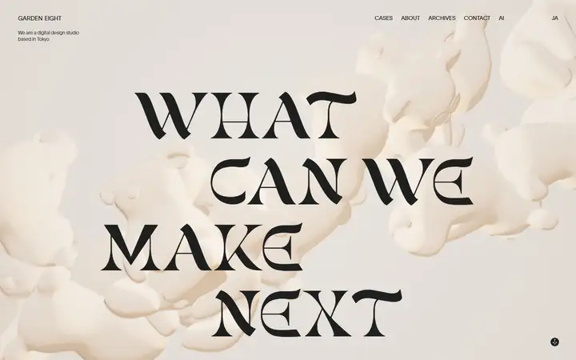
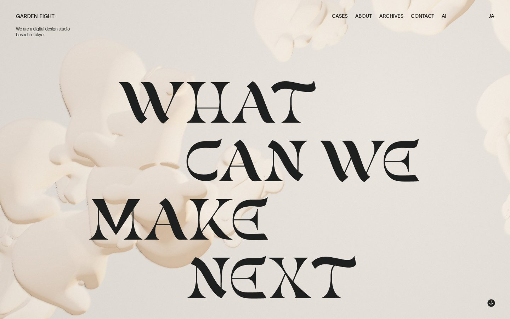
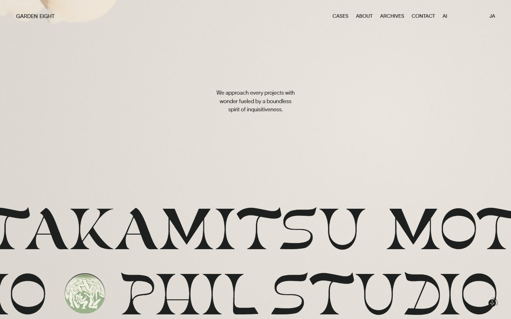
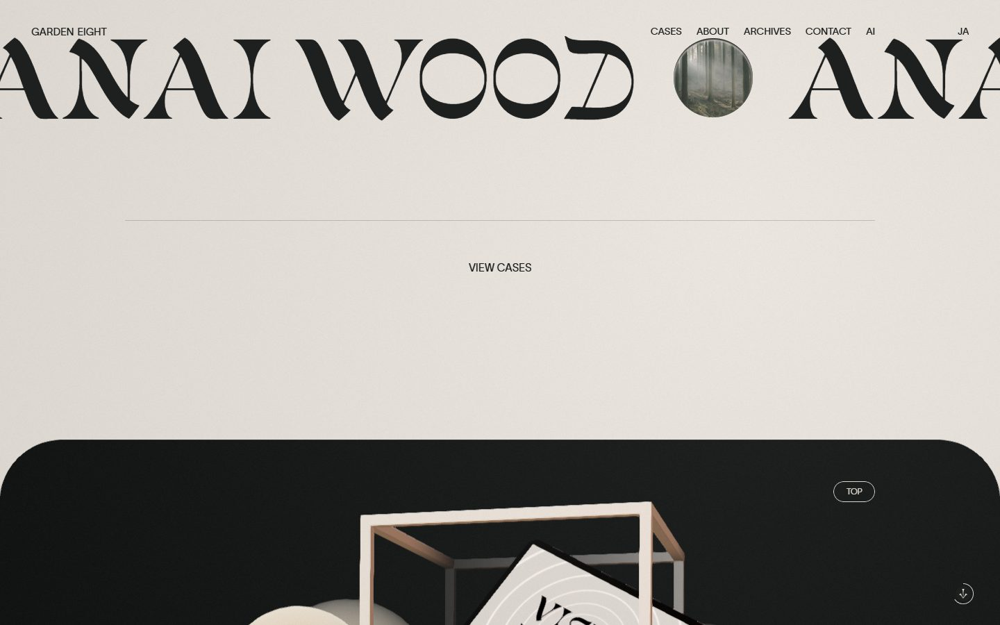
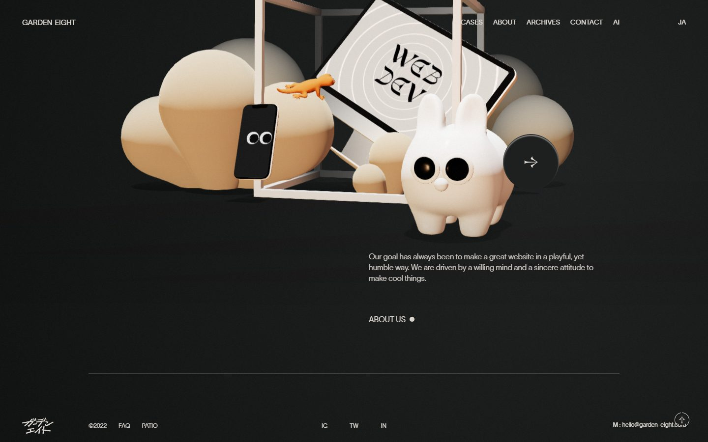
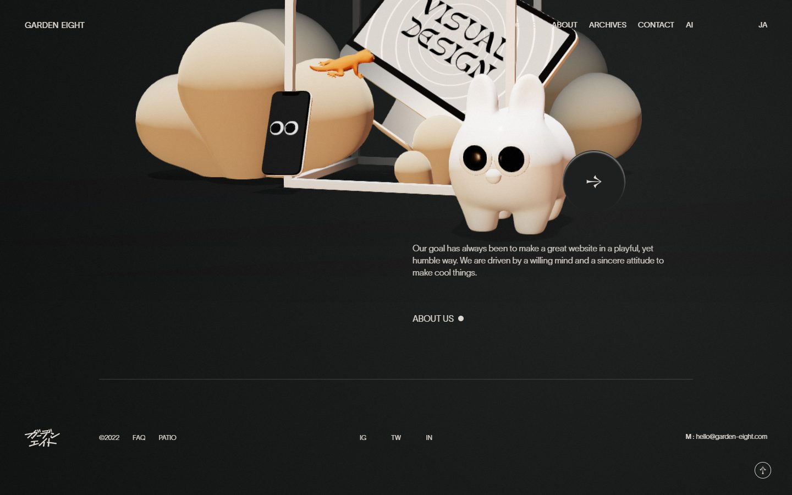
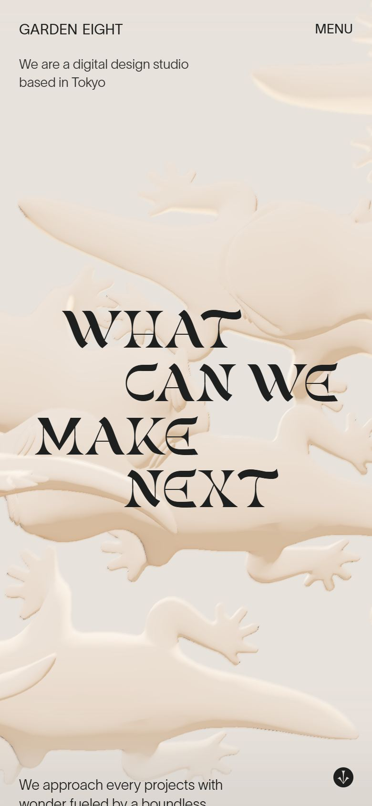

# Garden Eight

<!-- gallery:start -->

<a href="../../README.md#worlds">All sites</a> &nbsp;&nbsp; <a href="../oryzo/teardown.md">&larr; Oryzo</a> &nbsp;&nbsp; <a href="../resn/teardown.md">Resn &rarr;</a> &nbsp;&nbsp; <a href="https://garden-eight.com">Open the live site</a>

<!-- gallery:end -->

Looked at on 2026-10-28. https://garden-eight.com

**The idea:** playful but humble: clay-soft lizards and one strange serif on warm paper.

## What you see
A warm off-white page. Behind a four-line headline in a flared, calligraphic display serif, cream clay-like lizards drift in 3D. Client names slide sideways in the same serif at huge size, each followed by a round photo. The page ends in a dark rounded panel with a toy-like 3D still life: clouds, a wire cube, a tablet whose screen changes from "Web Dev" to "Visual Design", a phone with cartoon eyes, a white creature and a small orange lizard. The footer logo is the name in hand-written katakana.

## Stack
| Layer | What |
|---|---|
| Framework | Nuxt |
| 3D | three.js r133 |
| Motion | GSAP 3.12.1 |
| Fonts | gunsan (display), lausanne (text) |
| Weight | 1.9 MB (470 KB JS, 119 KB fonts), 75 requests |
| Reduced motion | No |
| Hosting | nginx |

## Steal
- One odd display face does all the character work. Everything else is a plain grotesk at small size.
- Client names as a marquee in that face, with a real photo between names.
- 3D in one soft material and one colour, so it sits behind the type instead of fighting it.
- Under 2 MB for a page with a 3D hero and a 3D footer.

## Don't steal
- Nothing on the banned list. The small dot after "ABOUT US" is the only borderline bit.
- The typo in "every projects". Proofread the one sentence you show.
