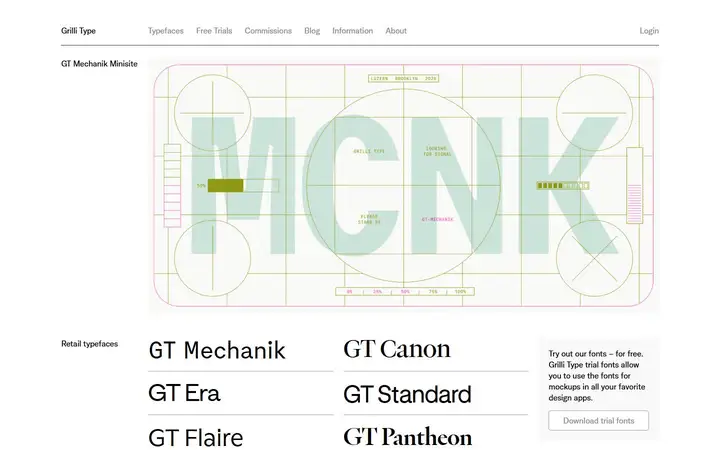
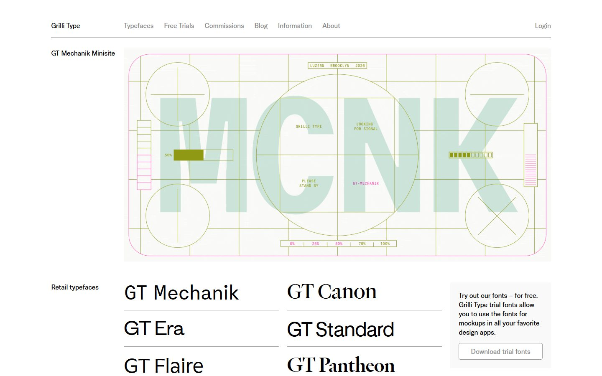
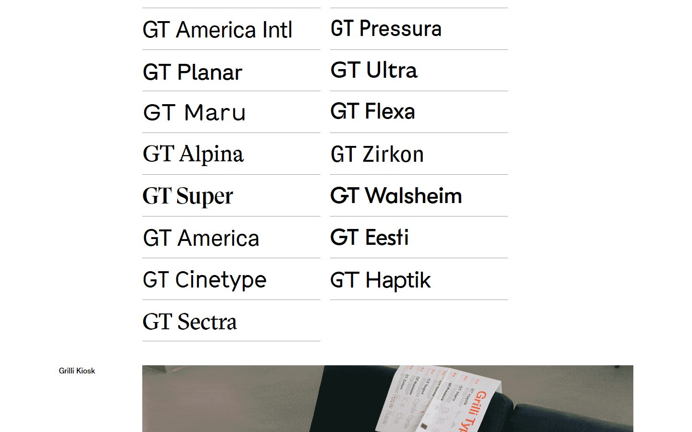
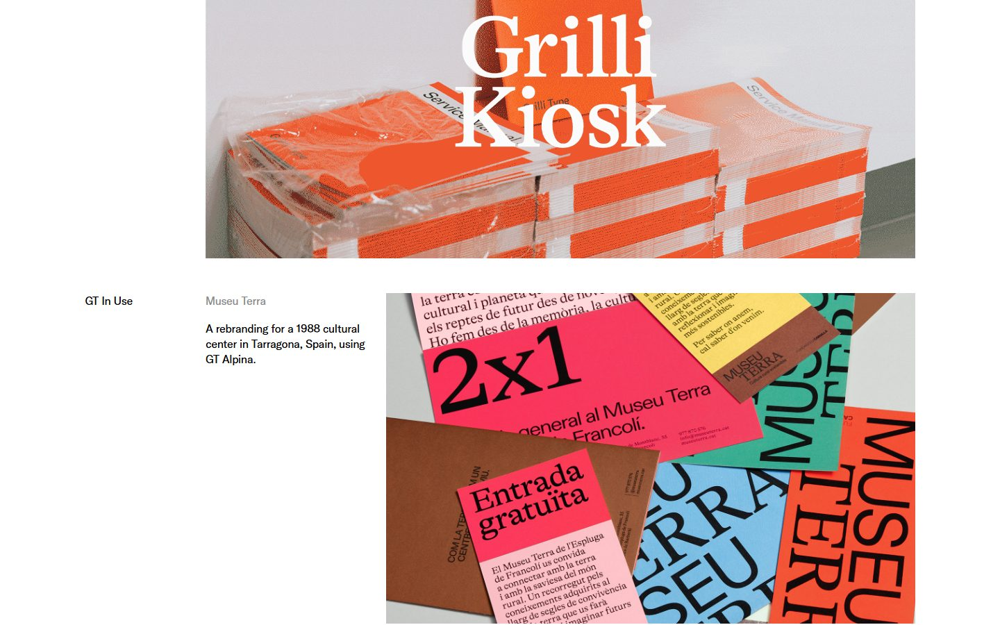
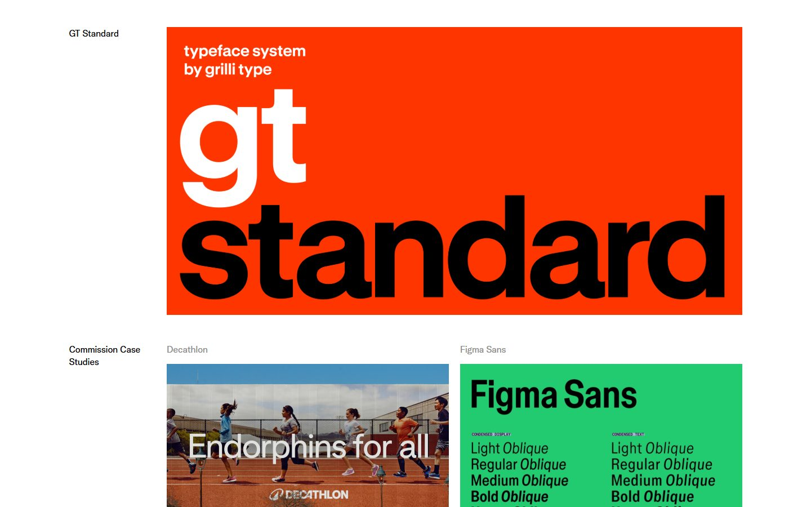
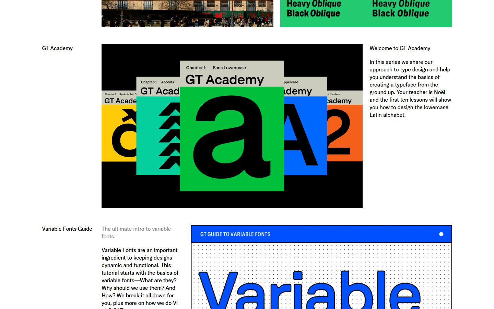
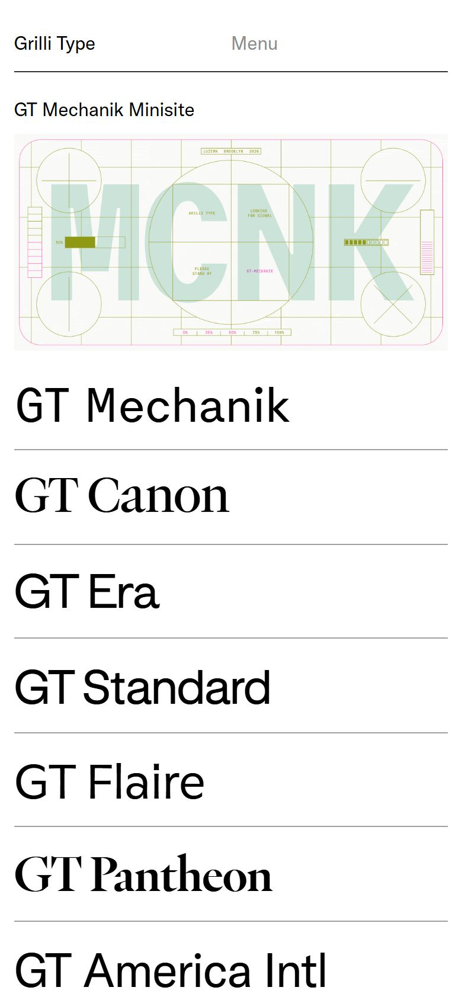

# Grilli Type

<!-- gallery:start -->

<a href="../../README.md#type-foundries-and-editorial">All sites</a> &nbsp;&nbsp; <a href="../klim/teardown.md">&larr; Klim Type Foundry</a> &nbsp;&nbsp; <a href="../dinamo/teardown.md">Dinamo &rarr;</a> &nbsp;&nbsp; <a href="https://www.grillitype.com">Open the live site</a>

<!-- gallery:end -->

Looked at on 2026-10-28. https://www.grillitype.com

**The idea:** a Swiss ruled index where every typeface name is set in its own face.

## What you see

A white page with a black rule under the nav. Every section starts with a plain label in the left column ("Retail typefaces", "GT In Use", "Commission Case Studies") and its content to the right. The retail list is two columns of names, each set at about 45 px in its own typeface, with grey hairlines between rows. Below come large images: a booklet photo, client work, a red GT Standard poster, and the GT Academy covers with a short paragraph beside them. On the phone the names stack one per row and keep their size.

## Stack

| Layer | What |
|---|---|
| Framework | Angular 9.0.1, rendered on the server (`ng-transition="serverApp"`), Express behind nginx 1.11.3 and CloudFront |
| Grid | CSS grid, 14 columns, 20 px gaps. Section labels take the first two columns; content runs from column 3 |
| Fonts | GT Corporate for the interface, plus each listed family loaded to set its own name: GT Era, Mechanik, Canon, Standard, Flaire, Pantheon, America |
| Weight | 13,094 KB over 56 requests: 9,371 KB images, 1,579 KB JS, 1,394 KB fonts |
| Reduced motion | No `prefers-reduced-motion` rule |

## Steal

- Name each family in itself. The list of names is the specimen.
- A hanging label column: section names in the first two of 14 columns, everything else hangs off column 3.
- Hairlines under list rows instead of cards or boxes.
- Interface type at one small size and one weight, so the specimens carry all the contrast.

## Don't steal

- Nothing on the banned list. The mono caps on the Mechanik banner are specimen art for a mono typeface.
- The weight: 13 MB for a home page, mostly images.
