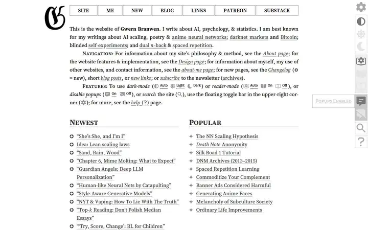
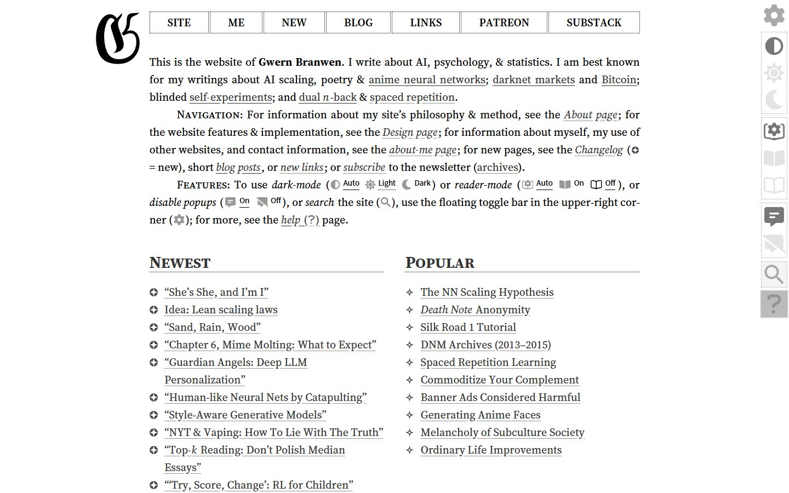
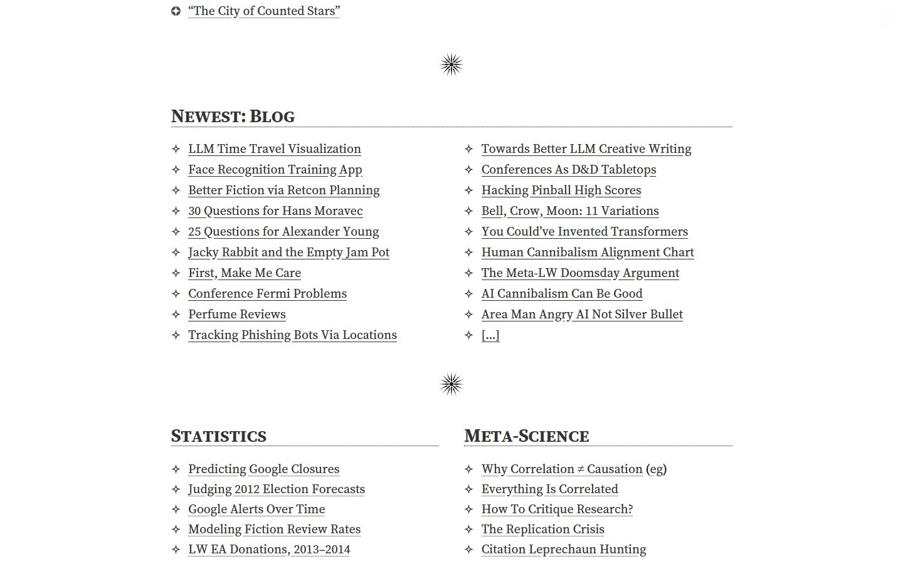
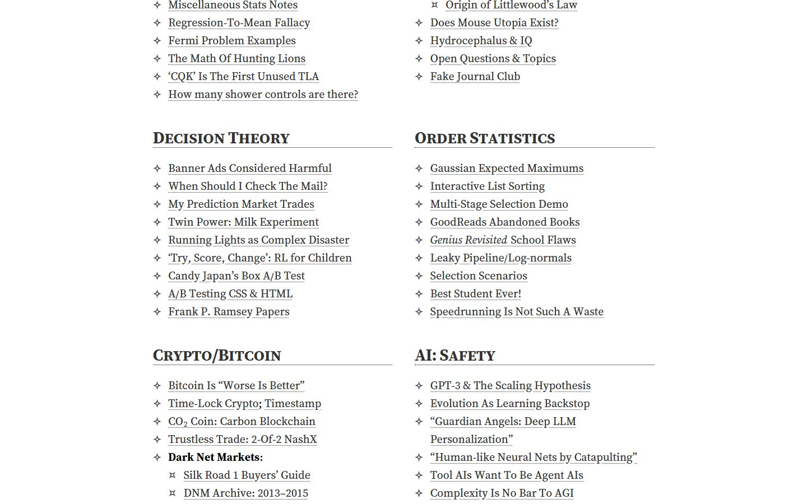
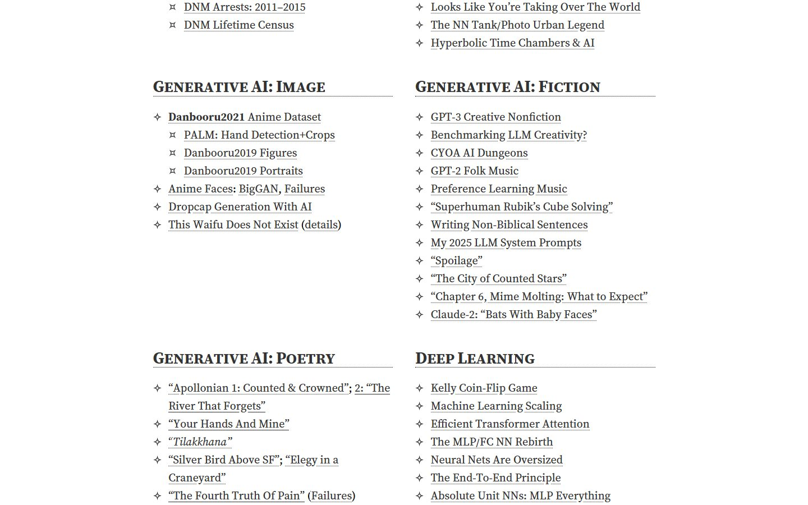
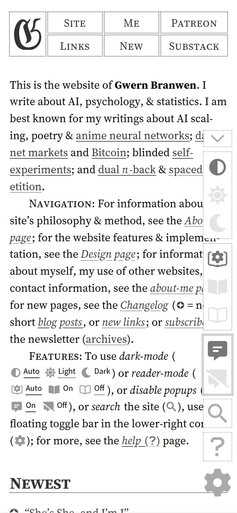

# Gwern.net

<!-- gallery:start -->

<a href="../../README.md#writing-and-personal-sites">All sites</a> &nbsp;&nbsp; <a href="../the-pudding/teardown.md">&larr; The Pudding</a> &nbsp;&nbsp; <a href="../robin-sloan/teardown.md">Robin Sloan &rarr;</a> &nbsp;&nbsp; <a href="https://gwern.net">Open the live site</a>

<!-- gallery:end -->

Looked at on 2026-10-28. https://gwern.net

**The idea:** an essay archive typeset like a scholarly book: justified serif, small caps, fleurons.

## What you see

One column of justified, hyphenated Source Serif 4, with indented paragraphs and no space between them. Paragraphs open with run-in small-caps heads, "Navigation:" and "Features:". The site index is two-column lists under small-caps heads with a dotted rule, and a starburst fleuron between sections. Bullets are glyphs with meanings: a four-point star for items, ¤ for sub-items, a circled plus for new pages. Links have dotted underlines. A toolbar for theme, reader mode, popups and search floats at the right edge.

## Stack

| Layer | What |
|---|---|
| Generator | Hakyll |
| Hosting | Cloudflare |
| Fonts | Source Serif 4 for text; Source Sans 3 and IBM Plex Mono for interface and code |
| Layout | CSS for sidenote columns on both sides; a 649 px breakpoint for phones |
| Weight | 875 KB over 26 requests: 280 KB fonts, 268 KB JS, 147 KB images |
| Reduced motion | No `prefers-reduced-motion` rule |

## Steal

- Book paragraphing: first-line indents, no gap between paragraphs, justified and hyphenated.
- Run-in small-caps heads inside the paragraph instead of a separate heading.
- Bullet glyphs that carry meaning (item, sub-item, new) instead of plain dots.
- Dotted underlines, so a paragraph dense with links stays readable.
- One fleuron between major sections.

## Don't steal

- Nothing on the banned list.
- The floating toolbar. On the phone it opens over the right edge of the text.
