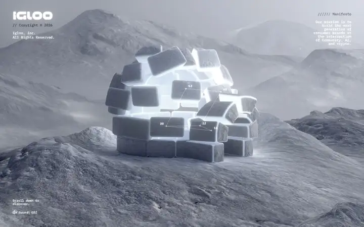
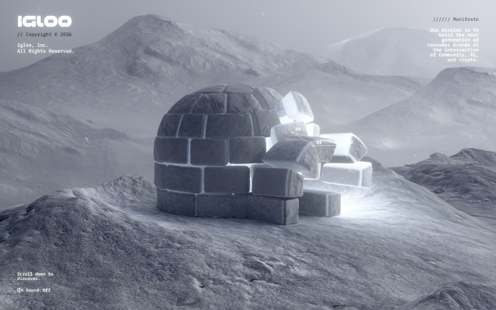
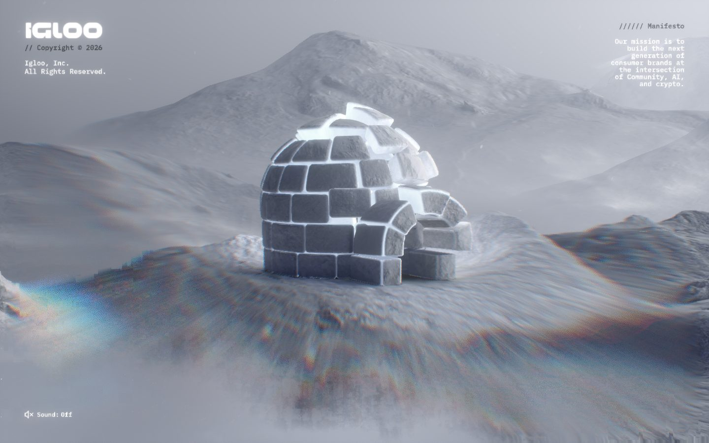
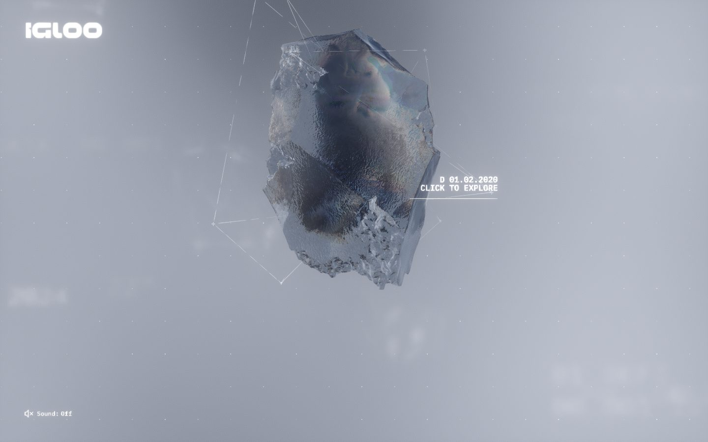
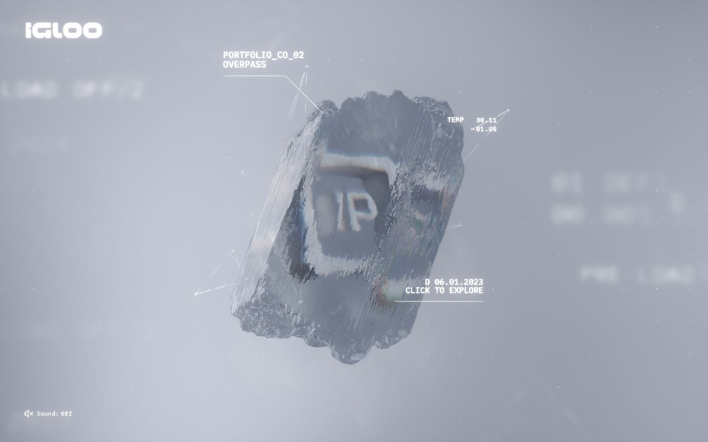
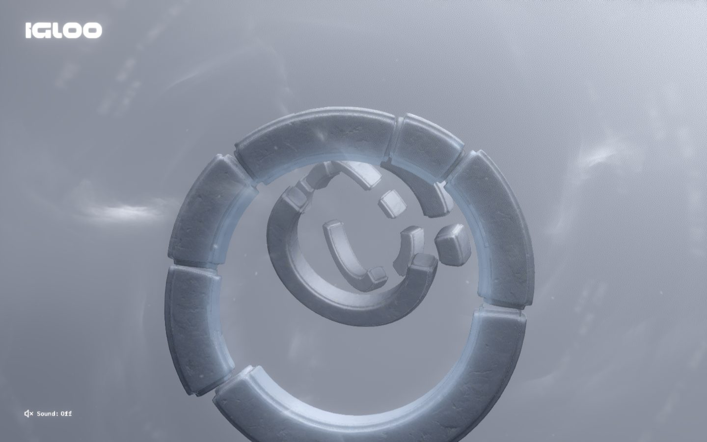
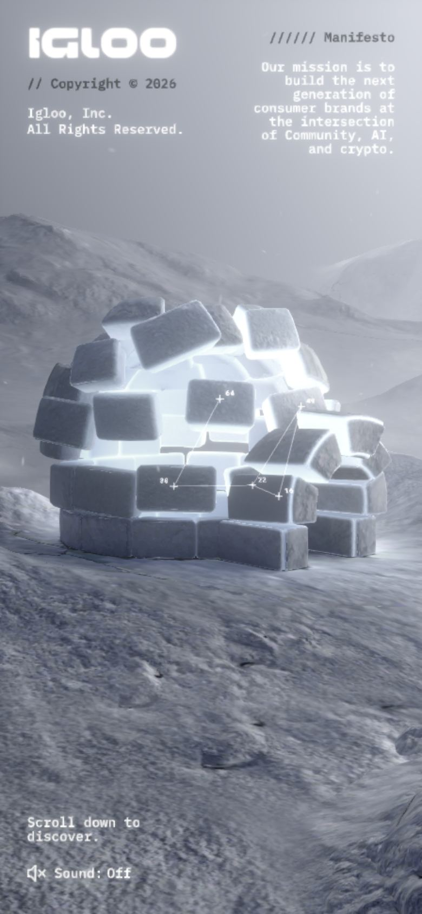

# Igloo Inc.

<!-- gallery:start -->

<a href="../../README.md#worlds">All sites</a> &nbsp;&nbsp; <a href="../lusion/teardown.md">&larr; Lusion</a> &nbsp;&nbsp; <a href="../bruno-simon/teardown.md">Bruno Simon &rarr;</a> &nbsp;&nbsp; <a href="https://igloo.inc">Open the live site</a>

<!-- gallery:end -->

Looked at on 2026-10-28. https://igloo.inc

**The idea:** an igloo built from ice blocks, and each portfolio company is frozen inside one.

## What you see
A grey snowfield under mountains, with an igloo in the middle. Blocks are loose in the first capture and set in the second, so scrolling builds it. Then the camera moves into fog where each portfolio company sits inside a rough block of ice, tagged with thin leader lines, a date and "Click to explore". It ends on the logo made from the same blocks. All text is small monospace in the corners, and sound is off until you turn it on.

## Stack
| Layer | What |
|---|---|
| Framework | None detected. Empty `<body>` and one module script; the HTML shell is the same template as messenger.abeto.co |
| 3D | three.js r165 |
| Fonts | No web fonts detected |
| Weight | 15 MB total, 558 KB of it JS, 95 requests |
| Reduced motion | No |
| Hosting | Vercel behind Cloudflare |

## Steal
- Portfolio items as objects inside one material, not cards. Ice is the brand, so the work is shown in ice.
- The logo built from the scene's own blocks at the end.
- Labels drawn as leader lines to the object, like specimen tags.
- Sound off by default behind a plain text toggle.

## Don't steal
- Monospace everything, with "////// Manifesto" and "PORTFOLIO_CO_02" labels. That is the mono-label vocabulary on the banned list.
- The rainbow lens fringe across the fog in the second capture. It is a camera effect, not snow.
- A 15 MB page. That is a studio budget.
