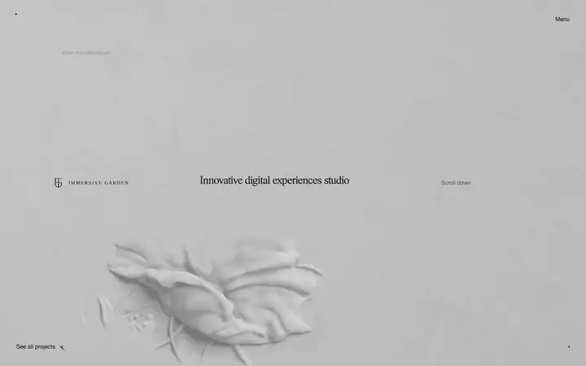
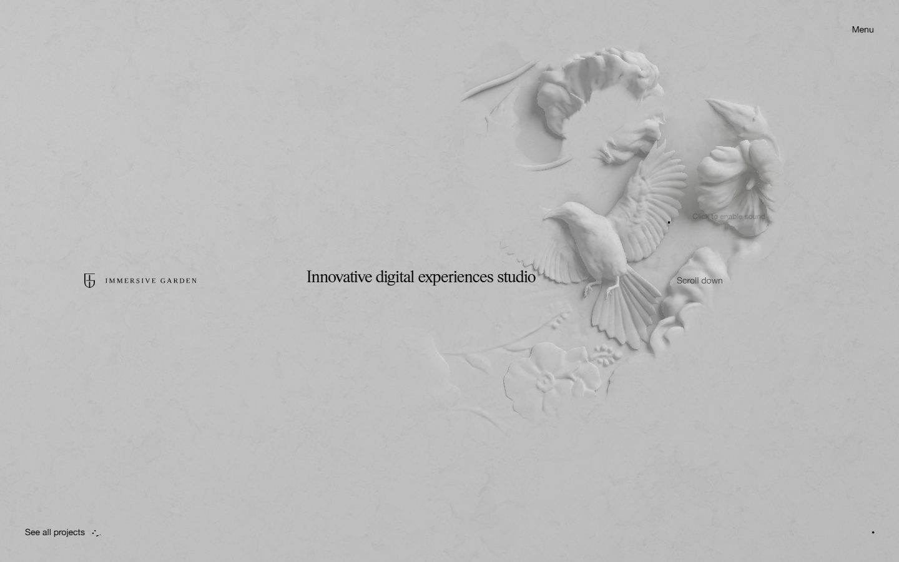
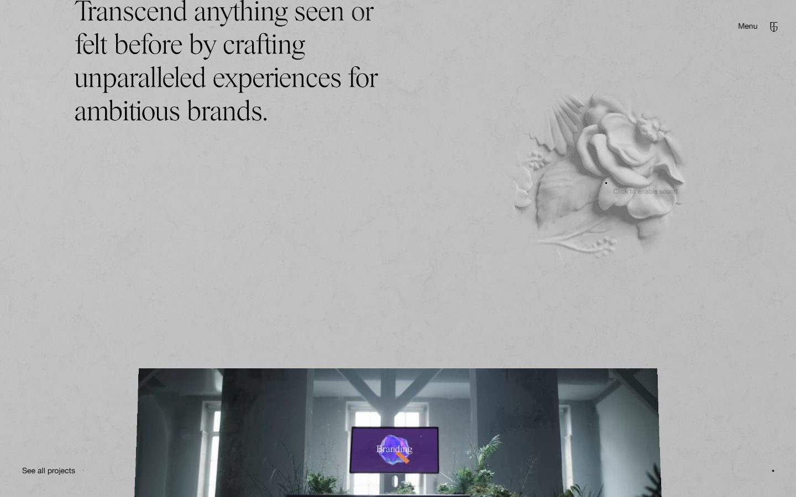
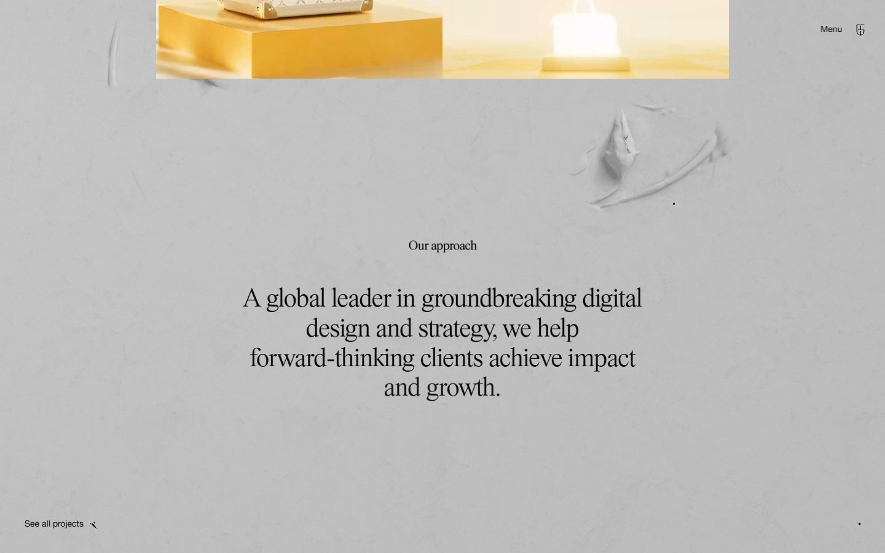
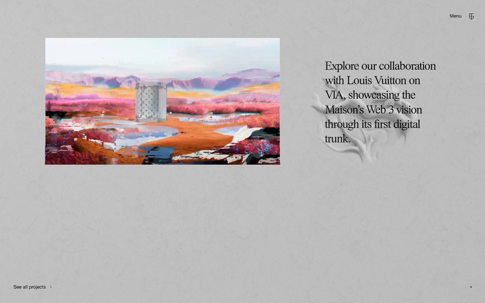
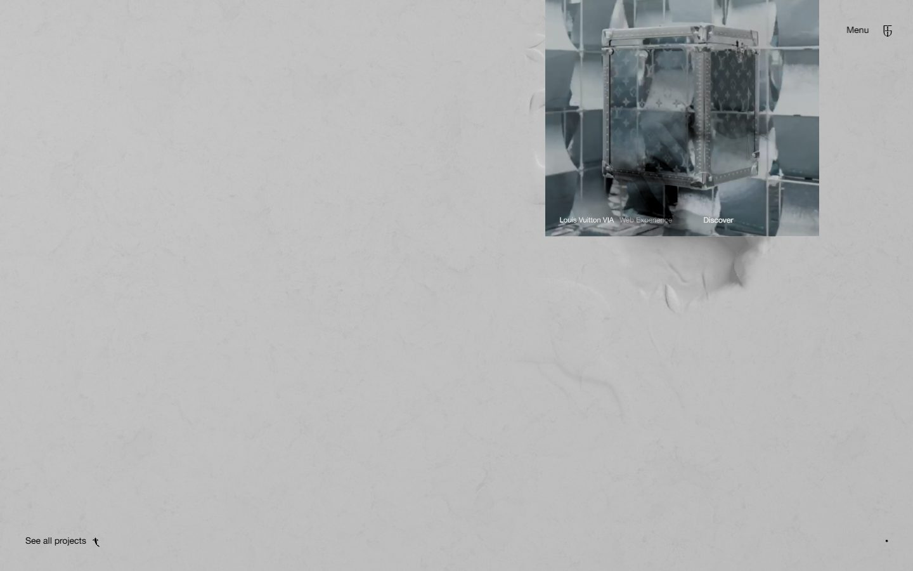
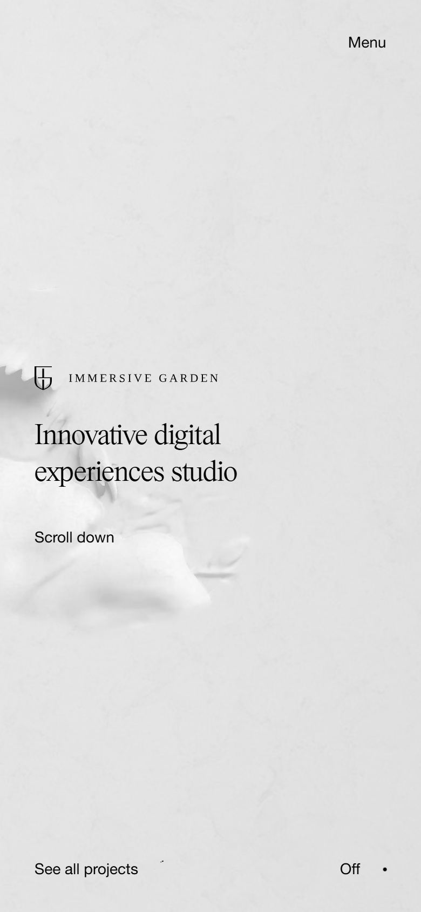

# Immersive Garden

<!-- gallery:start -->

<a href="../../README.md#worlds">All sites</a> &nbsp;&nbsp; <a href="../unseen/teardown.md">&larr; Unseen Studio</a> &nbsp;&nbsp; <a href="../messenger-abeto/teardown.md">Messenger (Abeto) &rarr;</a> &nbsp;&nbsp; <a href="https://www.immersive-g.com">Open the live site</a>

<!-- gallery:end -->

Looked at on 2026-10-28. https://www.immersive-g.com

**The idea:** the name as a plaster relief: birds and flowers that rise out of a grey wall.

## What you see
The whole page sits on one grey plaster texture. A carved relief of birds, flowers and leaves sits in the wall, and it is a different shape in each capture: a bird and petunias in the hero, a rose in the second, one stem in the third. Text is a Times-style serif in black at one size per block, with a small Helvetica for the menu. Each project is a short video with one sentence beside it. A dot cursor offers "Click to enable sound".

## Stack
| Layer | What |
|---|---|
| Framework | Nuxt; Lenis referenced in the HTML |
| 3D | three.js r151, one full canvas plus four 360x360 canvases |
| Fonts | PSTimes, HelveticaNeueRegular |
| Weight | 21.8 MB (4.7 MB images, 806 KB JS), 130 requests |
| Reduced motion | No |
| Hosting | Vercel |

## Steal
- One material for the whole background, with the motif carved into it rather than placed on top.
- A plain Times-style serif doing nearly all the type. Bookish and quiet.
- One sentence per project, next to the film.
- Colour only from the project media. The page itself is grey and black.

## Don't steal
- Nothing on the banned list.
- The copy: "Transcend anything seen or felt before", "A global leader in groundbreaking digital design". Claims, not facts.
- 21.8 MB of page weight.
- Light grey hint text on a grey wall.
