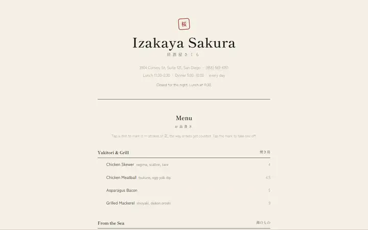
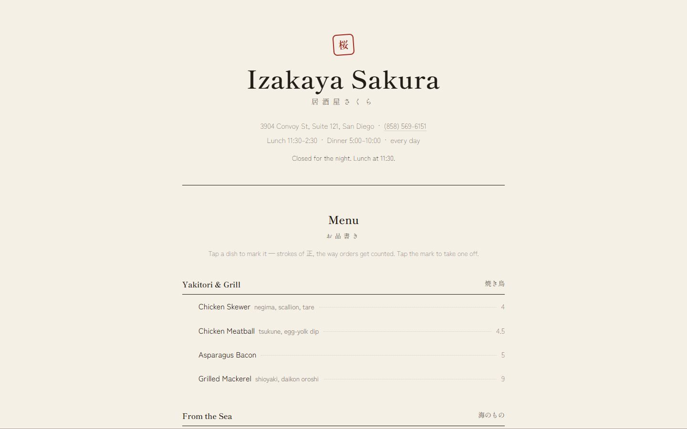
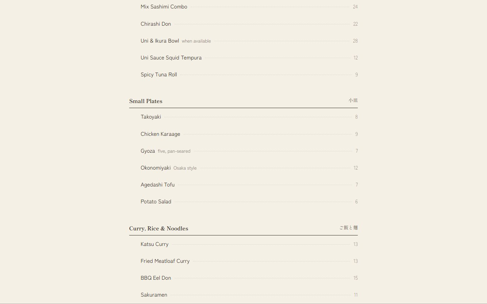
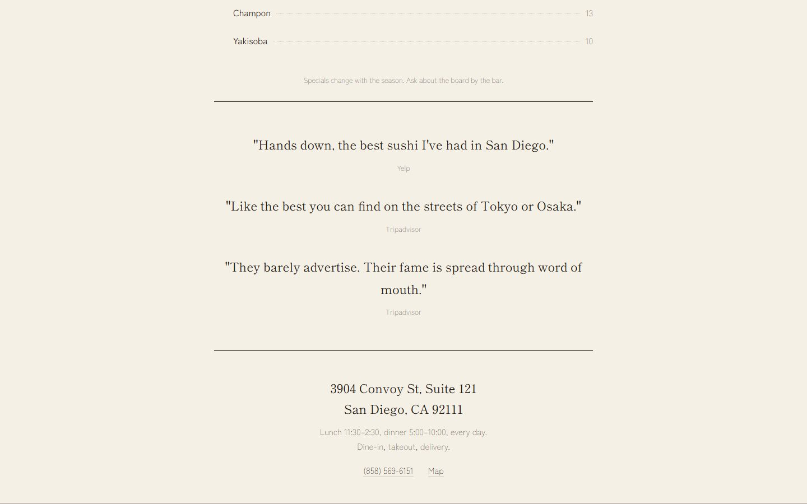
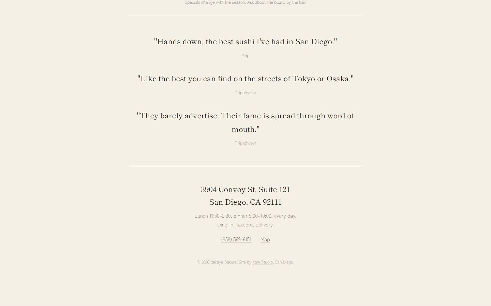
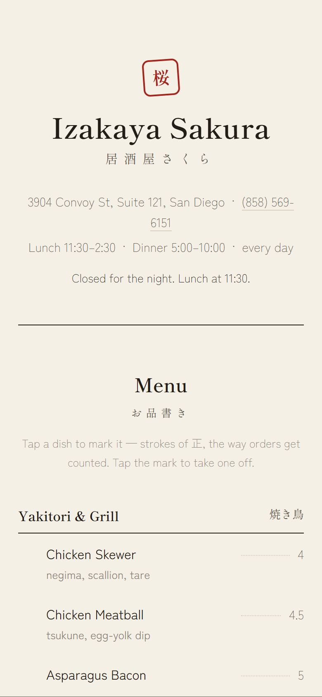

# Izakaya Sakura (house standard)

<!-- gallery:start -->

<a href="../../README.md#house-standard">All sites</a> &nbsp;&nbsp; <a href="../noma/teardown.md">&larr; noma</a> &nbsp;&nbsp; <a href="../activetheory/teardown.md">Active Theory &rarr;</a> &nbsp;&nbsp; <a href="https://www.seankani.com/studio/clients/izakaya-sakura/">Open the live site</a>

<!-- gallery:end -->

Kani Studio, v3, passed review. Live: <https://www.seankani.com/studio/clients/izakaya-sakura/>. Source: `E:\vibecoding\seankani.com\public\studio\clients\izakaya-sakura\index.html`.

**The idea:** a printed izakaya menu. You enter through a noren curtain, and orders are counted in 正 tally strokes.

## Why it passed

- **Plain hand-written HTML and CSS,** one file, no framework, two Google Fonts: Shippori Mincho for heads and quotes, Zen Kaku Gothic New for body and prices.
- **Typeset like the printed thing:**
  - ruled category heads with the Japanese name set right;
  - dot leaders to the prices;
  - tabular numerals;
  - a rotated red hanko stamp, which is the one ornament and comes from the subject.
- **Paper, ink, red and indigo** as the whole palette, defined as tokens in `:root`.
- **Real content only:** address, hours, an "open now" line computed from the actual hours, real review quotes set as plain blockquotes with no cards.
- **Motion from the subject, used once:**
  - the curtain halves part on entry;
  - tally strokes draw when you mark a dish;
  - the order bar slides up only when something is marked.

  Reduced motion removes all of it, and print hides it.
