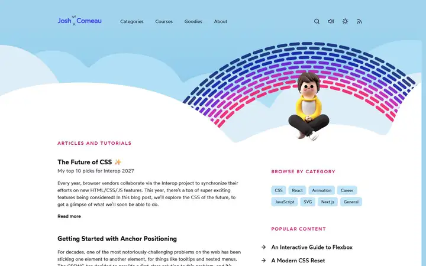
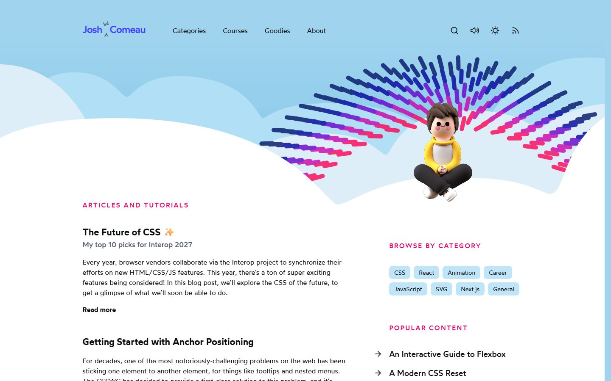
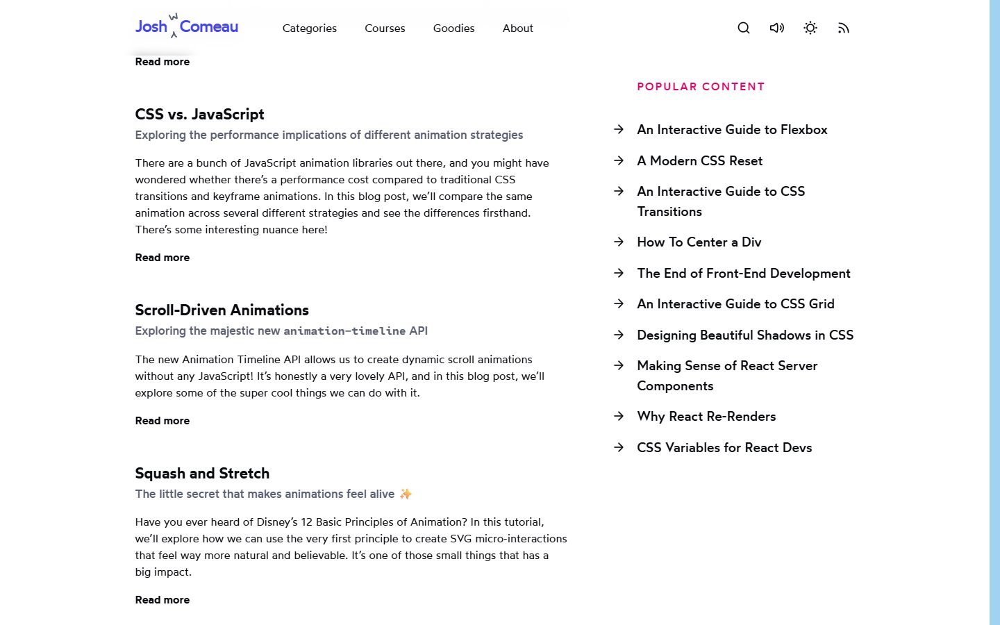
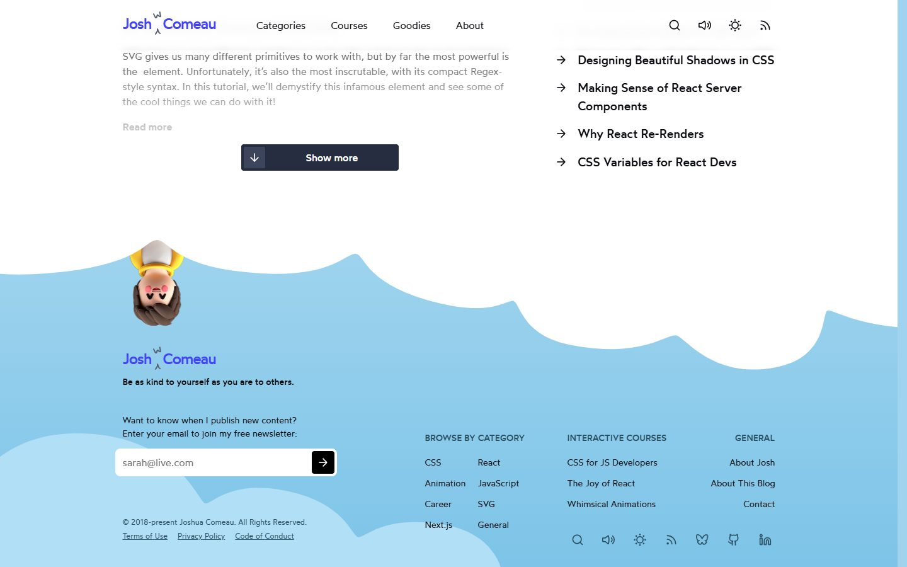
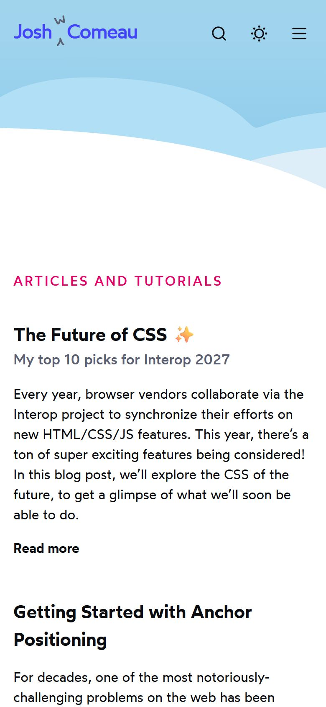

# Josh W. Comeau

<!-- gallery:start -->

<a href="../../README.md#studios-and-motion-craft">All sites</a> &nbsp;&nbsp; <a href="../emil-kowalski/teardown.md">&larr; Emil Kowalski</a> &nbsp;&nbsp; <a href="../lynn-fisher/teardown.md">Lynn Fisher &rarr;</a> &nbsp;&nbsp; <a href="https://www.joshwcomeau.com">Open the live site</a>

<!-- gallery:end -->

Looked at on 2026-11-08. https://www.joshwcomeau.com

**The idea:** a CSS teacher's blog that is itself a toy: whimsy in every small interaction.

## What you see
A sky-blue page with clouds, his 3D avatar sitting in a rainbow arc, and a calm article list. The fun is in the small things: a sound toggle that makes clicks and switches audible, a like button that fills up over many clicks, the avatar hanging upside down in the footer. The articles are interactive: you drag sliders and watch the CSS change.

## Stack
| Layer | What |
|---|---|
| Framework | Next.js |
| Fonts | Wotfard, Cartograph CF |
| Weight | 1.0 MB, 96 requests |
| Reduced motion | Has a `prefers-reduced-motion` rule |
| Hosting | Vercel |

## Steal
- Whimsy at the edges (cursor, sounds, footer), calm in the middle where you read.
- Interactive explanations: the reader moves a slider and the thing changes. The motion teaches.
- A sound switch that's off by default but delightful when on.

## Don't steal
- The avatar works because it's him. A mascot without a person behind it is decoration.
