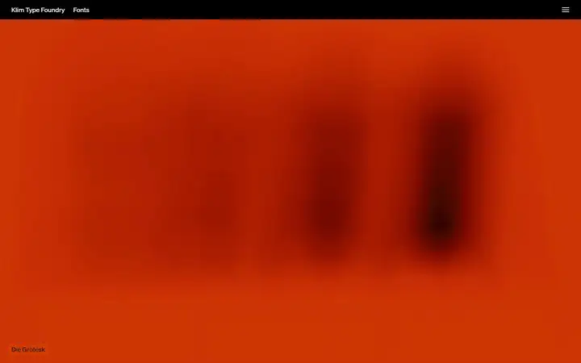
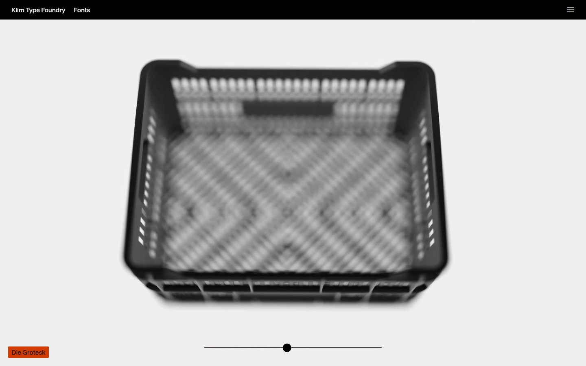
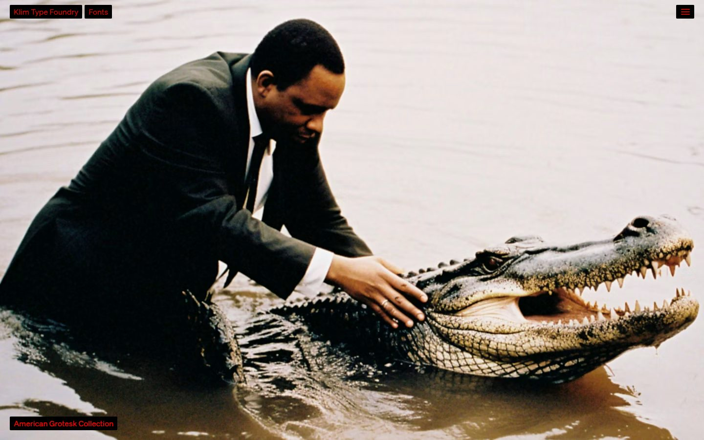
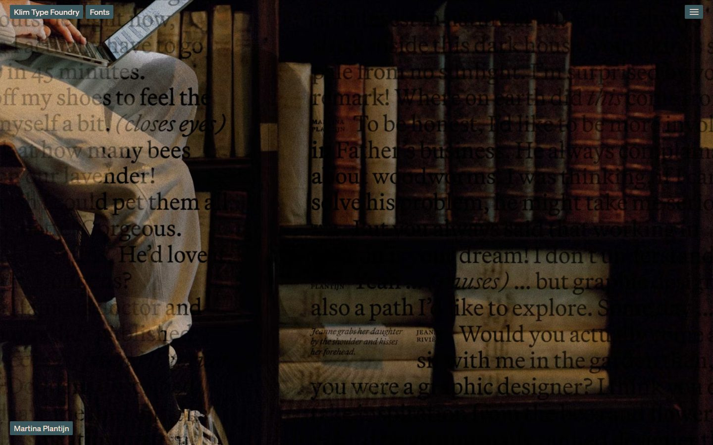
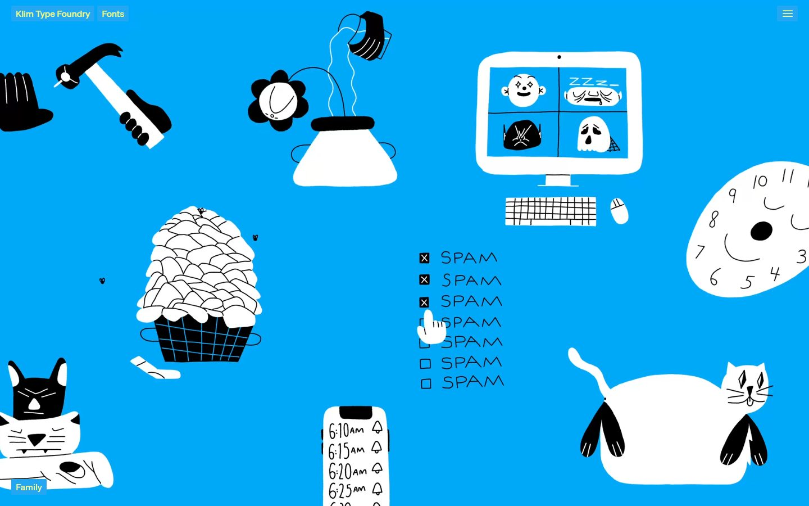
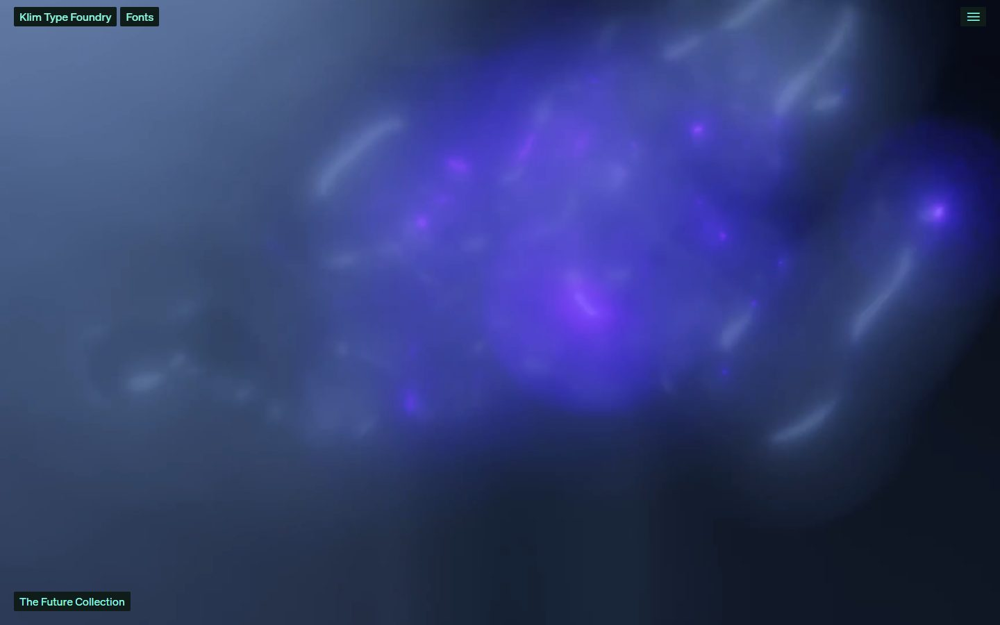
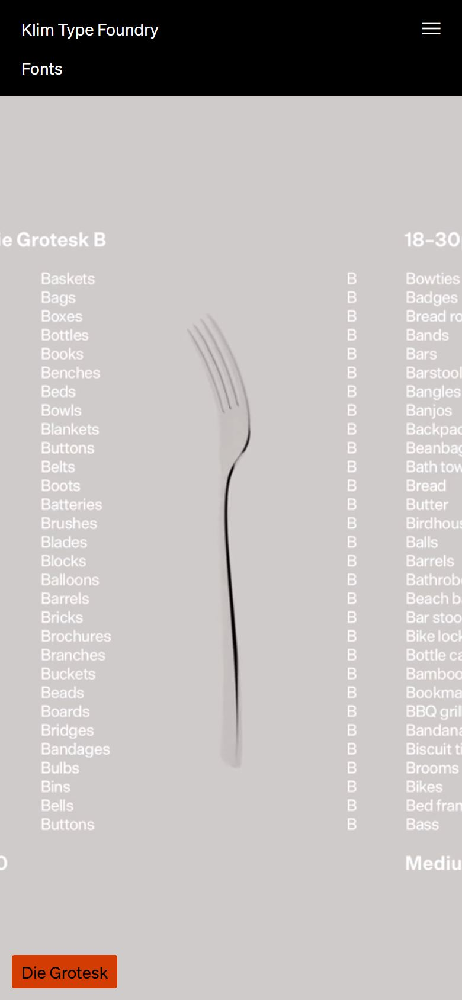

# Klim Type Foundry

<!-- gallery:start -->

<a href="../../README.md#type-foundries-and-editorial">All sites</a> &nbsp;&nbsp; <a href="../samsy/teardown.md">&larr; Samsy</a> &nbsp;&nbsp; <a href="../grilli-type/teardown.md">Grilli Type &rarr;</a> &nbsp;&nbsp; <a href="https://klim.co.nz">Open the live site</a>

<!-- gallery:end -->

Looked at on 2026-10-28. https://klim.co.nz

**The idea:** the home page is a run of full-screen campaigns, one per typeface.

## What you see

Each screen is one full-bleed scene for one family, with no headline and no tagline. The only fixed type is Söhne: "Klim Type Foundry" and "Fonts" top left, a menu icon top right, and the family name bottom left. All three sit in small filled boxes that take each panel's colours: red on black over the alligator, yellow on blue over the drawings. On the phone the Die Grotesk panel shows a column of B-words set in Die Grotesk B around a fork.

## Stack

| Layer | What |
|---|---|
| Generator | Gatsby 5.16.1 (meta generator tag) |
| Hosting | Amazon S3 behind CloudFront |
| Fonts | Söhne and Söhne Ikon, Klim's own, were the only faces loaded on the home page. The CSS also names Martina Plantijn and Söhne Mono |
| Weight | 1,324 KB over 41 requests: 730 KB images, 339 KB JS, 79 KB fonts |
| Reduced motion | No `prefers-reduced-motion` rule |

## Steal

- One family per screen, shown in a scene made for it instead of a type tester. The home page is the specimen.
- One neutral sans for all interface text, at one size, so any image can sit under it.
- Interface labels that borrow each panel's two colours, so the chrome changes with the picture and never fights it.
- The family name as the only caption, bottom left, linking to the font page.

## Don't steal

- The boxed labels pinned to the corners. Over full-bleed images they are the captions and they work; on an ordinary page the same shape is a floating corner chip.
- The Future Collection panel is a soft purple nebula. It reads as a gradient glow and says nothing about the type.
