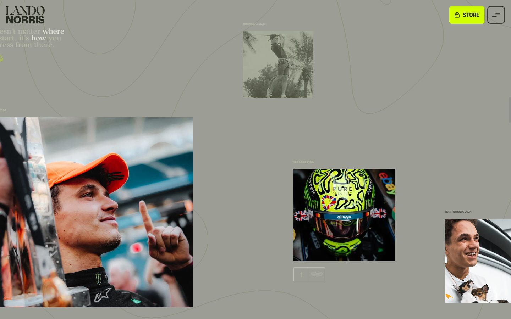

# Lando Norris

<!-- gallery:start -->

<a href="../../README.md#studios-and-motion-craft">All sites</a> &nbsp;&nbsp; <a href="../cuberto/teardown.md">&larr; Cuberto</a> &nbsp;&nbsp; <a href="../obys/teardown.md">Obys &rarr;</a> &nbsp;&nbsp; <a href="https://landonorris.com">Open the live site</a>

<!-- gallery:end -->

Looked at on 2026-11-08. https://landonorris.com

**The idea:** an F1 driver's site built like a fashion editorial: his signature, his helmet, his photos.

## What you see
Olive, off-white and one acid lime. The hero is his portrait with a 3D helmet (three.js) that turns as you move. His signature draws itself over giant condensed type. A manifesto paragraph mixes a condensed sans with lime serif italics. Then a loose collage of candid photos with tiny captions drifts past at different speeds. Faint topographic contour lines run behind everything, like a track map.

## Stack
| Layer | What |
|---|---|
| Framework | three.js r174, Lenis, Webflow |
| Fonts | Brier, Mona Sans Variable |
| Weight | 213 KB first load, 61 requests |
| Reduced motion | No `prefers-reduced-motion` rule in the CSS |
| Hosting | Cloudflare |

## Steal
- Motion from the subject: his own signature drawing in, his helmet turning, contour lines from a track.
- One loud accent (lime) on a quiet ground (olive, paper).
- Collage with captions: photos at different depths and speeds, each with a date and place.

## Don't steal
- No reduced-motion handling on a site this animated.
- Serif italics mixed into caps headlines work once per page, not on every line.
