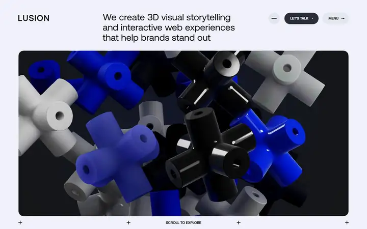
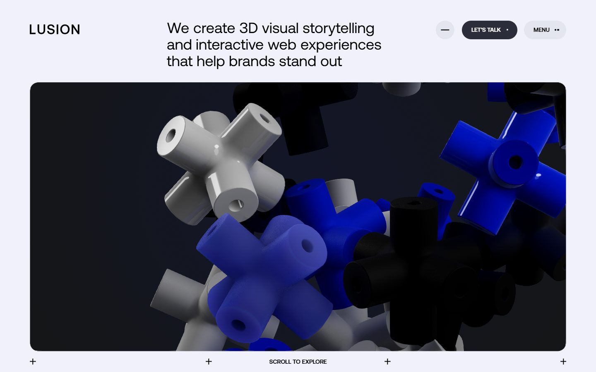
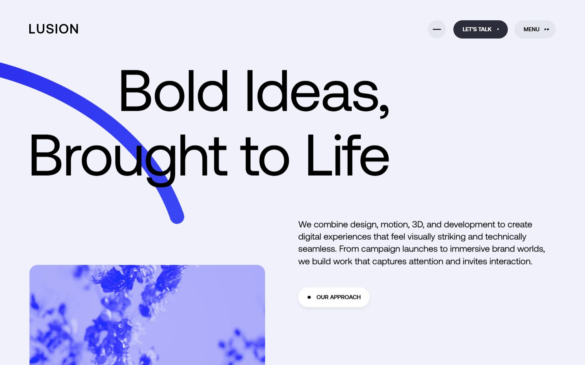
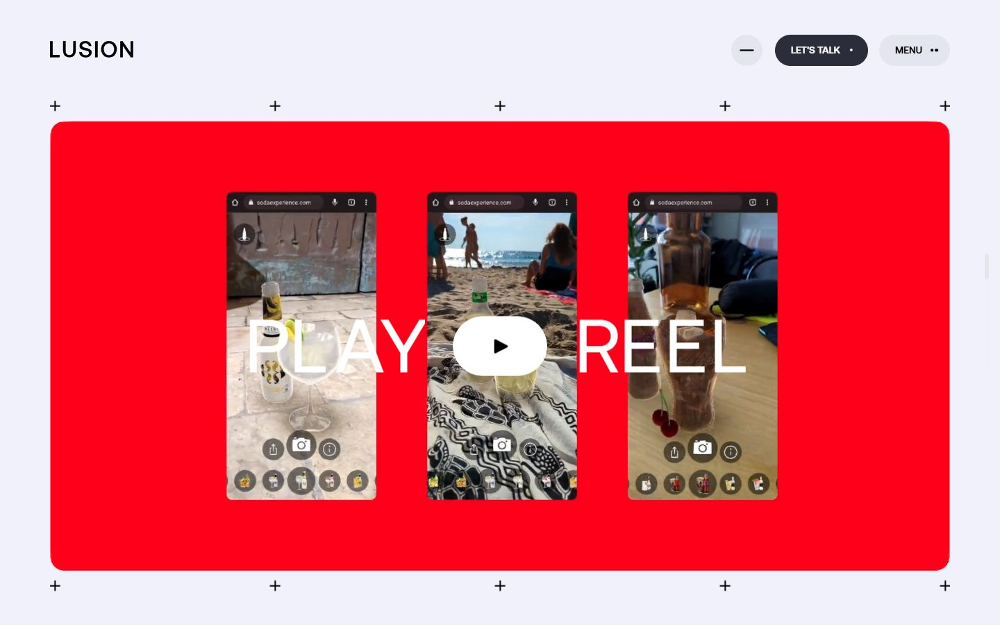
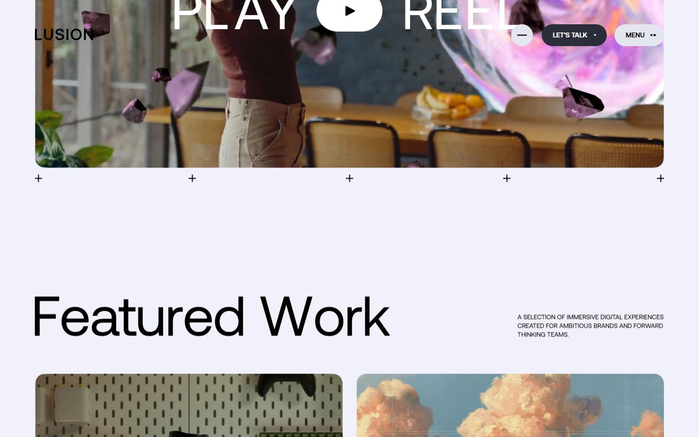
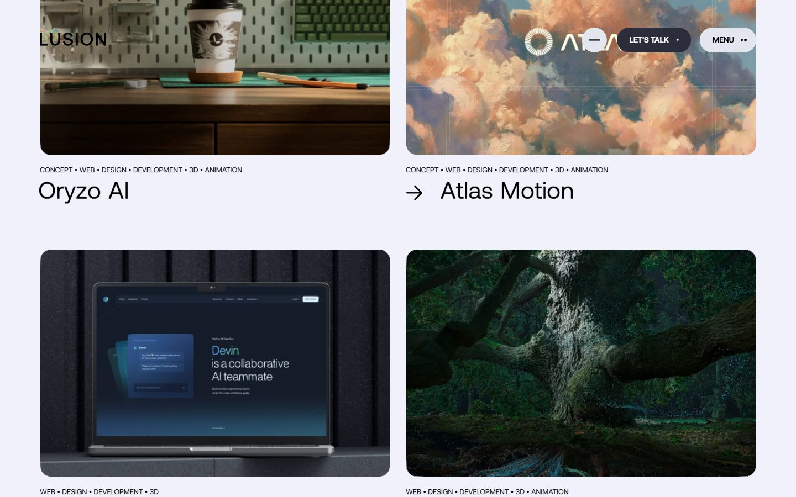
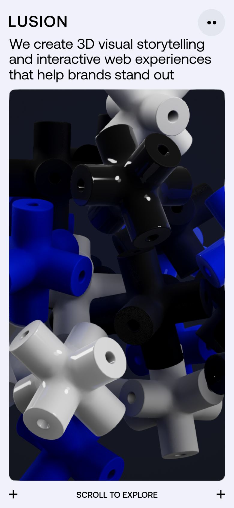

# Lusion

<!-- gallery:start -->

<a href="../../README.md#worlds">All sites</a> &nbsp;&nbsp; <a href="../seanblundin/teardown.md">&larr; Sean Blundin</a> &nbsp;&nbsp; <a href="../igloo-inc/teardown.md">Igloo Inc. &rarr;</a> &nbsp;&nbsp; <a href="https://lusion.co">Open the live site</a>

<!-- gallery:end -->

Looked at on 2026-10-28. https://lusion.co

**The idea:** a 3D studio opens on a heap of rendered parts, then steps aside for the work.

## What you see
The hero is a rounded dark panel full of identical cross-shaped parts, each in a different finish: glossy white plastic, matte blue foam, black rubber. They sit in a new arrangement in every capture, so they move. Below, a thick blue stroke runs through a two-line headline, then a red Play Reel panel, then a two-column grid of case studies. Small plus signs mark the corners of each panel like crop marks.

## Stack
| Layer | What |
|---|---|
| Framework | Astro (`_astro/` asset paths in the HTML) |
| 3D | three.js r158, two full-screen canvases |
| Fonts | Aeonik, IBM Plex Mono, LusionMono |
| Weight | 508 KB (298 KB JS, 186 KB fonts), 104 requests |
| Reduced motion | No `prefers-reduced-motion` rule in the CSS |
| Hosting | Netlify |

## Steal
- A material study as the hero. Every part has the same shape, so the only difference is the surface, and that shows the rendering skill without a word.
- Crop-mark plus signs at panel corners instead of borders.
- A light page under heavy 3D: about half a megabyte at load.
- Client names set large under each image, nothing else competing.

## Don't steal
- Category tags chained with bullets in small capitals: "CONCEPT • WEB • DESIGN • DEVELOPMENT • 3D • ANIMATION". Middot chain on the banned list.
- The small uppercase note beside "Featured Work".
- Dot badges in the "LET'S TALK •" and "MENU ••" pills.
- Copy like "visually striking and technically seamless".
