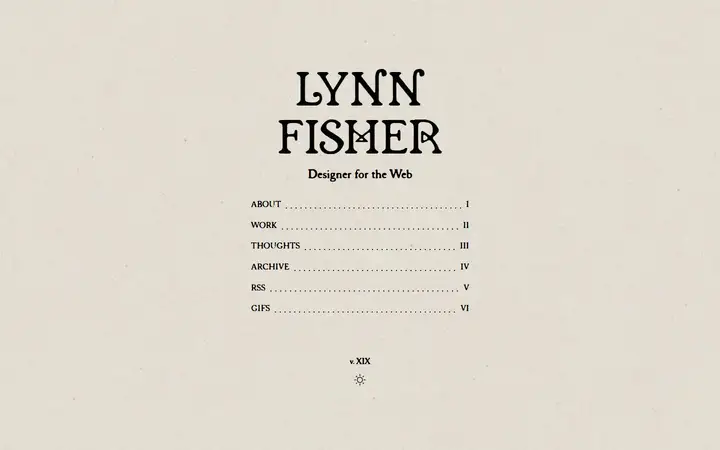
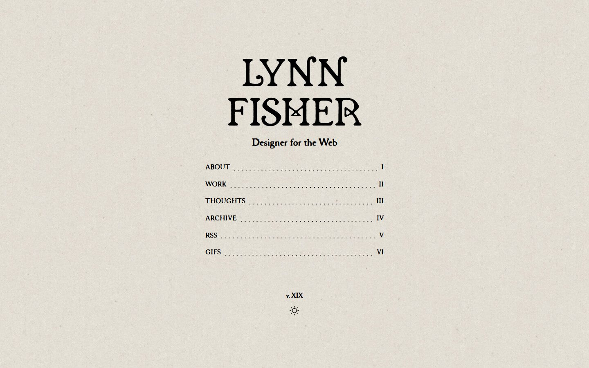
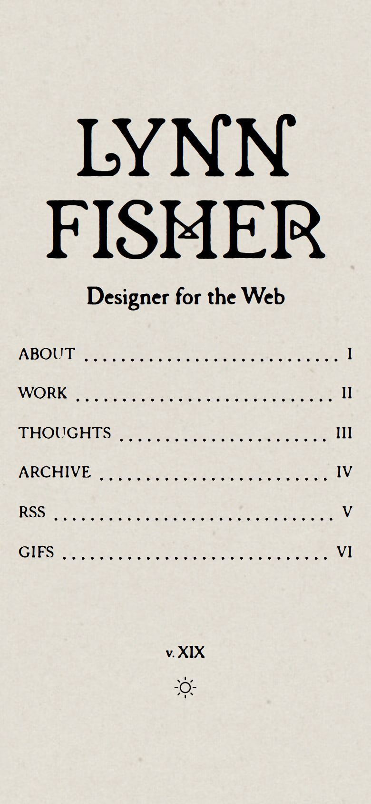

# Lynn Fisher

<!-- gallery:start -->

<a href="../../README.md#studios-and-motion-craft">All sites</a> &nbsp;&nbsp; <a href="../josh-comeau/teardown.md">&larr; Josh W. Comeau</a> &nbsp;&nbsp; <a href="../cuberto/teardown.md">Cuberto &rarr;</a> &nbsp;&nbsp; <a href="https://lynnandtonic.com">Open the live site</a>

<!-- gallery:end -->

Looked at on 2026-11-08. https://lynnandtonic.com

**The idea:** a personal site redesigned from scratch every year; this year it's a book's table of contents.

## What you see
A single page set like the front of an old book: her name in a blackletter-flavored display face, a contents list (About, Work, Thoughts, Archive, RSS, GIFs) with dot leaders and roman numerals, and "v XIX" for the 19th version of the site. Ten requests, 411 KB. She is known for layouts that change what they show as you resize the window, so drag the browser edge on her sites and her side projects (A Single Div, Airport Codes).

## Stack
| Layer | What |
|---|---|
| Framework | Hand-built HTML and CSS, no framework |
| Fonts | Hubano Rough, Sydonia Atramentiqua |
| Weight | 411 KB, 10 requests |
| Reduced motion | No `prefers-reduced-motion` rule in the CSS |
| Hosting | Netlify |

## Steal
- A yearly redesign with a version number. The site is a practice, not a finished thing.
- One printed-object idea carried all the way: dot leaders, roman numerals, paper.
- Resizing as an interaction: the layout is the toy.

## Don't steal
- Blackletter for anything people must read at length.
