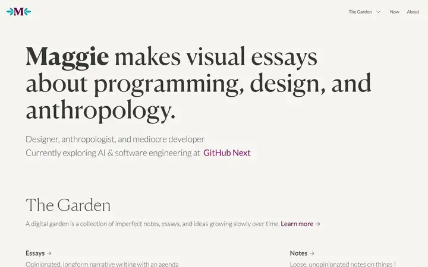
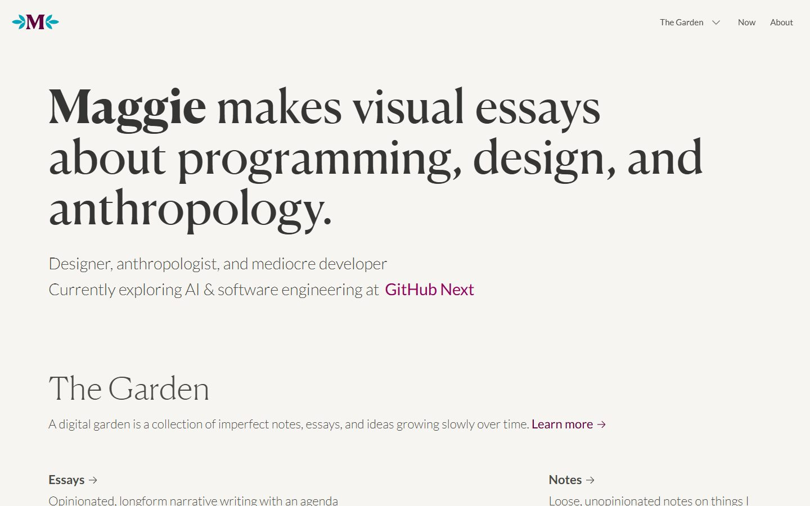
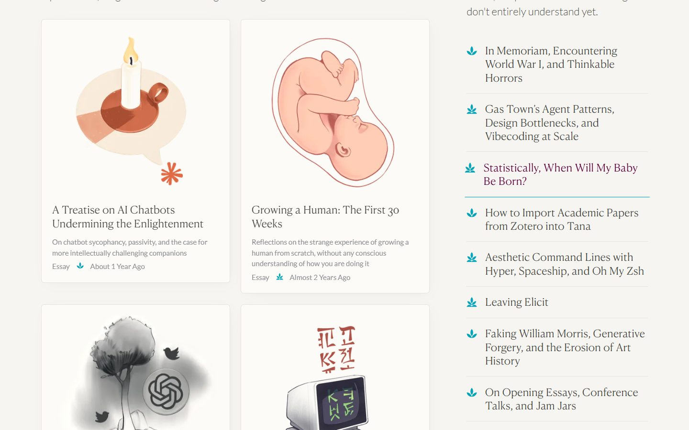
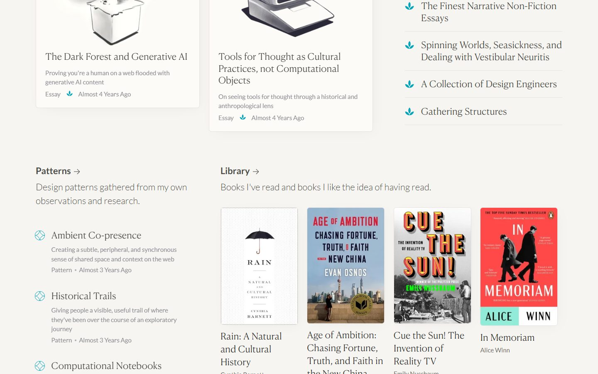
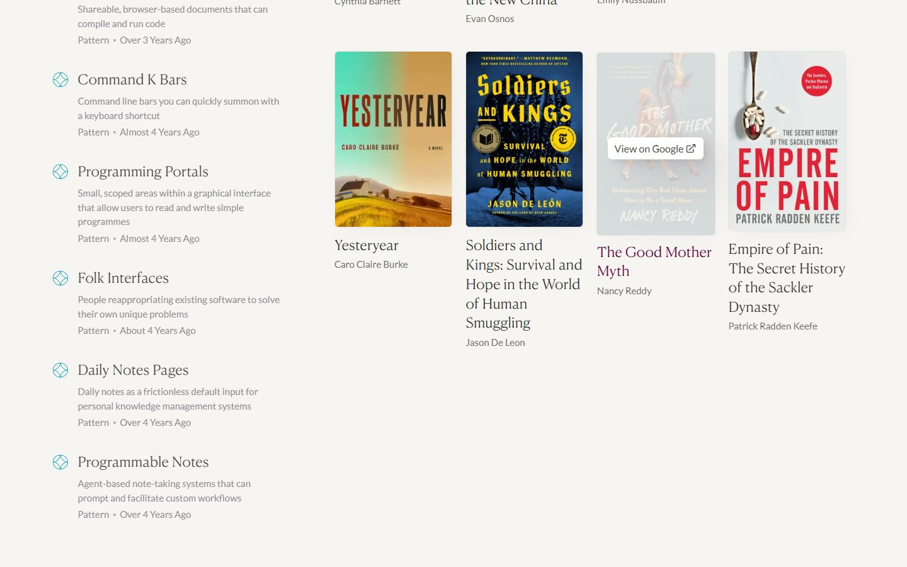
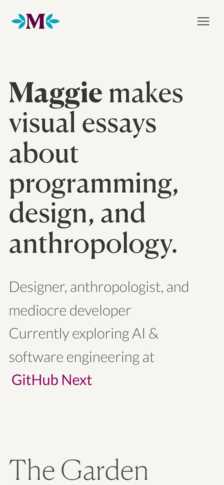

# Maggie Appleton

<!-- gallery:start -->

<a href="../../README.md#writing-and-personal-sites">All sites</a> &nbsp;&nbsp; <a href="../rauno/teardown.md">&larr; Rauno Freiberg</a> &nbsp;&nbsp; <a href="../ciechanowski-watch/teardown.md">Mechanical Watch, Bartosz Ciechanowski &rarr;</a> &nbsp;&nbsp; <a href="https://maggieappleton.com">Open the live site</a>

<!-- gallery:end -->

Looked at on 2026-10-28. https://maggieappleton.com

**The idea:** a digital garden: notes marked by growth stage, essays carried by her own drawings.

## What you see

A warm off-white page. The headline is Canela Deck at about 70 px, with "Maggie" in bold and the rest regular, followed by two lines of light Lato. "The Garden" splits into essays, shown as cards with her own drawings (a candle, a fetus, a dark forest), and notes, a list of Canela Text titles each marked with a small teal plant icon. Patterns get a lattice icon and a grey line with type and relative date. The library shows real book covers with title and author underneath.

## Stack

| Layer | What |
|---|---|
| Framework | Astro, on Vercel |
| JS | 0 KB measured |
| Fonts | Canela Deck and Canela Text for headings and titles, Lato for text and interface |
| Weight | 298 KB over 15 requests: 183 KB fonts, 90 KB images |
| Reduced motion | Yes, the CSS has a `prefers-reduced-motion` rule |

## Steal

- A metaphor that carries data: notes are marked seedling, budding or evergreen, so the plant icon tells you how finished a piece is.
- Her own drawings as the essay images, one per essay, all in one hand.
- One display serif at two optical sizes (Canela Deck for the big line, Canela Text for titles) over a plain sans.
- Relative dates ("Almost 4 Years Ago") that say how old a thought is.

## Don't steal

- Nothing on the banned list.
- Light-weight grey Lato at small sizes is hard to read.
