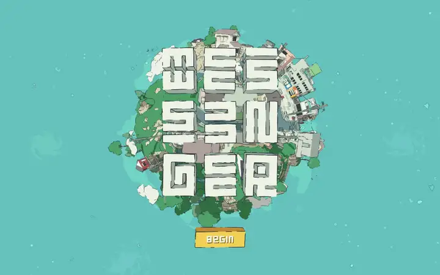
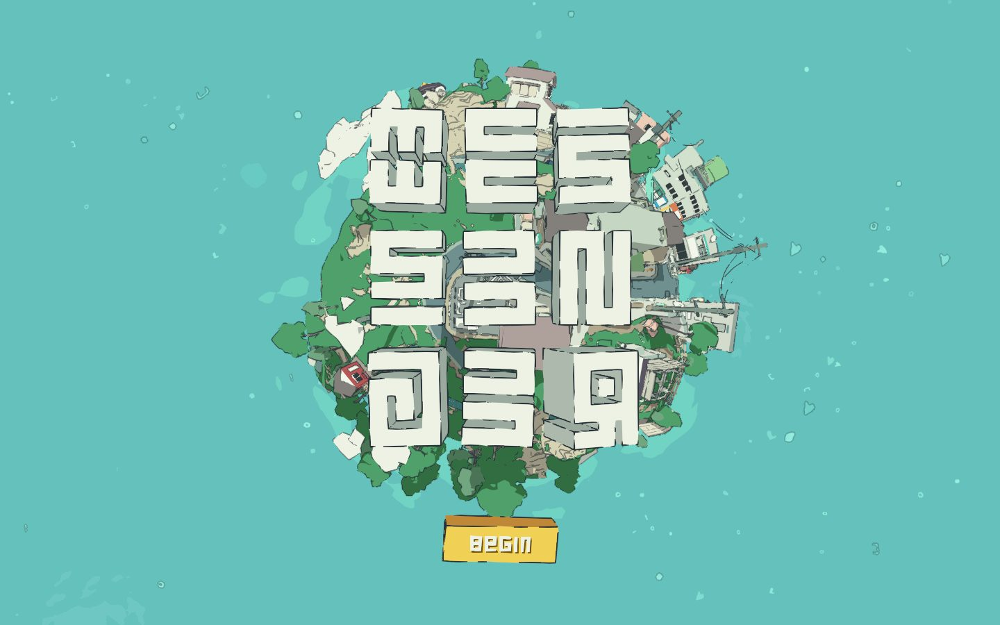
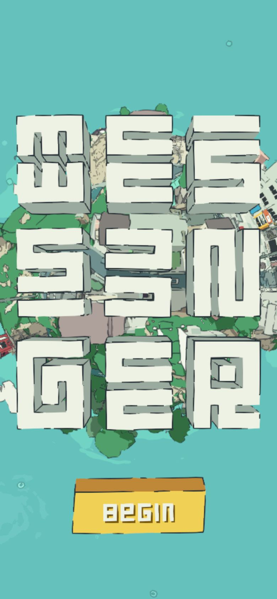

# Messenger (Abeto)

<!-- gallery:start -->

<a href="../../README.md#worlds">All sites</a> &nbsp;&nbsp; <a href="../immersive-garden/teardown.md">&larr; Immersive Garden</a> &nbsp;&nbsp; <a href="../oryzo/teardown.md">Oryzo &rarr;</a> &nbsp;&nbsp; <a href="https://messenger.abeto.co">Open the live site</a>

<!-- gallery:end -->

Looked at on 2026-10-28. https://messenger.abeto.co

**The idea:** a tiny planet that needs its mail delivered, drawn like an inked comic.

## What you see
Only the title screen was captured. A round planet covered in houses, trees, power poles and apartment blocks floats on a teal sea with small drifting specks. Everything is toon-shaded: flat colour fills with hand-drawn black outlines. The title is three rows of chunky extruded letters drawn in the same style as the buildings, and the only control is a yellow 3D block that says "Begin". The meta description sets the premise: "It's a small planet, but someone's gotta make the deliveries."

## Stack
| Layer | What |
|---|---|
| Framework | None detected. Empty `<body>`, scripts named `webgl-*.js` and `App3D-*.js` |
| 3D | three.js r180 |
| Fonts | No web fonts detected |
| Weight | 5.7 MB (564 KB JS), 111 requests |
| Reduced motion | No |
| Hosting | Cloudflare |
| Studio | Abeto. The HTML shell matches igloo.inc |

## Steal
- Title letters built like the town's buildings, so the logo belongs to the world.
- Ink outlines and flat fills. The 3D reads as illustration and needs no realistic materials.
- One button, one word.
- A one-line premise as the meta description.

## Don't steal
- Nothing on the banned list.
