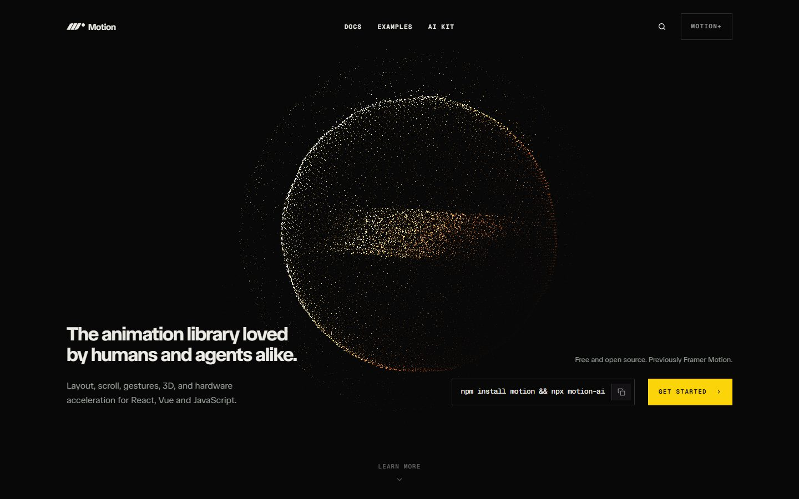
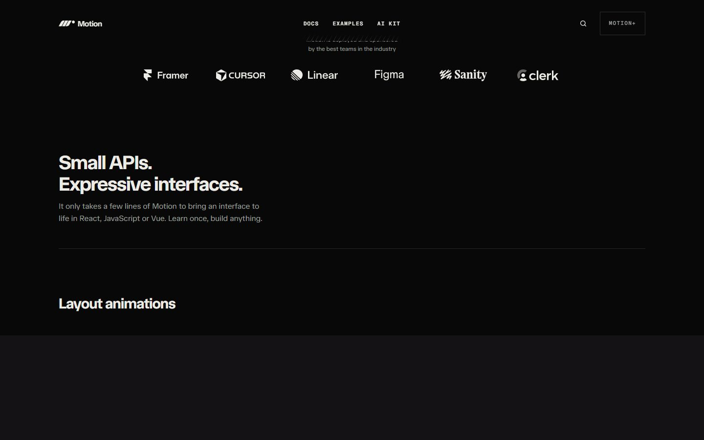
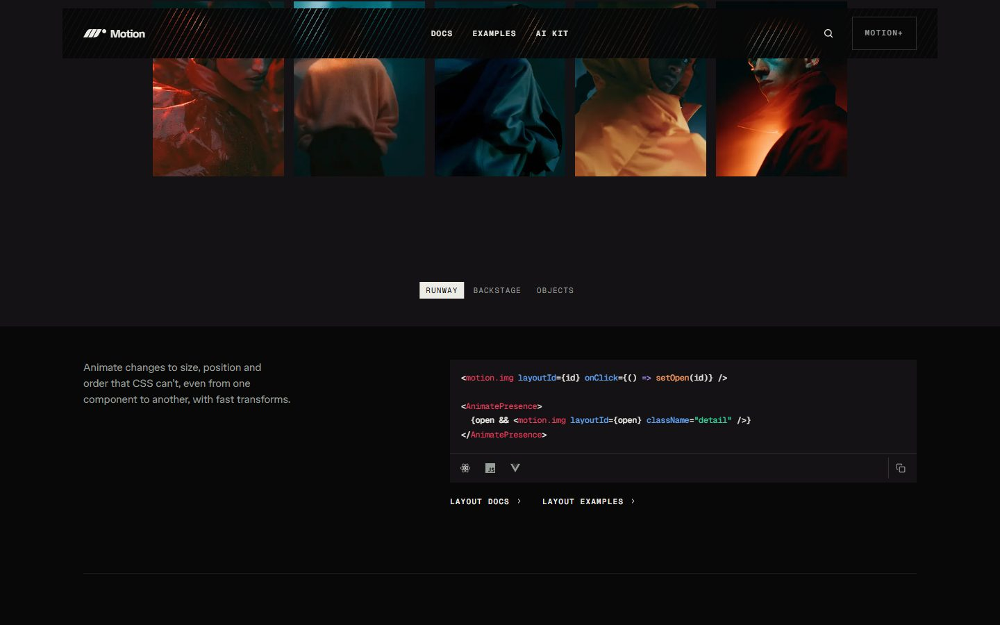
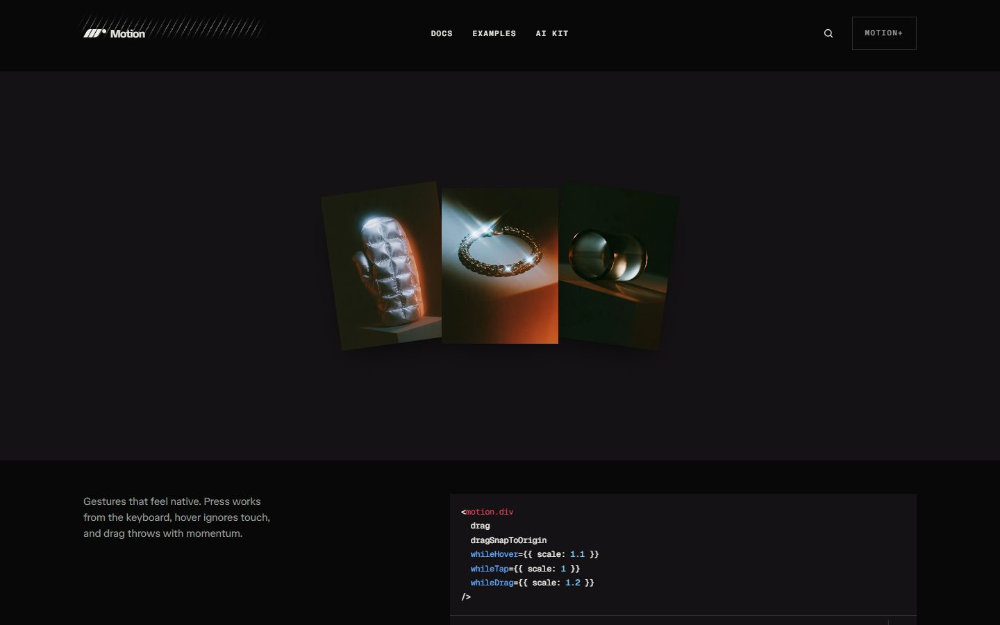
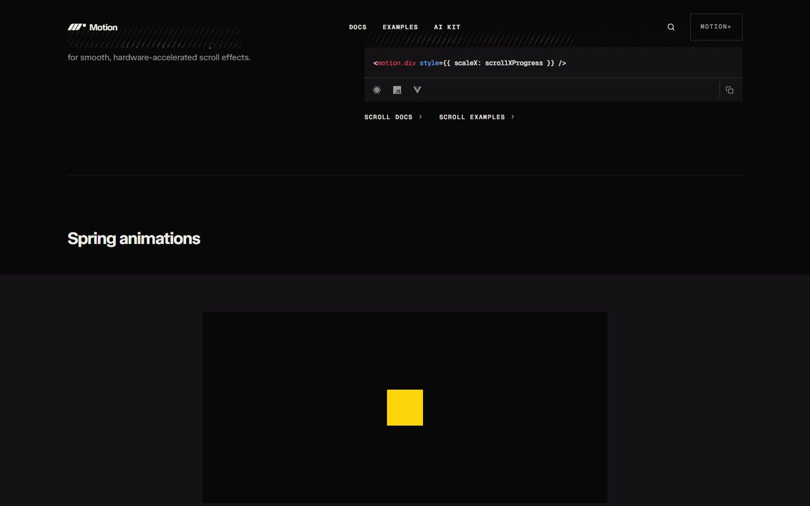
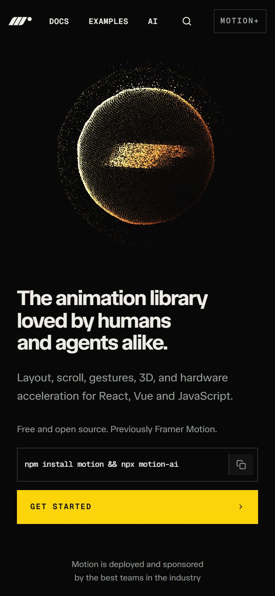

# Motion

<!-- gallery:start -->

<a href="../../README.md#studios-and-motion-craft">All sites</a> &nbsp;&nbsp; <a href="../basement-studio/teardown.md">&larr; basement.studio</a> &nbsp;&nbsp; <a href="../emil-kowalski/teardown.md">Emil Kowalski &rarr;</a> &nbsp;&nbsp; <a href="https://motion.dev">Open the live site</a>

<!-- gallery:end -->

Looked at on 2026-11-08. https://motion.dev

**The idea:** the animation library's site demonstrates each feature live, next to its code.

## What you see
Near-black page, a particle sphere in the hero with a gold band through it, and one yellow button. Each section after that is one feature (layout, gestures, scroll, springs) shown as a live demo on a dark stage, with the few lines of code that make it. The yellow square in the springs section is the whole demo: one shape, one motion, nothing else competing.

## Stack
| Layer | What |
|---|---|
| Framework | No framework fingerprint in the HTML; the library itself drives the demos |
| Fonts | Geist Mono, TASA Orbiter |
| Weight | 615 KB, 134 requests |
| Reduced motion | Has a `prefers-reduced-motion` rule |
| Hosting | Cloudflare |

## Steal
- Demo plus code side by side, one feature per section. The product shows itself.
- One accent color (yellow) used only for the call to action and the demo subject.
- The springs demo: a single square proves the feel better than a busy scene.

## Don't steal
- The tiny uppercase mono labels and the particle-sphere hero are both on the banned list.
- Dark mode everywhere for a site that isn't a dev tool.
