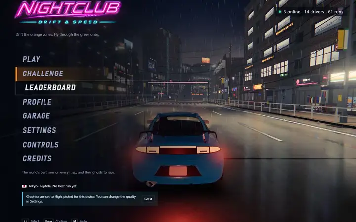
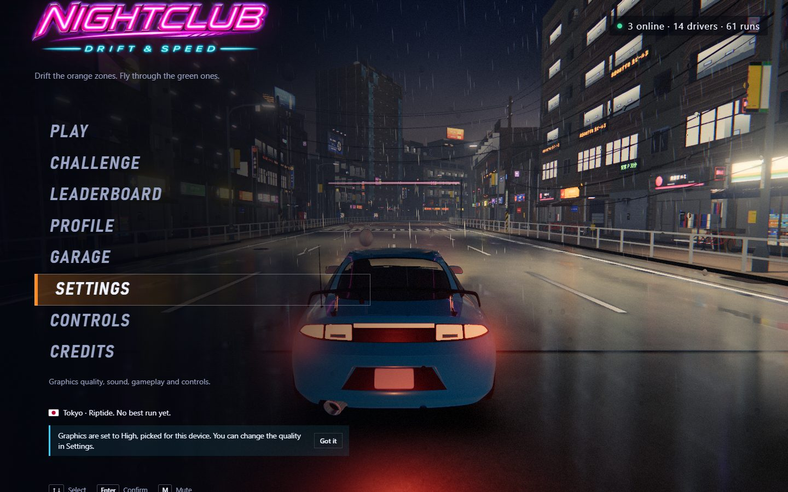
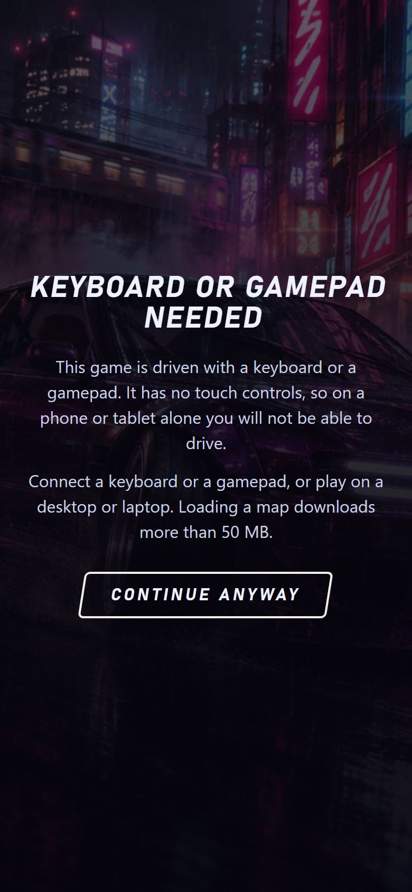

# NightClub: Drift & Speed

<!-- gallery:start -->

<a href="../../README.md#worlds">All sites</a> &nbsp;&nbsp; <a href="../rainforest-flight/teardown.md">&larr; Cloud Flight (Karim Beyrouti)</a> &nbsp;&nbsp; <a href="../crimson-loong/teardown.md">Crimson Loong &rarr;</a> &nbsp;&nbsp; <a href="https://nightclub-driftspeed.xyz">Open the live site</a>

<!-- gallery:end -->

Looked at on 2026-11-14. https://nightclub-driftspeed.xyz
Found on the Three.js X page (posted 2026-11-13).

**The idea:** a drift game whose menu is already a wet Tokyo street at night.

## What you see
The menu sits over the live scene, not a still: a blue coupe seen from behind on a wet road, rain falling, lit shop signs and apartment windows on both sides, tail lights reflected in the tarmac. Menu items are plain italic capitals down the left: Play, Challenge, Leaderboard, Profile, Garage, Settings, Controls, Credits. Top right says how many people are online, how many drivers and runs. A note says graphics were set to High for this device and can be changed in Settings. The site describes three places: neon Tokyo, a Norwegian mountain pass under the aurora and the Adriatic coast.

## Stack
| Layer | What |
|---|---|
| 3D | three.js r187 |
| Weight | 19.5 MB on first load, 709 KB of it JavaScript. 79 requests |
| Hosting | Vercel |

## Steal
- The menu is the game world. You see the car, the weather and the light before you press anything.
- Wet ground. The reflections of tail lights and signs do most of the night lighting work.
- Graphics quality picked for the device on first load, said in one line, changeable later.
- Keyboard hints at the bottom of the menu.
- Live counts (online, drivers, runs) as plain text.

## Don't steal
- The neon logo with glow and speed lines.
- 19.5 MB before the menu. Too heavy for a site that is not a game.
