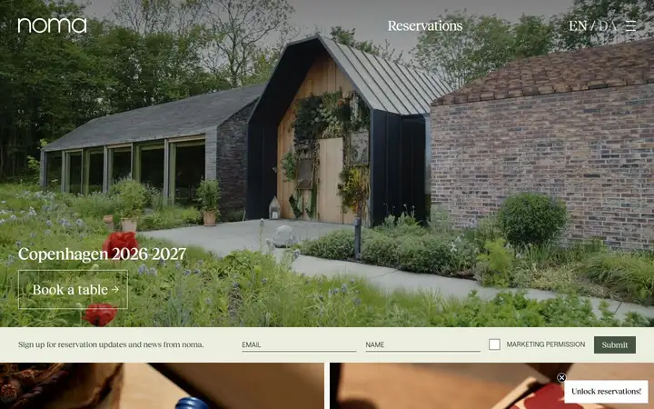
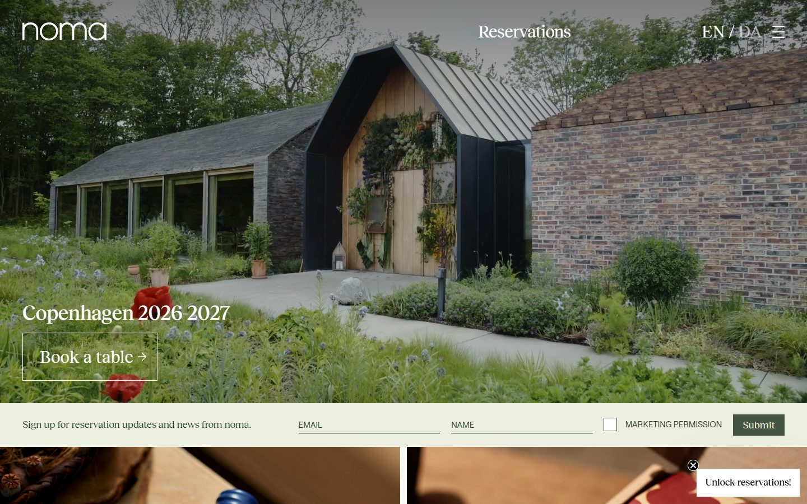
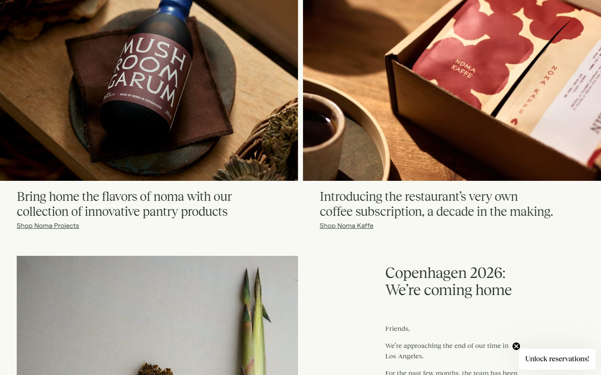
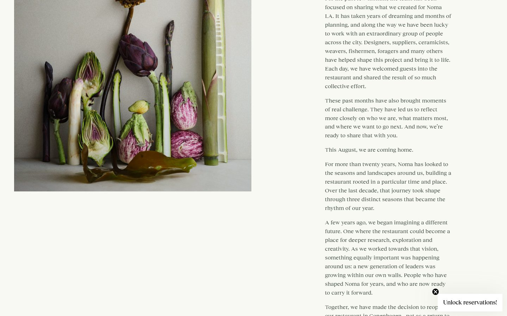
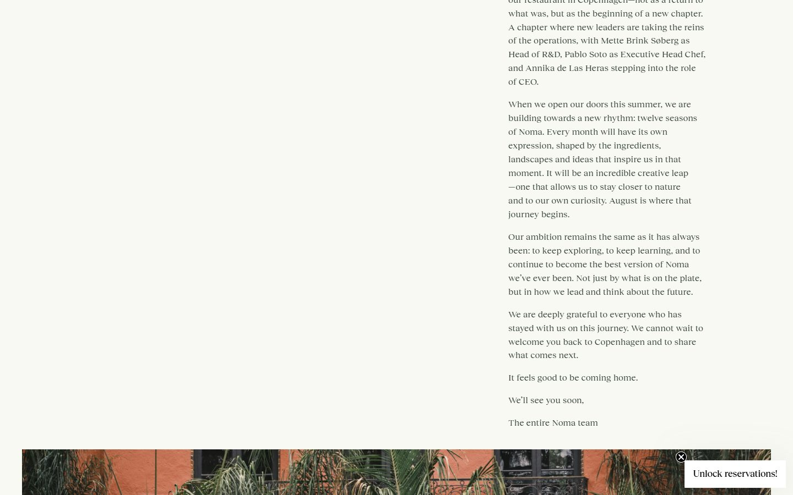
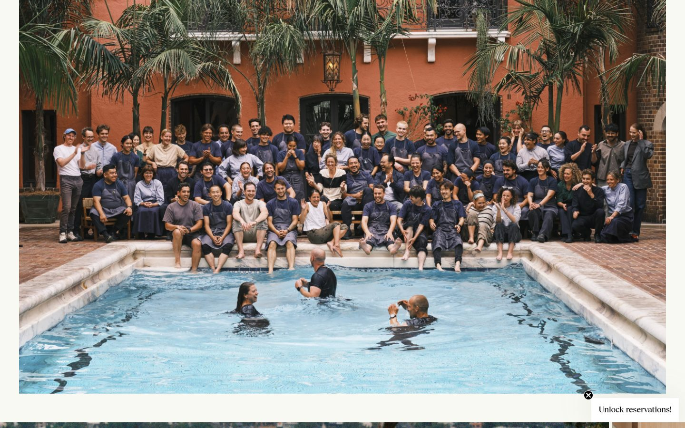

# noma

<!-- gallery:start -->

<a href="../../README.md#restaurants">All sites</a> &nbsp;&nbsp; <a href="../dishoom/teardown.md">&larr; Dishoom</a> &nbsp;&nbsp; <a href="../izakaya-sakura/teardown.md">Izakaya Sakura &rarr;</a> &nbsp;&nbsp; <a href="https://noma.dk">Open the live site</a>

<!-- gallery:end -->

Looked at on 2026-10-28. https://noma.dk

**The idea:** Plain photographs and a long letter signed by the team carry the whole homepage.

## What you see
A full-bleed photo of the restaurant's buildings and garden, "Copenhagen 2026-2027" and an outlined Book a table button. The header holds a lowercase wordmark, Reservations, EN / DA and a menu icon. A cream newsletter bar follows, then two shop still lifes (garum, coffee) with a one-line caption and an underlined link each. Then a long letter beside a tall still life: it opens "Friends,", explains the move from Los Angeles back to Copenhagen and a year of twelve monthly seasons, names the new leaders, and ends "The entire Noma team". After it, one staff photo of everyone around a pool.

## Stack
| Layer | What |
|---|---|
| Hosting | WordPress.com Atomic (`X-ac: ..._atomic_bur`), nginx |
| CMS | WordPress, custom `noma` theme; Jetpack, Contact Form 7, Complianz GDPR, Klaviyo, Site Kit by Google 1.190.0 |
| Booking | Tock (exploretock references in the page) |
| Type | Reckless Neue and Reckless (serif), Roobert (sans) |
| Weight | 18.6 MB, 98 requests, 18.1 MB of it images |
| Motion | Has a `prefers-reduced-motion` rule |

## Steal
- Write a real letter. News in full sentences, signed by the team, says more than any tagline.
- Name people. The letter names the new head chef, CEO and head of R&D.
- One photo of the whole staff doing something human.
- Header with two jobs only: book, and pick a language.

## Don't steal
- The "Unlock reservations!" teaser floats in the bottom-right corner of every screen: a floating corner chip that covers content.
- 18 MB of images. A small restaurant homepage should be a tenth of that.
- No JSON-LD in the served HTML, so no `Restaurant` hours or address for search. Dishoom has it.
