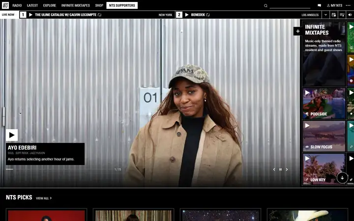
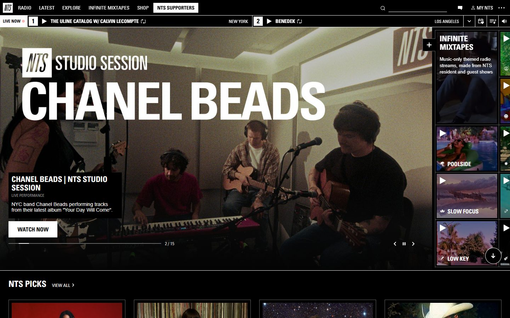
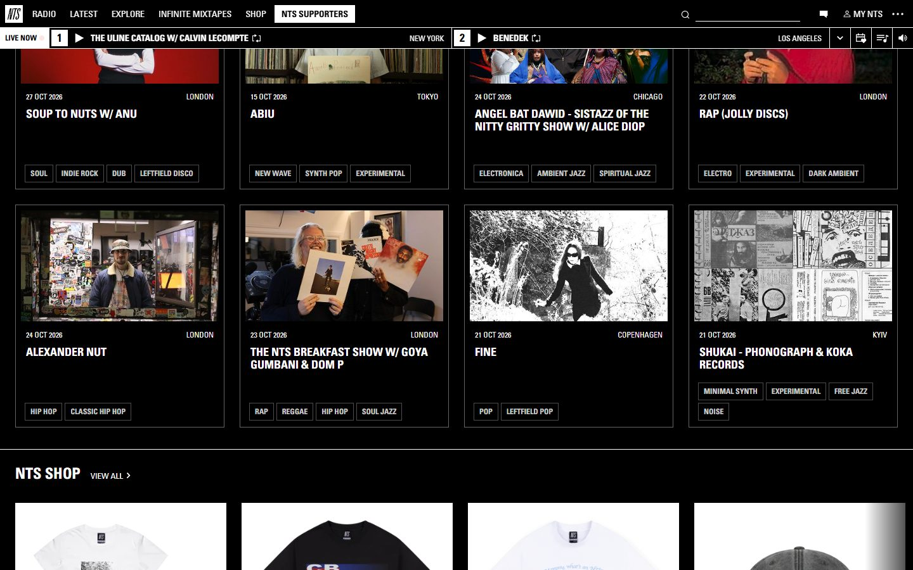
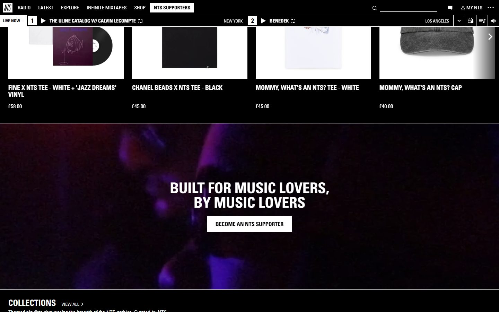
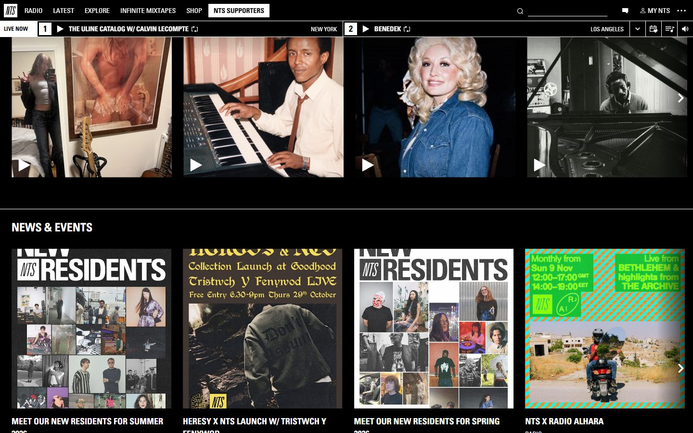
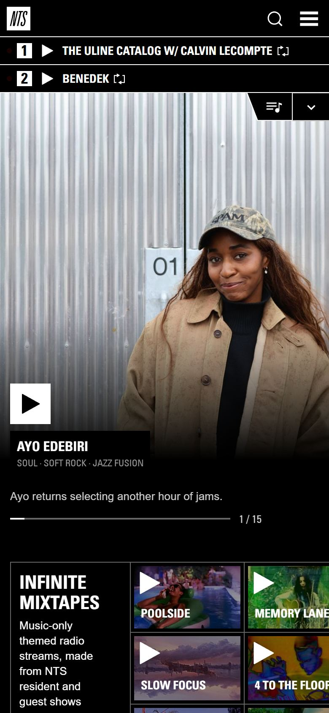

# NTS

<!-- gallery:start -->

<a href="../../README.md#products-radio-and-genre-pieces">All sites</a> &nbsp;&nbsp; <a href="../poolsuite/teardown.md">&larr; Poolsuite</a> &nbsp;&nbsp; <a href="../panic/teardown.md">Panic &rarr;</a> &nbsp;&nbsp; <a href="https://www.nts.live">Open the live site</a>

<!-- gallery:end -->

Looked at on 2026-10-28. https://www.nts.live

**The idea:** A radio that is always on: two live channels stay pinned under the nav on every page.

## What you see
A black page set entirely in white condensed caps. Under the nav, a bar holds LIVE NOW and both channels: number, play button, show name, city (New York, Los Angeles). Below it, a 15-slide carousel of shows, a column of Infinite Mixtapes tiles, then rows of outlined cards with date, city, show title and genre tags in outlined boxes. Then shop, a supporters band, collections, and news posters made by the station. On phone the two channels stack as rows at the top.

## Stack
| Layer | What |
|---|---|
| Hosting | nginx 1.20.2 behind CloudFront |
| Front end | React 18.3.1 with Redux, server state in `window._REACT_STATE_`, plus jQuery; one 6.1 MB `app.min.js` (1.4 MB transferred) |
| Type | Univers Condensed, nothing else |
| Weight | 1.6 MB, 140 requests |
| Motion | Reduced motion stops the live-dot flicker, the channel drawer slide and the loading GIF |
| Consent | OneTrust |

## Steal
- Put the live thing in the page chrome, not in a section. The player bar stays put while you scroll, so the site is a radio first.
- One condensed face in caps for everything. Hierarchy comes from size and outlined boxes, not extra fonts.
- Cards carry data, not blurbs: date, city, title, genres.
- Genre tags as plain outlined boxes in the same face. No color coding, no icons.

## Don't steal
- The red dot after LIVE NOW flickers on a 2 s loop. That is the banned pulsing dot badge. It is honest here, the station is live and reduced motion stops it, but it does not transfer.
- The tiny caps "LIVE PERFORMANCE" line under the hero title works like a kicker label.
- 140 requests and a 6 MB script for a page of cards.
