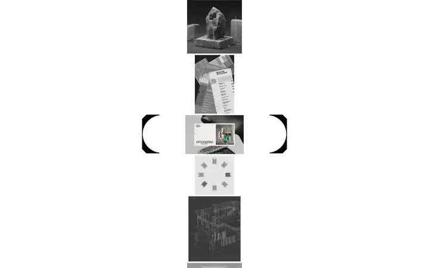
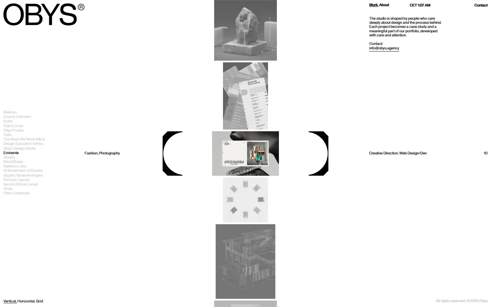
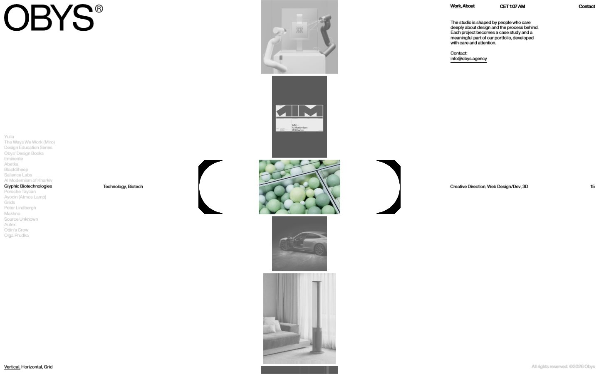
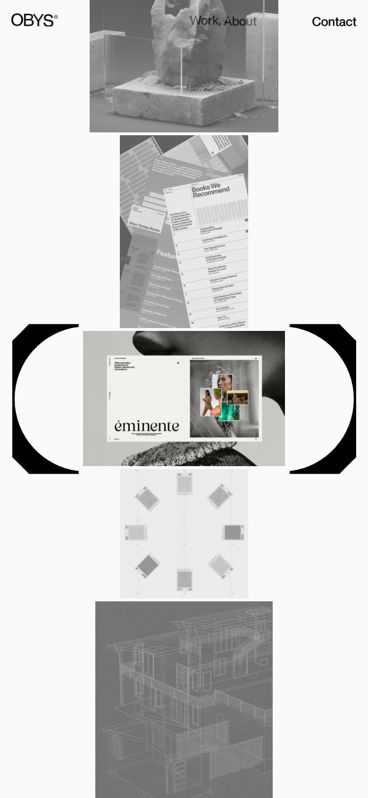

# Obys

<!-- gallery:start -->

<a href="../../README.md#studios-and-motion-craft">All sites</a> &nbsp;&nbsp; <a href="../lando-norris/teardown.md">&larr; Lando Norris</a> &nbsp;&nbsp; <a href="../paris-freestyle/teardown.md">Paris Freestyle &rarr;</a> &nbsp;&nbsp; <a href="https://obys.agency">Open the live site</a>

<!-- gallery:end -->

Looked at on 2026-11-08. https://obys.agency

**The idea:** a studio index where a strip of thumbnails scrolls through a bracket that picks the project.

## What you see
The whole home page is one mechanism: a vertical strip of project thumbnails, all grey, scrolling through a pair of big black brackets in the middle. Whatever sits inside the brackets turns to color, and its name lights up in the long grey list on the left, with its discipline and number on the right. A switch at the bottom changes the view to Vertical, Horizontal or Grid. A live clock sits in the header. 88 KB.

## Stack
| Layer | What |
|---|---|
| Framework | Hand-built, no framework fingerprint |
| Fonts | Obys, Obys Sans |
| Weight | 88 KB, 27 requests |
| Reduced motion | No `prefers-reduced-motion` rule in the CSS |
| Hosting | nginx |

## Steal
- One mechanism for the whole page: scroll moves the strip, the brackets choose. Index and showcase in one.
- Grey everywhere except the selected item: color as the selection state.
- Tiny weight for a site this striking.

## Don't steal
- Unreadably small grey list type on a big screen.
