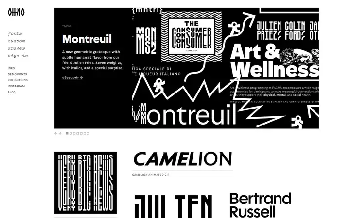
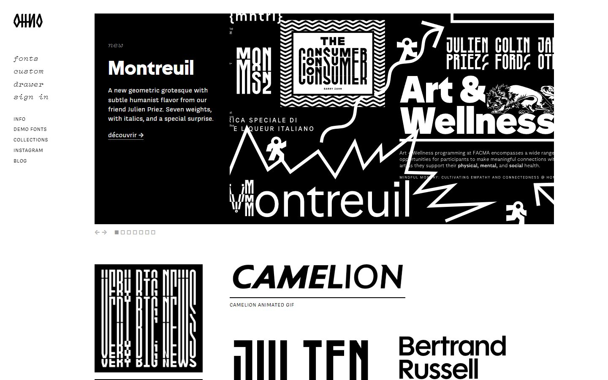
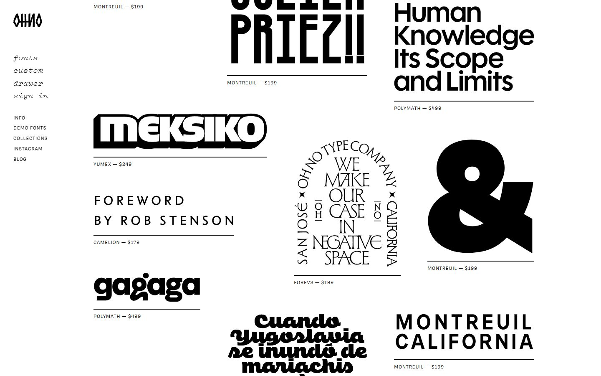
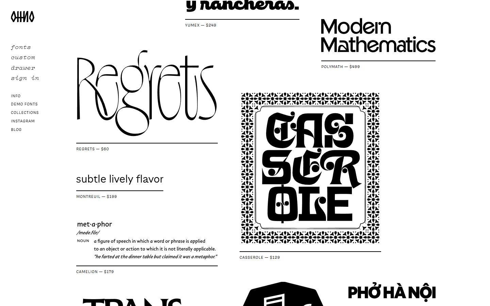
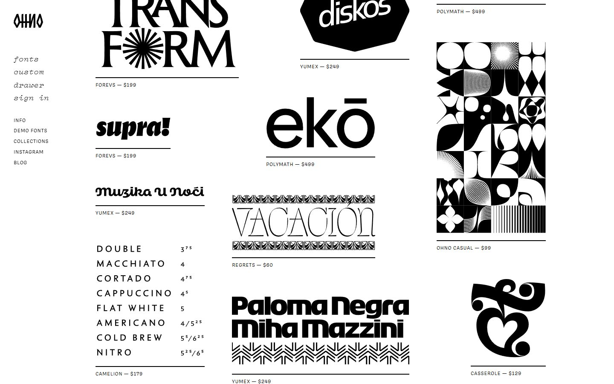
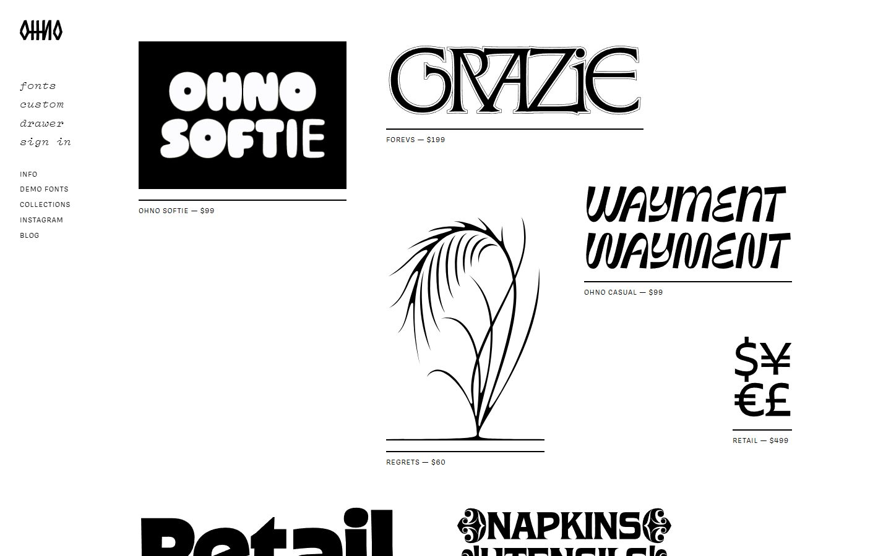
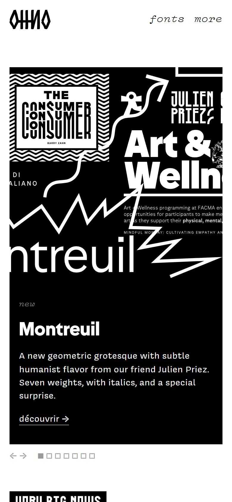

# OH no Type Company

<!-- gallery:start -->

<a href="../../README.md#type-foundries-and-editorial">All sites</a> &nbsp;&nbsp; <a href="../dinamo/teardown.md">&larr; Dinamo</a> &nbsp;&nbsp; <a href="../commercial-type/teardown.md">Commercial Type &rarr;</a> &nbsp;&nbsp; <a href="https://ohnotype.co">Open the live site</a>

<!-- gallery:end -->

Looked at on 2026-10-28. https://ohnotype.co

**The idea:** a shop window of black-and-white specimen art, each piece tagged with its font and price.

## What you see

Black and white only. A fixed left column holds the logo, a nav in lowercase italic Vulf Mono ("fonts", "custom", "drawer", "sign in") and smaller caps links. The right side opens with a release carousel whose title is set live in Montreuil Bold, then a loose three-column field of specimen pieces in three sizes: posters, lettering, a café menu, a dictionary entry. Each piece sits on a black rule with one caption under it, such as "YUMEX — $249".

## Stack

| Layer | What |
|---|---|
| CMS | Craft CMS with Craft Commerce (`x-powered-by`), behind Cloudflare |
| Images | Specimens are SVGs and GIFs from a DigitalOcean Spaces CDN |
| Fonts | Covik Sans for interface text and Vulf Mono for the nav, plus Montreuil, Camelion, Yumex, Forevs, Blazeface and Obviously, all their own |
| Weight | meta.json counts 217 KB over 39 requests; the CDN images were not counted |
| Reduced motion | No `prefers-reduced-motion` rule |

## Steal

- Black and white only, so dozens of display faces share one page without a colour fight.
- One repeated unit: artwork, a full-width rule, one caption with font and price. The repetition makes a ragged grid read as a set.
- Tiles in three sizes on a three-column grid with uneven vertical offsets. It looks pinned up without any rotation or shadow.
- Real uses as specimens (a café menu, a dictionary entry, a book jacket) instead of pangrams.

## Don't steal

- The small letter-spaced caps in the captions and side links. Under the artwork they work as price tags; moved above a heading they become the banned kicker.
