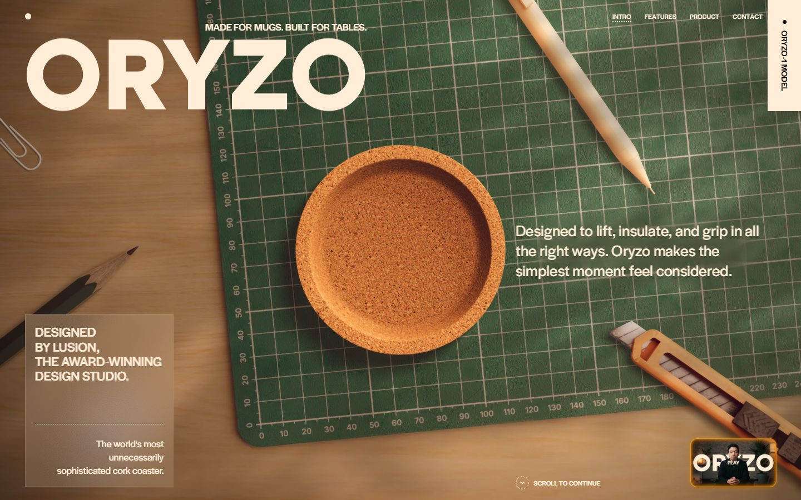
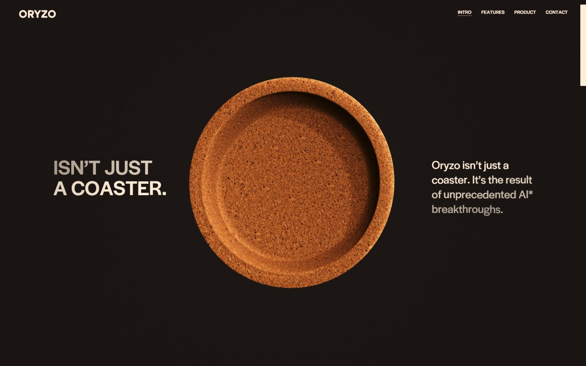
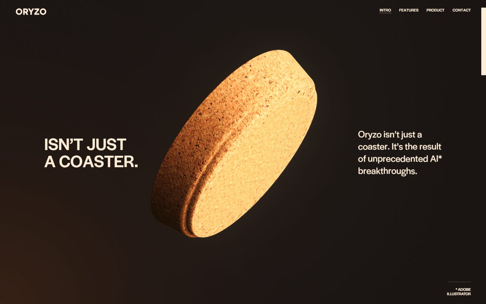
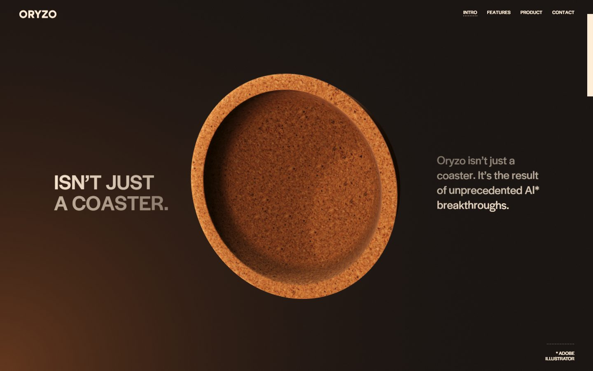
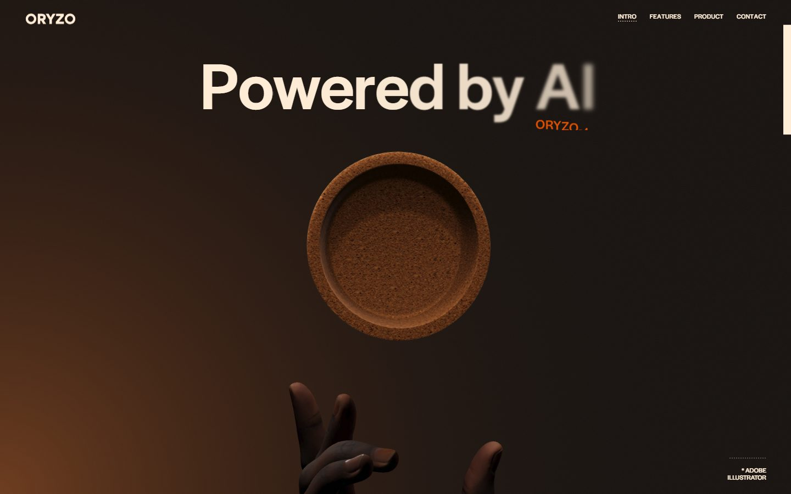
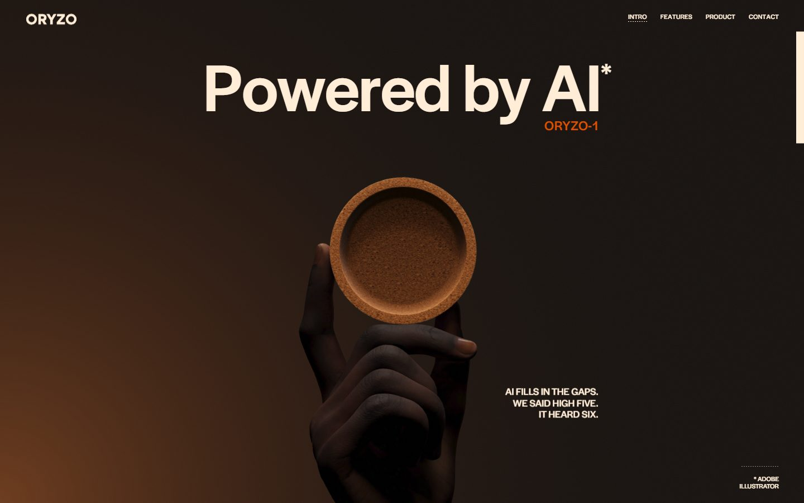
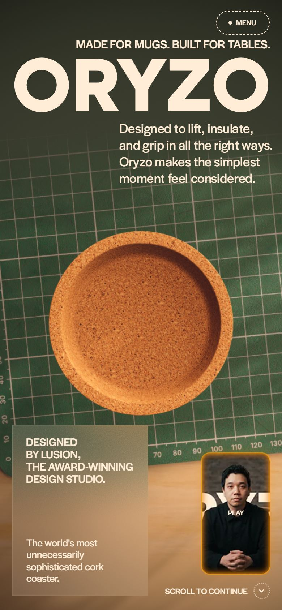

# Oryzo

<!-- gallery:start -->

<a href="../../README.md#worlds">All sites</a> &nbsp;&nbsp; <a href="../messenger-abeto/teardown.md">&larr; Messenger (Abeto)</a> &nbsp;&nbsp; <a href="../garden-eight/teardown.md">Garden Eight &rarr;</a> &nbsp;&nbsp; <a href="https://oryzo.ai">Open the live site</a>

<!-- gallery:end -->

Looked at on 2026-10-28. https://oryzo.ai

**The idea:** sell a cork coaster like an AI model launch, to prove the studio can sell anything.

## What you see
A top-down desk: cutting mat with ruler numbers, pencil, paper clip, utility knife and one cork coaster. Scrolling lifts the coaster into a dark brown space where it turns while lines of copy dim and brighten. A hand rises to catch it under "Powered by AI*", and the footnote says the AI is Adobe Illustrator. The HTML holds the rest: Pro and Pro Max tiers, a mock paper with BibTeX, an .OBJ "open-weight model", fake reviews, and the closing line "If we can sell a coaster, imagine what we can do for your brand."

## Stack
| Layer | What |
|---|---|
| Framework | Astro |
| 3D | three.js r178, tagged "modified by Lusion"; six canvases |
| Fonts | halyard-display-variable, Literata, DM Mono |
| Weight | 15 MB (7.5 MB images, 299 KB JS), 142 requests |
| Reduced motion | No |
| Hosting | Cloudflare |
| By | Lusion (meta author) |

## Steal
- Copy a genre's page structure exactly (launch hero, tiers, paper, BibTeX) and make the product plainly ordinary.
- Footnotes as punchlines: "Powered by AI*", then "* Adobe Illustrator".
- One real material, cork, rendered closely enough to carry the page.
- Real desk props to set the scale.

## Don't steal
- The frosted-glass "Designed by Lusion" card. Glassmorphism.
- The floating video thumbnail with an orange glow in the corner, and the vertical "ORYZO-1 MODEL" tab on the right edge. Corner chips.
- A joke on every line. It is the point of a parody; on a real product it is the banned pattern.
