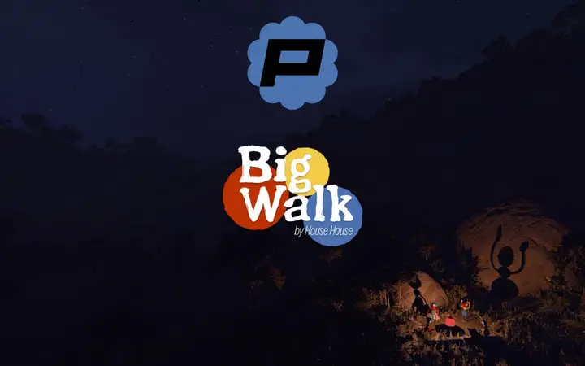
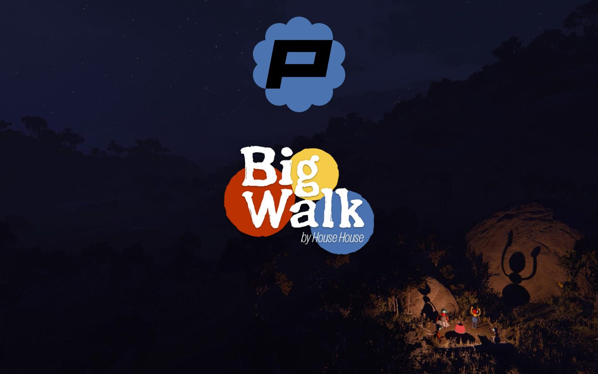
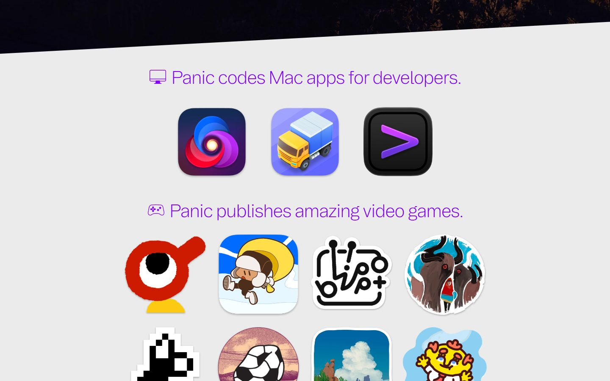
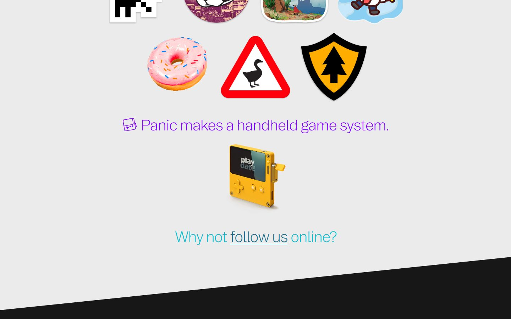
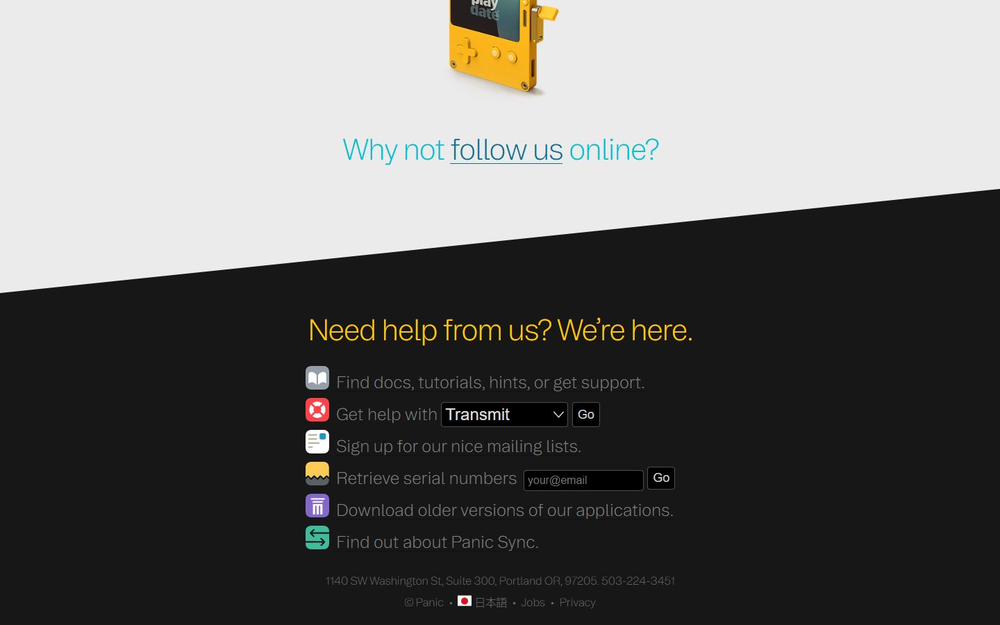
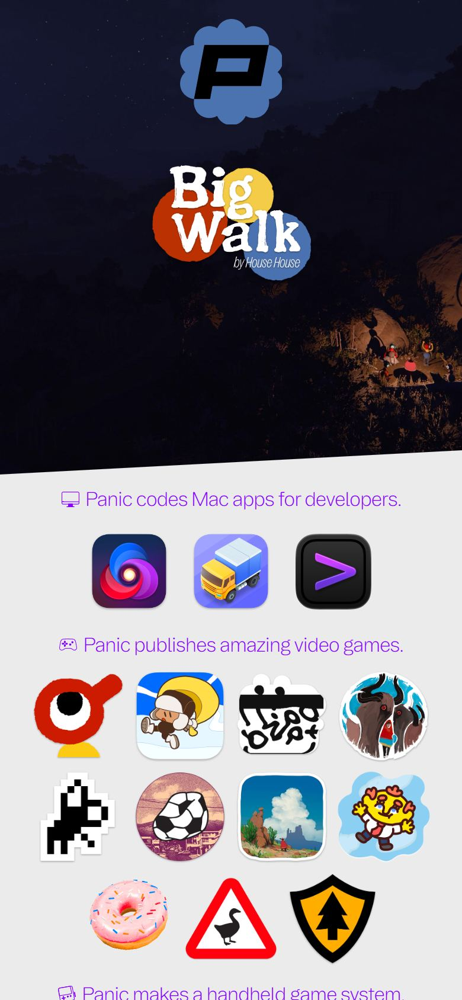

# Panic

<!-- gallery:start -->

<a href="../../README.md#products-radio-and-genre-pieces">All sites</a> &nbsp;&nbsp; <a href="../nts/teardown.md">&larr; NTS</a> &nbsp;&nbsp; <a href="../shopify-editions/teardown.md">Shopify Editions Winter '26 &rarr;</a> &nbsp;&nbsp; <a href="https://www.panic.com">Open the live site</a>

<!-- gallery:end -->

Looked at on 2026-10-28. https://www.panic.com

**The idea:** Three plain sentences say what Panic makes, and the icons of those things sit under each.

## What you see
The header is taken over by one of their published games, picked at random from eight on each load (Big Walk at capture): full-bleed game art, the game's logo linking to its own site, Panic's flower-shaped P on top. A slanted edge drops to a light grey page with three purple sentences: Mac apps, video games, a handheld. Under each sit only the icons, each in its own shape. The black footer is a help block with working tools inline (a product picker, a serial-number lookup), then the street address and phone number.

## Stack
| Layer | What |
|---|---|
| Hosting | Cloudflare |
| Front end | Static HTML and one CSS file; `panic.js` (1.8 KB) picks the takeover. 9 KB of JS in all |
| Canvas | `fly.js`: a 2D canvas pixel fly for the Time Flies takeover that steers around elements marked `.blockfly` |
| Edges | `clip-path: polygon(...)` for the diagonal section edges |
| Type | Booton, Hellix, Space Mono |
| Weight | 5.0 MB, 77 requests, 4.9 MB of it images |
| Motion | Has a `prefers-reduced-motion` rule |
| Analytics | Umami, self-hosted |

## Steal
- Say what you do in three flat sentences and put the work right under each. No about section needed.
- Let the newest work take the header, picked at random, linking out. A restaurant could do this with this week's dishes or a guest cook.
- Put working tools in the footer. The serial lookup is a form, not a link to a form.
- Address and phone as plain text at the bottom of the page.

## Don't steal
- Nothing on the banned list. The sticker-shaped icons are the products' own art.
- 4.9 MB of images for a page of icons. Size them for the box they sit in.
