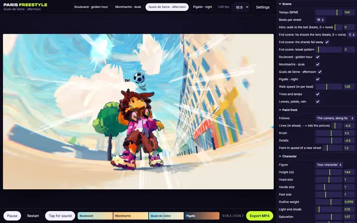
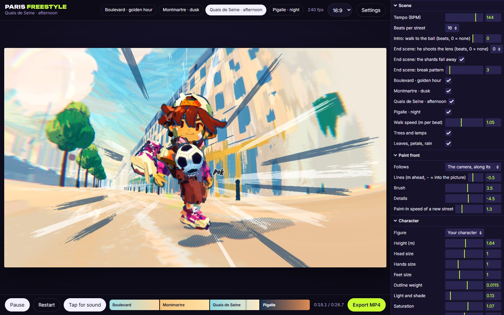

# Paris Freestyle

<!-- gallery:start -->

<a href="../../README.md#worlds">All sites</a> &nbsp;&nbsp; <a href="../obys/teardown.md">&larr; Obys</a> &nbsp;&nbsp; <a href="../rainforest-flight/teardown.md">Cloud Flight (Karim Beyrouti) &rarr;</a> &nbsp;&nbsp; <a href="https://parisfreestyle.netlify.app/">Open the live site</a>

<!-- gallery:end -->

Looked at on 2026-11-11. https://parisfreestyle.netlify.app/

**The idea:** a kid juggles a football down four Paris streets that paint themselves in as brush strokes, cut to a beat and exported as a clip.

## What you see
One canvas in a frame, like a video editor: four street chips along the top (Boulevard, golden hour; Montmartre, dusk; Quais de Seine, afternoon; Pigalle, night), a timeline along the bottom with one coloured band per street, and an Export MP4 button. A cartoon kid walks toward the camera keeping a ball up. The street is not modelled in detail: a wall is one flat cream stroke, a window is one blue dab, a tree is three greens. Paint arrives ahead of the camera (the panel calls it the paint front) and the paper is left bare where it has not reached, so every frame has white edges like a gouache study. Each touch of the ball prints a small hand-lettered word. The shadow under the kid is a halftone dot screen, and long dry-brush streaks radiate from the centre as speed lines. Colour fringes at the frame edge finish the lens.

The settings panel is the real lesson. It is written in plain words about the picture, not about the engine: "Paint-in speed of a new street", "Lines (m ahead, minus = into the picture)", "End scene: he shoots the lens", "the shards fall away". Tempo is in beats a minute and each street lasts a set number of beats, so the cuts land on the music. Format switches between 9:16, 4:5, 1:1 and 16:9 with a safe-area overlay for captions. Settings copy out and load back as JSON.

## Stack
| Layer | What |
|---|---|
| Framework | three.js r147, one canvas, custom brush shaders |
| Controls | lil-gui, restyled to the page |
| Export | MP4 muxed in the browser (mp4-muxer) |
| Fonts | Unbounded for the name, Inter for the controls, Caveat Brush for the words in the picture |
| Weight | 1.4 MB of script, most of it the character, baked into a script file from a rigged model |
| Reduced motion | none |
| Hosting | Netlify |

## Steal
- Leave the paper showing. Unpainted edges read as a choice; fog and fade-outs read as a limit.
- One stroke per thing: a window is a dab, not a window. The palette does the work, one palette per place and hour.
- Name a place together with its hour ("Quais de Seine, afternoon"). The light is part of the address.
- A timeline of places as coloured bands, cut on the beat: a tour that plays itself.
- Build the export in: aspect ratios, safe areas and an MP4 button make the piece its own camera crew.
- Label every control by what it does to the picture.
- Comic-book grammar for impact: a lettered word at each hit, halftone for shadow, streaks for speed.

## Don't steal
- The code and shaders are all rights reserved, with a notice in the source that forbids copying or reuse. Look, don't lift.
- The dark purple app chrome with pill buttons and an acid-green main button: it is a tool's skin, and on a site it would read as a template.
