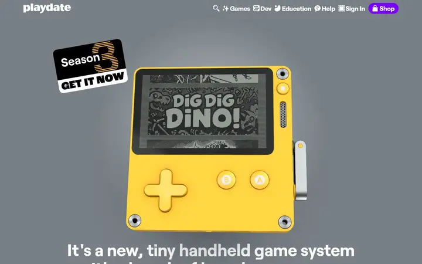
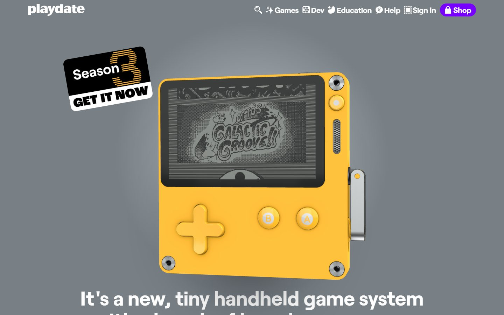
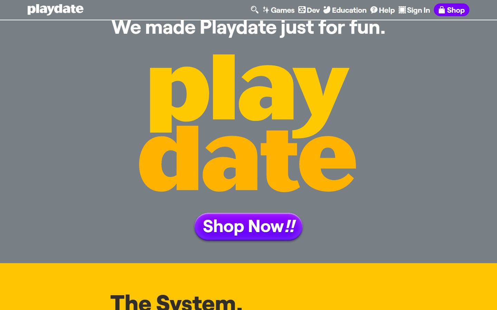
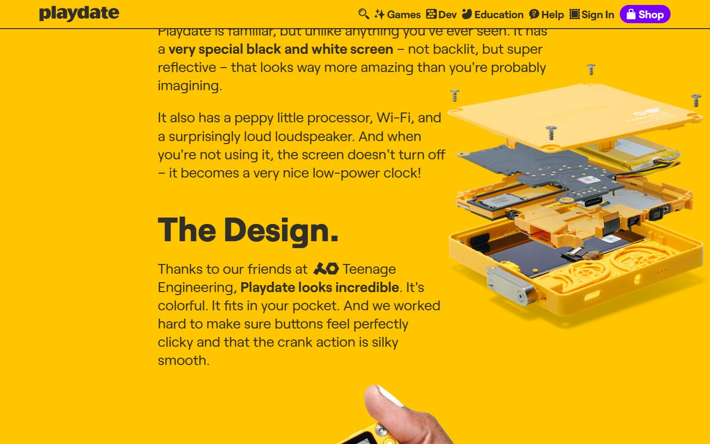
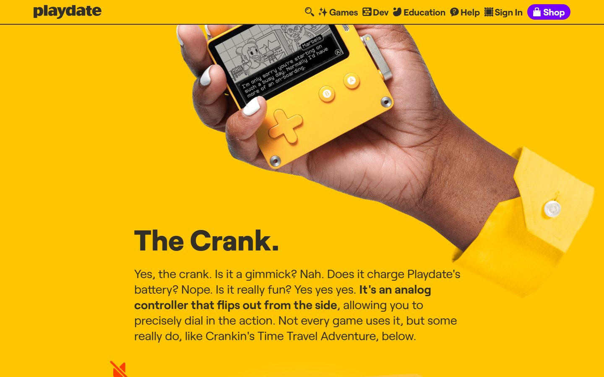
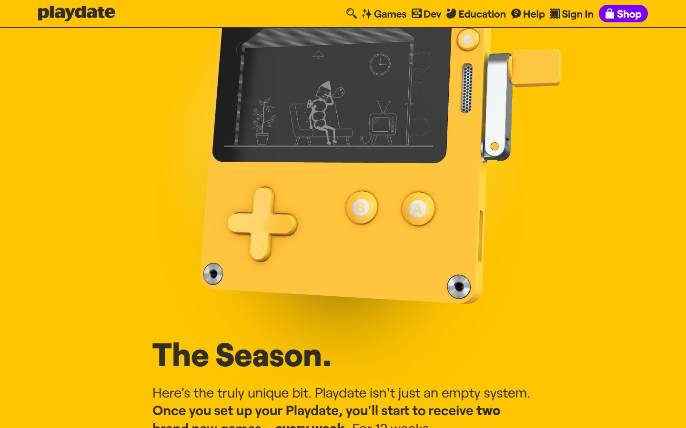
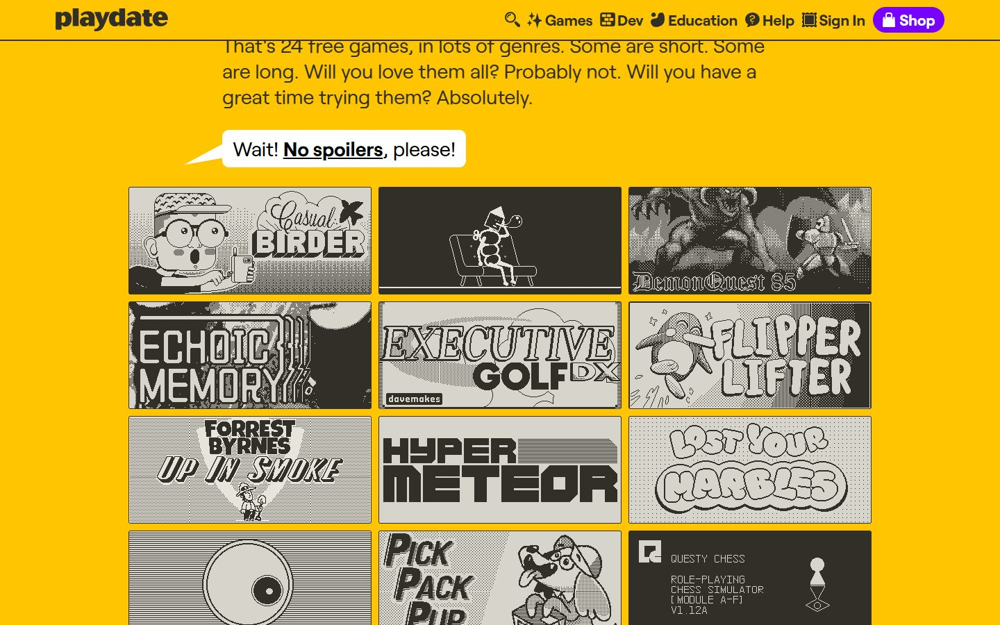
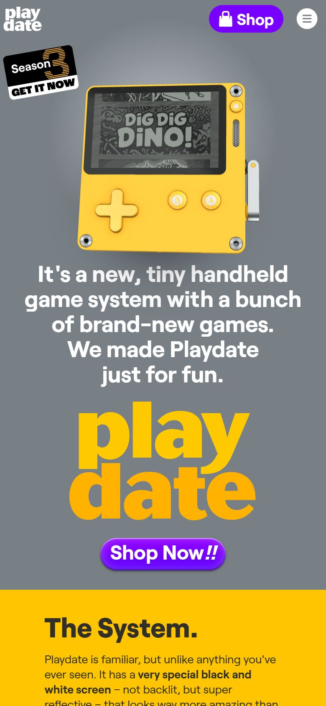

# Playdate

<!-- gallery:start -->

<a href="../../README.md#products-radio-and-genre-pieces">All sites</a> &nbsp;&nbsp; <a href="../ciechanowski-watch/teardown.md">&larr; ciechanowski-watch</a> &nbsp;&nbsp; <a href="../teenage-engineering/teardown.md">teenage engineering &rarr;</a> &nbsp;&nbsp; <a href="https://play.date">Open the live site</a>

<!-- gallery:end -->

Looked at on 2026-10-28. https://play.date

**The idea:** A real 3D Playdate plays its own games on screen and flips its crank open as you scroll.

## What you see
A grey page with a 3D Playdate whose screen plays the real game launcher, then one sentence, a huge yellow "play date" wordmark and a Shop button. Then the page and nav turn yellow. Four short sections (System, Design, Crank, Season) each get a bold head, one chatty paragraph and a product photo. A second 3D device flips its crank out and starts a game video when it is 75% in view.

## Stack
| Layer | What |
|---|---|
| Hosting | Cloudflare |
| Pages | Server-rendered HTML with hashed static JS; no front-end framework detected |
| 3D | three.js r90 inside their own `model-viewer.min.js`; two canvases, each device screen textured with an mp4 |
| Fallback | Goes static if WebGL has not rendered after 30 s |
| Motion | Reduced motion skips the intro reveal, swaps the crank animation for a "Watch the game!" button, and stops card tilt |
| Type | Roobert |
| Weight | 2.8 MB, 80 requests, 2.4 MB of it images |
| Analytics | Umami, self-hosted |

## Steal
- The motion is a product demo: the 3D device plays real footage.
- Page color follows the object: grey intro, then the device's yellow. One `data-color` per section drives page and nav.
- Sections named after the parts of the thing, each one head and one paragraph.
- Reduced motion handled effect by effect, with a button to opt in to the one that matters.

## Don't steal
- The rotated "Season 3 GET IT NOW" sticker in the hero corner is a floating corner chip.
- Tilt-and-shine on the game cards on hover. Decoration from a component library, not from the games.
- The Q&A banter ("Is it a gimmick? Nah.") works for Panic's own toy. Copied elsewhere it becomes a quip on every line.
