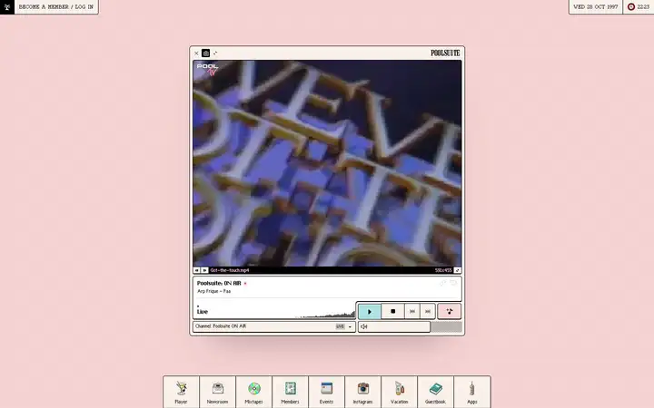
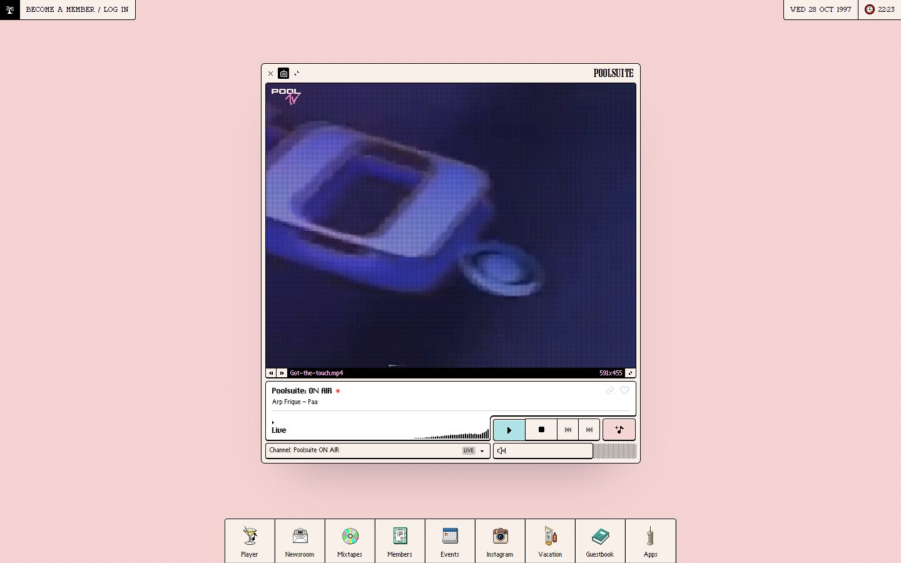
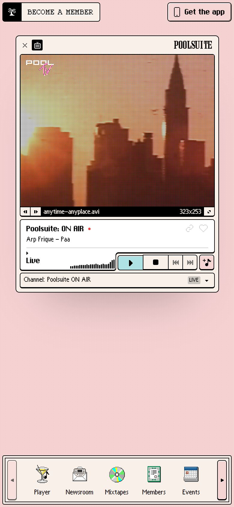

# Poolsuite

<!-- gallery:start -->

<a href="../../README.md#products-radio-and-genre-pieces">All sites</a> &nbsp;&nbsp; <a href="../teenage-engineering/teardown.md">&larr; teenage engineering</a> &nbsp;&nbsp; <a href="../nts/teardown.md">NTS &rarr;</a> &nbsp;&nbsp; <a href="https://poolsuite.net">Open the live site</a>

<!-- gallery:end -->

Looked at on 2026-10-28. https://poolsuite.net

**The idea:** A late-90s desktop: the radio is an app window, sections are dock icons, the year is 1997.

## What you see
A pink dotted desktop with a menu bar: member login on the left, date and clock on the right. The date shows today's weekday and day with the year set to 1997. In the middle is one player window: a dithered video channel with fake filenames (`Got-the-touch.mp4`, `anytime-anyplace.avi`), the track, a level meter, transport buttons and a channel picker. A dock of nine pixel icons (Player, Newsroom, Mixtapes, Members, Events, Instagram, Vacation, Guestbook, Apps) is the whole nav. The page does not scroll, so there are no scroll shots.

## Stack
| Layer | What |
|---|---|
| Hosting | Netlify |
| Framework | Vue 3.5.13 with Vuex and vue-router; the HTML is a 4 KB shell with an empty `#app` |
| CSS | Tailwind 3.4.15 |
| Type | Pixolde, ChiKareGo2, Ishmeria, Everyday; the CSS also names Perfect DOS VGA 437 and Argent Pixel |
| Boot | Preloads a boot logo, a boot background and five vacation photos |
| Weight | 4.1 MB, 98 requests: 1.45 MB JS, 2.5 MB images |
| Motion | No `prefers-reduced-motion` rule |
| Tracking | Facebook pixel |

## Steal
- Pick one period object and use it everywhere: window chrome, dock, clock, filenames. For a music project the player can be the homepage.
- The nav is a row of icons with a word under each. The whole site fits in one line.
- Dither the video to match the pixel fonts so footage and interface look like one machine.

## Don't steal
- The red dot after "ON AIR" and the LIVE tag are a dot badge and a status pill. On a live radio they mean something; on a shop or restaurant they would be decoration.
- Nothing renders without the 1.45 MB JS app; with JS off you get one apology line.
- No reduced-motion handling.
