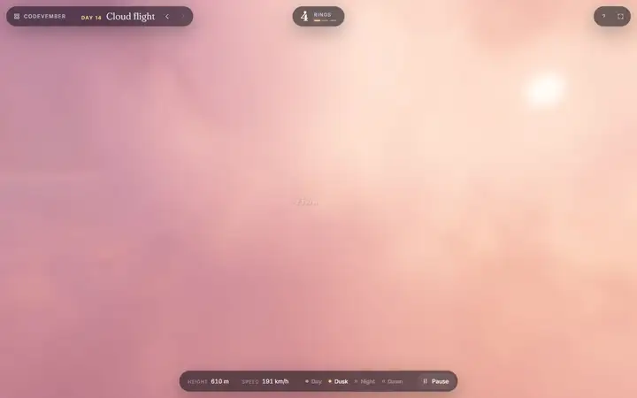
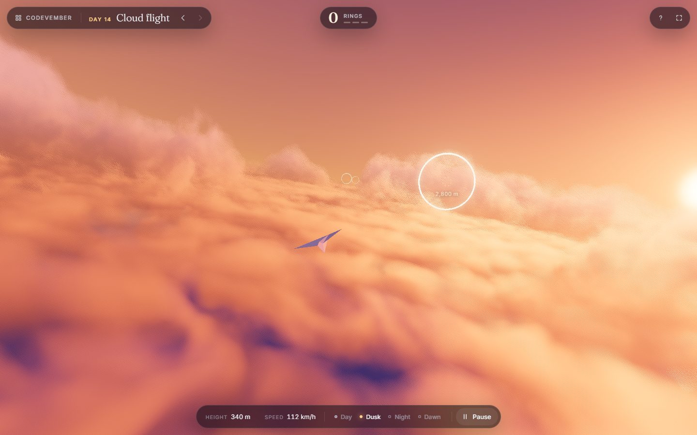
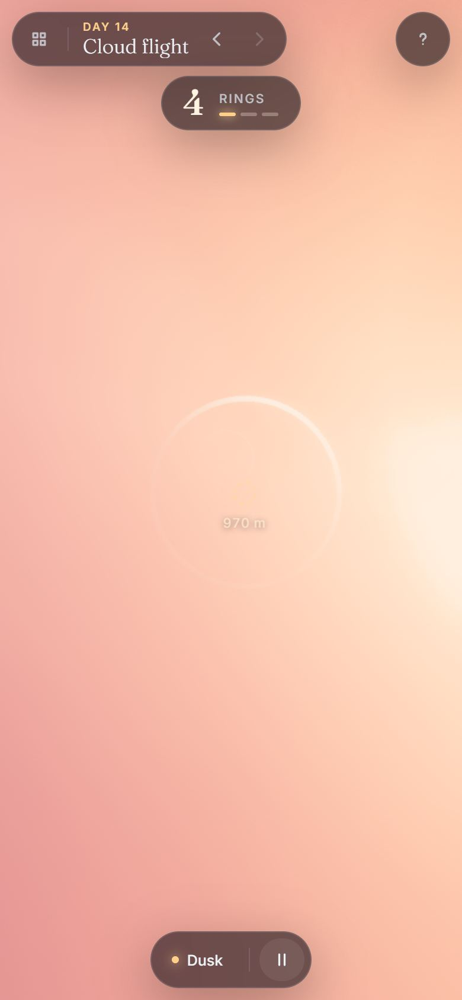

# Cloud Flight (Karim Beyrouti)

<!-- gallery:start -->

<a href="../../README.md#worlds">All sites</a> &nbsp;&nbsp; <a href="../paris-freestyle/teardown.md">&larr; Paris Freestyle</a> &nbsp;&nbsp; <a href="../nightclub-driftspeed/teardown.md">NightClub: Drift & Speed &rarr;</a> &nbsp;&nbsp; <a href="https://karimbeyrouti.github.io/rainforest/codevember.html#/flight">Open the live site</a>

<!-- gallery:end -->

Looked at on 2026-11-14. https://karimbeyrouti.github.io/rainforest/codevember.html#/flight
Found on the Three.js X page (posted 2026-11-14). Day 14 of Karim Beyrouti's Codevember.

**The idea:** a paper plane, a sea of cloud, and four times of day to fly it in.

## What you see
A paper plane flies over a thick cloud layer that fills the frame to the horizon. The clouds are lit from the right by a low sun: peach on top, violet in the gaps. White rings hang in the air to fly through, with a ring counter top centre. A bar at the bottom reads height and speed and switches Day, Dusk, Night and Dawn. A Pause button sits beside it. The day's name and prev/next arrows sit top left.

## Stack
| Layer | What |
|---|---|
| 3D | three.js r187, the WebGPU build (`three.webgpu`), with a render pipeline for post |
| Clouds | their own module (`cloud-noise`) loaded beside the scene |
| Fonts | Fraunces, Inter |
| Weight | 369 KB, all JavaScript. No images, no models. 13 requests |
| Hosting | GitHub Pages |

## Steal
- One subject, one light. The whole mood is the sun angle on the cloud tops.
- Time of day as four named buttons. Each is a full relight, so the same scene gives four pictures.
- Everything is generated: 369 KB with no textures or models.
- Pixel ratio capped at 2.
- The plane is tiny in frame. The clouds get the space.

## Don't steal
- The small uppercase labels in the top bar and the readout.
- Pill buttons with dots for the time of day.
