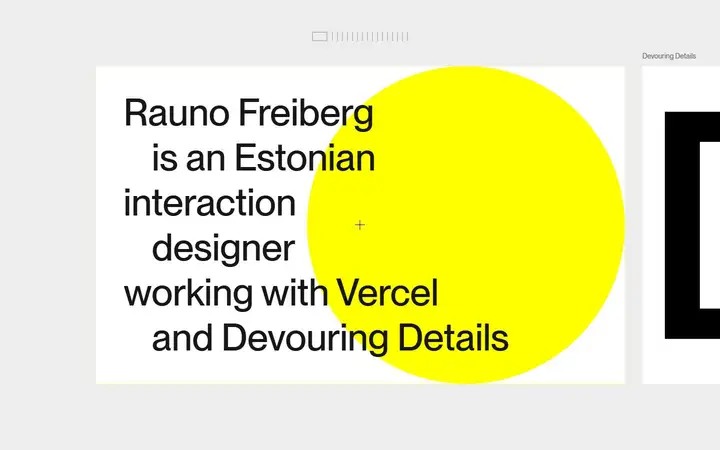
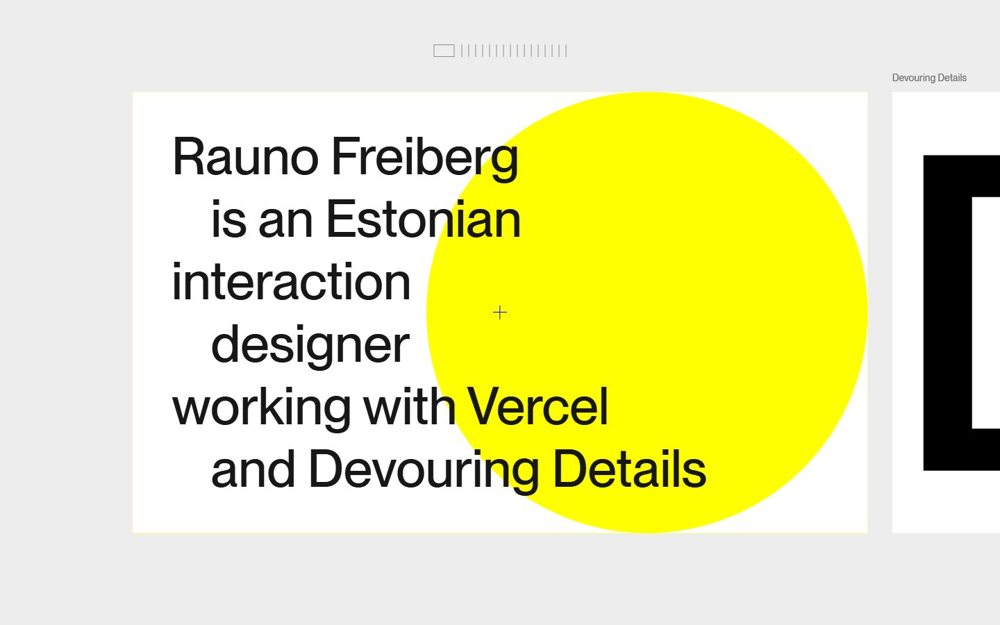
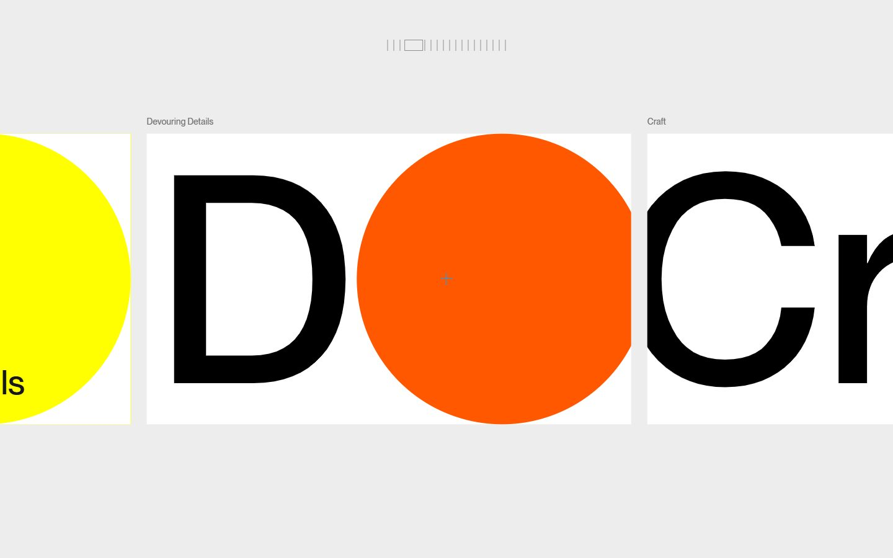
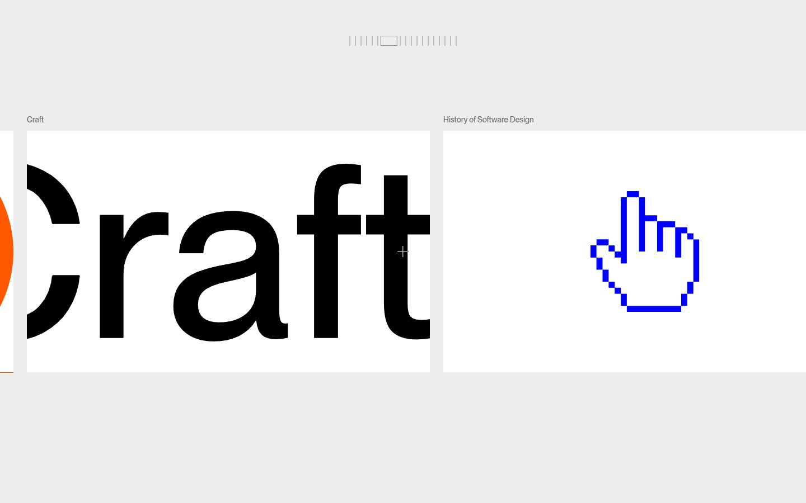
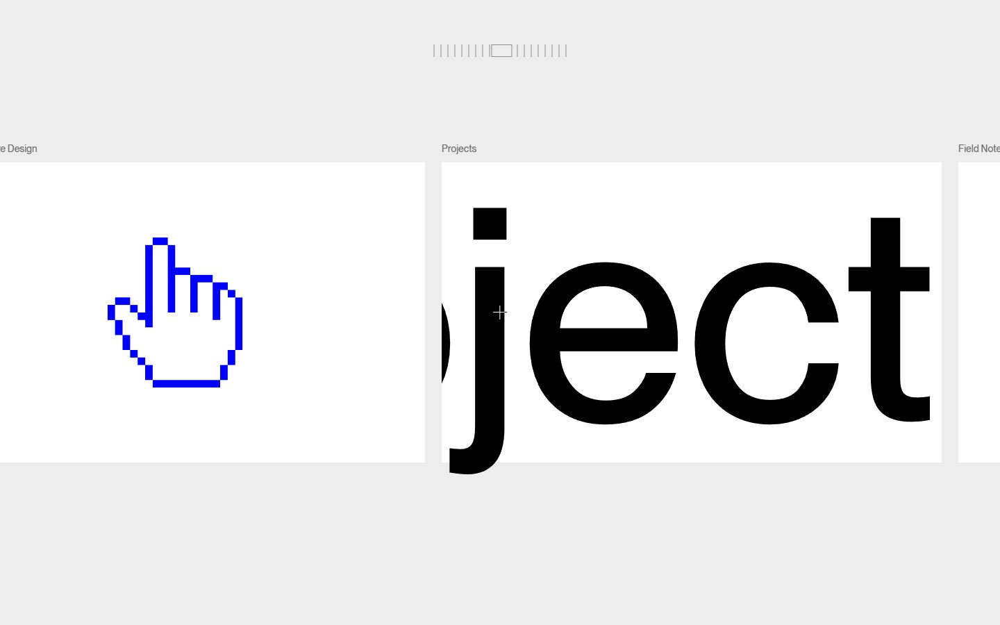
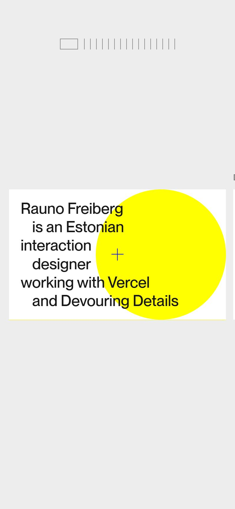

# Rauno Freiberg

<!-- gallery:start -->

<a href="../../README.md#writing-and-personal-sites">All sites</a> &nbsp;&nbsp; <a href="../craig-mod/teardown.md">&larr; Craig Mod</a> &nbsp;&nbsp; <a href="../maggie-appleton/teardown.md">Maggie Appleton &rarr;</a> &nbsp;&nbsp; <a href="https://rauno.me">Open the live site</a>

<!-- gallery:end -->

Looked at on 2026-10-28. https://rauno.me

**The idea:** the portfolio is one interaction: scrolling moves a sideways reel of big-type slides.

## What you see

A grey page with a row of white cards that slides sideways as you scroll. A ruler of thin ticks sits at top centre, one per card, and the current one widens into a box. A thin crosshair marks the centre of the screen. The first card sets "Rauno Freiberg is an Estonian interaction designer working with Vercel and Devouring Details" in six lines, every other line indented, over a flat yellow circle. Later cards hold one word set so large it crops at the edge ("DD", "Craft", "Projects") or a blue pixel hand cursor, each with a small grey sentence-case label above.

## Stack

| Layer | What |
|---|---|
| Framework | Next.js (pages router, `_next/static`) on Vercel |
| Fonts | One self-hosted file, `/dd.woff2` (51 KB), registered as the family "X" |
| Weight | 1,027 KB over 32 requests, 957 KB of it JS |
| Reduced motion | No `prefers-reduced-motion` rule |

## Steal

- Type as the picture: one word per card, big enough to crop at the edge.
- Hand-set line breaks with alternating indents, so a plain sentence reads as a title page.
- A tick ruler as the only navigation, one tick per item.
- Labels in small grey sentence case, not caps.

## Don't steal

- The flat colour circles. Nothing on the page says what they stand for, so they are decoration.
- Scroll turned sideways with no reduced-motion fallback.
- About 957 KB of JS for a page of words.
- On the phone the reel shows one small card in a mostly empty screen.
