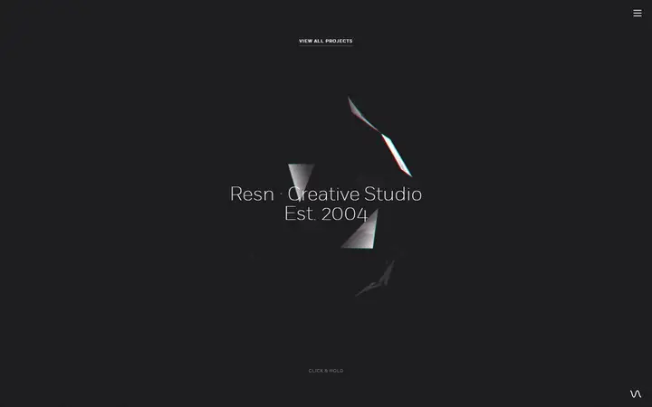
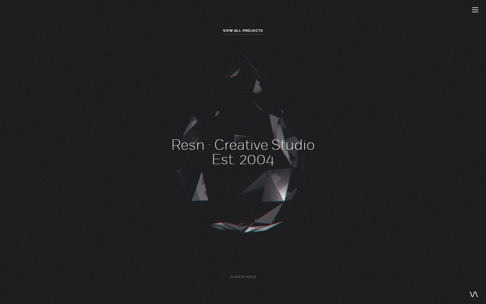
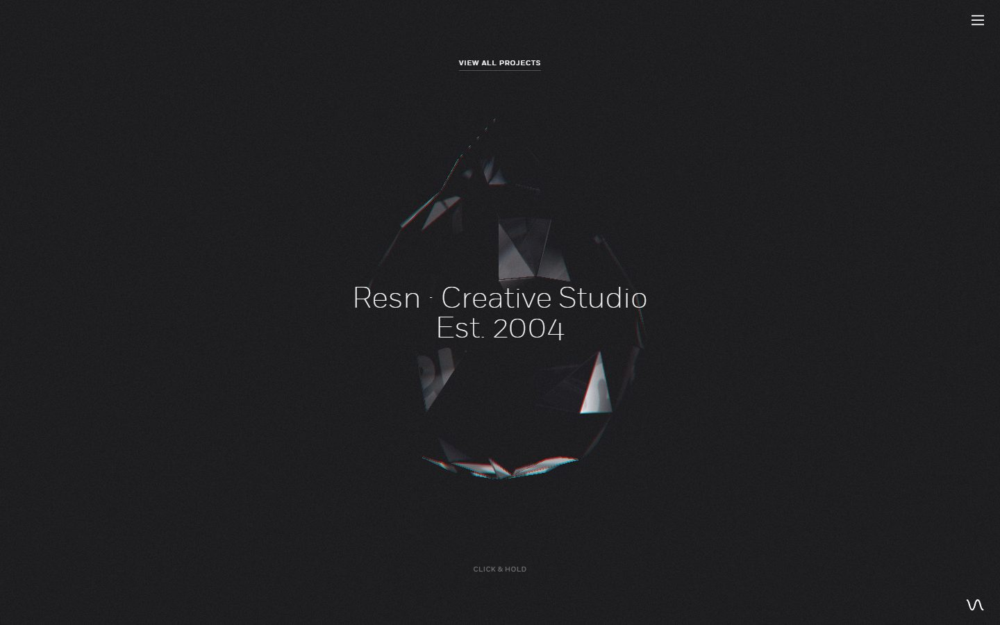
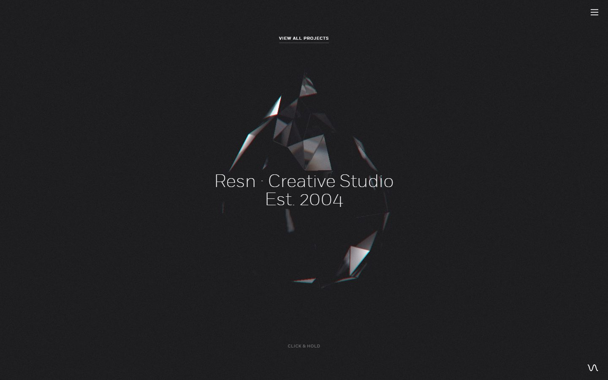
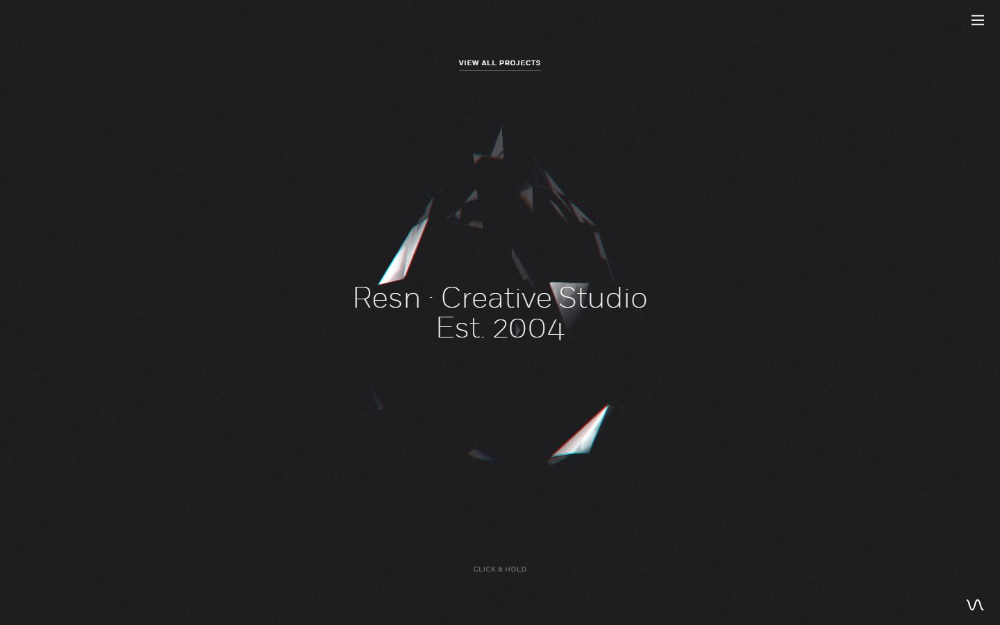
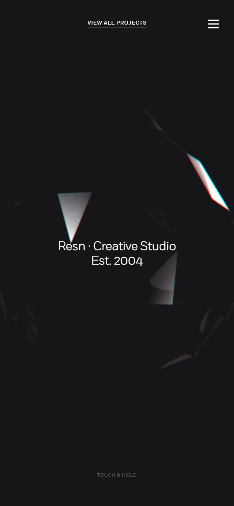

# Resn

<!-- gallery:start -->

<a href="../../README.md#worlds">All sites</a> &nbsp;&nbsp; <a href="../garden-eight/teardown.md">&larr; Garden Eight</a> &nbsp;&nbsp; <a href="../14islands/teardown.md">14islands &rarr;</a> &nbsp;&nbsp; <a href="https://resn.co.nz">Open the live site</a>

<!-- gallery:end -->

Looked at on 2026-10-28. https://resn.co.nz

**The idea:** one faceted drop floating in the dark, and the only instruction is click and hold.

## What you see
Near-black with fine grain. A teardrop made of loose triangular shards turns slowly, and the shard edges carry red and cyan fringes. Centre text in a light sans: "Resn · Creative Studio / Est. 2004". Around it only "View all projects", a menu icon and "Click & hold" (on the phone, "Touch & hold"). Scrolling does nothing: all four desktop captures are this one screen. The captures don't show what holding does. The loader icon in the HTML is also a drop (`loader__drop`).

## Stack
| Layer | What |
|---|---|
| Framework | None. RequireJS loader, Modernizr 2.5.3 and an IE10 check in the HTML |
| 3D | three.js r84, three canvases |
| Fonts | Fort (Extralight, Light, Book, Medium) |
| Weight | 27.6 MB (13 MB images, 4.35 MB JS), 131 requests |
| Reduced motion | No |
| Hosting | Amazon S3 behind CloudFront |

## Steal
- One object, one line of text, one instruction. The home page is a cover and the work is one link away.
- The prompt changes wording on touch devices ("Touch & hold").
- The founding year as the only claim on the page.
- Grain over the black.

## Don't steal
- 27.6 MB for one screen.
- The red and cyan edge fringes. A lens effect with no tie to the subject.
- Tiny letter-spaced uppercase for "VIEW ALL PROJECTS" and "CLICK & HOLD". Same vocabulary as the banned kicker.
