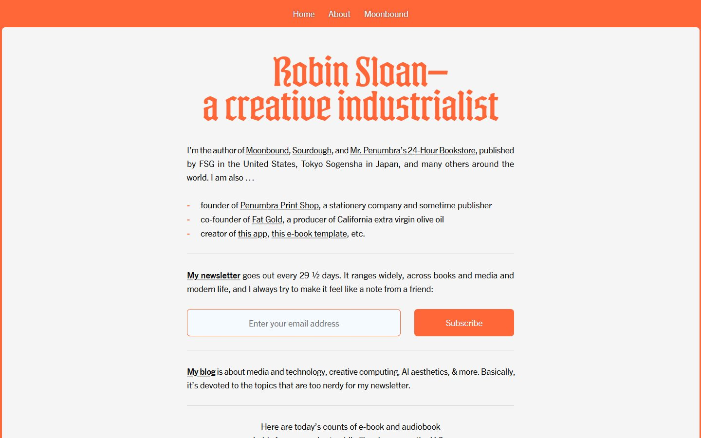
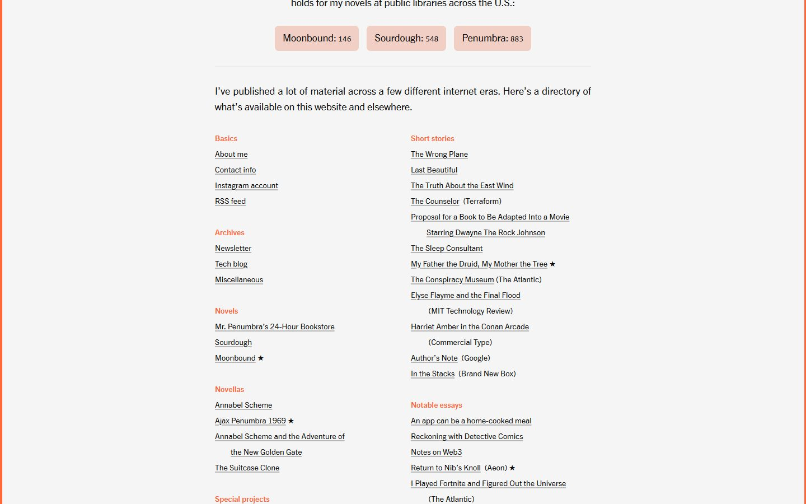
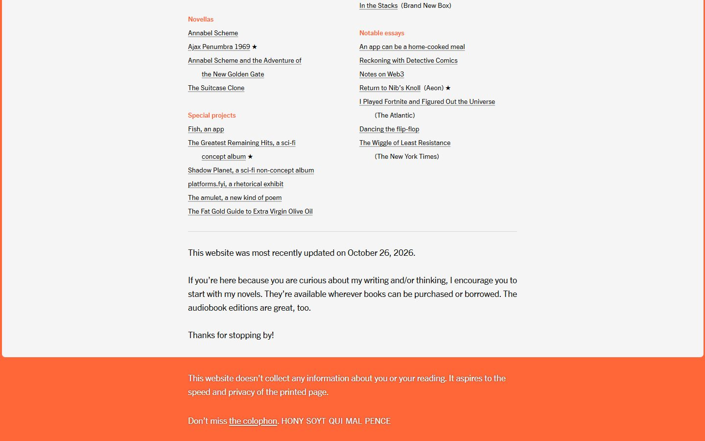
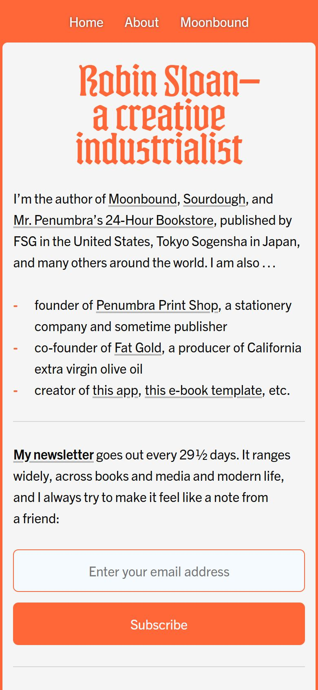

# Robin Sloan

<!-- gallery:start -->

<a href="../../README.md#writing-and-personal-sites">All sites</a> &nbsp;&nbsp; <a href="../gwern/teardown.md">&larr; Gwern.net</a> &nbsp;&nbsp; <a href="../craig-mod/teardown.md">Craig Mod &rarr;</a> &nbsp;&nbsp; <a href="https://www.robinsloan.com">Open the live site</a>

<!-- gallery:end -->

Looked at on 2026-10-28. https://www.robinsloan.com

**The idea:** a home page that aims for the printed page: one justified sheet and a directory.

## What you see

A light grey sheet inside an orange frame, with the nav in white on the orange. The headline is Kyrios in orange. Body text is Trade Gothic Next, justified, in a column of about 670 px, with orange hyphens as list bullets and grey hairlines between sections. A row of pink chips shows today's library hold counts for his three novels. The directory is two columns of underlined links under small orange heads, with stars on favourites. The footer says the site "aspires to the speed and privacy of the printed page."

## Stack

| Layer | What |
|---|---|
| Generator | `<meta name="generator" content="The very hands of Sloan">`, hand-built |
| Hosting | Cloudflare |
| Justification | A render-blocking script, `justif`, with TeX-style fitness classes and an en-US hyphenator, runs on `main p, li, blockquote` |
| Fonts | Kyrios for the headline, Trade Gothic Next for text, self-hosted and preloaded |
| Live data | Hold counts fetched from a Val Town endpoint into custom elements (`<hold-counts>`, `<book-data>`) |
| Weight | 2,195 KB over 7 requests. 1,976 KB of that is one preloaded GIF, `small-gate-loop.gif`, not visible in the screenshots |
| Reduced motion | No `prefers-reduced-motion` rule |

## Steal

- Real justification. If you justify on the web, run a proper line breaker with hyphenation, or don't justify.
- One sheet in a coloured frame: the frame is the brand, the sheet is the page.
- A directory instead of a feed: everything he has made, grouped, with stars on the places to start.
- One live number from the real world (library holds) as the page's only moving part.

## Don't steal

- Nothing on the banned list.
- The 2 MB GIF preload on a page that otherwise weighs about 220 KB.
