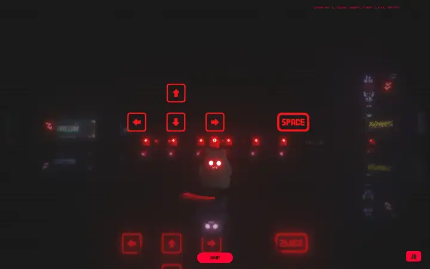
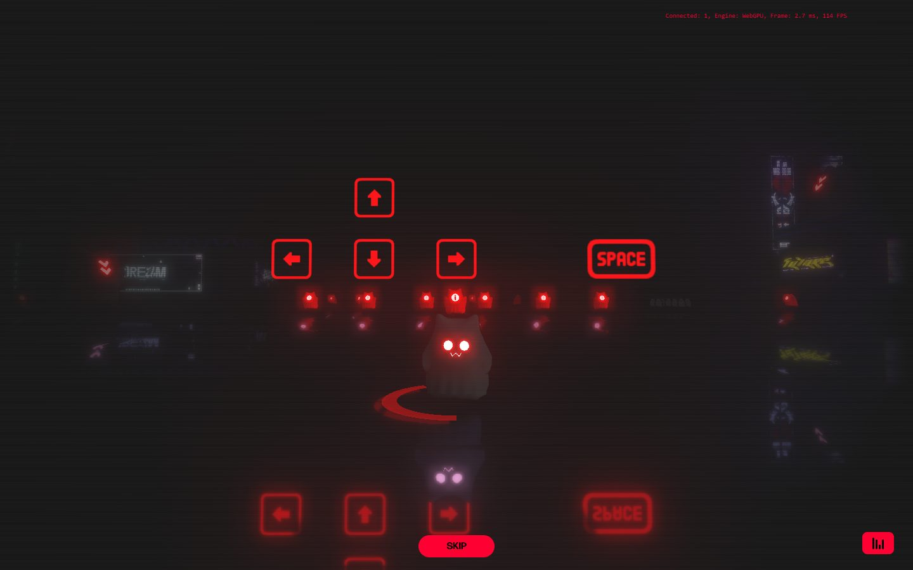
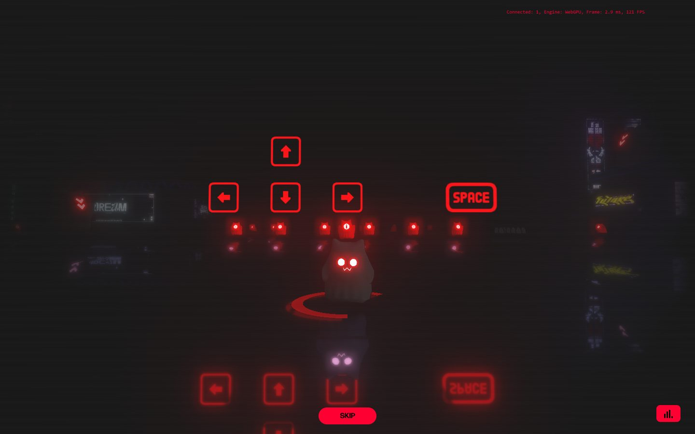
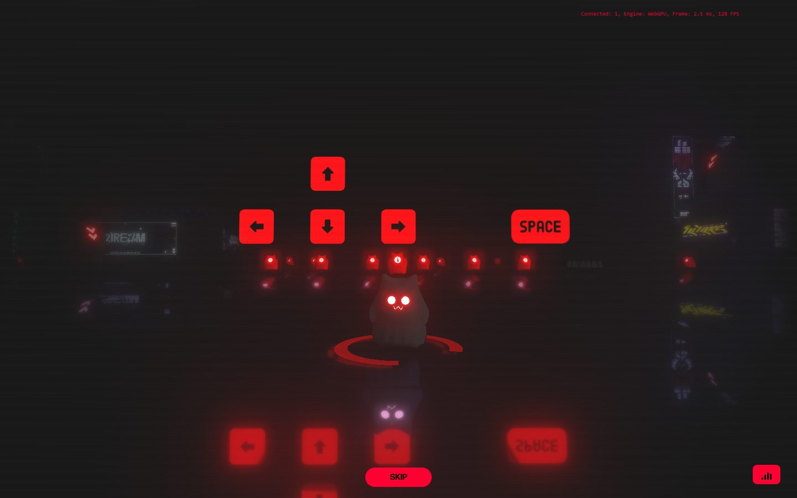
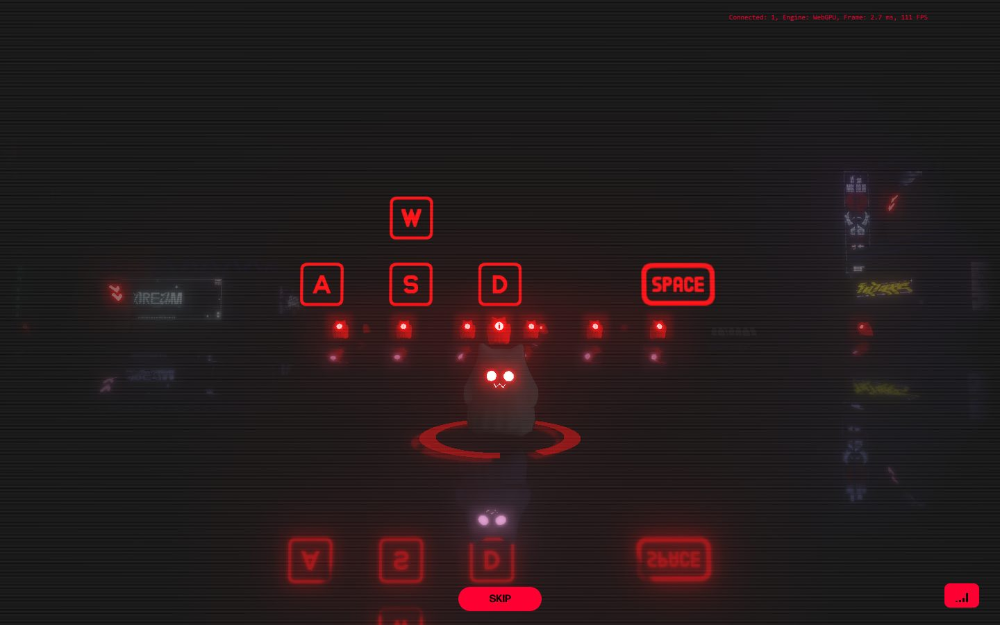
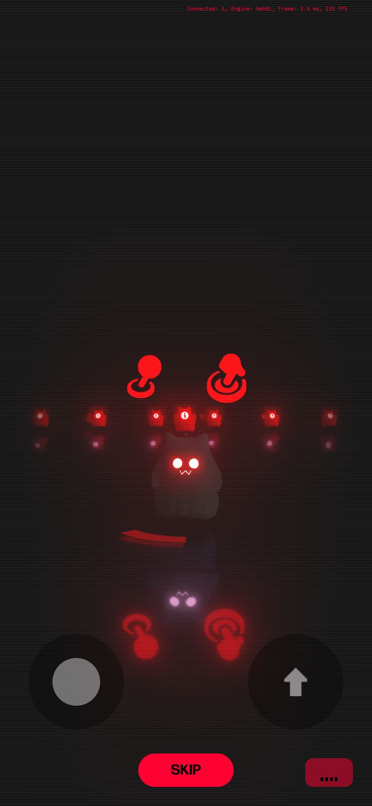

# Samsy

<!-- gallery:start -->

<a href="../../README.md#worlds">All sites</a> &nbsp;&nbsp; <a href="../14islands/teardown.md">&larr; 14islands</a> &nbsp;&nbsp; <a href="../klim/teardown.md">klim &rarr;</a> &nbsp;&nbsp; <a href="https://www.samsy.ninja">Open the live site</a>

<!-- gallery:end -->

Looked at on 2026-10-28. https://www.samsy.ninja

**The idea:** the portfolio is a game, and the first screen teaches you the controls.

## What you see
A dark room with scanlines over everything. A small cat-eared figure with glowing eyes stands on a red ring on a reflective floor. Above it, red keycaps light up in turn to show the controls: arrows, then WASD, then Space, mirrored in the floor. A row of small red figures with "i" markers sits behind. A red Skip pill sits at the bottom, a sound button bottom right. A live readout top right says "Connected: 1, Engine: WebGPU, Frame: 2.7 ms, 114 FPS". On the phone it says WebGL, and the keycaps become touch gestures with a thumb-stick and a jump button. Every capture is the tutorial at `/tutorial`; scrolling doesn't leave it.

## Stack
| Layer | What |
|---|---|
| Framework | None detected. 4 KB HTML with empty `#preloader` and `#app` |
| 3D | three.js r182dev. WebGPU on desktop, WebGL on the phone (from the on-screen readout) |
| Fonts | forma-djr-display via Typekit |
| Weight | 6.5 MB (1.5 MB images, 1.1 MB JS), 39 requests |
| Reduced motion | No |
| Hosting | nginx 1.10.3 on Ubuntu |

## Steal
- Teach the controls inside the world: the keycaps are scene objects, reflected in the floor.
- A separate touch tutorial on phones instead of showing keyboard keys.
- Skip available from the first frame.
- WebGPU where it exists, WebGL where it doesn't.

## Don't steal
- Red bloom on every keycap, ring and eye. Glow as the whole style.
- The scanline overlay. Nothing about the subject is a CRT.
- The debug readout left on. Fine for a graphics engineer's own site, noise anywhere else.
