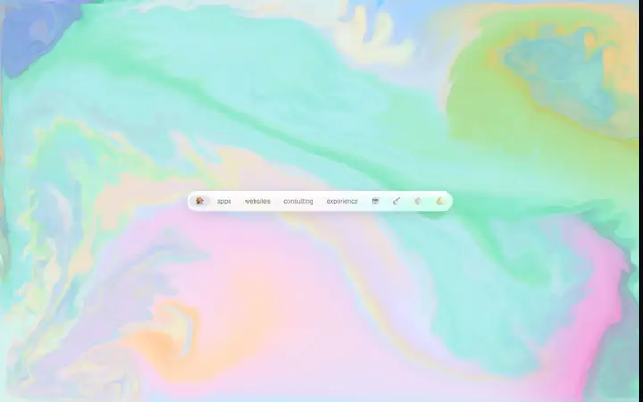
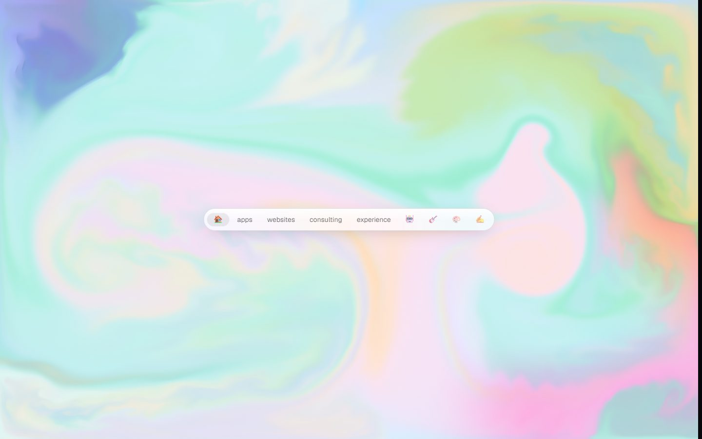
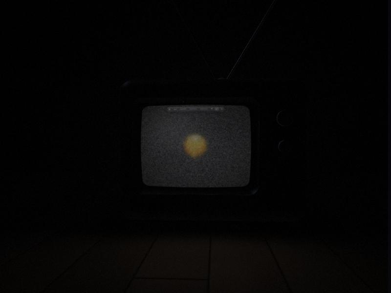
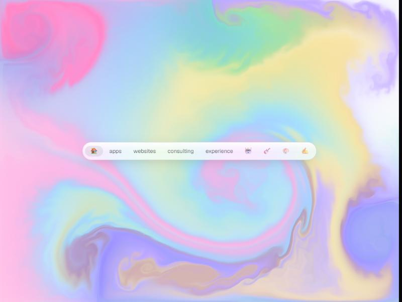
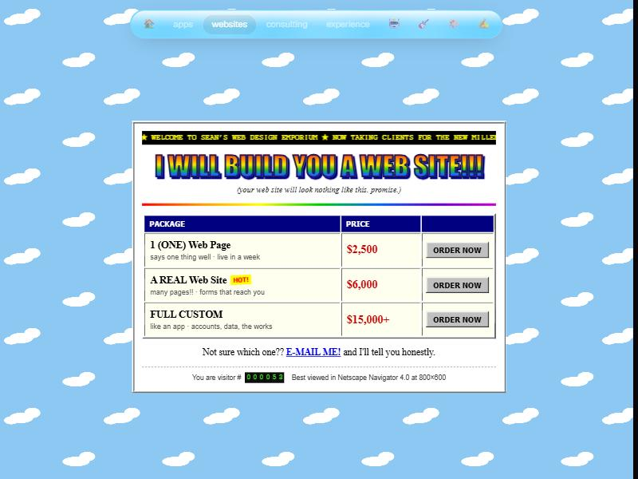
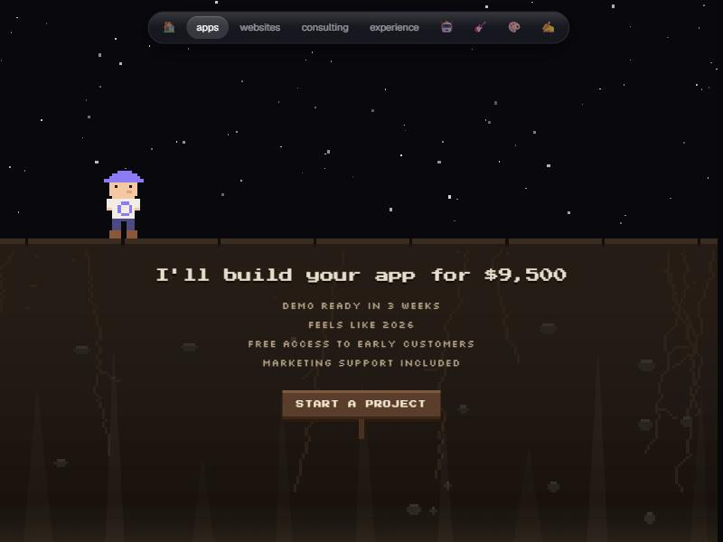
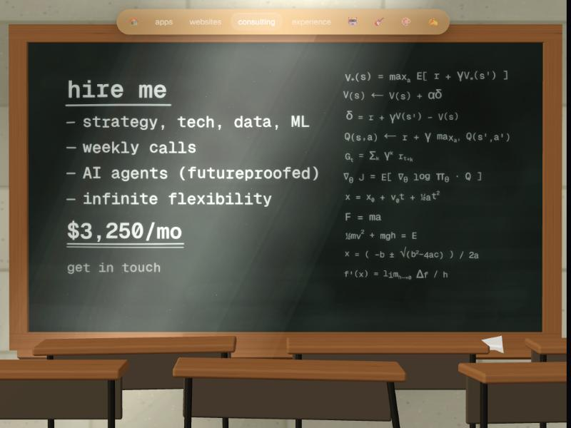
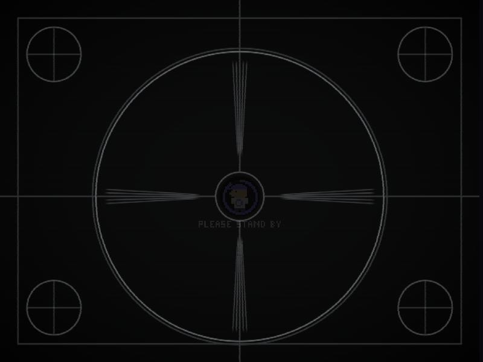
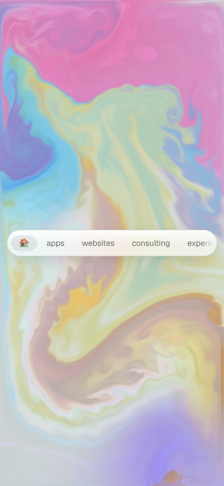

# seanblundin.com

<!-- gallery:start -->

<a href="../../README.md#worlds">All sites</a> &nbsp;&nbsp; <a href="../activetheory/teardown.md">&larr; Active Theory</a> &nbsp;&nbsp; <a href="../lusion/teardown.md">Lusion &rarr;</a> &nbsp;&nbsp; <a href="https://seanblundin.com">Open the live site</a>

<!-- gallery:end -->

Looked at on 2026-10-28.

**The idea:** the site is a TV, and every page is a channel.

## What you see

It opens on an old CRT set in a dark room, and the camera dives into the screen. The home page is a watercolour-ink fluid you stir with the cursor. Each section after that has its own visual genre:

- **websites:** a 1999 Geocities parody ("your web site will look nothing like this, promise").
- **apps:** pixel-art dirt and stars.
- **consulting:** a chalkboard in a classroom.
- **experience:** a chrome LinkedIn logo.
- **music:** TV static with "click for sound".
- **art:** a shared pixel canvas visitors draw on.
- **Loader:** a test card that says "Please stand by".
- **404:** "no signal, try another channel 1–9", and the number keys really do change pages.

## Stack

| Layer | What |
|---|---|
| Framework | Next.js App Router, statically prerendered (`x-nextjs-prerender`, RSC payload) |
| Hosting | Railway (`server: railway-hikari`, edge `lax1`) |
| CSS | Tailwind with shadcn-style tokens (`--card`, `--popover`, `--ring`), renamed to a space theme (`--void`, `--galactic`, `--nebula`, `--stardust`) |
| Fonts | Geist + Geist Mono via `next/font`, with metric-matched Arial fallbacks so nothing shifts. Pixel pages load Silkscreen and Press Start 2P only on those pages |
| Motion | Motion (framer-motion) for UI. The home scene is **hand-written WebGL**: no three.js, about 17 KB compressed for the page chunk |
| Analytics | Self-hosted Umami on Railway (2 KB) |

## Why it works

- **One conceit carries everything.** Intro, loader, 404, keyboard shortcuts and page genres all come from "TV with channels".
- **The shaders are art-directed.** The comments read like a cinematographer's notes. Some examples, in summary:
  - ink piles up under a soft ceiling so overlaps stay pastel and never go to mud;
  - where three inks overlap, saturation is lifted back up, because watercolour turns olive there;
  - the room is exposed for the room, not the screen, the way a film camera would see it.

  The fluid uses the classic stable-fluids passes (splat, curl, vorticity, pressure), the same structure as [PavelDoGreat's demo](https://github.com/PavelDoGreat/WebGL-Fluid-Simulation), but with a colour model and a reason to exist.
- **Craft details:**
  - `prefers-reduced-motion` skips the intro;
  - a 9-second failsafe clears the intro if anything hangs;
  - the channel images are preloaded on the home page only;
  - it listens for `webglcontextlost` and cleans up its listeners;
  - a phone gets a softened, enlarged copy the way a TV shows vertical video;
  - there's a skip link and an `sr-only` h1.
- **Light for what it does.** The home page is about 375 KB compressed in total: about 170 KB of JS, 50 KB of fonts and 112 KB of WebP. TTFB was 85 ms.

## Steal

- One conceit applied everywhere, down to the 404 and the keyboard.
- A genre shift per page, with fonts loaded per page.
- Shader comments that describe a physical material, not maths.

## Don't steal

- The frosted-glass pill nav (`backdrop-blur-2xl` + highlight gradient + shadow). That's glassmorphism.
- Mono uppercase letter-spaced labels: "BLOG", "404 · NO SIGNAL", "CLICK FOR SOUND", "FREE SPOTS 41 OF 50".
- The dot-badge pill and scarcity counter on `/claude`.
- Emoji nav icons.
- Geist as the face. It's the Vercel/shadcn default.

## Author

The source is not public. [github.com/seanblundin](https://github.com/seanblundin) has 18 public repos and none of them is the site. The [blog](https://seanblundin.com/blog) has one personal post (2026-10-21) and no build write-up.
