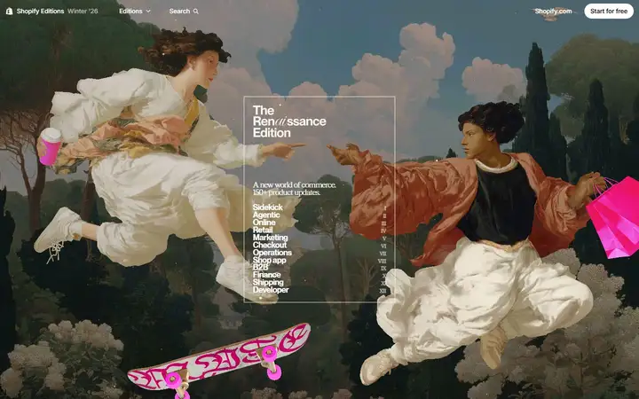
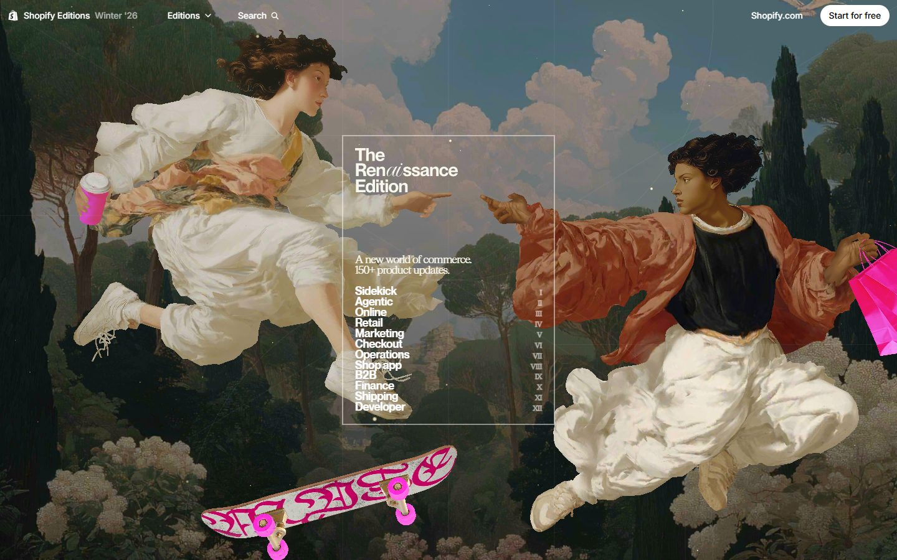
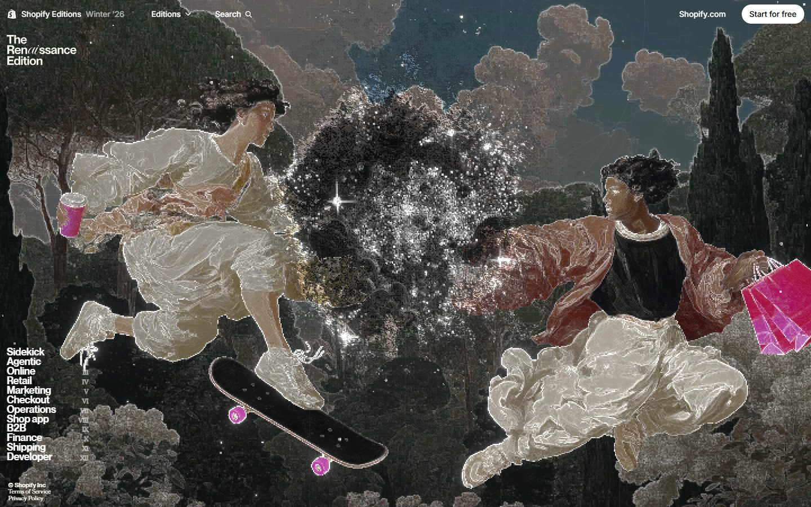
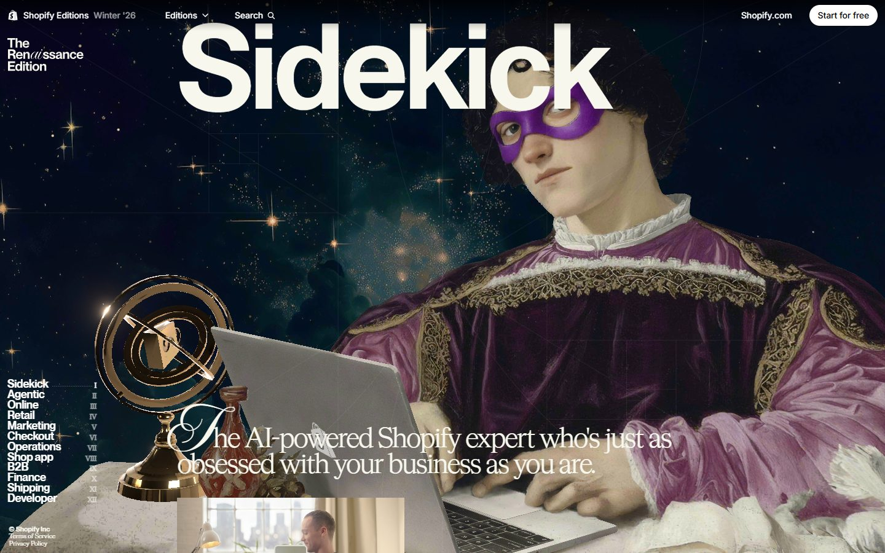
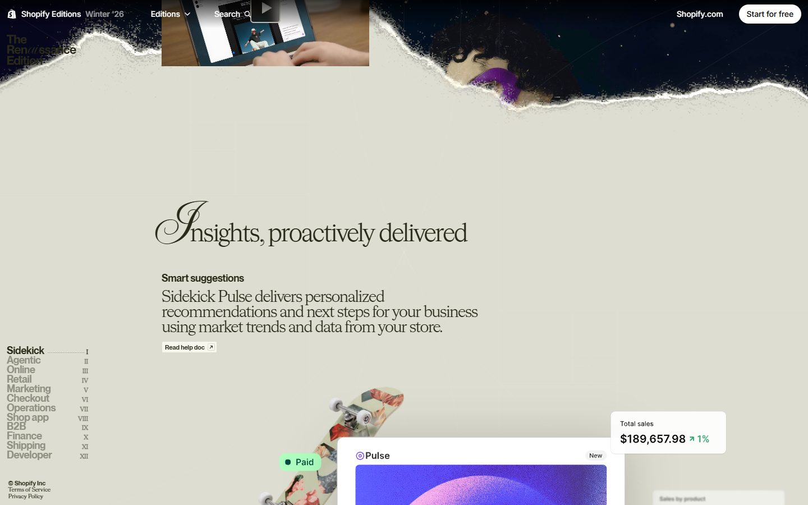
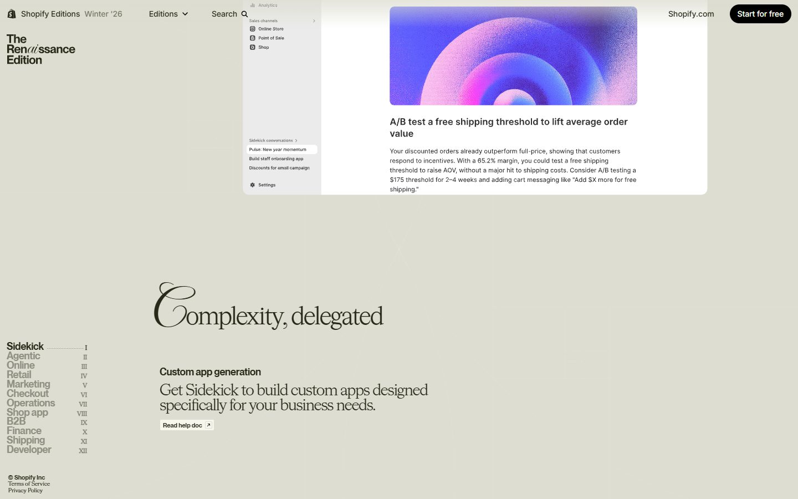
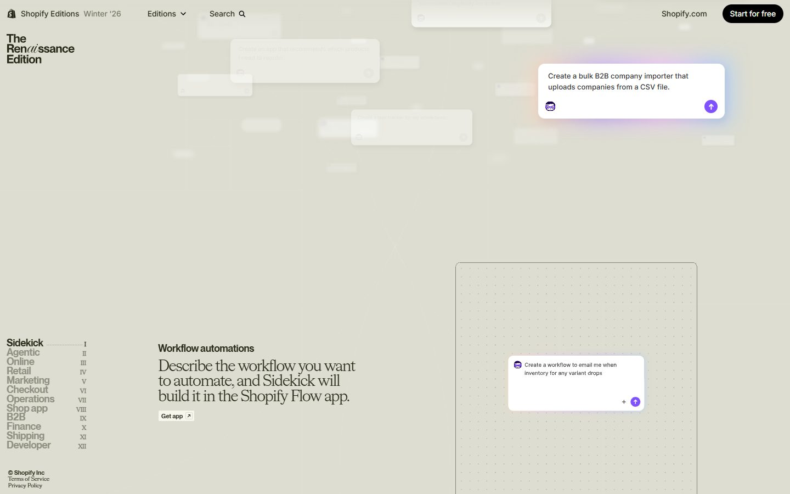
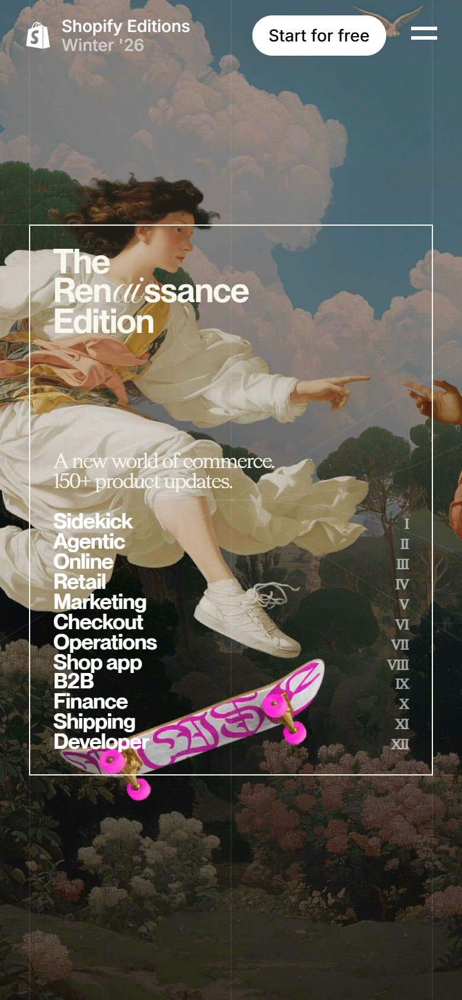

# Shopify Editions Winter '26

<!-- gallery:start -->

<a href="../../README.md#products-radio-and-genre-pieces">All sites</a> &nbsp;&nbsp; <a href="../panic/teardown.md">&larr; Panic</a> &nbsp;&nbsp; <a href="../dishoom/teardown.md">Dishoom &rarr;</a> &nbsp;&nbsp; <a href="https://www.shopify.com/editions/winter2026">Open the live site</a>

<!-- gallery:end -->

Looked at on 2026-10-28. https://www.shopify.com/editions/winter2026

**The idea:** A product changelog staged as a Renaissance painting, in twelve Roman-numeral chapters.

## What you see
The hero is a painted collage after the Creation of Adam: two figures in sneakers reach for each other, one holding a coffee cup, one holding shopping bags, a skateboard floating between. A thin framed box holds the title and a twelve-item contents list numbered I to XII. On scroll a shader breaks the painting into glittering pixels and the contents list docks at the left. Each chapter opens with a huge head over another painting, then a torn-paper edge drops into beige pages where a script swash capital starts each serif head, beside product mockups.

## Stack
| Layer | What |
|---|---|
| Hosting | Cloudflare |
| Framework | Remix (`window.__remixContext`) |
| Effects | three.js r181 on a full-viewport canvas |
| Scroll | Lenis smooth scroll |
| Type | Inter Variable, Neue Montreal, HW Cigars, Imperial Script |
| Weight | 3.6 MB, 70 requests; the HTML alone is 1.45 MB |
| Motion | No `prefers-reduced-motion` rule |

## Steal
- A table of contents as the hero. Twelve words and twelve numerals tell you the size of the thing before you scroll.
- One ornament, repeated: a script swash capital on each serif head.
- A sticky contents list that marks the chapter you are in.
- A visual world borrowed from one period and held for the whole page.

## Don't steal
- The prompt card in the Sidekick chapter sits on a pink and purple gradient glow.
- Floating chips in the mockups: a "Paid" pill with a dot, a "Total sales" card, a "New" badge.
- "Ren*ai*ssance": the title is a pun, the kind of clever line the banned list warns about.
- Lenis scroll smoothing, a full-screen shader and no reduced-motion rule.
