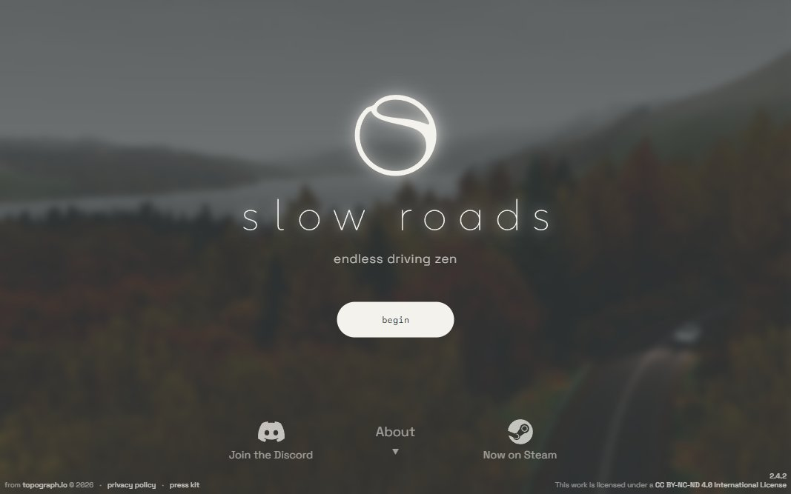

# Slow Roads

<!-- gallery:start -->

<a href="../../README.md#worlds">All sites</a> &nbsp;&nbsp; <a href="../noma/teardown.md">&larr; noma</a> &nbsp;&nbsp; <a href="../basement-studio/teardown.md">basement.studio &rarr;</a> &nbsp;&nbsp; <a href="https://slowroads.io">Open the live site</a>

<!-- gallery:end -->

Looked at on 2026-11-08. https://slowroads.io

**The idea:** an endless, procedurally generated drive in the browser: zen instead of a goal.

## What you see
The start screen is a blurred frame of the world (a lake in mist, autumn forest) with a glowing logo and one button. Press begin and you drive a road that never ends, generated as you go through hills, coast, forest and desert, with weather and time of day. Autodrive lets it drive itself. No score, no map, no goal, just the road. The changelog in the sidebar reads like a game's, not a demo's: dashboards, interiors, motor sounds per vehicle, cruise control. It's on Steam too.

Our headless shooter hits Cloudflare's bot check here, so this hero was captured by hand in a real browser.

## Stack
| Layer | What |
|---|---|
| Framework | WebGL with procedural terrain and road generation (topograph.io) |
| Fonts | A geometric UI sans |
| Weight | n/a (bot check) |
| Reduced motion | n/a |
| Hosting | Cloudflare Pages |

## Steal
- Generate the world ahead of the player and drop it behind: endless with a fixed memory budget.
- Mood over mechanics: weather, light and sound are the content.
- Autodrive: let the toy play itself, so the site also works as a screensaver.

## Don't steal
- The code and art are CC BY-NC-ND: look, don't lift.
