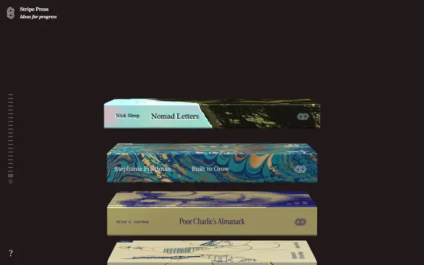
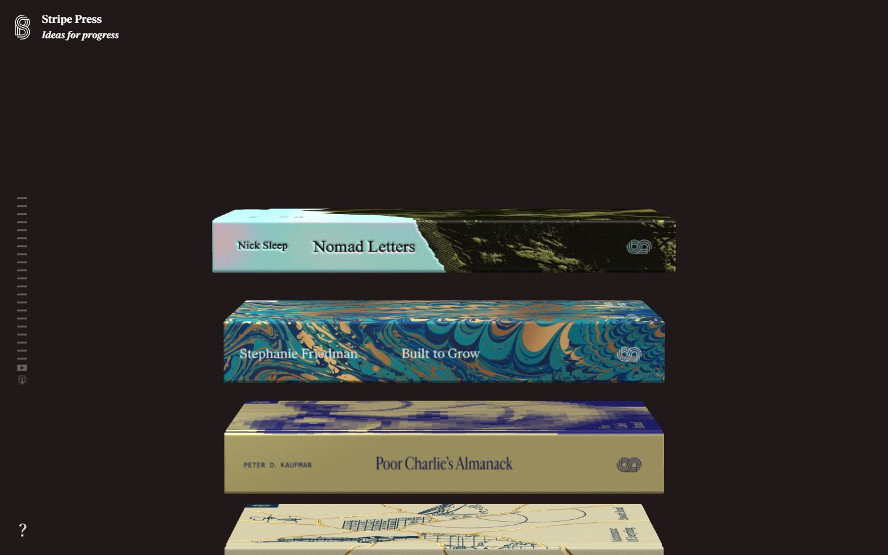
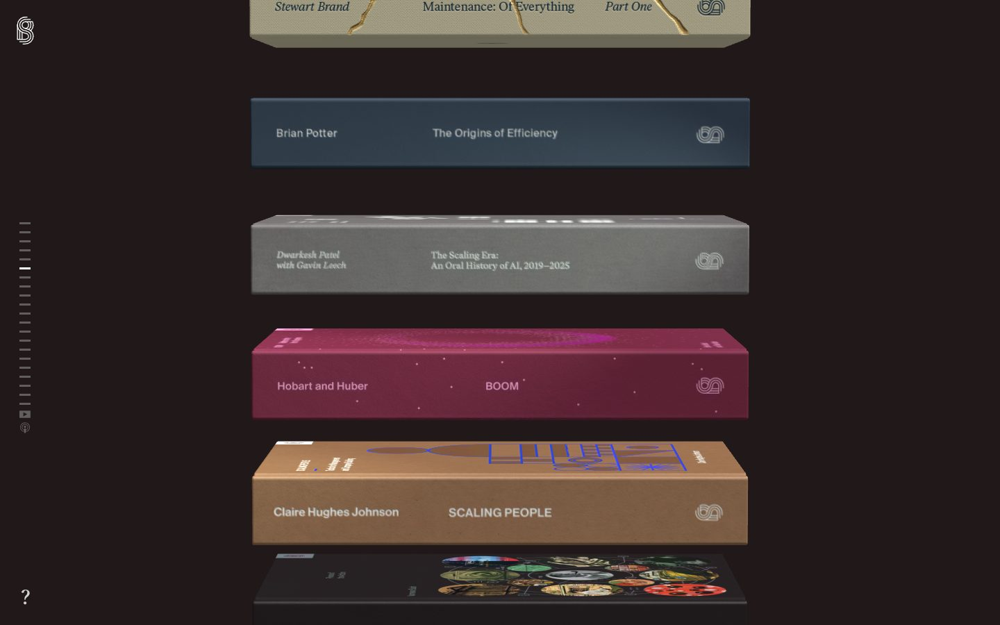
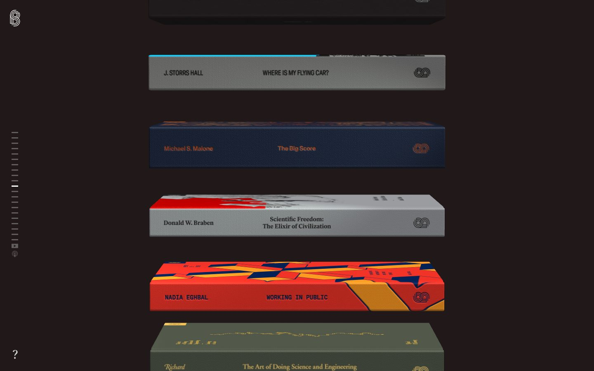
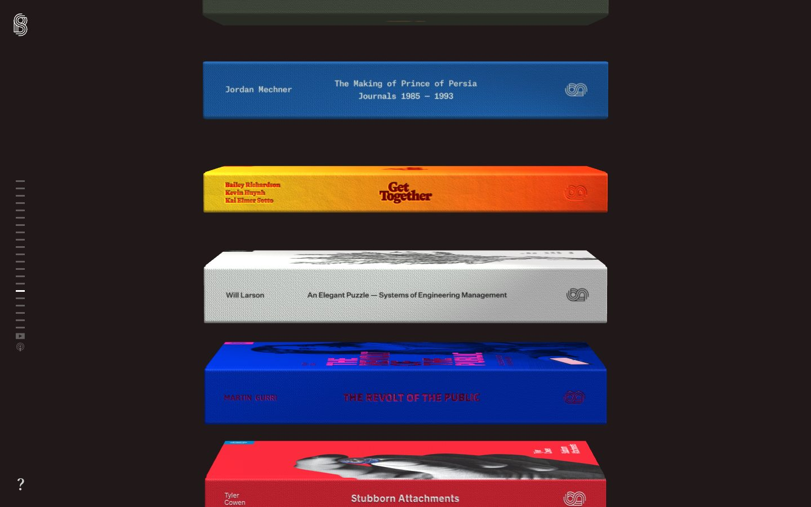
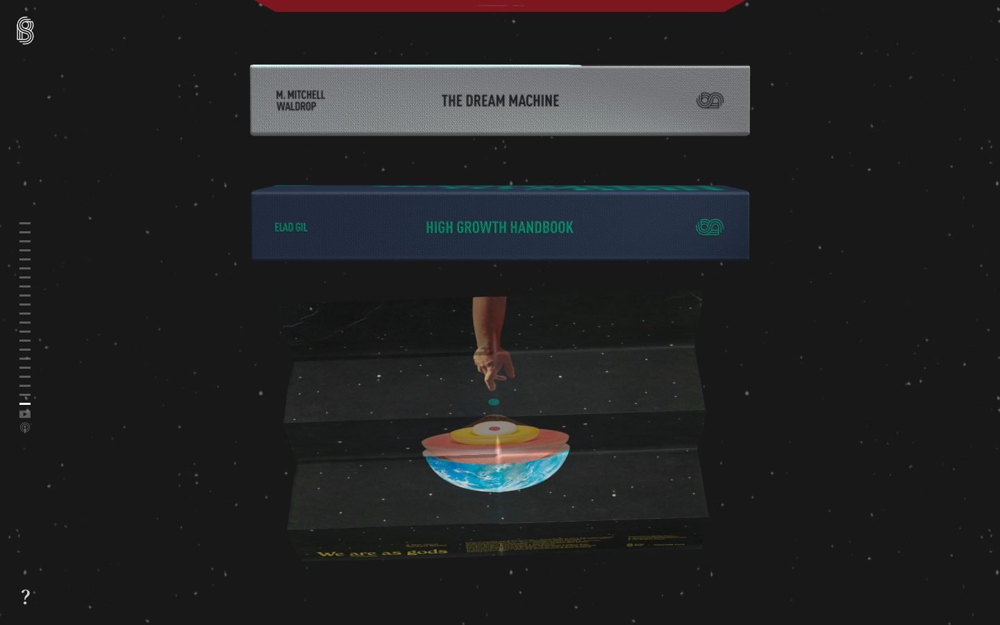
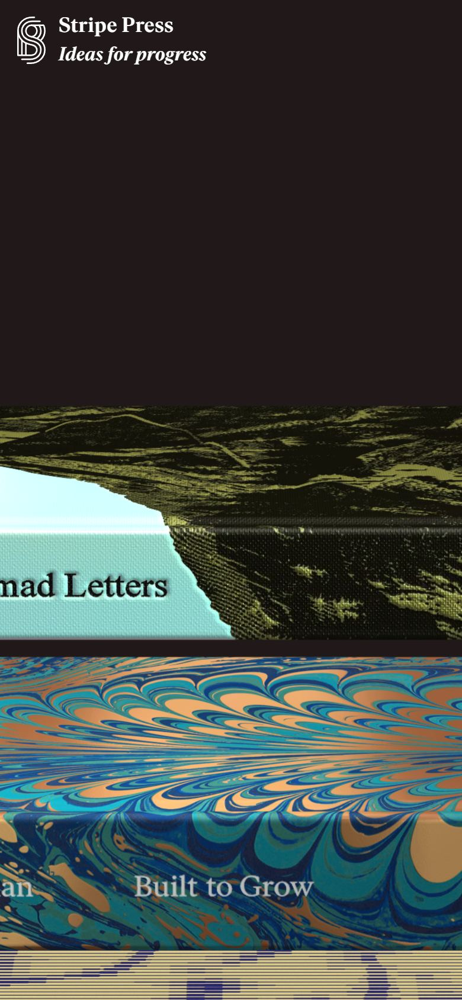

# Stripe Press

<!-- gallery:start -->

<a href="../../README.md#type-foundries-and-editorial">All sites</a> &nbsp;&nbsp; <a href="../commercial-type/teardown.md">&larr; Commercial Type</a> &nbsp;&nbsp; <a href="../the-pudding/teardown.md">The Pudding &rarr;</a> &nbsp;&nbsp; <a href="https://press.stripe.com">Open the live site</a>

<!-- gallery:end -->

Looked at on 2026-10-28. https://press.stripe.com

**The idea:** the catalogue is a stack of the actual books, spines out, rendered in 3D.

## What you see

A dark brown page with nothing on it but books. Each spine carries its real cover art and cloth grain, with the author on the left, the title in the middle and the press mark on the right, in whatever type that book uses. A column of short ticks on the left marks your place, one per book, with YouTube and podcast icons below. The wordmark is two lines of Ivar, roman then italic: "Stripe Press / Ideas for progress".

## Stack

| Layer | What |
|---|---|
| Renderer | three.js r151 on one full-viewport canvas |
| HTML | Each book is also a real `<button>` with an `h2` title link, an `h3` author and its own colour variables; 21 in the source |
| JS | Stripe's in-house bootstrapper from `b.stripecdn.com`; nginx |
| Fonts | Ivar Display, Ivar Headline, Ivar Text |
| Weight | 690 KB over 189 requests, 355 KB of it JS |
| Reduced motion | No `prefers-reduced-motion` rule |

## Steal

- Show the real object. The spines carry each book's own typography, so the catalogue shows the press's range with no extra copy.
- Keep the content as plain HTML under the canvas, styled per item, so it survives without WebGL.
- A tick column as the scroll index: one tick per item, the current one highlighted, no labels.
- One serif family for the press's own voice, with the italic carrying the second line.

## Don't steal

- Nothing on the banned list.
- No reduced-motion handling on a scroll-driven 3D scene.
- On the phone the spines run past the screen edge and the titles are cut off.
