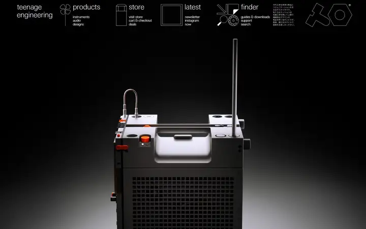
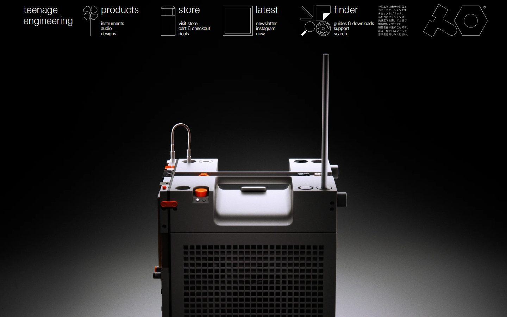
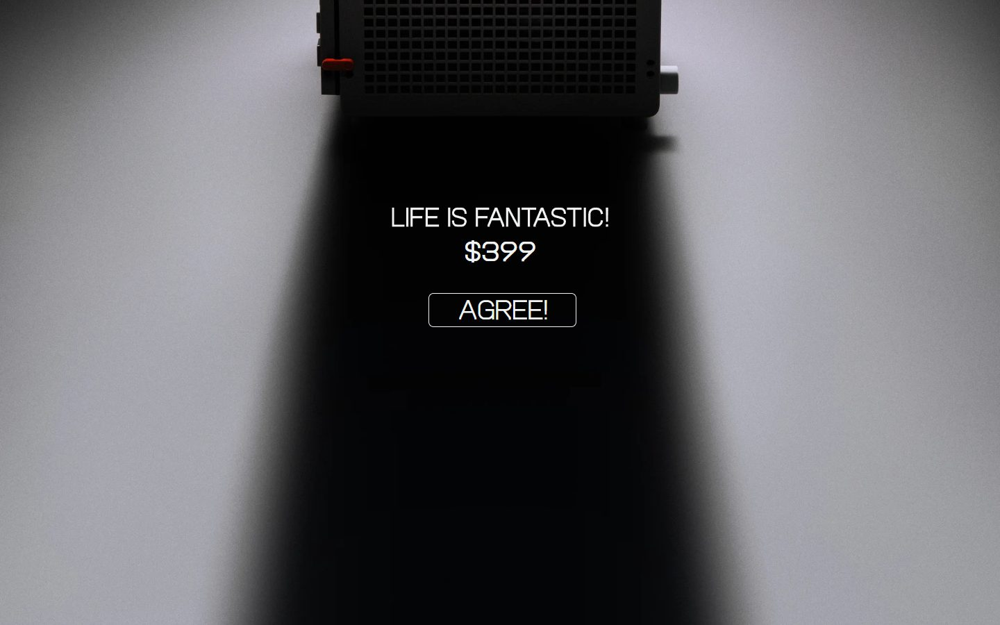
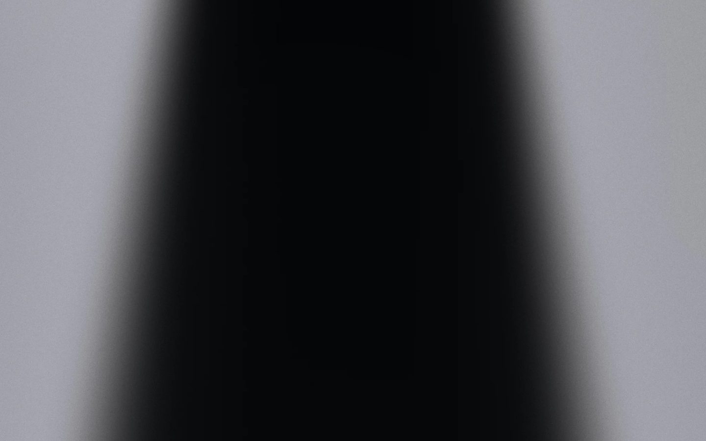
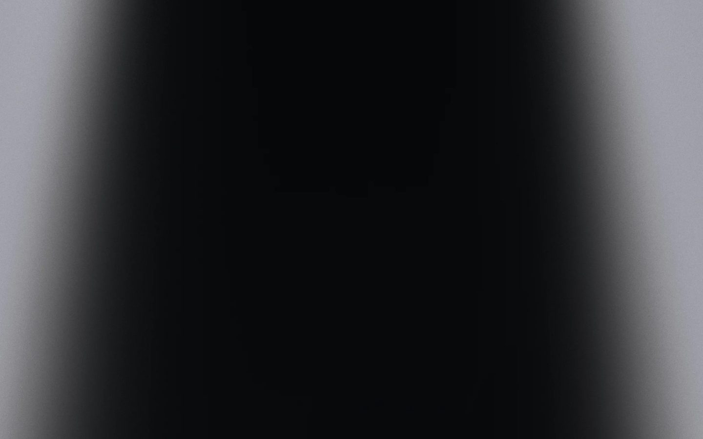
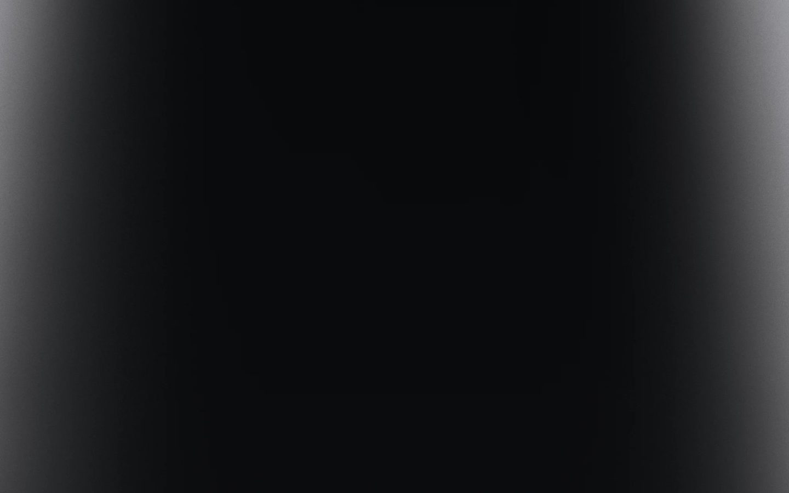
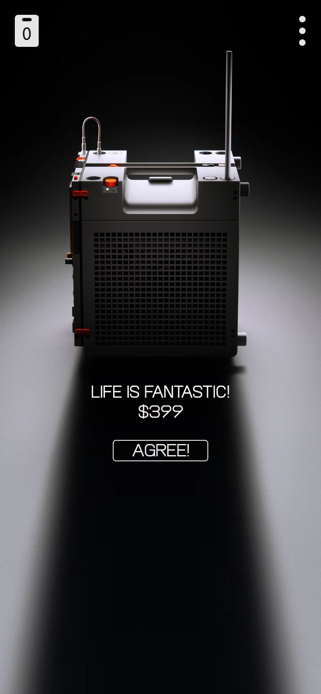

# teenage engineering

<!-- gallery:start -->

<a href="../../README.md#products-radio-and-genre-pieces">All sites</a> &nbsp;&nbsp; <a href="../playdate/teardown.md">&larr; Playdate</a> &nbsp;&nbsp; <a href="../poolsuite/teardown.md">Poolsuite &rarr;</a> &nbsp;&nbsp; <a href="https://teenage.engineering">Open the live site</a>

<!-- gallery:end -->

Looked at on 2026-10-28. https://teenage.engineering

**The idea:** One product under one light; its long shadow runs down the page and becomes the layout.

## What you see
A black page. The nav is four words (products, store, latest, finder), each with a thin line icon and three plain sublinks, plus a block of Japanese mission text and the logo outline. Below sits one studio photo of a grey boxy device lit from above. Scrolling follows its shadow down a pale floor: "LIFE IS FANTASTIC! $399" and an AGREE! button sit inside it, then screens of shadow, then a "hold on..." newsletter field and one joke set in the shadow about the shadow being too long. The price and button link to `/store/ep-35`.

## Stack
| Layer | What |
|---|---|
| Hosting | Amazon S3 behind CloudFront |
| Framework | React Router, server-rendered (`__reactRouterContext` in the page) |
| Layout | 272 boxes sized as `calc(N * var(--client-width))`, so the page scales with window width like a poster |
| Images | WebP from assets.teenage.engineering in several sizes |
| Type | te-20, TechnoType, and a face named Unicode |
| Weight | 701 KB, 84 requests, 470 KB of it JS |
| Motion | Has a `prefers-reduced-motion` rule |

## Steal
- One object, one light, a lot of black. A single strong product photo carries the whole page.
- Let the photo set the grid. The shadow is the column the text sits in.
- A nav that shows the whole site at once: four words, an icon each, three sublinks under each.
- One joke, taken from the photo itself, placed once at the end.

## Don't steal
- Nothing on the banned list.
- Several screens of empty shadow before the next thing. Fine for a product launch, wrong for a business whose hours and address need to be found.
